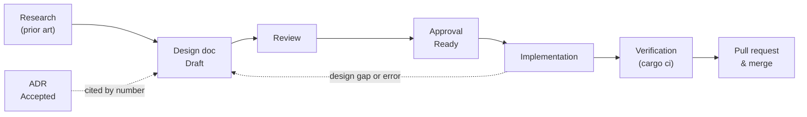

# Contributing to `control-rs`

`control-rs` is developed design-first. Every capability in the library and
its infrastructure crates is specified in a design document before it is
implemented, and the design document is the reference that reviewers,
tests and CI check the code against. A decision at the workspace, crate or
project level is written as an Architecture Decision Record (ADR), so that
design documents can cite it instead of arguing it again
([ADR-0001](documentation/adr/0001-adopt-adrs.md)).

This guide describes that process. Tool installation is in the
[dependency registry](documentation/dependencies.md); cargo aliases and the
local CI workflow are in the
[Development Guide](documentation/development-guide.md).

---

## 1. The pipeline



| Stage          | Output                                     | Exit condition                                    |
|:---------------|:-------------------------------------------|:--------------------------------------------------|
| Research       | Sources for the design's References        | Enough prior art to justify the design choices    |
| Design         | `documentation/<project>/<slug>-design.md` | Doc complete, status `Draft`                      |
| Review         | Review comments, revisions                 | Review comments resolved                          |
| Approval       | Design doc ready to implement              | Maintainer sets status `Ready`                    |
| Implementation | Code, tests, examples, benches             | Code satisfies every requirement in the doc       |
| Verification   | Passing quality gates                      | `cargo ci` passes locally and in GitHub Actions   |
| Merge          | Squash-merged PR on `main`                 | Review approval                                   |

Implementation does not start until the design doc is `Ready` and every
ADR it cites is `Accepted`. ADRs sit outside this sequence: one is written
when a workspace-level decision arises (§3.2).

### When a design doc is required

| Change                                                         | Design doc                         |
|:---------------------------------------------------------------|:-----------------------------------|
| New module, numerical model, algorithm or infrastructure crate | New doc                            |
| Change to a public API, data layout, wire protocol or CI gate  | Revise the owning doc              |
| New third-party dependency                                     | Revise the owning doc              |
| Workspace, crate or project-level decision                     | ADR (§3.2); revise each citing doc |
| Change that contradicts a `Ready` or `Shipped` doc             | Revise the doc first               |
| Bug fix, test addition, refactor within an approved design     | None                               |
| Typos, formatting, comments                                    | None                               |

A decision is workspace-level when it binds more than one crate or sets a
rule for the whole workspace: a dependency or toolchain policy, a workspace
convention, a format shared between crates. A choice inside one crate or
component belongs in that component's design doc.

---

## 2. Research

Survey published methods, standards and reference implementations before
writing the design. The purpose is to ground each design choice in prior
art and to find out whether an idea already exists as a published method.

Research notes are working material and are not committed. The committed
record is the design doc's **References** section, which cites published
works only. Original choices made for this crate are stated as ordinary
design prose.

---

## 3. Design and decisions

### 3.1 Design document

A design document is `documentation/<project>/<slug>-design.md`, where
`<project>` is a directory under `documentation/` (`math`,
`numerical-models`, `ets`, `ets-host`, `ci`, `tui`, `macros`, `vv`, ...)
and `<slug>` is a short name. Its requirements and verification conditions
follow the grammar the requirement tracer reads
([Author Workflow](documentation/vv/requirement-traceability-design.md#author-workflow)).
The `trace-reqs` gate checks every document listed in
[`.cargo/trace/trace.toml`](.cargo/trace/trace.toml). Open a PR containing the
design doc. Design docs normally merge ahead of, and separately from, their
implementation. Vale checks prose under `documentation/` and `src/` in CI.

### 3.2 Architecture Decision Record

An ADR is written when a workspace, crate or project-level decision arises
(§1), during design or at any other time. It is
`documentation/adr/NNNN-<slug>.md`, numbered in order, and listed in the
[ADR index](documentation/adr/README.md). The tracer reads its ID and status
lines ([Configuration](documentation/vv/requirement-traceability-design.md#configuration)).
Open a PR containing the ADR alone, or together with the design doc
revisions that cite it. An ADR is `Accepted` before any implementation that
depends on it merges.

Design docs cite the ADR by number.

---

## 4. Review and approval

Review checks that requirements are testable, that §4 satisfies §2, that
§6 verifies every requirement with a concrete oracle and bound, and that
the References support the cited claims. A maintainer sets `Ready` when the
doc may be implemented, `Shipped` when it is implemented and `Stale` when it
needs re-review. Tooling and automation never set them.

Review of an ADR checks that the decision is at the workspace, crate or
project level, that each rejected option is a real alternative and that
every follow-up names its owner. A maintainer sets `Accepted`.

---

## 5. Implementation

Implement the `Ready` design. Do not choose between alternatives the
doc leaves open, and do not add capability the doc does not specify.

**When the design is silent or wrong**, stop and revise the doc: fix the
section, add a Revision History row and return it to review. A change to
requirements, public API or architecture needs re-approval before the code
that depends on it lands. A workspace, crate or project-level decision made
during implementation becomes an ADR before that code lands.

**Code conventions** (enforced by the workspace lint policy in
`Cargo.toml` and `.cargo/clippy.toml`):

- Library code returns `Result<T, E>` with a crate-local error enum. No
  `unwrap`, `expect`, `panic!` or `unimplemented!` outside tests
  and examples.
- Every public item is documented (`missing_docs = "deny"`), following
  [`documentation/documentation-standards.md`](documentation/documentation-standards.md),
  including `# Errors` and `# Safety` sections where they apply.
- Minimize dependencies. Before adopting a crate, inspect its real
  dependency tree with `cargo tree` and record the decision in the design
  doc.
- `f64` is the default for continuous-state math. Other numeric types and
  `no_std` support follow the module's design doc.
- Clippy runs with `all`, `pedantic`, `nursery` and `cargo` denied. Fix
  findings rather than suppressing them. A necessary `#[allow]` is scoped
  to the smallest item and carries a comment giving the reason.

**Tests reference requirements.** Name or document each test so the
requirement it verifies (`FR-n` of the owning doc) is identifiable, and
match the kinds listed in §6.1: unit tests beside the module, benches in
`benches/` (criterion), pedagogical examples in `examples/`, numerical
cross-checks in `control-rs-verification` (`cargo compare`) and on-target
suites through the Embedded Test Server.

---

## 6. Verification

Run the full gate set before opening a PR:

```sh
cargo ci                  # all gates in gate.toml
cargo gate fmt,clippy     # a subset while iterating
cargo ci -v               # stream gate output, tagged [group] gate
```

The gates are declared in [`.cargo/gate.toml`](.cargo/gate.toml): `fmt`, `clippy`,
`doc`, `vale`, `build`, `test`, `coverage`, `deny`, `deny-duplicates`, `semver`,
`geiger`,
`valgrind`, `cross-compare`, `regression` and `mutants`. GitHub Actions
runs `mutants` as the `mutants-*` chunk gates, one job each, and
runs the other gates on every PR, across the supported toolchains from the
MSRV (`1.89.0`) to beta. Some gates need extra tools or are Linux-only;
see the Development Guide.

A pre-commit hook is tracked at [`.github/pre-commit`](.github/pre-commit).
Install it once after cloning:

```sh
git config core.hooksPath .github/
```

---

## 7. Pull requests

- Branch from `main` as `<handle>/<topic>`. Roadmap work uses the roadmap
  ID in the topic (`<handle>/pr3-2-benchmarking`); see
  [`documentation/roadmap.md`](documentation/roadmap.md).
- Keep one concern per PR: an ADR, a design doc, or the implementation of
  one approved doc.
- The PR description links the design doc and any ADR, and lists the
  requirements the change implements or modifies.
- PRs are squash-merged into `main`.
- The workspace `Cargo.lock` is committed and CI builds against it. Developers
  update it by hand: run `cargo update` in a dedicated PR, run the gates, and
  commit the result. Nothing refreshes it automatically, so dependency
  upgrades appear only in those PRs. CI's lint job builds the runner with
  `cargo --locked ci`, its `fetch` gate runs `cargo fetch --locked`, and the
  publish job runs `cargo publish --locked`, so a PR that changes
  dependencies must include the updated `Cargo.lock`.
  The example crates under `examples/` are separate workspaces whose lock
  files stay ignored.
- Generated reports (`ci-report.md`, `trace-report.*`, `tarpaulin-report.*`)
  are ignored and not committed.

---

## 8. AI-assisted development

Contributors may use AI assistants. Assistant instruction files
(`AGENTS.md`, `CLAUDE.md`, `GEMINI.md`) and agent tooling directories are
local and ignored by git; they encode this same process for automated
tools. The process does not change: assistants follow the same gates,
never set `Ready`, `Shipped`, `Stale` or `Accepted`, and the contributor is
accountable for every line submitted.

---

## License

By contributing, you agree that your contributions are dual-licensed under
MIT OR Apache-2.0, matching the project license.
