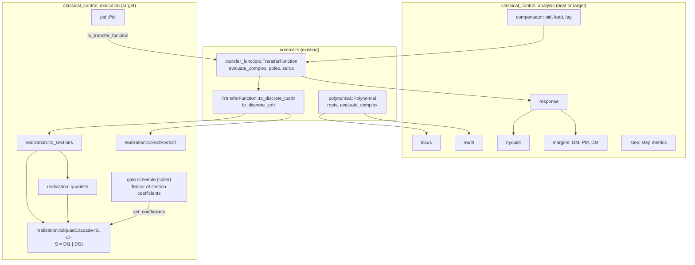
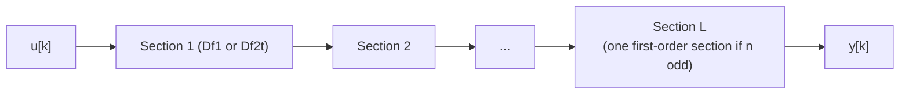

# Classical Control Toolbox (classical-control)


---

### 1. Introduction

The `classical_control` module of `control-rs` provides single-input,
single-output analysis, compensator construction and firmware execution over
the existing `Polynomial` and `TransferFunction` types. Analysis covers root
locus, the Routh-Hurwitz test, Bode, Nyquist and Nichols response data,
stability and delay margins, and step-response metrics. Execution covers
Direct Form I and Transposed Direct Form II realizations in floating or
fixed point, second-order-section cascades with coefficient update for gain
schedules, and a discrete PID controller with anti-windup, so a compensator
designed on the host runs unchanged on the target and is tested there
through ETS. Every routine writes into caller-owned, statically sized buffers;
no dependence on a graphical interface or plotting library.
The module replaces the stub `src/classical_tools`.

Primary usage scenarios:

- **Stability screening**: A user checks a characteristic polynomial for
  right-half-plane roots without solving for them. Failure is a wrong count,
  a false imaginary-axis flag after a cancellation in the Routh array, or a
  silent result on a degenerate array.
- **Loop shaping**: A user sweeps an open-loop transfer function over
  frequency and reads gain, phase and delay margins and crossover
  frequencies, or counts Nyquist encirclements of $-1$. Failure is a margin
  outside the stated refinement bound, a reported crossover that does not
  exist (including one refined onto a pole on the imaginary axis), or an
  encirclement count that depends on where the frequency samples fall.
- **Gain selection**: A user computes closed-loop pole loci over a gain set
  to choose a proportional gain and checks the closed-loop step response.
  Failure is a locus point that is not a root of the closed-loop
  characteristic polynomial, or a metric that disagrees with its definition.
- **Compensator construction**: A user builds a PID, lead or lag
  compensator as a `TransferFunction` and composes it with the plant.
  Failure is a coefficient that differs from the named form.
- **Firmware deployment**: A user discretizes a compensator, factors it into
  second-order sections or runs a PID with output limits, and executes it
  once per sample on the target. Failure is an output sequence that departs
  from the reference realization, unbounded integrator growth under
  saturation, an output jump on a gain change, or a per-sample cost that
  varies with data.
- **Fixed-point deployment**: A user quantizes a floating-point section
  design to `Fixed<Repr, SHIFT>` and runs it on an FPU-less core, or swaps
  section coefficients from a gain schedule between samples. Failure is a
  coefficient silently clipped at quantization, a panic or wrap on
  overflow, or an output outside the stated deviation from the
  floating-point realization.

---

### 2. Requirements

#### 2.1 Functional Requirements

- **FR-1 — Root locus**: For an open-loop `TransferFunction`
  $L (s) = N (s)/D (s)$ and a caller-supplied gain set $\lbrace k_i \rbrace$,
  returns for
  each $k_i$ the roots of $D (s) + k_i N (s)$.
- **FR-2 — Routh-Hurwitz count**: For a real characteristic polynomial,
  returns the number of roots in the open right half plane and whether roots
  lie on the imaginary axis, without computing roots, including the
  zero-first-column and zero-row cases. When leading terms of an entry
  cancel, the next-order term survives, so the imaginary-axis flag is set
  only by a row that is zero in exact arithmetic and the count is unchanged
  by positive scaling of the polynomial. When no stage can decide the count
  (§4.3), the routine returns `RouthIndeterminate` and never a guessed
  count.
- **FR-3 — Frequency response**: For a continuous or discrete
  `TransferFunction` and a caller-supplied frequency set, returns
  $G (j\omega)$ or $G (e^{j\omega T_s})$ as complex values and as magnitude in
  dB with unwrapped phase in degrees, which serve Bode, Nyquist and Nichols
  data.
- **FR-4 — Nyquist encirclement count**: For a continuous open-loop
  `TransferFunction`, returns the net number of encirclements of $-1$ by the
  Nyquist contour, indenting around open-loop poles on the imaginary axis.
  The count and the pole count $P$ do not depend on where the samples fall:
  every near-axis pole is indented whether or not a sample lies within the
  indentation radius, and a contour that passes through $-1$ at a sample or
  between two samples returns `ContourThroughCriticalPoint`. A numerator
  or denominator padded with trailing zero coefficients is read by its
  degree, and a zero denominator returns `Improper`.
- **FR-5 — Stability margins**: From an open-loop `TransferFunction` and a
  frequency set, returns gain margin, phase margin, their crossover
  frequencies and the stability margin $\min_\omega |1 + L (j\omega)|$, the
  minimum over every finite sample of the set, and reports a margin as
  absent when its crossover does not occur in the set. A reported crossover
  satisfies its defining condition at the refined frequency: $L$ is finite
  and $\lvert |L| - 1 \rvert$ is within the refinement bound for a gain
  crossover, and $\operatorname{Re} L < 0$ with $\operatorname{Im} L$ within the
  refinement bound for a phase crossover. A refinement that lands on a pole
  or fails the condition is dropped, never reported.
- **FR-6 — PID compensator**: Constructs a PID `TransferFunction` in
  standard, series or parallel form, with an optional first-order
  derivative filter.
- **FR-7 — Lead and lag compensators**: Constructs lead and lag
  `TransferFunction` values from their corner frequencies and gain.
- **FR-8 — Direct-form realization**: For a discrete `TransferFunction`
  normalized to $a_0 = 1$, executes its difference equation one sample per
  call in Transposed Direct Form II with one state per denominator order,
  for any `T: Scalar`, and resets the state to zero on request.
- **FR-9 — Second-order-section cascade**: Executes a series of
  second-order sections of one caller-selected structure, Direct Form I (FR-17)
  or Transposed Direct Form II, one sample per call, for any
  `T: Scalar`, and resets every section state on request.
- **FR-10 — Section factorization**: Converts a discrete `TransferFunction`
  into second-order sections by pairing poles with their nearest zeros,
  starting with the poles closest to the unit circle, with at most one
  first-order section for odd order, such that the product of the sections
  equals the source transfer function.
- **FR-11 — Discrete PID execution**: Per sample, returns
  $u = \operatorname{sat} (K_p e + I + D)$ between output limits
  $u_{min} \le u_{max}$, with the derivative acting on the measurement
  through a first-order filter discretized by backward difference and the
  integral discretized by forward Euler. A setpoint step at constant
  measurement leaves $D$ unchanged (VC-11.2); the literature basis for
  measurement derivative is open (§8).
- **FR-12 — Integrator anti-windup**: Under output saturation, updates the
  integrator by a caller-selected mode: conditional integration (clamping)
  or back-calculation with tracking time constant $T_t$. Back-calculation
  adds the tracking term $h (u - v)/T_t$ and is zero when unsaturated, so it
  keeps exact integral action; it is not a discount of the error or a leak
  of the integrator (§5).
- **FR-13 — Bumpless gain change**: Changing $K_p$ or $K_d$ between samples
  corrects the integrator so the unsaturated output recomputed from the last
  sample's error and derivative state is unchanged, for each gain alone and
  together, and also before the first sample. A change of $K_i$ needs no
  correction because the integrator holds accumulated $K_i h e$ increments
  and only later increments use the new gain. The next sample's output
  differs by the intended response $\Delta K_p\, \Delta e + \Delta K_d\, \Delta \delta$;
  changes of $T_f$, $h$, $T_t$ and the limits are not bumpless.
- **FR-14 — PID analysis model**: Returns the continuous-time transfer
  function of the unsaturated controller, coefficient-identical to the
  FR-6 parallel form with derivative filter.
- **FR-15 — Step-response metrics**: From sampled response data
  $(t_k, y_k)$, returns rise time from 10% to 90%, settling time for a
  caller threshold (default 2%), percent overshoot, peak and peak time,
  taking $y_{init} = 0$ and $y_{final}$ as the last sample unless supplied.
- **FR-16 — Delay margin**: Returns the delay margin at each gain crossover
  found under FR-5, in time units for continuous systems and in samples for
  discrete systems.
- **FR-17 — Direct Form I section**: Executes a second-order section in
  Direct Form I with four states (two past inputs, two past outputs), one
  sample per call, and resets the state to zero on request.
- **FR-18 — Coefficient update**: Replaces the coefficients of a section,
  cascade or direct form between samples without clearing its state.
- **FR-19 — Coefficient quantization**: Converts floating-point section
  coefficients to `Fixed<Repr, SHIFT>` with round-to-nearest, and returns
  an error naming the section when a coefficient lies outside the
  representable range instead of saturating it. The range comparison does
  not round its bounds through `f64`: the `f64` image of `Fixed::MIN` and
  `Fixed::MAX` is accepted for every `Repr`, including `i64`, where `MAX`
  has no exact `f64`. The comparison is made in raw units, $v / \Delta$
against the raw bounds, with a $\pm 0.5$ rounding margin below $2^{52}$,
above which every `f64` is an integer and the margin is dropped; `NaN` and
infinities are rejected.
- **FR-20 — Section stability test**: Reports whether a first- or
  second-order section, or every section in a caller-supplied set, has its
  poles strictly inside the unit circle, from its denominator coefficients
  without root finding.

#### 2.2 Non-Functional Requirements

- **NFR-1 — Numeric output only**: No routine depends on a plotting or GUI
  library; outputs are numeric buffers.
- **NFR-2 — Caller-owned buffers**: Sweep and locus outputs are written into
  caller-provided, statically sized buffers; no routine allocates.
- **NFR-3 — Fixed operation count**: Routh array construction,
  frequency-response evaluation and margin refinement perform a fixed number
  of operations for a given polynomial order, frequency count and refinement
  depth.
- **NFR-4 — Constant per-sample cost**: Each update of FR-8, FR-9, FR-11
  and FR-17, and each FR-18 coefficient update, executes a fixed operation
  count set by order or section count, with no allocation and no
  data-dependent loop bound.

#### 2.3 Constraints

- **C-1 — Existing model types**: Builds on `Polynomial` and
  `TransferFunction` and introduces no parallel representation.
- **C-2 — Capacity bounds**: Conforms to `polynomial-design.md` C-1 and
  `transfer-function-design.md` C-3.
- **C-3 — Root-crate module**: Ships as `src/classical_control` of
  `control-rs` (the stub `src/classical_tools` renamed) and adds no
  dependency.
- **C-4 — Error convention**: Conforms to `error-design.md` NFR-1.
- **C-5 — Excluded scope**: Multivariable systems and interactive tuning
  are out of scope; the PID (FR-11 to FR-14) requires `T: Float`.
- **C-6 — On-target test enrollment**: The test modules for FR-8 to FR-13
  and FR-17 to FR-20 declare ETS suites per `macros-design.md` FR-1.
- **C-7 — Discretization ownership**: Continuous-to-discrete conversion
  conforms to `transfer-function-design.md` FR-4; this module adds none.
- **C-8 — Multiply accumulate**: Realizations bound
  `T: Scalar + Signed + MulAcc`, accumulate through `MulAcc`, and
  conform to `num-traits-design.md` FR-7 and `fixed-num-design.md` FR-8.
  `Signed` is required because sections store `-a_i`; unsigned `Fixed`
  implements `saturating_neg` as zero and would clear the feedback taps.
- **C-9 — Fixed-point scale**: Fixed-point realizations use scales for which
  `Fixed<Repr, SHIFT>: Scalar`, conforming to `fixed-num-design.md` FR-7.

---

### 3. Technical Overview

`src/classical_control` is an unconditional, `#![no_std]` module of the root
crate beside `modern_control`, `robust_control` and `nonlinear_control`. It
splits into two layers. The analysis layer drives `Polynomial::roots`,
`TransferFunction::evaluate_complex`, `TransferFunction::eval_frequency`
and `TransferFunction::poles`, and adds sweep drivers, crossing detection,
metrics and constructors. The execution layer turns a discrete
`TransferFunction`, obtained through `TransferFunction::to_discrete_tustin`
or `to_discrete_zoh` (C-7), into per-sample state machines that run on the
target.



---

### 4. Architecture

#### 4.1 Module Layout

```text
src/classical_control/
├── mod.rs          # ClassicalError; re-exports
├── locus.rs        # root_locus
├── routh.rs        # routh_count
├── response.rs     # frequency_response, ResponsePoint
├── nyquist.rs      # nyquist_encirclements
├── margins.rs      # stability_margins, Margins, delay margin
├── step.rs         # step_info, StepInfo
├── compensator.rs  # pid, lead, lag
├── realization.rs  # DirectForm2T, Df1, Df2t, BiquadCascade, to_sections, quantize
└── pid.rs          # Pid, AntiWindup
```

Each submodule holds its own inline `tests` module, so test paths are
`classical_control::<submodule>::tests::<name>`; `ets_suite` expands only
an inline module (C-6).

`src/lib.rs` declares `pub mod classical_control;` in place of
`pub mod classical_tools;`. Buffer lengths are const generics: a locus over
$K$ gains of an order-$n$ system writes `[[Complex<T>; n]; K]`, a sweep
over $M$ frequencies writes `[ResponsePoint<T>; M]`, a direct form holds
`[T; ORDER]` and a cascade holds `[S; L]` for a section type `S`.

#### 4.2 Root Locus

`root_locus` returns a $K \times (D-1)$ array of complex roots, one row per
caller gain. For each gain it copies the denominator into a stack array of
length $D$, adds $k_i$ times the numerator coefficient by coefficient, and
passes the sum to `ArrayPolynomial::roots`; the routine defines no
polynomial type of its own. The roots of $D (s) + k_i N (s)$ are the locus
points [1]. Rows are independent unordered sets, so branches are not
matched across gains (continuation [3] and adaptive gain selection [1] are
rejected, §5). A failed solve ends the sweep with `ClassicalError::Root`.

#### 4.3 Routh-Hurwitz Count

The Routh array is never stored whole: two adjacent rows are kept, and
each new row replaces the older one. Every entry is a leading term, a
coefficient with an integer power of $\varepsilon$, so the limit
$\varepsilon \to 0^+$ [4] is carried in the data and no numeric
$\varepsilon$ exists. Entries no larger than the caller's tolerance are
set to exact zero when the first two rows are seeded and when each row is
formed. At each step a row of zeros sets the imaginary-axis flag and is
replaced by the derivative of the auxiliary polynomial of the row above,
and a zero first entry becomes $\varepsilon$. The count is the number of
sign changes of the first entry between consecutive rows, which equals the
number of right-half-plane roots. The cost is $O (N^2)$ time and $O (N)$
stack.

**Two-row recurrence.** With $u$ and $l$ the upper and lower rows, entry
$j$ of the next row is $(l_0 u_{j+1} - u_0 l_{j+1}) / l_0$, so only $u$ and
$l$ are live. The first two rows hold the even-indexed and odd-indexed
coefficients from the leading one. After $N - 1$ steps the first entries of
the rows form the first column.

**Tolerance.** One absolute tolerance $\mathrm{tol}$ is applied to the
given coefficients and to each computed entry, as a zero test only. A
leading coefficient within $\mathrm{tol}$ of zero returns
`ZeroLeadingCoefficient`. A relative or scaled tolerance is an open
question (§8).

**Zero first entry and zero row.** A zero first entry with a nonzero
remainder becomes $\varepsilon$ and later entries carry powers of
$\varepsilon$; the sign of an entry is the sign of its dominant term. A row
whose entries are all zero sets the imaginary-axis flag, and the next row is
the coefficient list of the derivative of the auxiliary polynomial formed
from the row above. Roots of the auxiliary polynomial are symmetric about
the origin, so they include any imaginary-axis roots, but the flag alone
does not say how many lie on the axis.

**Cancellation.** A difference of two entries of equal $\varepsilon$ order
whose leading coefficients cancel is not zero: its value is set by the
next-order terms. An entry stored as one term cannot represent it, and
treating it as zero can empty a row, raise a false imaginary-axis flag and
drop sign changes (VC-2.4). Each entry is therefore a truncated series of
four coefficients with a known-until exponent. Subtraction, product and
quotient promote the next order on cancellation, and an entry whose
known terms all vanish while its tail is unknown is reported as
indeterminate instead of being read as zero.

**Three stages.** An $\varepsilon$ perturbation also moves imaginary-axis
roots, so it cannot be trusted when roots are symmetric about the origin.
The count runs in three stages, each used only if the earlier one meets a
zero first entry. Stage 1 forms the exact array with no $\varepsilon$ and
stops at the first zero first entry. Stage 2 repeats it on the reversed
polynomial $s^n p (1/s)$, which preserves the sign of $\operatorname{Re}$
and maps imaginary roots to imaginary roots. Stage 3 runs the
$\varepsilon$ series, and is allowed only when a Hurwitz-determinant gate
shows that symmetric roots are impossible: the determinant $\Delta_n$ of
the Hurwitz matrix, formed by Gaussian elimination with partial pivoting,
must exceed $\sqrt{\epsilon}$ times the Hadamard bound on its row norms.
If the gate fails or the series cannot decide, the call returns
`RouthIndeterminate` (FR-2, VC-2.4). Trailing zero low-order coefficients
are stripped first and set the imaginary-axis flag (a root at the origin).

**Sign changes.** The count adds one whenever the first entry of the new row
has a sign different from the first entry of the previous row, starting
from the sign of the leading coefficient, so a negative leading coefficient
does not change the count.

#### 4.4 Frequency Response and Nichols Data

`frequency_response` returns one `ResponsePoint` per caller frequency,
holding the frequency, the complex value, the magnitude in dB and the phase
in degrees. The value is $G (j\omega)$ for a continuous system and
$G (e^{j\omega T_s})$ for a discrete one [5]. Phase is unwrapped by a
small running state that holds the previous principal phase and a multiple
of $360^\circ$, adjusted whenever consecutive principal phases jump by
more than $180^\circ$; the first sample keeps its principal value, so the
result depends on the order of the sweep. One record type serves Bode data
(magnitude and phase against frequency), Nyquist data (the complex value)
[6] and Nichols data (magnitude against phase) [7]. The routine chooses no
frequencies and cannot fail.

#### 4.5 Nyquist Encirclements

`nyquist_encirclements` fills a caller-owned buffer of $M$ points with
$L (s_k)$ and returns the net clockwise encirclement count $N$ of $-1$ with
the number $P$ of open-loop right-half-plane poles; the caller forms
$Z = N + P$, because the routine does not interpret the count. It first
rejects a discrete system, an improper $L$ and non-positive $\omega_{max}$
or indentation radius $r$. The contour closes from the last point back to
the first, which stands in for the arc at infinity and is valid only when
$L$ is proper. Poles come from `TransferFunction::poles`, and $P$ counts
those with real part above $r$.

The points lie at $\omega_k = \omega_{max} u_k^3$ with $u_k$ uniform on
$[-1, 1]$, which places samples densely near $\omega = 0$. Each point
$j\omega_k$ is moved right by the
largest $\sqrt{r^2 - (\omega_k - \operatorname{Im} p)^2}$
over the poles with $|\operatorname{Re} p| \le r$, so the contour follows a
small semicircle around any near-axis pole [6]. The semicircle belongs to
the contour, not to the grid: a grid spaced wider than $2r$ has no sample on
the arc, or a pole between samples would be counted by $N$ but not by $P$
and $Z = N + P$ would be wrong (VC-4.5). Between each pair of consecutive
grid samples the routine therefore evaluates $L$ at 15 additional arc
points per near-axis pole, spaced as $x = (3v - v^3) / 2$ with $v$ uniform
in $[-1, 1]$ so that they cluster where the arc turns fastest, and merges
them in ascending frequency. The count is odd so that no arc point sits
at the apex, where a pole with $\operatorname{Re} p = r$ lies. Arc points
feed the winding count only: the caller buffer holds the $M$ grid samples. A point within a relative
$\sqrt{\epsilon}$ of $-1$, or with non-finite $L$, ends the call with
`ContourThroughCriticalPoint`, and so does a segment between consecutive
points (including arc points and the closing segment) whose distance from
$-1$ is within $\sqrt{\epsilon} (1 + \max (|L_a|, |L_b|))$, measured as a
segment-to-point distance, since a
crossing of the negative real axis through $-1$ is not an encirclement
either way (VC-4.4). The degrees used to reject an improper $L$ are those of
the last nonzero coefficients, so zero padding above the degree is ignored
(VC-4.3). The count is the signed number of crossings
of the negative real axis by $1 + L$ over consecutive points and the
closing pair; it needs only comparisons between neighbouring points, so it
accumulates no angle and tracks no branch cut.

#### 4.6 Stability and Delay Margins

`stability_margins` makes one pass over an ascending sweep and keeps only
the previous finite sample. A sign change of $\operatorname{Im} L$ with
$\operatorname{Re} L < 0$ at both ends brackets a phase crossover, which
avoids the $\pm 180^\circ$ branch cut of a wrapped phase, and a sign change
of $|L| - 1$ brackets a gain crossover [8]. Each bracket is then refined by
a compile-time number $B$ of bisection steps that evaluate $L$ itself, so
the error is the bracket width over $2^B$ whatever the sweep density (NFR-3).
Bisection assumes one sign change in the bracket. A pole of $L$ inside the
bracket breaks that: $L$ is non-finite there, the side test reads it as
"below", and the interval can shrink onto the pole. The bisection steps
around a non-finite midpoint by one third of the remaining interval, and
abandons the bracket if the nudged point is also non-finite. A refined
crossover is
therefore re-evaluated and kept only if $L$ is finite and meets its defining
condition (FR-5, VC-5.5): a phase crossover must satisfy
$\operatorname{Re} L < 0$ and a gain crossover $\lvert |L| - 1 \rvert$ within
the bound, or it is dropped. Crossings fill fixed arrays of
$C$ slots per kind, in frequency order, and further crossings are
discarded. The stability margin is the minimum of $|1 + L|$ over the
samples. A non-finite sample, such as an integrator at $\omega = 0$, is
skipped and clears the stored previous sample, so it cannot create a
bracket or set the stability margin.

Gain margin is $1/|L|$ at a phase crossover. Phase margin is
$180^\circ + \angle L$ at a gain crossover. The delay margin is
$\phi_m/\omega_{gc}$ with $\phi_m$ in radians [9], divided by $T_s$ for a
discrete system so that it is reported in samples. A margin without a
crossing is `None`, and the routine cannot fail.

#### 4.7 Step-Response Metrics

`step_info` reads caller time and response arrays and keeps no state, so it
applies equally to simulated and on-target logs. It takes $y_{final}$ from
the options or the last sample, normalizes
$y_{norm} = (y - y_{init})/ (y_{final} - y_{init})$ and computes each metric
by its own scan, following MATLAB `stepinfo` [10]. Rise time runs from the
first sample reaching 0.1 to the first reaching 0.9, each time interpolated
linearly between its bracketing samples. Settling time is the time of the
sample after the last one outside $\theta\,|y_{final} - y_{init}|$ of
$y_{final}$, with $\theta = 0.02$ by default, and is absent if the last
sample is outside the band. Overshoot is $100 \max (0, \max_k y_{norm,k} - 1)$.
Peak is the largest $|y_k - y_{init}|$ and peak time is the first sample
that reaches it. Empty input, $y_{final} = y_{init}$ and a negative
threshold return `InvalidParameter`.

#### 4.8 Compensators

Compensators are built by pure constructor functions that return an
ordinary `TransferFunction`, so results compose through `series`,
`parallel` and `feedback` and the module holds no compensator state. `pid`
accepts three forms [11]:

| Form     | Transfer function                            |
|:---------|:---------------------------------------------|
| Standard | $K_p (1 + \frac{1}{T_i s} + T_d s)$          |
| Series   | $K_c (1 + \frac{1}{\tau_i s})(\tau_d s + 1)$ |
| Parallel | $K_p + \frac{K_i}{s} + K_d s$                |

An ideal derivative has high gain at high frequency [12, Sec. 11.5], so
`pid` takes an optional filter time constant $T_f$ that replaces $s$ in the
derivative term by $s/ (1 + T_f s)$, the first-order filter of Åström
[13, Sec. 6.3]. Each form expands to one degree-2 numerator and one
degree-2 denominator array. Without a filter the result is improper
unless the derivative term vanishes, and it is accepted only where the
caller's capacities admit it (`transfer-function-design.md` C-1); otherwise
the call returns `Improper`. A non-positive integral time or filter
constant returns `InvalidParameter`. `lead` returns
$K (1 + s/b)/ (1 + s/ (bN))$ and `lag` returns $M (1 + s/a)/ (1 + sM/a)$ [11].
A discrete compensator is the Tustin image of the continuous one,
with prewarping at the design crossover [14], through
`TransferFunction::to_discrete_tustin` (C-7).

#### 4.9 Firmware Realizations

All realizations use the denominator convention
$H (z) = \frac{b_0 + b_1 z^{-1} + \dots + b_n z^{-n}}{1 + a_1 z^{-1} + \dots + a_n z^{-n}}$
and the Transposed Direct Form II recurrence that SciPy `lfilter`
implements [15]:

```math
y[k] = b_0 u[k] + d_1[k-1], \qquad
d_i[k] = b_i u[k] - a_i y[k] + d_{i+1}[k-1], \quad d_{n+1} \equiv 0.
```

Direct Form I (FR-17) computes the same section from past inputs and
outputs:

```math
y[k] = b_0 u[k] + b_1 u[k-1] + b_2 u[k-2] - a_1 y[k-1] - a_2 y[k-2].
```

| Structure | State per biquad | Strength                                                                                       | Use                                |
|:----------|:-----------------|:-----------------------------------------------------------------------------------------------|:-----------------------------------|
| `Df2t`    | 2                | Half the state [17], [18]; zeros precede the poles in series order [16]                        | Floating-point static filters      |
| `Df1`     | 4                | Overflows only if the output does [19]; minimal artifacts when coefficients change online [20] | Fixed point and scheduled sections |

- **`DirectForm2T<T, ORDER>`** holds $b_0$, `[T; ORDER]` numerator and
  denominator tails and `[T; ORDER]` state, built from a discrete
  `TransferFunction` divided through by $a_0$ (FR-8).
- **`Df2t<T>`** holds $(b_0, b_1, b_2, a_1, a_2)$ and $(d_1, d_2)$, the
  layout CMSIS-DSP uses per DF2T stage [17]. **`Df1<T>`** holds the same
  coefficients and $(u_{k-1}, u_{k-2}, y_{k-1}, y_{k-2})$, the CMSIS DF1
  state [18]. Both implement a sealed `Section<T>` trait with
  `update(u) -> y`, `reset()` and `set_coefficients(c)`, the whole
  run-time surface (FR-18). CMSIS stores $a_1, a_2$ negated relative to
  this convention [17]; coefficients exported for CMSIS are negated at
  export, never in the recurrence.
- **`BiquadCascade<S, L>`** runs `[S; L]` in series (FR-9), the structure
  SciPy `sosfilt` uses to minimize numerical precision errors for
  high-order filters [21]. SciPy recommends sections over a single
  high-order direct form for most filtering tasks [15].

**Accumulation.** Each output is one `MulAcc` chain that narrows once (C-8).
Sections store $-a_1, -a_2$, the CMSIS-DSP convention [17], so
every chain is multiply-accumulates only; `set_coefficients` takes the
§4.9 convention and negates once. `Df1` computes $y$ as one `from_acc`
of five `mac` steps over its four states and the input, the five-product,
single-narrowing scheme of the CMSIS DF1 kernels
[18]. `Df2t` and `DirectForm2T` keep their states in `T::Acc`, so the
wide dynamic range TDF-II states need [17] is the accumulator's, and
only the output narrows:

```text
y  = from_acc(mac(d1, b0, u))
d1 = mac(mac(d2, b1, u), -a1, y)
d2 = mac(mac(0,  b2, u), -a2, y)
```

For `f32` and `f64` the accumulator is the type itself and `mac` is
the unfused multiply and add (`num-traits-design.md` FR-7); for `Fixed` it
is the wide integer of `fixed-num-design.md` FR-8. One generic `update`
serves every type, rounds once per output for `Fixed`, and never panics or
wraps (`num-traits-design.md` FR-6). Fused or vendor arithmetic enters
through an accelerated type that implements `MulAcc` outside the crate,
such as the `f32` newtype and CMSIS-style `q31` type planned beside
`CmsisDspBlas` in `examples/subprograms/thumbv7em/`
(`num-traits-design.md` §4.5).

`to_sections` (FR-10) builds the cascade on the host or the target at
initialization. It takes poles and zeros from `TransferFunction::poles`
and `zeros`, pairs each pole with its nearest zero starting with the poles
closest to the unit circle, groups conjugate pairs into real second-order
sections and, for odd order, keeps one first-order section with
$b_2 = a_2 = 0$, following SciPy `zpk2sos` [22]. The pairing minimizes
the peak gain of each section [22]. The overall gain is placed in the
first section.

**Fixed point.** `quantize` (FR-19) converts `f64` section coefficients,
the input of `Df1` and `Df2t`, to `Fixed<Repr, SHIFT>` with round-to-nearest and
refuses, with
`ClassicalError::CoefficientRange { section }`, any coefficient outside the
type's range. The check runs in raw units: $x = v / \Delta$ must lie in
$[\mathrm{MIN}_{raw} - 1/2, \mathrm{MAX}_{raw} + 1/2)$, so a value that
rounds to `MAX` is accepted (the `f64` image of `i64::MAX` is $2^{63}$) and
a value that would round past it is not; from $2^{52}$ upward the margin is
dropped because every `f64` is an integer. Stable second-order sections have $|a_1| < 2$, so the scale
must leave integer bits; C-9 already requires
$\text{SHIFT} \le \text{BITS} - 2$ for `Scalar`. This plays the role of
the CMSIS `postShift`, which lets coefficients exceed $[-1, 1)$ [18],
but is fixed per type rather than per call. Overflow saturates in the
accumulator and at the
output, as the CMSIS Q15 DF1 output saturates [18].

**Section stability (FR-20).** A section with denominator
$1 + a_1 z^{-1} + a_2 z^{-2}$ is stable if and only if $|a_2| < 1$ and
$|a_1| < 1 + a_2$, and a first-order section if and only if $|a_1| < 1$
[23]. `is_stable` evaluates these comparisons; `all_stable` folds them
over a slice of sections. For `Fixed` the comparisons are exact.

**Gain schedules.** A schedule is a caller-side wrapper, outside this
module: a `Tensor` of section coefficients indexed by the scheduling
variable, written with `set_coefficients` (FR-18). State persists across
the update, and `Df1` keeps it in signal units, so `Df1` is the scheduled
structure [20].

The stability region is an intersection of half-planes in $(a_1, a_2)$ and
so is convex, and multilinear interpolation over a `Tensor` grid
(`tensor-design.md` FR-2) returns a convex combination of grid-point
coefficients. If every grid section passes `all_stable`, every frozen
value is therefore stable. This requires interpolating second-order
sections with a pairing consistent across the grid, not `DirectForm2T`
coefficients. Fast variation is outside the guarantee (§6.3, §8).



#### 4.10 Discrete PID

A `Pid` is a small `Copy` value holding the parameters, the coefficients
derived from them, and the loop state: the integrator, the filtered
derivative, the previous measurement and the last error. Its public
operations are the constructor, `step(r, y) -> u`, `reset`, `set_gains`
and `to_transfer_function`.

`new` returns `InvalidParameter` unless $u_{min} \le u_{max}$, $h > 0$,
$T_f \ge 0$ and, for `BackCalculation`, $T_t > 0$. It computes
`ad`, `bd`, `kih` and `hbt` ($h/T_t$ or 0) once, so `step` is a fixed
sequence of saturating operations with no branch except the limit
selection and the anti-windup test (NFR-4). The controller is `Copy` and
holds no heap state.
The derivative acts on the measurement, not the error, with the filter
$T_f \dot D + D = -K_d \dot y$ discretized by backward difference as in
Wittenmark et al. [24]. Backward difference keeps the filter coefficient
$a_d = T_f/ (T_f + h)$ in $[0, 1]$ for all parameters [13, Sec. 6.7]. The
filtered measurement derivative is stored without $K_d$ so a gain change
does not rescale history:

```math
\delta_k = a_d \delta_{k-1} - \frac{y_k - y_{k-1}}{T_f + h}, \qquad
D_k = K_d \delta_k.
```

The integral uses forward Euler, suited to sample times short relative to
the controller bandwidth [25]. One `step(r, y) -> u`:

1. $e = r - y$; update $\delta$ ($y_{k-1} = y_k$ on the first call).
2. $v = K_p e + I + K_d \delta$; $u = \min (\max (v, u_{min}), u_{max})$.
3. Update $I$ by the anti-windup mode, then store $y_{k-1}$ and return $u$.

Output is computed before the state update, so the measurement-to-actuation
delay is steps 1 and 2 only (§8).

`AntiWindup` has two modes, countering integrator runaway under
saturation [12, Sec.]:

| Mode                     | Integrator update                                                                     | Basis                                                                     |
|:-------------------------|:--------------------------------------------------------------------------------------|:--------------------------------------------------------------------------|
| `Clamping`               | $I \leftarrow I + K_i h e$, held when $u \ne v$ and $K_i h e$ has the sign of $v - u$ | Conditional integration [25]; testing $K_i h e$ stays valid for $K_i < 0$ |
| `BackCalculation { tt }` | $I \leftarrow I + h (K_i e + (u - v)/T_t)$                                            | Back-calculation [24], [25]                                               |

$T_t$ is the caller's; Åström gives $T_d < T_t < T_i$ and
$T_t = \sqrt{T_i T_d}$ as a rule of thumb [13, Sec. 6.5], with
$T_i = K_p/K_i$ and $T_d = K_d/K_p$ in parallel gains. The rustdoc states
the rule; the constructor does not default it.

`set_gains` implements bumpless transfer by updating the integrator state,
as DiscretePIDs.jl does [26]:
$I \leftarrow I + (K_p - K_p') e_{k} + (K_d - K_d') \delta_k$, which keeps
$v$ unchanged for the last sample (FR-13). `to_transfer_function` returns
`compensator::pid` in parallel form with filter $T_f$ (FR-14).

#### 4.11 Error Handling

`ClassicalError` is one flat enum. `InvalidParameter` covers every
non-positive or out-of-order argument, including $u_{min} > u_{max}$.
`Improper` covers a Nyquist or PID transfer function that is improper or
does not fit its capacities. `NotContinuous` and `NotDiscrete` reject the
wrong sampling domain for Nyquist counting and realization.
`ZeroLeadingCoefficient` is raised by the Routh test and by a realization
with $a_0 = 0$, `ContourThroughCriticalPoint` by the Nyquist sampler,
`RouthIndeterminate` by the Routh test when the array needs $\varepsilon$
and a cancellation cannot be resolved,
`SectionCount` by `to_sections` and `CoefficientRange { section }` by
`quantize`. `Root` wraps `RootError` from the locus, the Nyquist poles and
the factorization.

The enum has a hand-written `Display`, `impl core::error::Error` and
`From<RootError>` (C-4). `update`, `step`, `reset`, `set_coefficients`,
`frequency_response` and `stability_margins` are infallible (NFR-4).

---

### 5. Alternatives

| Alternative                                           | Rejected Because                                                                                                                                                                     | Reference            |
|:------------------------------------------------------|:-------------------------------------------------------------------------------------------------------------------------------------------------------------------------------------|:---------------------|
| Automatic gain selection for the root locus           | Needs heuristics over locus features and a variable-length output, which conflicts with NFR-2. Callers supply the gain set.                                                          | [1]                  |
| Equally spaced locus pole map by arc-length gain selection | Each gain step depends on the previous roots, so the step count is data dependent (NFR-3). Planned as a host-only wrapper outside this module that calls `root_locus` on refined gain sets (§8). | [3]                  |
| Continuation tracing of locus branches                | Integrates a differential equation per branch; step count is data-dependent, which conflicts with NFR-3.                                                                             | [3]                  |
| Polynomial (exact) margin computation                 | Needs polynomial root finding per call, and python-control falls back from it when it is inaccurate in discrete time. Bisection on $L$ reaches a stated bound at fixed cost (NFR-3). | [8]                  |
| Linear interpolation of crossings only                | Accuracy is tied to sweep density; bisection on $L$ costs $B$ extra evaluations per crossing and removes that dependence.                                                            | [8]                  |
| Distinct compensator type                             | Compensators are ordinary `TransferFunction` values in the reference toolbox; a separate type duplicates composition (C-1).                                                          | [11]                 |
| One section structure for all types                   | DF2T halves the state but needs wide state range in fixed point, and DF1 is the robust fixed-point and retuning structure; offering both behind `Section<T>` costs one extra type.   | [17], [19], [20]     |
| Saturate out-of-range coefficients at quantization    | Silently changes the pole and zero locations; an error makes the caller pick a wider integer part.                                                                                   | [18]                 |
| Per-term multiply-add (`Scalar::mul_add`)             | Rounds each term, up to five times per `Fixed` section output, where a wide accumulator narrows once as the CMSIS DF1 kernels do.                                                    | [18]                 |
| Fused `libm` multiply-add as the float default        | Software fusion is slower than an unfused multiply and add on most targets; fusion is faster only with an `fma` instruction, so it belongs to an accelerated type (C-8).             | [28]                 |
| Interpolate `DirectForm2T` coefficients in a schedule | The convexity argument for frozen-value stability holds for the section stability triangle only.                                                                                     | [23]                 |
| Single high-order direct form as the only realization | Second-order sections have fewer numerical problems at high order; `DirectForm2T` is kept for low orders and caller choice.                                                          | [15], [21]           |
| Link CMSIS-DSP                                        | Adds a C library dependency (C-3) and ties the realization to Arm targets; the native sections cover its DF1 and DF2T structures generically.                                        | [17]                 |
| Run the PID through `DirectForm2T`                    | A linear realization cannot saturate or stop integration; windup is an execution concern under actuator limits.                                                                      | [12, Sec. 11.4]      |
| Discount the error or an EMA of the integrator for anti-windup | A leak $I \leftarrow \gamma I + K_i h e$ has fixed point $K_i h e / (1 - \gamma)$, so at zero error the integrator decays to zero and cannot hold a nonzero steady-state output. Back-calculation adds a term only while $u \ne v$ and leaves unsaturated integral action exact. | [25]                 |
| Integrator leak factor $\gamma$ while saturated       | No cited basis; clamping and back-calculation are the documented modes, and $\gamma = 1$ is clamping without its sign condition.                                                     | [25]                 |
| Velocity (incremental) PID                            | Bumpless by construction, but the actuator or a downstream accumulator must integrate the output; the positional form with integrator correction gives the same bumpless property.   | [13, Sec. 6.7], [26] |
| Discrete compensator constructors                     | Duplicates `transfer-function-design.md` FR-4 (C-7); Tustin with prewarping already matches the continuous response at the design frequency.                                         | [14]                 |

---

### 6. Verification & Validation

#### 6.1 Verification

| Condition | Requirement | Method       | Target                                                                             | Criterion                                                                                                                                                                                  |
|:----------|:------------|:-------------|:-----------------------------------------------------------------------------------|:-------------------------------------------------------------------------------------------------------------------------------------------------------------------------------------------|
| VC-1.1    | FR-1        | `libtest`    | `control_rs::classical_control::locus::tests::locus_roots_satisfy_characteristic`  | Every returned root satisfies §6.2 for $D + k_i N$ over a 3-pole, 1-zero plant and 20 gains                                                                                                |
| VC-1.2    | FR-1        | `libtest`    | `control_rs::classical_control::locus::tests::locus_zero_gain`                     | At $k = 0$ the roots equal `TransferFunction::poles` within §6.2                                                                                                                           |
| VC-2.1    | FR-2        | `libtest`    | `control_rs::classical_control::routh::tests::routh_matches_known_roots`           | For polynomials built by `Polynomial::from_roots` with 0 to 4 right-half-plane roots, the count equals the constructed count exactly                                                       |
| VC-2.2    | FR-2        | `libtest`    | `control_rs::classical_control::routh::tests::routh_zero_first_column`             | $s^4 + s^3 + 2s^2 + 2s + 3$ returns 2 right-half-plane roots                                                                                                                               |
| VC-2.3    | FR-2        | `libtest`    | `control_rs::classical_control::routh::tests::routh_zero_row`                      | $s^3 + s^2 + s + 1$ returns 0 right-half-plane roots and the imaginary-axis flag                                                                                                           |
| VC-2.4 | FR-2 | `libtest` | `control_rs::classical_control::routh::tests::epsilon_row_cancellation_keeps_coefficients` | Polynomials with a zero first-column entry whose later entries cancel at leading order return the `numpy.roots` right-half-plane count and no imaginary-axis flag, for example $s^5 - 3s^3 - 3s^2 - 3s - 3$ returns 3 |
| VC-2.5 | FR-2 | `libtest` | `control_rs::classical_control::routh::tests::routh_count_is_invariant_to_positive_scaling` | The epsilon-row cancellation cases scaled by 0.5 and 4 return the same count and flag |
| VC-2.6 | FR-2 | `libtest` | `control_rs::classical_control::routh::tests::routh_agrees_with_roots_on_integer_polynomials` | Over 4000 pseudo-random integer polynomials the count equals the number of roots with positive real part, or the call returns `RouthIndeterminate` in at most 2 % of cases |
| VC-3.1    | FR-3        | `libtest`    | `control_rs::classical_control::response::tests::first_second_order_closed_form`   | Magnitude and phase of first-order and second-order systems meet §6.2                                                                                                                      |
| VC-3.2    | FR-3        | `libtest`    | `control_rs::classical_control::response::tests::discrete_unit_circle`             | A discrete system is evaluated at $e^{j\omega T_s}$ and matches the closed form within §6.2                                                                                                |
| VC-3.3    | FR-3        | `libtest`    | `control_rs::classical_control::response::tests::phase_unwrapped`                  | Consecutive phase samples of a fourth-order lag differ by less than $180^\circ$                                                                                                            |
| VC-4.1    | FR-4        | `libtest`    | `control_rs::classical_control::nyquist::tests::encirclements_known_cases`         | Stable, open-loop unstable and integrating plants return the encirclement counts implied by their known closed-loop pole locations                                                         |
| VC-4.2    | FR-4        | `libtest`    | `control_rs::classical_control::nyquist::tests::contour_through_critical_point`    | A loop with $L(j\omega_0) = -1$ returns `ContourThroughCriticalPoint`                                                                                                                      |
| VC-4.3 | FR-4 | `libtest` | `control_rs::classical_control::nyquist::tests::padded_proper_loop_is_accepted` | A proper loop whose numerator is padded with trailing zero coefficients is accepted |
| VC-4.3b | FR-4 | `libtest` | `control_rs::classical_control::nyquist::tests::zero_denominator_is_improper` | A zero denominator returns `Improper` |
| VC-4.3c | FR-4 | `libtest` | `control_rs::classical_control::nyquist::tests::pole_on_indent_radius_is_not_counted` | With no sample on the pole, a pole at $\operatorname{Re} p = r$ is not counted in $P$ and one at $1.01 r$ is |
| VC-4.4 | FR-4 | `libtest` | `control_rs::classical_control::nyquist::tests::critical_point_between_samples_is_rejected` | $L = 1/s^2$, which passes through $-1$ at $\omega = 1$ between grid samples, returns `ContourThroughCriticalPoint` |
| VC-4.5 | FR-4 | `libtest` | `control_rs::classical_control::nyquist::tests::sparse_grid_still_indents_near_axis_pole` | For $L = 1/((s^2 + 1/4)(s + 1))$ with 101 samples spaced wider than $2r$, $(N, P) = (2, 0)$, equal to the count of a 1001-sample grid |
| VC-5.1    | FR-5        | `libtest`    | `control_rs::classical_control::margins::tests::third_order_margins`               | Gain margin, phase margin and both crossovers of $4/(s+1)^3$ meet §6.2                                                                                                                     |
| VC-5.2    | FR-5        | `libtest`    | `control_rs::classical_control::margins::tests::absent_crossover`                  | A first-order loop returns `None` for gain margin                                                                                                                                          |
| VC-5.3    | FR-5        | `libtest`    | `control_rs::classical_control::margins::tests::margins_cross_check`               | Margins on the cross-check cases meet their tolerance entries in §6.2                                                                                                                      |
| VC-5.4 | FR-5 | `libtest` | `control_rs::classical_control::margins::tests::stability_margin_is_minimum_over_samples` | The stability margin equals the brute-force minimum of $\lvert 1 + L \rvert$ over the samples exactly and is below the last sample's value; one finite sample seeds it |
| VC-5.6 | FR-5 | `libtest` | `control_rs::classical_control::margins::tests::reported_crossovers_satisfy_their_definition_near_poles` | For a pole swept from 0.7 to 1.5 in 21 steps, every reported crossover satisfies its defining condition |
| VC-5.5 | FR-5 | `libtest` | `control_rs::classical_control::margins::tests::bisection_does_not_converge_onto_a_pole` | For $L = 2/((s^2+1)(s+1))$ swept over $[0.5, 1.5]$ the reported gain crossover has finite $L$, $\lvert |L| - 1 \rvert \le 10^{-6}$, is not within $10^{-3}$ of the pole and has a phase margin equal to $180^\circ + \angle L$ |
| VC-6.1    | FR-6        | `libtest`    | `control_rs::classical_control::compensator::tests::pid_forms`                     | The three forms produce coefficient vectors equal to their closed-form expansions exactly                                                                                                  |
| VC-6.2    | FR-6        | `libtest`    | `control_rs::classical_control::compensator::tests::pid_filtered_proper`           | A filtered PID is proper and an unfiltered derivative returns `Improper` where the capacity cannot hold it                                                                                 |
| VC-7.1    | FR-7        | `libtest`    | `control_rs::classical_control::compensator::tests::lead_lag`                      | Lead and lag coefficients equal their closed forms exactly and non-positive parameters return `InvalidParameter`                                                                           |
| VC-8.1    | FR-8        | `libtest`    | `control_rs::classical_control::realization::tests::df2t_matches_reference`        | `DirectForm2T` output sequences for orders 1 to 4 meet the §6.2 cross-check entries                                                                                                        |
| VC-8.2    | FR-8        | `libtest`    | `control_rs::classical_control::realization::tests::df2t_reset`                    | After `reset`, the output sequence equals that of a newly built realization exactly                                                                                                        |
| VC-8.3    | FR-8        | `libtest`    | `control_rs::classical_control::realization::tests::df2t_from_continuous`          | Building from a continuous `TransferFunction` returns `NotDiscrete`                                                                                                                        |
| VC-8.4    | FR-8        | `libtest`    | `control_rs::classical_control::realization::tests::df2t_fixed_total`              | `DirectForm2T<Fixed<i32, 29>, 2>` driven at full-scale input saturates without panic or wrap                                                                                               |
| VC-9.1    | FR-9        | `libtest`    | `control_rs::classical_control::realization::tests::cascade_matches_reference`     | `BiquadCascade` output sequences of `Df1` and `Df2t` sections meet the §6.2 cross-check entries                                                                                            |
| VC-9.2    | FR-9        | `libtest`    | `control_rs::classical_control::realization::tests::cascade_reset`                 | After `reset`, every section state is zero                                                                                                                                                 |
| VC-10.1   | FR-10       | `libtest`    | `control_rs::classical_control::realization::tests::sections_reproduce_source`     | The frequency response of the factored cascade equals that of the source within §6.2 for even and odd orders up to 8                                                                       |
| VC-10.2   | FR-10       | `libtest`    | `control_rs::classical_control::realization::tests::sections_pairing_order`        | Each section's zeros are the remaining zeros nearest its poles, with poles taken in order of distance to the unit circle, and an odd order yields exactly one section with $b_2 = a_2 = 0$ |
| VC-11.1   | FR-11       | `libtest`    | `control_rs::classical_control::pid::tests::unsaturated_matches_recurrence`        | Within limits, outputs equal the closed-form recurrence of §4.10 within §6.2                                                                                                               |
| VC-11.2   | FR-11       | `libtest`    | `control_rs::classical_control::pid::tests::setpoint_step_no_derivative_kick`      | A setpoint step at constant measurement leaves $D$ unchanged exactly                                                                                                                       |
| VC-11.3   | FR-11       | `libtest`    | `control_rs::classical_control::pid::tests::output_within_limits`                  | Every output lies in $[u_{min}, u_{max}]$ and `new` returns `InvalidParameter` for $u_{min} > u_{max}$, $h \le 0$ or $T_f < 0$                                                             |
| VC-12.1   | FR-12       | `libtest`    | `control_rs::classical_control::pid::tests::clamping_holds_integrator`             | Under sustained saturation in `Clamping`, $I$ is constant exactly and resumes integrating when the error changes sign                                                                      |
| VC-12.1b  | FR-12       | `libtest`    | `control_rs::classical_control::pid::tests::clamping_reverse_acting_holds`         | Reverse-acting `Clamping` ($K_i < 0$) holds $I$ at zero under sustained saturation, and a later zero error returns zero output                                                             |
| VC-12.2   | FR-12       | `libtest`    | `control_rs::classical_control::pid::tests::back_calculation_fixed_point`          | Under sustained saturation in `BackCalculation`, $I$ converges to the closed-form fixed point within §6.2                                                                                  |
| VC-13.1   | FR-13       | `libtest`    | `control_rs::classical_control::pid::tests::bumpless_gain_change`                  | After `set_gains`, the recomputed unsaturated output differs from the previous one by at most the §6.2 bound                                                                               |
| VC-13.2 | FR-13 | `libtest` | `control_rs::classical_control::pid::tests::bumpless_each_gain_alone` | Changing $K_p$ alone, $K_i$ alone or $K_d$ alone, and changing gains before the first sample, keeps the recomputed unsaturated output within the §6.2 bound |
| VC-14.1   | FR-14       | `libtest`    | `control_rs::classical_control::pid::tests::analysis_model_matches_compensator`    | `to_transfer_function` coefficients equal `compensator::pid` parallel form with filter exactly                                                                                             |
| VC-15.1   | FR-15       | `libtest`    | `control_rs::classical_control::step::tests::second_order_closed_form`             | Rise time, settling time, overshoot, peak and peak time of a sampled underdamped second-order step meet §6.2                                                                               |
| VC-15.2   | FR-15       | `libtest`    | `control_rs::classical_control::step::tests::defaults_and_threshold`               | Omitted $y_{final}$ uses the last sample and a 5% threshold yields the closed-form 5% settling time within one sample period                                                               |
| VC-16.1   | FR-16       | `libtest`    | `control_rs::classical_control::margins::tests::delay_margin_closed_form`          | The delay margin of $4/(s+1)^3$ and of its discretization meets §6.2, in seconds and in samples respectively                                                                               |
| VC-17.1   | NFR-1       | `inspection` | —                                                                                  | The module imports no plotting or GUI crate                                                                                                                                                |
| VC-18.1   | NFR-2       | `inspection` | —                                                                                  | No routine allocates; outputs are const-sized buffers                                                                                                                                      |
| VC-19.1   | NFR-3       | `analysis`   | —                                                                                  | Routh construction, response evaluation and margin refinement have loop bounds fixed by order, frequency count and $B$                                                                     |
| VC-20.1   | NFR-4       | `analysis`   | —                                                                                  | `update`, `step`, `reset` and `set_coefficients` contain no allocation, no fallible operation and only loops bounded by `ORDER` or `L`                                                     |
| VC-21.1   | C-1         | `review`     | —                                                                                  | The public API takes and returns `Polynomial`, `TransferFunction`, realizations and buffers only                                                                                           |
| VC-22.1   | C-2         | `review`     | —                                                                                  | Every const parameter is bounded as the cited constraints require                                                                                                                          |
| VC-23.1   | C-3         | `inspection` | —                                                                                  | The change adds no entry to `[dependencies]` in the root `Cargo.toml`                                                                                                                      |
| VC-24.1   | C-4         | `inspection` | —                                                                                  | `ClassicalError` derives the `error-design.md` NFR-1 traits and has hand-written `Display`                                                                                                 |
| VC-25.1   | C-5         | `review`     | —                                                                                  | The public API exposes no multivariable or interactive item, and the PID items bound `T: Float`                                                                                            |
| VC-26.1   | C-6         | `inspection` | —                                                                                  | The `realization` and `pid` test modules carry `#[cfg_attr(not(test), control_rs_macros::ets_suite)]`                                                                                      |
| VC-27.1   | C-7         | `review`     | —                                                                                  | The module defines no continuous-to-discrete transform                                                                                                                                     |
| VC-28.1   | FR-17       | `libtest`    | `control_rs::classical_control::realization::tests::df1_matches_df2t`              | For `f64` sections, `Df1` and `Df2t` outputs agree within §6.2 on the cross-check cases                                                                                                    |
| VC-28.2   | FR-17       | `libtest`    | `control_rs::classical_control::realization::tests::df1_fixed_matches_reference`   | `Df1<Fixed<i16, 13>>` and `Df1<Fixed<i32, 29>>` outputs meet the §6.2 fixed-point bound against the `f64` realization                                                                      |
| VC-28.3   | FR-17       | `kani`       | `control_rs::classical_control::realization::proofs::prove_df1_fixed_update_total` | For all `Fixed<i16, 13>` coefficients, states and inputs, `Df1::update` returns without panic                                                                                              |
| VC-28.4   | FR-17       | `libtest`    | `control_rs::classical_control::realization::tests::df1_fixed_single_rounding`     | Without saturation, each `Df1<Fixed<i16, 13>>` output equals the exact integer sum of its five products rounded once with ties to even                                                     |
| VC-29.1   | FR-18       | `libtest`    | `control_rs::classical_control::realization::tests::set_coefficients_keeps_state`  | After `set_coefficients`, state equals its value before the call and the next output equals that of a section built with the new coefficients and the same state                           |
| VC-30.1   | FR-19       | `libtest`    | `control_rs::classical_control::realization::tests::quantize_round_and_range`      | Each quantized coefficient is within $\Delta/2$ of its source and a coefficient outside the range returns `CoefficientRange` with its section index                                        |
| VC-30.2 | FR-19 | `libtest` | `control_rs::classical_control::realization::tests::quantize_accepts_representable_extremes` | The `f64` image of `Fixed::MIN` and `Fixed::MAX` quantizes for `i32` and for `i64` at two scales, and $\pm 10^{10}$ returns `CoefficientRange` for `Fixed<i64, 30>` |
| VC-31.1   | C-8         | `inspection` | —                                                                                  | Every recurrence in `realization` is a `MulAcc` chain with one `from_acc` per output, and the section types bound `T: Scalar + Signed + MulAcc`                                              |
| VC-33.1   | FR-20       | `libtest`    | `control_rs::classical_control::realization::tests::stability_triangle`            | For sections built from pole pairs at radius $0.5$, $0.99$, $1.0$ and $1.01$ over a grid of angles, and for first-order sections, `is_stable` equals `max \|pole\| < 1`                    |
| VC-33.2   | FR-20       | `libtest`    | `control_rs::classical_control::realization::tests::interpolated_schedule_stable`  | Every multilinear interpolation of a `Tensor` grid of stable sections at 1,000 random query points passes `is_stable`                                                                      |
| VC-32.1   | C-9         | `review`     | —                                                                                  | Fixed-point realizations are bounded `T: Scalar`, so only `fixed-num-design.md` FR-7 scales instantiate                                                                                    |

Coverage: 90% line coverage of `src/classical_control`, measured with
`cargo coverage`. Excluded: none.

#### 6.2 Acceptance

| Claim                                | Oracle                                                                                                | Measure                                                                                   | Bound                                                                                                                                       |
|:-------------------------------------|:------------------------------------------------------------------------------------------------------|:------------------------------------------------------------------------------------------|:--------------------------------------------------------------------------------------------------------------------------------------------|
| Routh count (FR-2)                   | Closed-form: polynomials constructed from known roots                                                 | Exact equality                                                                            | Equal                                                                                                                                       |
| Locus roots (FR-1)                   | Invariant: residual of $D + k N$ at each root                                                         | $\lvert D(p) + kN(p) \rvert / \sum_j \lvert c_j \rvert \lvert p \rvert^j$                 | $\le 10 n u$                                                                                                                                |
| Frequency response (FR-3)            | Closed-form first-order and second-order responses                                                    | Relative error of magnitude; absolute error of phase                                      | $\le 10 u$; $\le 10^{-9}$ deg                                                                                                               |
| Margins (FR-5)                       | Closed form for $4/(s+1)^3$: $\omega_{pc} = \sqrt{3}$, $K_g = 2$, $\omega_{gc} = \sqrt{16^{1/3} - 1}$ | Relative error of each crossover and margin                                               | $\le \Delta_\omega / (2^B \omega) + 10 u$, with $\Delta_\omega$ the bracketing grid step; phase margin adds $10 u \cdot 180^\circ / \phi_m$ |
| Margins (FR-5)                       | Independent reference implementation (`cross-check`)                                                  | Relative error of each margin and crossover                                               | Tolerance entries `classical-control/<case>/<margin>`                                                                                       |
| Delay margin (FR-16)                 | Closed form $\phi_m/\omega_{gc}$ from the FR-5 closed form                                            | Relative error                                                                            | Sum of the FR-5 relative bounds on $\phi_m$ and $\omega_{gc}$                                                                               |
| DF2T and cascade output (FR-8, FR-9) | Independent reference implementation (`cross-check`): SciPy `lfilter` and `sosfilt`                   | Maximum absolute output error over the sequence, relative to $\max_k \lvert y_k \rvert$   | Tolerance entries `classical-control/<case>/output`                                                                                         |
| Fixed-point DF1 rounding (FR-17)     | Closed form: exact integer accumulation of the five products                                          | Exact equality with the once-rounded sum                                                  | Equal                                                                                                                                       |
| Fixed-point sections (FR-17, FR-8)   | Independent reference: the same sections in `f64`                                                     | Maximum absolute output error over the sequence, in units of $\Delta = 2^{-\text{SHIFT}}$ | Tolerance entries `classical-control/<case>/fixed`                                                                                          |
| DF1 against DF2T (FR-17)             | Metamorphic: both structures on the same `f64` sections                                               | Maximum absolute output error relative to $\max_k \lvert y_k \rvert$                      | $\le 10 L u \cdot \max_k \sum_j \lvert h_j \rvert$, with $h$ the cascade impulse response                                                   |
| Section factorization (FR-10)        | Metamorphic: response of the cascade against the source at $M$ frequencies                            | Relative error of $H(e^{j\omega T_s})$                                                    | Tolerance entries `classical-control/<case>/sections`                                                                                       |
| PID recurrence (FR-11)               | Manufactured: §4.10 recurrence evaluated in `f64` for an `f32` controller                             | Relative error per sample                                                                 | $\le 10 k u$ at sample $k$                                                                                                                  |
| Back-calculation (FR-12)             | Closed-form fixed point $I^* = u_{lim} - K_p e - K_d \delta + T_t K_i e$ under constant $e$, $\delta$ | Relative error after $20 T_t / h$ samples                                                 | $\le 10^{-6}$ for `f64`                                                                                                                     |
| Bumpless change (FR-13)              | Invariant: $v$ before and after `set_gains`                                                           | $\lvert v' - v \rvert$                                                                    | $\le 4 u (\lvert K_p e \rvert + \lvert I \rvert + \lvert K_d \delta \rvert)$                                                                |
| PID model (FR-14)                    | Closed-form coefficient expansion                                                                     | Exact equality                                                                            | Equal                                                                                                                                       |
| Step metrics (FR-15)                 | Closed form for $\omega_n^2/(s^2 + 2\zeta\omega_n s + \omega_n^2)$ sampled at period $h$              | Absolute error of times; absolute error of overshoot (%)                                  | $\le h$; $\le 100 \lvert \ddot y(t_p) \rvert h^2 / 8$                                                                                       |
| Compensators (FR-6, FR-7)            | Closed-form coefficient expansion                                                                     | Exact equality                                                                            | Equal                                                                                                                                       |

$u$ is the unit roundoff of `T`. The locus residual normalization is the
standard backward-error scaling for polynomial roots; the bound assumes the
`Polynomial::roots` accuracy of `polynomial-design.md`. The step-metric
overshoot bound is the Taylor bound on a smooth peak sampled within $h/2$
of its true time. The back-calculation fixed point follows from setting the
§4.10 update to zero with $u = u_{lim}$. The phase margin
$180^\circ + \angle L$ cancels, so a phase rounding of $10 u \cdot 180^\circ$
is $180^\circ / \phi_m$ times larger relative to $\phi_m$.

#### 6.3 Limits

- Root locus rows are unordered; branch continuity is not verified.
- Realization accuracy is checked against cross-check references on the
  stated cases, not bounded analytically; the bound depends on pole radius
  and section pairing.
- Fixed-point accuracy is checked against tolerance entries, not bounded
  analytically; quantization limit cycles are not exercised.
- The gain-schedule wrapper is outside the module; only the FR-18 update it
  calls and frozen-value stability (FR-20) are verified. Stability under
  fast scheduling variation is not established.
- ETS suites run the FR-8 to FR-13 and FR-17 to FR-19 tests on the target (C-6);
  cycle and stack budgets per `update` are not asserted by this plan.
- The step-metric oracle covers underdamped second-order responses only.
- Bumpless transfer (FR-13) covers $K_p$ and $K_d$ at the last sample;
  changes of $T_f$, $h$, $T_t$ and the limits are not verified.
- Nyquist counts are verified on loops with known closed-loop poles; the
  tolerance for a segment passing near $-1$ is $\sqrt{\epsilon}$ relative,
  not a bound on the count error.
- Mutation testing (`cargo mutants`) excludes only mutants with a stated
  equivalence argument in `.cargo/mutants.toml`; an exclusion without one is
  a defect.

---

### 7. Performance & Resource Considerations

**Allocation.** All outputs are caller-owned const-sized buffers; Routh
uses one $(n+1) \times \lceil (n+1)/2 \rceil$ stack array (NFR-2).
Realizations and `Pid` hold all state inline; their size is fixed by
`ORDER` or `L`. `to_sections` uses stack arrays of the source capacity.

**Execution time.** Routh is $O (n^2)$. A response sweep of $M$ points costs
$M$ evaluations of numerator and denominator by Horner's rule, $O (Mn)$. A
root locus over $K$ gains costs $K$ root solves at the cost of
`Polynomial::roots`. Margins add $O (M)$ over a sweep plus $B$ evaluations
per crossing. `DirectForm2T::update` costs $2n + 1$ `mac` calls and one
`from_acc`; `Df1` and `Df2t` cost 5 `mac` calls and one `from_acc` per
section;
`Pid::step` costs a fixed count independent of data apart from the clamp
comparison (NFR-4). `to_sections` costs two root solves and is meant for
initialization, not the sample loop.

**Numeric types.** Analysis is generic over `T: Float` (`f32`, `f64`);
Routh signs are exact for exactly representable coefficients. Realizations
are generic over `T: Scalar` (`f32`, `f64`, `Fixed` at C-9 scales); the PID
is `T: Float` (C-5). A float `mac` is one multiply and one add; a `Fixed`
`mac` is one widening multiply and one wide add, and `from_acc` one
rescale and narrow (`fixed-num-design.md` FR-8). State per section is two
`T::Acc` values for `Df2t` and four `T` values for `Df1` [17], [18]; for
`Fixed<i16, _>` a `Df2t` section therefore holds two `i64`
states.

**`no_std`.** The whole module is `#![no_std]` and runs under ETS on the
target (C-6).

---

### 8. Risks & Open Questions

- **Limit cycles (FR-17, FR-19).** Quantization limit cycles in fixed-point
  sections are not in the evidence base.
- **Fast scheduling (FR-18, FR-20).** Frozen-value stability of every
  interpolated section does not imply stability when the scheduling
  variable changes quickly; the evidence base has no rate bound for
  time-varying sections.
- **Accumulator headroom (C-8).** `Fixed<i32, _>` accumulators have one
  guard bit, as the CMSIS Q31 kernels do [18]; two extreme products
  saturate a chain (`fixed-num-design.md` §8.9). Fixed-point biquads with
  configurable guard bits exist in Rust [27].
- **Float reproducibility (C-8).** Host and target float realizations agree
  bit for bit only if the compiler never fuses `a * b + c`
  (`num-traits-design.md` §8.6); an accelerated fused type differs by up to
  one rounding per term, which the cross-check tolerances must allow.
- **Computational delay (§4.10).** The output-before-update ordering is an
  assumption; the Wittenmark et al. section on computational delay [24]
  is not in the evidence base.
- **Section scaling and order (FR-10).** Placing the gain in the first
  section is an assumption; peak-gain scaling across sections and the
  execution order of the paired sections are not specified by the
  evidence.
- **Derivative kick (FR-11).** The only primary support for measurement
  derivative is a crate feature list [27]; the textbook statement is not
  in the evidence base.
- **Discrete Nyquist (FR-4).** The contour is specified for continuous
  systems; the discrete unit-circle contour is not in the evidence base.
- **Routh tolerance (FR-2).** The zero test needs a caller tolerance; no
  cited rule sets its default, and an absolute tolerance is not invariant to
  scaling the polynomial.
- **Routh cancellation (FR-2).** Resolved in rev 2.4: exact array, then the
  reversed polynomial, then a four-term $\varepsilon$ series behind a
  Hurwitz-determinant gate, else `RouthIndeterminate` (§4.3, VC-2.4,
  VC-2.6). Open: the gate threshold $\sqrt{\epsilon}$ and the series length
  are engineering choices not in the evidence base; the sweep in VC-2.6 bounds
  the indeterminate rate at 2 %.
- **Equally spaced locus (FR-1).** An even pole map needs adaptive gain
  steps, which are data dependent and conflict with NFR-3. Plan: a host-only
  wrapper that refines the gain set from the previous rows' root spacing and
  calls `root_locus`, tracked after phase 5.
- **Index.** `documentation/README.md` has no control-toolboxes table.

---

### 9. Development Plan

| Phase                             | Delivers                                                                                                                                                                                 | Requirements                                                                             | Effort | Status   |
|:----------------------------------|:-----------------------------------------------------------------------------------------------------------------------------------------------------------------------------------------|:-----------------------------------------------------------------------------------------|:-------|:---------|
| 1. Module, Routh and compensators | `src/classical_control` (stub renamed), `ClassicalError`, `routh`, `compensator`                                                                                                         | FR-2, FR-6, FR-7, C-1, C-3, C-4, C-7                                                     | 3 days | Complete |
| 2. Frequency domain               | `response`, `nyquist`, `margins` with bisection refinement and delay margin, cross-check tolerances                                                                                      | FR-3, FR-4, FR-5, FR-16, NFR-1, NFR-2, NFR-3                                             | 4 days | Complete |
| 3. Locus and step metrics         | `locus`, `step`                                                                                                                                                                          | FR-1, FR-15, C-2                                                                         | 2 days | Complete |
| 4. Floating-point execution       | `realization` (`DirectForm2T`, `Df2t`, `Df1`, cascade, `to_sections`, `set_coefficients`, `is_stable`), `pid`, ETS suites, SciPy cross-check cases; needs `num-traits-design.md` Phase 6 | FR-8, FR-9, FR-10, FR-11, FR-12, FR-13, FR-14, FR-17, FR-18, FR-20, NFR-4, C-5, C-6, C-8 | 5 days | Complete |
| 5. Fixed-point execution          | `quantize`, `Fixed` instantiations, fixed-point tolerance entries, VC-28.3 proof; needs `fixed-num-design.md` Phase 6                                                                    | FR-19, C-9                                                                               | 3 days | Complete |

Phase 4 starts from the prior `classical_tools` realization and PID code (commit
`9996a73`), reworked to §4.9 and §4.10.

---

### 10. Revision History

| Revision | Date             | Author            | Description                                                                                                                                                                                                                                                                                                                                              |
|:---------|:-----------------|:------------------|:---------------------------------------------------------------------------------------------------------------------------------------------------------------------------------------------------------------------------------------------------------------------------------------------------------------------------------------------------------|
| 1.0      | October 4, 2026  | @MitchellDScott   | Initial design document: FR-1 to FR-7, NFR-1 to NFR-3, C-1 to C-5.                                                                                                                                                                                                                                                                                       |
| 2.0      | October 5, 2026  | @MitchellDScott   | Adds firmware execution and analysis extensions: FR-8 to FR-20, NFR-4, C-6 to C-9. DF1 and DF2T sections over `T: Scalar + MulAcc` with one narrowing per output, fixed-point quantization, coefficient update and section stability for gain schedules. Changes NFR-3 (margin refinement) and C-5 (run-time PID and fixed-point realizations in scope). |
| 2.1      | October 6, 2026  | @MitchellDScott   | Implementation: inline test module per submodule (§4.1), `quantize` takes section coefficients (§4.9), `ClassicalError::NotContinuous` for discrete Nyquist input (§4.5, §4.11), phase-margin bound scaled by $180^\circ / \phi_m$ (§6.2); phases 1 to 5 complete.                                                                                       |
| 2.2      | October 13, 2026 | Claude Sonnet 5.5 | Header migrated to the Approval and Doc Status badge grammar; Approval set to Stale pending review.                                                                                                                                                                                                                                                      |
| 2.4      | October 14, 2026 | Claude Sonnet 5.5 | Fixes for the PR 88 findings: three-stage Routh with a Hurwitz gate and `RouthIndeterminate` (§4.3, §4.11), raw-unit range check in `quantize` (§4.9, FR-19), pole-stepping bisection (§4.6), arc insertion and segment-to-point test in Nyquist (§4.5); VC-2.6 and VC-5.6 added. |
| 2.3      | October 14, 2026 | Claude Sonnet 5.5 | Review of PR 88: FR-2 cancellation, FR-4 sample-independent indentation and critical-segment rejection, FR-5 crossover defining condition and exact minimum, FR-13 scope, FR-19 extremes; §4.3 expanded; §4.5 and §4.6 revised; anti-windup and locus alternatives; VC-2.4 to VC-30.2 added; §6.3 and §8 updated. |

---

## References

[1] Python Control Systems Library, *control.root_locus_map* (Version
0.10.2). [Online].
Available: https://python-control.readthedocs.io/en/latest/generated/control.root_locus_map.html.
Accessed: Oct. 4, 2026.

[2] NumPy Developers, *numpy.roots* (Version 2.2). [Online].
Available: https://numpy.org/doc/2.2/reference/generated/numpy.roots.html.
Accessed: Sep. 4, 2026.

[3] C. T. Pan and K. S. Chao, "A computer-aided root-locus method," *IEEE Trans.
Autom. Control*, vol. 23, no. 5, pp. 856–860, 1978, doi:
10.1109/TAC.1978.1101860.

[4] T. Davidson, "Section 4: Stability and the Routh-Hurwitz condition," *EE
3CL4 Course Notes, McMaster University*. [Online].
Available: https://www.ece.mcmaster.ca/~davidson/EE3CL4/slides/Routh_Hurwitz_handout.pdf.
Accessed: Sep. 4, 2026.

[5] Python Control Systems Library, *control.frequency_response* (Version
0.10.2). [Online].
Available: https://python-control.readthedocs.io/en/latest/generated/control.frequency_response.html.
Accessed: Oct. 4, 2026.

[6] Python Control Systems Library, *control.nyquist_response* (Version
0.10.2). [Online].
Available: https://python-control.readthedocs.io/en/latest/generated/control.nyquist_response.html.
Accessed: Oct. 4, 2026.

[7] Python Control Systems Library, *control.nichols_plot* (Version
0.10.2). [Online].
Available: https://python-control.readthedocs.io/en/latest/generated/control.nichols_plot.html.
Accessed: Oct. 4, 2026.

[8] Python Control Systems Library, *control.stability_margins* (Version
0.10.2). [Online].
Available: https://python-control.readthedocs.io/en/latest/generated/control.stability_margins.html.
Accessed: Oct. 5, 2026.

[9] The MathWorks, Inc., "allmargin," *Control System Toolbox
Documentation*. [Online].
Available: https://www.mathworks.com/help/control/ref/dynamicsystem.allmargin.html.
Accessed: Oct. 5, 2026.

[10] The MathWorks, Inc., "stepinfo," *Control System Toolbox
Documentation*. [Online].
Available: https://www.mathworks.com/help/control/ref/dynamicsystem.stepinfo.html.
Accessed: Oct. 5, 2026.

[11] JuliaControl, "lib/ControlSystemsBase/src/pid_design.jl," in
*JuliaControl/ControlSystems.jl*. [Online].
Available: https://github.com/JuliaControl/ControlSystems.jl/blob/master/lib/ControlSystemsBase/src/pid_design.jl.
Accessed: Oct. 4, 2026.

[12] K. J. Åström and R. M. Murray, *Feedback Systems: An Introduction for
Scientists and Engineers*, 2nd ed. Princeton, NJ, USA: Princeton University
Press, 2020.

[13] K. J. Åström, *Control System Design*, preprint, 2002, ch. 6. [Online].
Available: https://www.cds.caltech.edu/~murray/courses/cds101/fa02/caltech/astrom-ch6.pdf.
Accessed: Oct. 5, 2026.

[14] The MathWorks, Inc., "Continuous-Discrete Conversion Methods," *Control
System Toolbox Documentation*. [Online].
Available: https://www.mathworks.com/help/control/ug/continuous-discrete-conversion-methods.html.
Accessed: Oct. 5, 2026.

[15] SciPy Developers, *scipy.signal.lfilter* (Version 1.18.0). [Online].
Available: https://docs.scipy.org/doc/scipy/reference/generated/scipy.signal.lfilter.html.
Accessed: Oct. 5, 2026.

[16] J. O. Smith III, "Numerical Robustness of TDF-II," in *Introduction to
Digital Filters with Audio Applications*, Sept. 2007 ed. Stanford, CA, USA:
CCRMA, Stanford University. [Online].
Available: https://ccrma.stanford.edu/~jos/fp/Numerical_Robustness_TDF_II.html.
Accessed: Oct. 5, 2026.

[17] Arm Limited, "Biquad Cascade IIR Filters Using a Direct Form II Transposed
Structure," *CMSIS-DSP Documentation*. [Online].
Available: https://arm-software.github.io/CMSIS-DSP/latest/group__BiquadCascadeDF2T.html.
Accessed: Oct. 5, 2026.

[18] Arm Limited, "Biquad Cascade IIR Filters Using Direct Form I Structure,"
*CMSIS-DSP Documentation*. [Online].
Available: https://arm-software.github.io/CMSIS-DSP/latest/group__BiquadCascadeDF1.html.
Accessed: Oct. 5, 2026.

[19] J. O. Smith III, "Direct Form II," in *Introduction to Digital Filters with
Audio Applications*, Sept. 2007 ed. Stanford, CA, USA: CCRMA, Stanford
University. [Online].
Available: https://ccrma.stanford.edu/~jos/fp/Direct_Form_II.html. Accessed:
Oct. 5, 2026.

[20] korken89, *biquad* (Version 0.6.0). [Online].
Available: https://docs.rs/biquad/0.6.0/biquad/. Accessed: Oct. 5, 2026.

[21] SciPy Developers, *scipy.signal.sosfilt* (Version 1.18.0). [Online].
Available: https://docs.scipy.org/doc/scipy/reference/generated/scipy.signal.sosfilt.html.
Accessed: Oct. 5, 2026.

[22] SciPy Developers, *scipy.signal.zpk2sos* (Version 1.18.0). [Online].
Available: https://docs.scipy.org/doc/scipy/reference/generated/scipy.signal.zpk2sos.html.
Accessed: Oct. 5, 2026.

[23] STMicroelectronics, "BQD filter design equations," STMicroelectronics,
Appl. Note AN2874, Rev. 1, Feb. 2009. [Online].
Available: https://www.st.com/resource/en/application_note/an2874-bqd-filter-design-equations-stmicroelectronics.pdf.
Accessed: Oct. 5, 2026.

[24] B. Wittenmark, K.-E. Årzén, and K. J. Åström, "Computer control: An
overview," International Federation of Automatic Control (IFAC), IFAC
Professional Brief, 2002. [Online].
Available: https://lup.lub.lu.se/search/files/6377599/8627775.pdf. Accessed:
Oct. 5, 2026.

[25] The MathWorks, Inc., "Discrete PID Controller," *Simulink
Documentation*. [Online].
Available: https://www.mathworks.com/help/simulink/slref/discretepidcontroller.html.
Accessed: Oct. 5, 2026.

[26] JuliaControl, "README.md," in *JuliaControl/DiscretePIDs.jl*. [Online].
Available: https://github.com/JuliaControl/DiscretePIDs.jl. Accessed: Oct. 5,

2026.

[27] QUARTIQ, *idsp* (Version 0.22.1). [Online].
Available: https://docs.rs/idsp/0.22.1/idsp/. Accessed: Oct. 5, 2026.

[28] The Rust Project Developers, "f32::mul_add," *The Rust Standard
Library*. [Online]. Available: https://doc.rust-lang.org/std/primitive.f32.html.
Accessed: Sep. 4, 2026.