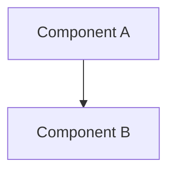

# Type/Module Name (<slug>)

---

### 1. Introduction

Motivation and scope.

Primary usage scenarios:

- **[Scenario name]**: [A job a user performs, and what failure looks like.]
- **[Scenario name]**: [A job a user performs, and what failure looks like.]

---

### 2. Requirements

#### 2.1 Functional Requirements

- **FR-1 — [Short Name]**: [Observable behavior or capability.]
- **FR-2 — [Short Name]**: [Observable behavior or capability.]

#### 2.2 Non-Functional Requirements

- **NFR-1 — [Short Name]**: [Quality, performance, or resource bound.]
- **NFR-2 — [Short Name]**: [Quality, performance, or resource bound.]

#### 2.3 Constraints

-
**C-1 — [Short Name]**: [Bound, target environment, inherited decision, or explicit exclusion.]
-
**C-2 — [Short Name]**: [Bound, target environment, inherited decision, or explicit exclusion.]

---

### 3. Technical Overview

Scope, primary subsystems, location in the workspace and sibling designs
depended on.

---

### 4. Architecture

Describe the implementation, from broad scope to specifics.

#### 4.1 [Subsystem / Component Name]

[Data structures, traits, functions, and memory layouts.]

#### 4.2 [Subsystem / Component Name]

[Algorithms, state machines, and mathematical formulations.]

#### 4.3 Error Handling

[The error type, its variants and the conditions that produce each.]

#### 4.4 Dependencies

| Crate | Features | `no_std` | Justification |
|:------|:---------|:---------|:--------------|
| [...] | [...]    | [...]    | [...]         |

---

### 5. Alternatives

| Alternative | Rejected Because | Reference |
|:------------|:-----------------|:----------|
| [...]       | [...]            | [...]     |

---

### 6. Verification & Validation

#### 6.1 Verification

| Condition | Requirement | Method     | Target                                | Criterion |
|:----------|:------------|:-----------|:--------------------------------------|:----------|
| VC-1.1    | FR-1        | `libtest`  | `crate::module::tests::test_name`     | [...]     |
| VC-1.2    | FR-1        | `kani`     | `crate::module::proofs::harness_name` | [...]     |
| VC-2.1    | NFR-1       | `analysis` | —                                     | [...]     |

Coverage: [target]% line coverage of [crate or module].
Excluded: [item and reason].

#### 6.2 Acceptance

| Claim | Oracle | Measure | Bound |
|:------|:-------|:--------|:------|
| [...] | [...]  | [...]   | [...] |

#### 6.3 Limits

What this verification plan does not establish.

---

### 7. Performance & Resource Considerations

Stack and static memory, allocation, execution time, and supported numeric
types.

---

### 8. Risks & Open Questions

Unspecified details, risks, assumptions and open questions.

---

### 9. Development Plan

| Phase     | Delivers | Requirements  | Effort   | Status  |
|:----------|:---------|:--------------|:---------|:--------|
| 1. [Name] | [...]    | [FR-1, C-1]   | [n days] | Planned |
| 2. [Name] | [...]    | [FR-2, NFR-1] | [n days] | Planned |

---

### 10. Revision History

| Revision | Date          | Author      | Description              |
|:---------|:--------------|:------------|:-------------------------|
| 1.0      | Month D, YYYY | @AuthorName | Initial design document. |

---

## References

[1] A. Author, "Title," *Publication/Venue*, vol. n, no. n, pp. n–n, Year.