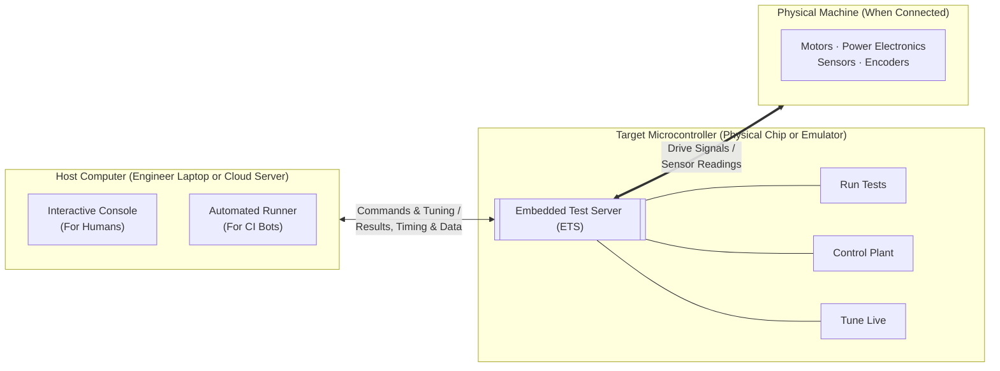
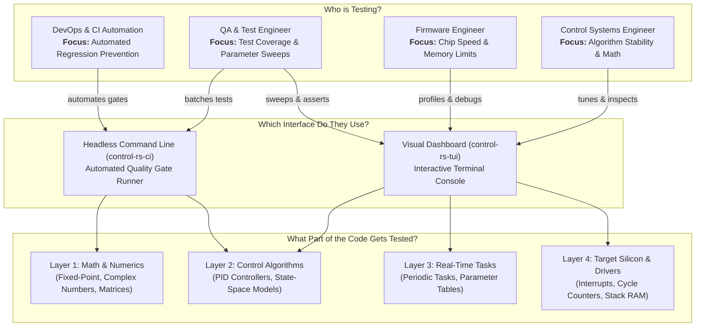
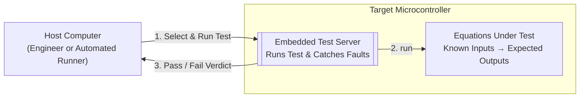
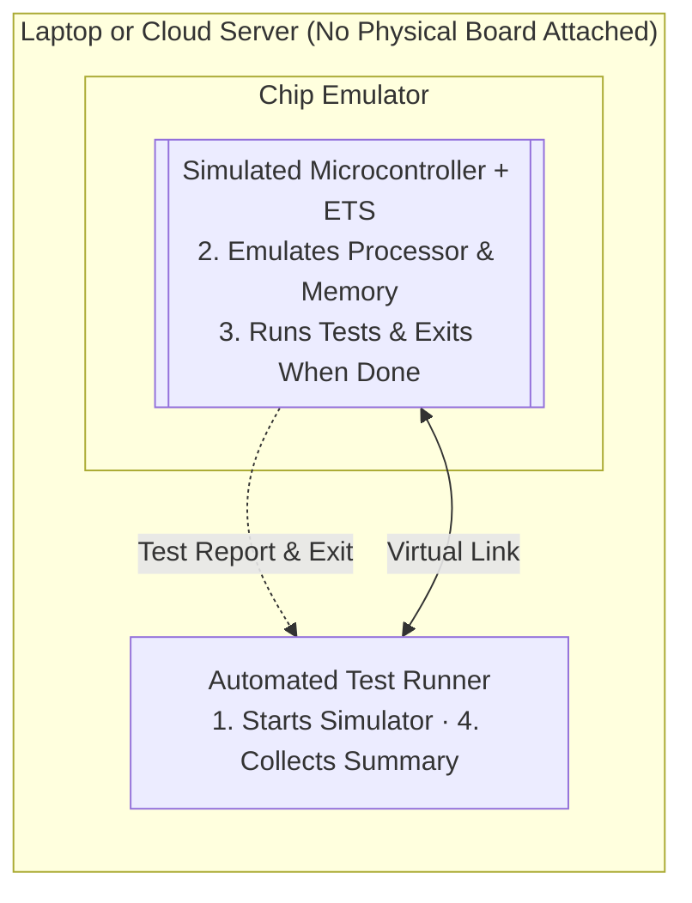
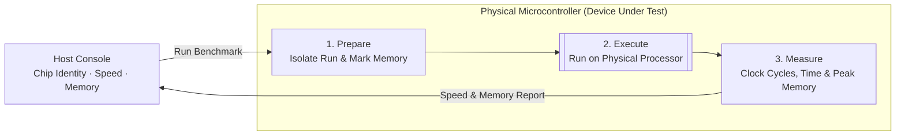
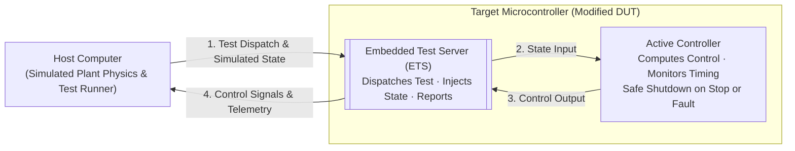
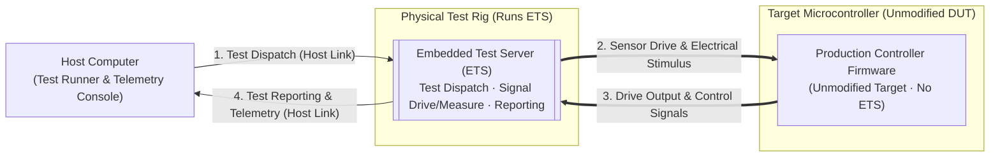
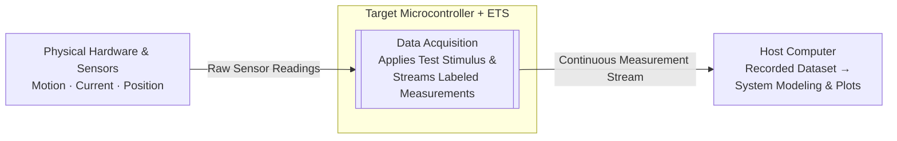
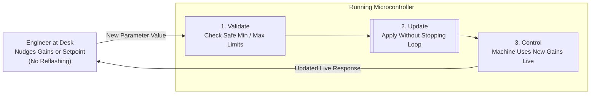

# Concept of Operations (ConOps): Embedded Test Server (ETS)

A visual guide to testing, benchmarking, data acquisition, and live tuning on
virtual and physical microcontrollers.

---

## 1. What is ETS?

1. **It Lives on the Chip:** Built directly into the microcontroller firmware so
   the chip can test and monitor itself.
2. **It Connects to Your Computer:** Talks to developer laptops or automated
   cloud servers over a cable or virtual connection.
3. **It Tests, Records & Tunes Live:** Runs tests, measures speed and memory,
   logs sensor data, and adjusts live parameters.

---

## 2. Who Uses ETS and Why

Different team members use ETS to test different parts of the system and answer
different questions:

---

## 3. Six Ways ETS is Used

| #     | Use Case                 | Setup                                                | What Crosses the Boundary                               | Operational Goal                                 |
|:------|:-------------------------|:-----------------------------------------------------|:--------------------------------------------------------|:-------------------------------------------------|
| **1** | **Unit Test**            | Host + Cargo                                         | Test selection → Pass/fail verdict                      | Verify math and edge cases                       |
| **2** | **Emulator**             | Host + Qemu + Cargo                                  | Virtual link commands → Test summary                    | Catch bugs without physical hardware             |
| **3** | **Device Under Test**    | Physical board plugged into host                     | Benchmark request → Clock cycles, time & RAM            | Prove code fits chip speed and memory limits     |
| **4** | **Hardware in the Loop** | Modified DUT (sim plant) or Unmodified DUT (ETS rig) | Sensor feedback / stimulus ↔ Control commands & reports | Verify closed-loop stability, timing & safe stop |
| **5** | **Data Acquisition**     | Chip wired to physical sensors & hardware            | Test stimulus & sensor stream → Recorded dataset        | Characterize hardware and build plant models     |
| **6** | **Hand-Tuning**          | Console attached to a running controller             | Live parameter tweak ↔ Immediate response change        | Dial in smooth performance on the bench          |

### 3.1 Math & Algorithm Logic

### 3.2 Virtual Chip on a Host

### 3.3 Benchmarking Real Silicon

### 3.4 Hardware in the Loop (Closed-Loop Control)

Closed-loop verification separates into two distinct configurations depending
on whether the device under test (DUT) is modified with ETS or runs unmodified
production firmware:

#### 3.4.1 Modified DUT

#### 3.4.2 Unmodified DUT

### 3.5 Data Acquisition & Experimentation

### 3.6 Hand-Tuning Parameter Adjustments

