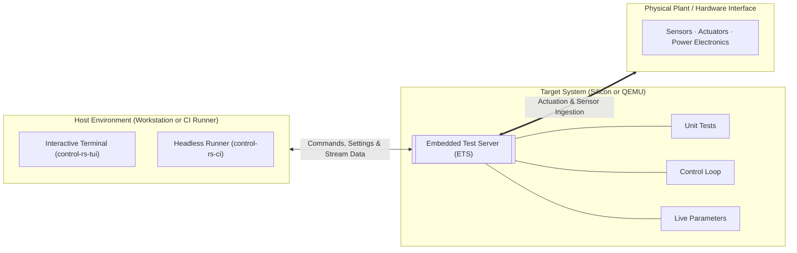
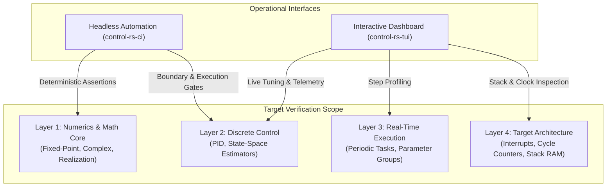
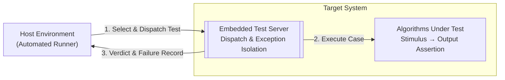
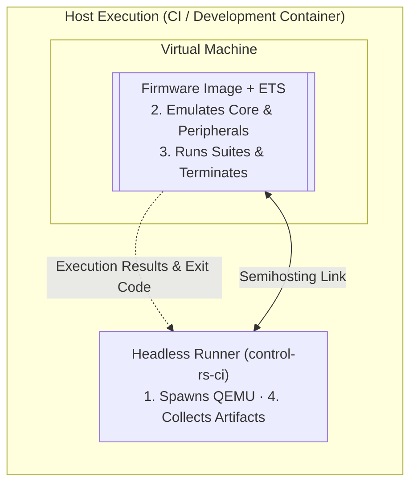
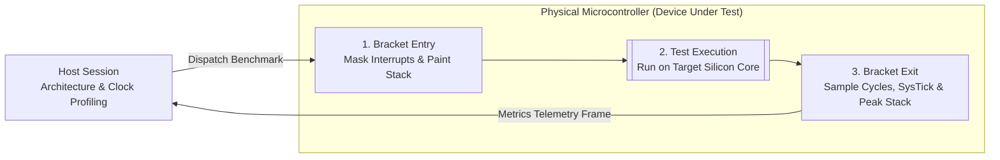
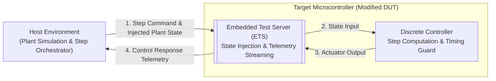
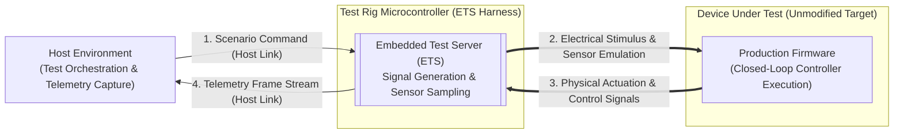
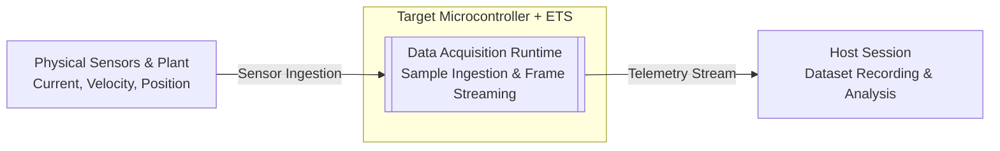
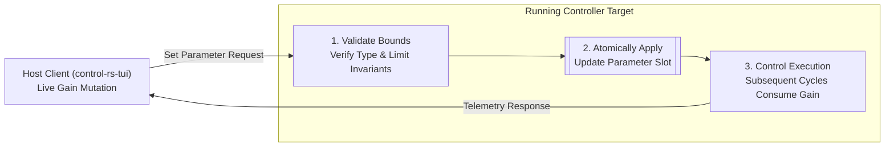

# Concept of Operations (ConOps): Embedded Test Server (ETS)

---

## 1. System Topology

---

## 2. Interface Allocations

---

## 3. Operational Scenarios

| #     | Scenario                 | Configuration                                        | Interface Boundary                                      | Operational Objective                            |
|:------|:-------------------------|:-----------------------------------------------------|:--------------------------------------------------------|:-------------------------------------------------|
| **1** | **Unit Test**            | Host Native                                          | Test selection → Pass/fail verdict                      | Verify mathematical algorithms and realization   |
| **2** | **Emulator**             | Host + QEMU                                          | Semihosting link commands → Summary telemetry           | Pre-silicon execution on target ISA targets      |
| **3** | **Device Under Test**    | Physical Silicon (USB CDC / UART)                    | Benchmark command → Cycle count, duration, stack peak   | Verify execution bounds on target hardware       |
| **4** | **Hardware in the Loop** | Modified DUT (Plant Sim) or Unmodified DUT (ETS Rig) | State injection ↔ Actuator commands & step telemetry    | Validate closed-loop timing and safe state fault |
| **5** | **Data Acquisition**     | Silicon with Plant Peripherals                       | Stimulus pattern → High-rate telemetry stream           | Stream high-rate state for model identification  |
| **6** | **Live Tuning**          | Interactive Session                                  | Parameter mutation command ↔ Verification telemetry     | Update controller gains during live execution    |

### 3.1 Algorithm & Unit Test Execution

### 3.2 Target Emulation (QEMU)

### 3.3 Hardware Benchmarking (Silicon DUT)

### 3.4 Hardware-in-the-Loop Simulation (Closed-Loop Control)

Closed-loop verification separates into two distinct configurations depending
on whether the device under test (DUT) integrates ETS or runs unmodified
production firmware:

#### 3.4.1 Modified DUT (Internal Plant Simulation)

#### 3.4.2 Unmodified DUT (External ETS Rig)

### 3.5 High-Rate Telemetry & Data Acquisition

### 3.6 Live Parameter Tuning

