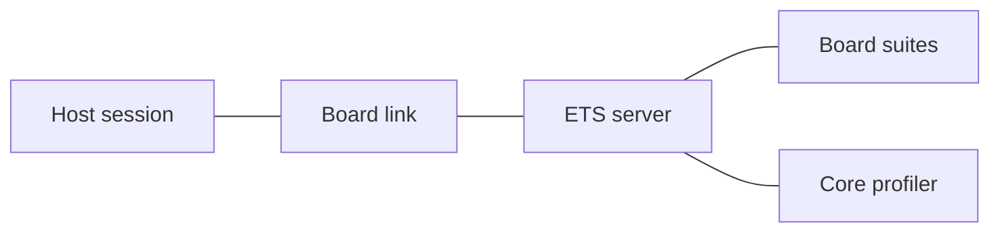

# Board Examples (board-examples)

---

### 1. Introduction

Each board example is a standalone firmware package under `examples/` that runs the Embedded Test Server on one microcontroller board and connects it to the host through the link the board provides (`ets-link-design.md`). The packages cover the ESP32-C6, the Arduino Uno R4 Minima, the Seeed XIAO nRF52840, the Seeed XIAO ESP32-S3 and the Teensy 4.x boards. The QEMU and Teensy 4.1 examples that verify the ETS crates belong to `embedded-test-server-design.md` and `ets-executive-design.md`.

Primary usage scenarios:

- **Board bring-up**: A user builds a board package, flashes it and discovers its suites from the host; failure is a link that never completes discovery.
- **Sustained exchange**: A user runs a lockstep task over the board link; failure is a buffer overflow or dropped message at the commanded rate.
- **Fault reporting**: A user provokes a panic on the board; failure is a reset without a fault report.

---

### 2. Requirements

#### 2.1 Functional Requirements

- **FR-1 — Board link**: Each board package connects the ETS to the host through the link its hardware provides, and the host completes discovery over it.
- **FR-2 — Reference links on hardware**: The USB bulk and CAN reference links complete discovery between the host and a physical target.
- **FR-3 — Fault reporting**: A panic on each board delivers `TargetPanic` telemetry to the host before the board resets.

#### 2.2 Non-Functional Requirements

- **NFR-1 — Sustained task rate**: A lockstep task over a Full-Speed USB, UART or CAN board link runs at no less than $100\ \text{Hz}$ without buffer overflow.

#### 2.3 Constraints

- **C-1 — Inherited target environment**: Conforms to `embedded-test-server-design.md` C-1 and C-2.
- **C-2 — Standalone packages**: Each board package builds outside the workspace and depends on the workspace crates by path.

---

### 3. Technical Overview

A board package supplies three things to the ETS: a byte stream or packet transport for its hardware, a CPU profiler for its core and a linker script that places the suite and task sections. The package constructs a `StreamLink`, a `Context` and the board suites in `#[ets_setup]`; the executive and the host session are unchanged across boards.

---

### 4. Architecture

#### 4.1 Package Layout

Each board package is one image with two suites:

- **Board suite**: On-target cases and settings for the board: gain constraints, matrix state transitions or filter checks, and the settings that the host tunes.
- **Lifecycle task**: The `LifecycleTask` of `examples/qemu/src/gain_task.rs`, shared by every package, so the same task runs over each board link.

#### 4.2 Board Links

| Board | Package | Link |
|:------|:--------|:-----|
| ESP32-C6 | `examples/esp32c6` | `StreamLink` over USB Serial/JTAG |
| Arduino Uno R4 Minima | `examples/uno_r4` | `StreamLink` over the SCI2 UART |
| Seeed XIAO nRF52840 | `examples/xiao_nrf52840` | `StreamLink` over USBD CDC-ACM |
| Teensy 4.0 and 4.1 | `examples/teensy4` | `StreamLink` over USB CDC-ACM |

---

### 6. Verification & Validation

#### 6.1 Verification

| Condition | Requirement | Method | Target | Criterion |
|:----------|:------------|:-------|:-------|:----------|
| VC-1.1 | FR-1 | `analysis` | — | Each board package completes discovery with the host over its link |
| VC-2.1 | FR-2 | `analysis` | — | Host SocketCAN and USB bulk (`nusb`) links complete discovery with physical hardware targets |
| VC-3.1 | FR-3 | `analysis` | — | An intentional panic on each board delivers `TargetPanic` before the reset |
| VC-4.1 | NFR-1 | `analysis` | — | A lockstep task at $100\ \text{Hz}$ over the ESP32-C6, XIAO nRF52840 and Uno R4 links runs continuously without buffer overflow |
| VC-5.1 | C-1 | `analysis` | — | Each board package builds `no_std` with no allocator symbols |
| VC-6.1 | C-2 | `inspection` | — | Each board package has its own manifest and builds outside the workspace |

#### 6.3 Limits

Every condition requires a physical board. The plan does not establish rates above $100\ \text{Hz}$ on Full-Speed USB, UART or CAN links; the Teensy 4.1 rate is verified in `ets-link-design.md`.

---

### 8. Risks & Open Questions

- **XIAO ESP32-S3 and Teensy 4.0 packages (§4.2)**: Neither package exists yet, so VC-1.1 to VC-5.1 cover three of the five boards.
- **Host CAN on non-Linux hosts (FR-2)**: SocketCAN exists only on Linux, so the CAN check runs on a Linux host.

---

### 9. Development Plan

| Phase | Delivers | Requirements | Effort | Status |
|:------|:---------|:-------------|:-------|:-------|
| 1. ESP32-C6 | Board package, `StreamLink` over USB Serial/JTAG | FR-1, FR-3, C-1, C-2 | 2 days | In progress |
| 2. Uno R4 Minima and XIAO nRF52840 | Board packages, UART and USBD links | FR-1, FR-3, NFR-1 | 3 days | In progress |
| 3. XIAO ESP32-S3 and Teensy 4.0 | Board packages | FR-1, FR-3 | 3 days | Planned |
| 4. USB bulk and CAN on hardware | Physical-target discovery sessions | FR-2 | 3 days | Planned |

---

### 10. Revision History

| Revision | Date             | Author          | Description                                                                 |
|:---------|:-----------------|:----------------|:----------------------------------------------------------------------------|
| 1.0      | October 13, 2026 | @MitchellDScott | Initial draft: board examples covering ESP32-C6, Uno R4 and XIAO nRF52840. |
