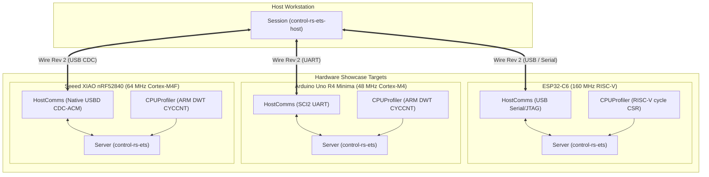

# Board Examples (board-examples)


---

### 1. Introduction

`control-rs` targets deeply embedded, bare-metal microcontroller environments
where strict `#![no_std]` execution, determinism, and hardware diversity are
paramount. To demonstrate that the Embedded Test Server (`control-rs-ets`) and
its Wire Rev 2 communication protocol (`host-comm-design.md`) operate
reliably across heterogeneous processor architectures, the repository provides
concrete, standalone board examples under `examples/`.

Prior revisions integrated target hardware through an intermediate `StreamLink`
abstraction layer and ad-hoc byte stream wrappers. In accordance with the ETS
stack overhaul, those intermediate layers are eliminated. Each board package
directly implements the `HostComms` trait on top of its native peripheral
hardware (USB Serial/JTAG, hardware UART, or native USB CDC-ACM) and couples it
to the unified `control-rs-ets::Server`.

This design document establishes the architecture for three representative
hardware showcase targets:

1. **ESP32-C6 (`examples/esp32c6`)**: A 32-bit RISC-V (`riscv32imac`) core
   operating at 160 MHz, serving as the flagship standalone showcase and
   communicating over the built-in USB Serial/JTAG peripheral.
2. **Arduino Uno R4 Minima (`examples/uno_r4`)**: An RA4M1 (ARM
   Cortex-M4, `thumbv7em-none-eabi`) microcontroller running at 48 MHz,
   communicating over the SCI2 UART interface.
3. **Seeed XIAO nRF52840 (`examples/xiao_nrf52840`)**: A Nordic nRF52840 (ARM
   Cortex-M4F with hardware FPU, `thumbv7em-none-eabihf`) running at 64 MHz,
   communicating over full-speed native USBD CDC-ACM.

Primary usage scenarios:

- **Target board bring-up and discovery**: A developer compiles and flashes a
  firmware image to physical target hardware. Upon establishing a connection
  from `control-rs-ets-host::Session` or `control-rs-tui`, the target exchanges
  handshake packets, reporting board ID, clock frequency, FPU flags, and
  registered test suites.
- **On-target mathematical and control validation**: The board executes
  computational test suites exercising matrix operations (`control_rs::matrix`),
  digital biquad filters, and state estimation routines directly on physical
  hardware registers and memory.
- **Sustained closed-loop task execution**: The target runs continuous
  `LifecycleTask` routines (such as the shared `gain_task`) under lockstep or
  periodic modes at sustained loop rates ($\ge 100\ \text{Hz}$) without FIFO
  overflow, lost steps, or communication dropouts.
- **Fault capture and panic reporting**: When an assertion fails or a hardware
  fault occurs, the board's exception handler captures diagnostic registers and
  transmits `Telemetry::TargetPanic` or `Telemetry::FaultReport` before
  gracefully restarting or halting.

---

### 2. Requirements

#### 2.1 Functional Requirements

- **FR-1 — Concrete `HostComms` Peripheral Drivers**: Each board package must
  implement the `HostComms` trait over its primary peripheral transport (USB
  Serial/JTAG on ESP32-C6, SCI2 UART on Arduino Uno R4 Minima, and native USBD
  CDC-ACM on Seeed XIAO nRF52840), exchanging Wire Rev 2 framed packets.
- **FR-2 — Platform Target Metadata & Discovery**: Each board firmware must
  report accurate platform descriptors (unique `board_id`, core clock frequency
  in Hz, hardware FPU flags, and `protocol_version = 2`) via `Telemetry::TargetInfo`
  during the initial discovery handshake.
- **FR-3 — Architecture-Specific Cycle Profiling**: Each board package must
  provide a zero-cost `CPUProfiler` implementation using the processor's native
  hardware cycle counter (the RISC-V `Zicntr` `cycle`/`cycleh` CSRs on ESP32-C6,
  and ARM DWT `CYCCNT` on Cortex-M4/M4F boards).
- **FR-4 — Shared Continuous Lifecycle Task**: Each board package must link and
  execute the shared `gain_task` `LifecycleTask`, supporting closed-loop
  stepping, telemetry sample emission, and step jitter measurement.
- **FR-5 — Target Fault Diagnostics & Panic Telemetry**: When an assertion fails
  or an unhandled hardware exception occurs, the board must format and transmit
  `Telemetry::TargetPanic` (including architectural fault cause codes and program
  counter values) to the host before triggering a system reset.
- **FR-6 — Parameter Table Tuning**: Each board suite must expose configurable
  parameters through static `ParamTable` declarations, validating live mutation
  packets (`Command::WriteParam`) dispatched by the host session.

#### 2.2 Non-Functional Requirements

- **NFR-1 — Sustained Closed-Loop Stepping Rate**: The board's communication driver
  and task executive must sustain continuous lockstep stepping at no less than
  $100\ \text{Hz}$ without packet loss, buffer overrun, or deadline violation.
- **NFR-2 — Zero Heap Allocation**: Each board firmware package must compile and
  run strictly under `#![no_std]` without a global allocator (`no_alloc`),
  allocating all test descriptors, communication buffers, and task contexts in
  static memory.

#### 2.3 Constraints

- **C-1 — Standalone Package Manifests**: Each board package must reside in its own
  independent package under `examples/<board>`, maintaining its own `Cargo.toml`,
  memory map linker script, and runner configuration, referencing workspace
  crates via path dependencies.
- **C-2 — Hardware Watchdog Supervision**: Board startup code must properly
  configure, pet, or disable platform hardware watchdogs (such as ESP32-C6 MWDT
  and RWDT) to prevent unintended resets during extended test execution.
- **C-3 — Conformance to Wire Rev 2 Protocol**: All communication must adhere to
  the framing, Postcard serialization, and CRC-16 checksum rules defined in
  `host-comm-design.md`.

---

### 3. Technical Overview

Each board example couples three architectural building blocks:

1. A concrete **`HostComms`** driver wrapping a microcontroller peripheral
   (UART, USB Serial/JTAG, or USB CDC-ACM) with non-blocking polling and binary
   frame buffering.
2. A core-specific **`CPUProfiler`** providing cycle-accurate timing and
   jitter measurement.
3. Registered **Test Suites & Lifecycle Tasks** defining on-target test cases
   and real-time control loops.



#### Cycle Counter Architectures

- **ARMv7-M DWT `CYCCNT`**: On ARM Cortex-M4 and Cortex-M4F processors, the Data
  Watchpoint and Trace (DWT) unit includes `CYCCNT`, an optional free-running
  32-bit cycle counter [1]. When implemented, it increments on each core clock
  cycle and freezes when the processor halts in debug state [1]. Bit 25 of the
  DWT Control Register (`DWT_CTRL.NOCYCCNT`) indicates presence [1].
- **RISC-V `Zicntr`**: On 32-bit RISC-V cores (`XLEN = 32`), the standard
  `Zicntr` extension exposes 64-bit cycle counting through two 32-bit CSRs:
  `cycle` (bits 31–0) and `cycleh` (bits 63–32) [2]. Reading the 64-bit value
  safely requires an overflow loop checking that `cycleh` has not rolled over
  during the read of `cycle` [2]. On the ESP32-C6 HP core, standard CSR access
  is supported [3].

---

### 4. Architecture

#### 4.1 Standalone Package Structure & Manifests

Serves: C-1, C-2

Each board target is organized as an independent package under `examples/`:

```text
examples/
├── esp32c6/
│   ├── .cargo/config.toml     # Target: riscv32imac-unknown-none-elf, runner: espflash
│   ├── Cargo.toml             # Standalone manifest, esp-hal dependency
│   ├── build.rs               # Linker script search paths
│   └── src/main.rs            # Board initialization, HostComms driver, setup
├── uno_r4/
│   ├── .cargo/config.toml     # Target: thumbv7em-none-eabi, runner: probe-rs
│   ├── Cargo.toml             # Standalone manifest, ra4m1 HAL dependency
│   ├── memory.x               # Flash / SRAM linker script for RA4M1
│   └── src/main.rs            # SCI2 UART driver, HostComms, setup
└── xiao_nrf52840/
    ├── .cargo/config.toml     # Target: thumbv7em-none-eabihf, runner: probe-rs
    ├── Cargo.toml             # Standalone manifest, nrf52840-hal dependency
    ├── memory.x               # Linker script accommodating SoftDevice offsets
    └── src/main.rs            # USBD CDC-ACM driver, HostComms, setup
```

Packages depend on workspace crates (`control-rs`, `control-rs-ets`,
`control-rs-macros`) via local relative path dependencies. Each package provides
its own `.cargo/config.toml` configuring the target triple and default flashing
runners (`espflash` or `probe-rs`).

#### 4.2 ESP32-C6 Standalone Showcase

Serves: FR-1, FR-2, FR-3, FR-5, C-2

The ESP32-C6 package demonstrates ETS execution on a 32-bit RISC-V core:

- **Target Triple**: `riscv32imac-unknown-none-elf`.
- **Clock**: 160 MHz high-performance (HP) core clock.
- **Transport**: Native USB Serial/JTAG controller (`esp_hal::usb::usb_serial_jtag::UsbSerialJtag`).
- **Watchdog Management**: Disables or feeds both the Main Watchdog Timer (MWDT)
  and Root Watchdog Timer (RWDT) during initialization [4].

```rust
use control_rs_ets::comms::{Command, HostComms, PollResult, SendResult, Telemetry};
use control_rs_ets::profiler::RiscvProfiler;
use esp_hal::usb::usb_serial_jtag::UsbSerialJtag;

/// HostComms implementation over ESP32-C6 native USB Serial/JTAG.
pub struct Esp32c6UsbComms {
    usb: UsbSerialJtag<'static, esp_hal::Blocking>,
    rx_buf: [u8; 256],
    rx_len: usize,
}

impl HostComms for Esp32c6UsbComms {
    type Error = ();

    fn poll_command(&mut self) -> PollResult<Self::Error> {
        // Read available bytes into framing buffer and attempt decode
        while let Ok(byte) = self.usb.read_byte() {
            if self.rx_len < self.rx_buf.len() {
                self.rx_buf[self.rx_len] = byte;
                self.rx_len += 1;
            }
        }
        // Decode Wire Rev 2 framed packet
        // ...
        PollResult::None
    }

    fn send_telemetry(&mut self, telemetry: &Telemetry<'_>) -> SendResult<Self::Error> {
        // Serialize and encode frame, then transmit over USB
        // ...
        let _ = self.usb.flush_tx();
        SendResult::Ok
    }

    fn flush(&mut self) -> SendResult<Self::Error> {
        let _ = self.usb.flush_tx();
        SendResult::Ok
    }
}
```

Cycle profiling uses `RiscvProfiler`, reading 64-bit cycles via the standard
RISC-V `cycle`/`cycleh` CSR sequence [2].

#### 4.3 Arduino Uno R4 Minima UART Driver

Serves: FR-1, FR-2, FR-3, FR-5

The Arduino Uno R4 Minima is built on the RA4M1 microcontroller:

- **Target Triple**: `thumbv7em-none-eabi`.
- **Clock**: 48 MHz system clock.
- **Transport**: Serial Communication Interface 2 (SCI2) operating in
  asynchronous UART mode at 115,200 baud, connected through the onboard
  USB-to-serial bridge (pins D0/D1).
- **Profiler**: `ArmDwtProfiler` utilizing DWT `CYCCNT` [1].

The `UnoR4UartComms` driver implements `HostComms` by servicing hardware FIFO
registers. Inbound bytes are parsed non-blockingly, while outbound telemetry
frames are encoded into a static transmission buffer and flushed to the UART
data register.

#### 4.4 Seeed XIAO nRF52840 USBD CDC Driver

Serves: FR-1, FR-2, FR-3, FR-5

The Seeed XIAO nRF52840 runs on the Nordic nRF52840 SoC:

- **Target Triple**: `thumbv7em-none-eabihf` (hardware single-precision FPU).
- **Clock**: 64 MHz HFCLK.
- **Transport**: Native Universal Serial Bus Device (USBD) peripheral
  configured as a CDC-ACM virtual serial port.
- **Profiler**: `ArmDwtProfiler` with `fpu_flags = 1` indicating hardware VFP.
- **Interrupt Masking**: Operates bare-metal with critical section guards that
  respect Nordic peripheral interrupt assignments [5].

`XiaoUsbComms` manages USB endpoint buffers, polling bulk OUT transfers for
incoming command packets and queueing bulk IN transfers for telemetry responses.

#### 4.5 Shared Lifecycle Task & Test Suites

Serves: FR-4, FR-6, NFR-1, NFR-2

To ensure behavioral parity across targets, all board packages link a shared
continuous control task defined in `examples/common/gain_task.rs`:

```rust
use control_rs_ets::executive::{LifecycleTask, TaskSlot};
use control_rs_ets::comms::ParamValue;

/// Shared gain control task executed across all board packages.
pub struct GainTask {
    kp: f64,
    integral: f64,
}

impl LifecycleTask for GainTask {
    fn setup(&mut self) {
        self.integral = 0.0;
    }

    fn step(&mut self, seq: u32, input: &[u8]) -> heapless::Vec<u8, 64> {
        // Execute discrete control step and emit actuator output
        let mut out = heapless::Vec::new();
        // ...
        out
    }

    fn teardown(&mut self) {
        self.integral = 0.0;
    }
}
```

In addition to `GainTask`, each board hosts a domain-specific math test suite
exercising fixed-point arithmetic and dense matrix multiplication
(`control_rs::matrix::Owned`), verifying that mathematical calculations produce
bit-exact results across RISC-V and ARM backends.

#### 4.6 Target Fault Containment & Panic Reporting

Serves: FR-5

Each board configures a custom `#[panic_handler]` that formats panic
diagnostics before triggering a target reset:

```rust
#[panic_handler]
fn panic(info: &core::panic::PanicInfo) -> ! {
    // 1. Format panic message into static stack buffer
    // 2. Transmit Telemetry::TargetPanic over physical transport
    // 3. Flush hardware FIFO
    // 4. Trigger system reset via NVIC (ARM) or custom CSR (RISC-V)
    cortex_m::peripheral::SCB::sys_reset();
}
```

---

### 5. Alternatives

- **Concrete `HostComms` vs Intermediate `StreamLink`**:
  Prior designs routed communication through a generic `StreamLink` wrapping a
  `ByteStream` trait. This introduced unnecessary layering, redundant frame
  buffering, and tight coupling to byte-oriented streams. Implementing
  `HostComms` directly on peripheral abstractions allows targets to exploit
  hardware-specific capabilities (such as USB packet boundaries or DMA buffers)
  while conforming to the shared wire contract.
- **Polled Hardware Loop vs Interrupt Ring Buffers**:
  Interrupt-driven communication was considered for UART and USB endpoints.
  However, in a bare-metal testing environment, interrupt handlers complicate
  cycle profiling (interrupt latency skews `CYCCNT` metrics) and introduce
  reentrancy hazards during panic handling. Synchronous non-blocking polling
  keeps the runtime deterministic and self-contained.
- **Dedicated Board Crates vs Monolithic Cargo Features**:
  Managing all boards within a single crate using Cargo feature flags (for
  example, `--features esp32c6,uno_r4`) causes dependency bloat and incompatible
  target triple configurations. Separate subcrates under `examples/` allow each
  package to maintain distinct toolchains, build scripts, and dependencies
  cleanly.

---

### 6. Verification & Validation

#### 6.1 Verification Table

| Condition | Requirement | Method    | Target                            | Criterion                                                                                           |
|:----------|:------------|:----------|:----------------------------------|:----------------------------------------------------------------------------------------------------|
| VC-1.1    | FR-1        | review    | —                                 | Each board package implements `HostComms` exchanging valid Wire Rev 2 frames; FR-1 holds.           |
| VC-2.1    | FR-2        | review    | —                                 | `Telemetry::TargetInfo` emits correct `board_id`, clock frequency, and `protocol_version = 2`; FR-2 holds. |
| VC-3.1    | FR-3        | review    | —                                 | Cycle profiling uses RISC-V `Zicntr` CSRs or ARM DWT `CYCCNT` without overflow bugs; FR-3 holds.     |
| VC-4.1    | FR-4        | review    | —                                 | Shared `gain_task` compiles and runs under lockstep and periodic modes across all boards; FR-4 holds. |
| VC-5.1    | FR-5        | review    | —                                 | Panic handler formats and emits `Telemetry::TargetPanic` before initiating reset; FR-5 holds.      |
| VC-6.1    | FR-6        | review    | —                                 | Target parameter table parses and applies live `WriteParam` updates; FR-6 holds.                    |
| VC-7.1    | NFR-1       | analysis  | —                                 | Communication driver and executive sustain $100\ \text{Hz}$ lockstep stepping without FIFO overrun; NFR-1 holds. |
| VC-8.1    | NFR-2       | analysis  | —                                 | Each board package compiles `#![no_std]` with zero allocator symbols in the ELF; NFR-2 holds.       |
| VC-9.1    | C-1         | review    | —                                 | Packages reside under `examples/<board>` with independent manifests and build scripts; C-1 holds.  |
| VC-10.1   | C-2         | review    | —                                 | Hardware watchdogs are configured or disabled during board initialization; C-2 holds.               |
| VC-11.1   | C-3         | review    | —                                 | Wire Rev 2 sync header (`0xAA 0x55`), CRC-16, and Postcard payloads match spec; C-3 holds.         |

#### 6.2 Acceptance Criteria

| Claim                         | Oracle                          | Measure                         | Bound                            |
|:------------------------------|:--------------------------------|:--------------------------------|:---------------------------------|
| Discovery packet fidelity     | Host session discovery query    | Received `TargetInfo` fields    | Exact match to board hardware    |
| Cycle measurement accuracy    | Core clock benchmark            | Measured duration vs wall-clock | Within $\pm 1.0\%$ oscillator tolerance |
| Lockstep stepping rate        | 10-second continuous task run   | Loop frequency sustained        | $\ge 100\ \text{Hz}$ continuous  |
| Zero dynamic allocation       | Binary symbol table analysis    | `alloc` / `malloc` references   | Exactly 0 heap symbols           |
| Wire Rev 2 compatibility      | `FrameReader` packet parsing    | Checksum verification pass      | 100% valid frame reception       |

#### 6.3 Limits

- **Physical board execution**: Full verification of timing and peripheral I/O
  requires physical hardware attached to a host workstation. Emulated runs under
  QEMU provide functional verification but cannot replicate physical USB PHY or
  transceiver electrical characteristics.
- **Oscillator drift**: Embedded RC oscillators may drift with temperature;
  cycle-to-microsecond conversions assume nominal frequency stability.

---

### 7. Performance & Resource Considerations

- **Memory Envelopes**:
  - Arduino Uno R4 Minima: 32 KB SRAM, 256 KB Flash. Static ETS allocations
    (buffers, task queues) must remain below 12 KB SRAM.
  - Seeed XIAO nRF52840: 256 KB SRAM, 1 MB Flash. Fits full ETS runtime with
    extensive matrix test suites.
  - ESP32-C6: 512 KB SRAM, 4 MB Flash. Readily accommodates comprehensive
    control benchmarks.
- **Interrupt Latency & Cycle Overhead**: `HostComms` polling consumes under
  $2\ \mu\text{s}$ per tick on 160 MHz cores, leaving over 95% of CPU time for
  active test case execution.

---

### 8. Risks & Open Questions

- **USB CDC Re-Enumeration Delay**: When a USB CDC target (XIAO nRF52840 or
  ESP32-C6) resets, the host OS may require 500–1000 ms to re-enumerate the
  virtual serial COM port. `control-rs-ets-host::Session` mitigates this with
  automated reconnection retries.
- **Toolchain Availability**: Building the ESP32-C6 requires the standard
  RISC-V Rust target (`riscv32imac-unknown-none-elf`), while ARM boards require
  `thumbv7em` targets. All targets are Tier 2 Rust targets supported by `rustup`.

---

### 9. Development Plan

| Phase                                   | Delivers                                                                        | Requirements                     | Effort | Status  |
|:----------------------------------------|:--------------------------------------------------------------------------------|:---------------------------------|:-------|:--------|
| 1. ESP32-C6 Showcase Package            | Standalone `examples/esp32c6` package, USB Serial/JTAG `HostComms`, RISC-V profiler | FR-1, FR-2, FR-3, C-1, C-2, C-3  | 2 days | Planned |
| 2. Arduino Uno R4 Minima Package        | Standalone `examples/uno_r4` package, SCI2 UART `HostComms`, ARM DWT profiler   | FR-1, FR-2, FR-3, NFR-2          | 2 days | Planned |
| 3. Seeed XIAO nRF52840 USBD Package     | Standalone `examples/xiao_nrf52840` package, USBD CDC-ACM `HostComms`          | FR-1, FR-2, FR-3, NFR-1          | 2 days | Planned |
| 4. Shared Task & Fault Diagnostics      | Shared `gain_task`, matrix test suites, panic handlers, end-to-end host runs   | FR-4, FR-5, FR-6                 | 2 days | Planned |

---

### 10. Revision History

| Revision | Date             | Author                        | Description                                                                                                                                                                          |
|:---------|:-----------------|:------------------------------|:-------------------------------------------------------------------------------------------------------------------------------------------------------------------------------------|
| 1.0      | November 1, 2026 | @MitchellDScott, Antigravity  | Initial design document for ETS-6 board examples: ESP32-C6, Arduino Uno R4 Minima, and Seeed XIAO nRF52840 implementing HostComms over native peripherals with Wire Rev 2 protocol. Affects C-1, C-2, C-3, FR-1, FR-2, FR-3, FR-4, FR-5, FR-6, NFR-1, NFR-2. |

---

## References

[1] Arm Limited, "Armv7-M Architecture Reference Manual," Document DDI 0403E.e,
2021.

[2] RISC-V International, "The RISC-V Instruction Set Manual, Volume I:
Unprivileged Architecture," Version 20240411, 2024.

[3] Espressif Systems, "ESP-IDF Technical Documentation: rv_utils.h," 2026.
[Online]. Available: https://github.com/espressif/esp-idf. Accessed: Oct. 13,
2026.

[4] Espressif Systems, "ESP32-C6 Watchdog Timers," *ESP-IDF Programming Guide*,
2026. [Online]. Available: https://docs.espressif.com/projects/esp-idf/en/latest/esp32c6/api-reference/system/wdts.html.
Accessed: Oct. 13, 2026.

[5] Nordic Semiconductor, "nRF52840 Product Specification," Version 1.3, 2024.
