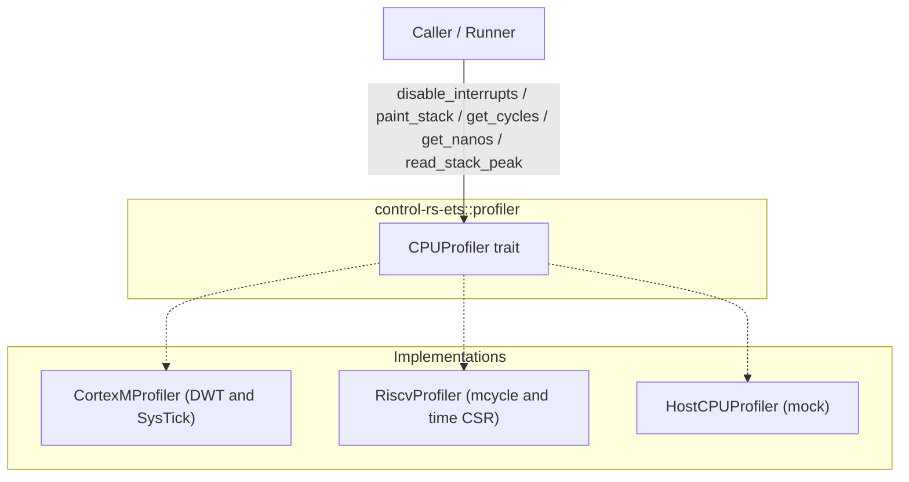

# CPUProfiler (cpu-profiler)


### 1. Introduction

Measuring code on a microcontroller needs target-specific hooks for clock
cycles, elapsed time, stack usage, interrupt isolation, and target reset/exit. The
`CPUProfiler` trait in `control-rs-ets::profiler` defines those hooks.
Implementations are supplied by the end user or silicon vendor, with built-in
reference backends for ARM Cortex-M, RISC-V, and host targets.

---

### 2. Requirements

#### 2.1 Functional Requirements

- **FR-1 — Monotonic Execution Cycle Measurement**: The profiler must provide monotonically increasing CPU cycle counts across executions. On targets lacking cycle-counting hardware (such as ARMv6-M), the profiler must indicate clock absence and report zero cycles without compilation or runtime failure.
- **FR-2 — Wall-Clock Elapsed Time Acquisition**: The profiler must report monotonically non-decreasing wall-clock elapsed time in nanoseconds derived from hardware timers.
- **FR-3 — Stack Boundary Inspection**: The profiler must inspect the active stack pointer and query linker-defined stack boundaries. Inspection operations must not corrupt or perturb active stack frames.
- **FR-4 — Stack High-Watermark Measurement**: The profiler must determine peak stack memory consumption during execution by painting unused stack memory with a sentinel pattern and detecting the deepest watermark displacement. Painting must remain bounded between the stack boundary and the frame safety threshold.
- **FR-7 — Test Interrupt Isolation**: The profiler must support scoped interrupt disabling (`disable_interrupts`) during critical test execution and permanent interrupt disabling (`disable_interrupts_permanently`) upon panic or fatal failure.
- **FR-8 — Target Lifecycle Control**: The profiler must provide target control hooks to initiate a warm system reset (`reset`) or terminate execution in virtualized environments (`exit`).

#### 2.2 Non-Functional Requirements

- **NFR-1 — Deterministic Low Overhead**: Cycle and timer hooks execute within bounded clock cycles so measurements do not perturb the code under test.
- **NFR-2 — Stack Profiling Memory Safety**: Stack painting and scanning are confined strictly to the memory region between `stack_end` and a safety margin below `sp`.

#### 2.3 Constraints

- **C-1 — Strict `#![no_std]`, Zero Heap**: Consistent with the rest of `control-rs-ets`, executing with zero dynamic heap allocation.
- **C-2 — Target Architectures**: Support ARM Cortex-M (ARMv6-M, ARMv7-M, ARMv8-M), RISC-V (RV32, RV64), and Host mock.

---

### 3. Technical Overview

A caller paints the stack and samples the `CPUProfiler` hooks before and after a
measured region within an interrupt-isolated critical section (`disable_interrupts`),
then reads peak stack usage (`read_stack_peak`) and computes cycle and nanosecond deltas.



---

### 4. Architecture

#### 4.1. The CPUProfiler Trait

Serves: FR-1, FR-2, FR-3, FR-4, FR-7, FR-8, NFR-1, NFR-2, C-1

The core of the abstraction is the `CPUProfiler` trait, defined in
`control-rs-ets::profiler`:

```rust
pub trait CPUProfiler {
    /// Whether this profiler has a cycle-accurate hardware clock.
    /// Returns false on architectures lacking DWT or cycle counters (for example, ARMv6-M).
    fn has_clock(&self) -> bool {
        true
    }

    /// Disables interrupts and runs the given closure, returning its result.
    fn disable_interrupts<F, R>(&self, f: F) -> R
    where
        F: FnOnce() -> R,
    {
        f()
    }

    /// Disables interrupts permanently.
    fn disable_interrupts_permanently(&self) {}

    /// Exits the application/environment using target-specific mechanisms.
    fn exit(&self) -> ! {
        loop {}
    }

    /// Get the current CPU cycle count.
    fn get_cycles(&self) -> u64;

    /// Get the current time in nanoseconds.
    fn get_nanos(&self) -> u64;

    /// Get the current stack pointer.
    fn get_sp(&self) -> usize;

    /// Get the end of the current stack.
    fn get_stack_end(&self) -> usize;

    /// Paints the stack below the given stack pointer.
    unsafe fn paint_stack(&self, sp: usize);

    /// Reads the peak stack usage (in bytes) since the stack was painted, relative to the given stack pointer.
    unsafe fn read_stack_peak(&self, sp: usize) -> u32;

    /// Resets the CPU/system.
    fn reset(&self) -> ! {
        loop {}
    }
}
```

The Cortex-M cycle source is the DWT cycle counter, exposed by the `cortex-m`
peripheral access crate as a `cyccnt` register that is absent on Armv6-M
[1]. That absence is why FR-1 is a trait method rather than a
direct register read: a target without DWT supplies its own implementation.

Interrupt control (FR-7) is expressed through the portable critical-section
abstraction, which exists because there is otherwise no universal API across
targets [2].

Stack measurement (FR-4) uses painting, "a runtime technique for estimating the
maximum stack depth a task has reached" [3]. The approach is "very
common in embedded systems and is used by both FreeRTOS and Zephyr RTOS"
[4], and Zephyr exposes the same idea through
`k_thread_stack_space_get`, which reports unused stack when its init-stacks
options are enabled [5].

#### 4.2. Default Architecture Profilers and Dependency Gating

Serves: FR-1, FR-7, FR-8, C-2

To provide out-of-the-box convenience without forcing architecture dependencies
on custom platforms, `control-rs-ets` supplies optional default reference implementations:
* `CortexMProfiler`: Uses standard ARM DWT cycle counting, SysTick timing, `cortex_m::interrupt` critical sections (`disable_interrupts`, `disable_interrupts_permanently`), and `SCB::sys_reset` (`reset`).
* `RiscvProfiler`: Uses standard RISC-V `mcycle` and `time` CSR registers and `riscv::interrupt` global interrupt masking (`disable_interrupts`, `disable_interrupts_permanently`).
* `HostCPUProfiler`: Provides a zeroed mock implementation for host-side testing.

To prevent architecture-specific crates from being compiled on incompatible platforms or
bloating targets that do not use them, architectural dependencies are gated strictly by
target architecture `cfg` attributes (without combining arch and feature flags):
* `cortex-m` dependency and `CortexMProfiler` are gated behind `[target.'cfg(target_arch = "arm")'.dependencies]` and `#[cfg(target_arch = "arm")]`.
* `riscv` dependency and `RiscvProfiler` are gated behind `[target.'cfg(any(target_arch = "riscv32", target_arch = "riscv64"))'.dependencies]` and `#[cfg(any(target_arch = "riscv32", target_arch = "riscv64"))]`.
* Host builds (`x86_64`, `aarch64`) compile `control-rs-ets` with zero architecture dependencies.

```rust
pub struct HostCPUProfiler;

impl CPUProfiler for HostCPUProfiler {
    fn get_cycles(&self) -> u64 { 0 }
    fn get_nanos(&self) -> u64 { 0 }
    fn get_sp(&self) -> usize { 0 }
    fn get_stack_end(&self) -> usize { 0 }
    unsafe fn paint_stack(&self, _sp: usize) {}
    unsafe fn read_stack_peak(&self, _sp: usize) -> u32 { 0 }
}
```

---

#### 4.3. Board-Level and Custom Target Implementations

Serves: FR-1, FR-7, FR-8, C-2

The fundamental motivation for the `CPUProfiler` trait is supporting diverse
processors and board-level hardware environments without burdening callers
with vendor peripheral drivers. Where an implementation lives depends on the
target:
* **Standard Cores**: May use the built-in `CortexMProfiler` or `RiscvProfiler`.
* **Non-Standard & Diverse Silicon (for example, ARMv6-M)**: Silicon lacking DWT (such
  as Cortex-M0/M0+, RP2040, or STM32F0) or targets running under an RTOS provide
  their own `CPUProfiler` implementation in their application or board-support crate.

For example, on an ARMv6-M RP2040 target, the board crate provides a custom
profiler utilizing the RP2040 64-bit microsecond hardware timer:

```rust
pub struct Rp2040Profiler {
    core_freq_hz: u32,
}

impl CPUProfiler for Rp2040Profiler {
    fn has_clock(&self) -> bool {
        true
    }

    fn get_cycles(&self) -> u64 {
        // Derive execution cycles from the 64-bit hardware microsecond timer
        self.get_nanos() * (self.core_freq_hz as u64) / 1_000_000_000
    }

    fn get_nanos(&self) -> u64 {
        // Read RP2040 hardware timer registers (TIMEHW / TIMELW)
        let timer_hw = 0x4005_4008 as *const u32;
        let timer_lw = 0x4005_400C as *const u32;
        unsafe {
            let high = core::ptr::read_volatile(timer_hw) as u64;
            let low = core::ptr::read_volatile(timer_lw) as u64;
            ((high << 32) | low) * 1000
        }
    }

    fn get_sp(&self) -> usize {
        let sp: usize;
        unsafe {
            core::arch::asm!("mov {}, sp", out(reg) sp);
        }
        sp
    }

    fn get_stack_end(&self) -> usize {
        unsafe extern "C" { static mut _stack_end: u32; }
        core::ptr::addr_of!(_stack_end) as usize
    }

    fn disable_interrupts<F, R>(&self, f: F) -> R
    where
        F: FnOnce() -> R,
    {
        cortex_m::interrupt::free(|_| f())
    }

    fn disable_interrupts_permanently(&self) {
        cortex_m::interrupt::disable();
    }

    fn reset(&self) -> ! {
        cortex_m::peripheral::SCB::sys_reset();
    }
}
```

`reset()` performs a host-commanded warm reboot. ETS's panic path calls it
after the host sends `Command::TryReset`; on Cortex-M it is
`SCB::sys_reset`, which can leave peripherals and active DMA running
(`embedded-test-server-design.md` §4.6).

---

### 5. Alternatives

* **Adopt an existing profiling crate**: Rejected. Crates such as `cortex-m-funnel`
  and `embedded-profiling` address runtime profiling in `no_std` environments
  [6] via traits requiring a clock read and an output sink [7]. However,
  `embedded-profiling` has not released since version 0.3.0 in December 2021 [8],
  and its trait covers only elapsed time snapshots without cycle counting, stack
  introspection, or interrupt control. Implementing `CPUProfiler` in-house minimizes dependencies.
* **Static stack analysis instead of painting**: Rejected as the primary
  measure, retained as a complement. `cargo-call-stack` is a whole-program stack
  analyzer but relies on experimental `-Z stack-sizes` [9], and inline assembly
  breaks LLVM's stack usage analysis [9]. Compiler-emitted per-function usage
  from `-fstack-usage` does not readily analyze nested call trees [4]. Runtime
  stack painting therefore provides the empirical high-water mark, with
  link-time tools (`flip-link`) as complementary overflow protection. No
  static stack analysis gate exists (the static-analyzer design and its `analyze` gate were withdrawn on 2026-09-14).
* **Tick-based timekeeping**: Rejected. A tickless monotonic avoids periodic
  interrupts to count ticks [10], whereas SysTick-based periodic tick generation
  incurs high interrupt rates [11] that perturb execution duration and jitter
  measurements.
* **Host-side trace tooling**: Rejected as a requirement. External tools such as
  SEGGER SystemView analyze and verify embedded systems from the host [12], but
  impose vendor-specific hardware or debug probes, violating open emulator and
  target independence constraints.
* **Separated clock and test executor traits**: Rejected. Splitting profiling
  into distinct clock and test executor interfaces requires target implementations
  to manage multiple lifetimes and structures.
* **Host mock verification for hardware drivers**: Rejected as the sole verification
  method. Testing `CPUProfiler` purely through host mocks verifies only that mock stubs
  return predetermined values, leaving real hardware interactions (DWT cycle counting,
  SysTick interrupt roll-overs, CSR reads, and inline assembly stack inspection)
  unverified. On-target checks run under QEMU through the `virtual-ets` gate
  and on physical hardware via board examples; the harness that hosts them is specified
  in `embedded-test-server-design.md` §4.3.

---

### 6. Verification & Validation

#### 6.1 Verification

| Condition | Requirement | Method    | Target                                                                                          | Criterion                                                                                                       |
|:----------|:------------|:----------|:------------------------------------------------------------------------------------------------|:------------------------------------------------------------------------------------------------|
| VC-1.2    | FR-1        | `gate`    | `build`                                                                                         | ARMv6-M (`thumbv6m-none-eabi`) compiles cleanly without DWT dependencies with `has_clock` returning false       |
| VC-1.3    | FR-1        | `gate`    | `virtual-ets`                                                                                   | On target, cycles advance monotonically across a known delay |
| VC-2.1    | FR-2        | `gate`    | `virtual-ets`                                                                                   | On target, elapsed nanoseconds advance monotonically          |
| VC-2.2    | FR-2        | `libtest` | `control_rs_ets::profiler::tests::test_systick_nanos_boundary_cases`                            | Sub-microsecond and rollover boundary timer samples convert cleanly without arithmetic underflow or timestamp jitter |
| VC-2.3    | FR-2        | `libtest` | `control_rs_ets::profiler::tests::test_naive_systick_rollover_flaw_and_hardened_resolution`     | SysTick hardware counter reload and pending IRQ rollovers do not cause backward time jumps or non-monotonic values |
| VC-3.1    | FR-3        | `gate`    | `virtual-ets`                                                                                   | On target, `get_sp` lies within the linker stack limits  |
| VC-4.1    | FR-4        | `libtest` | `control_rs_ets::profiler::tests::test_default_profiler_methods`                                 | Stack sentinel painting and peak scanning on synthetic buffer detects watermark displacement without corruption |
| VC-4.2    | FR-4        | `gate`    | `virtual-ets`                                                                                   | On target, the measured peak covers real call frames      |
| VC-4.3    | FR-4, NFR-2 | `libtest` | `control_rs_ets::profiler::tests::test_stack_paint_exhaustion_clamp` | When `sp` minus the safety margin is at or below `stack_end`, `paint_stack` writes no memory and `read_stack_peak` returns 0 |
| VC-4.4    | FR-4        | `libtest` | `control_rs_ets::profiler::tests::test_default_profiler_methods`                                 | Untouched sentinel words remain intact during high-watermark scanning, reporting zero usage when no frames are displaced |
| VC-7.1    | FR-7        | `libtest` | `control_rs_ets::profiler::tests::test_default_profiler_methods`                                 | `disable_interrupts` executes the supplied closure and returns its value, and `disable_interrupts_permanently` completes without panic |
| VC-7.2    | FR-7        | `gate`    | `virtual-ets`                                                                                   | On target, `disable_interrupts` masks hardware interrupts during test execution and restores interrupt state upon return |
| VC-8.1    | FR-8        | `libtest` | `control_rs_ets::util::tests::test_handle_failure_comms_disabled`                               | Target reset and exit hooks are invoked on catastrophic failure and virtual runner teardown |
| VC-8.2    | FR-8        | `gate`    | `virtual-ets`                                                                                   | On target under QEMU, `exit` and `reset` hooks cleanly terminate or restart the virtual target |
| VC-10.1   | NFR-1       | `gate`    | `virtual-ets` | Cycle and nanosecond hooks execute deterministically without dynamic allocation or unbounded loops across target architectures |
| VC-11.1   | NFR-2       | `libtest` | `control_rs_ets::profiler::tests::test_default_profiler_methods`                                 | Sentinel writes never exceed the safety margin below the current stack pointer                                  |
| VC-12.1   | C-1         | `gate`    | `clippy`                                                                                        | The `clippy` quality gate outcome reports `Pass`, verifying `#![no_std]` without heap allocation                |
| VC-13.1   | C-2         | `gate`    | `build`, `virtual-ets` | `control-rs-ets` compiles for the host and links into the QEMU firmware for `thumbv7em-none-eabihf`, `thumbv7em-none-eabi`, `riscv32imac-unknown-none-elf` and `riscv64gc-unknown-none-elf` |

#### 6.2 Acceptance

| Claim | Oracle | Measure | Bound |
|:------|:-------|:--------|:------|
| Cycle and time agreement | `cortex_m::asm::delay(n)` at a known core frequency | Relative error between the cycle delta and the derived nanoseconds | ≤ 1% over intervals ≥ 10,000 cycles |
| Stack bounds | Linker symbols `_stack_start`, `_stack_end` queried | Addresses touched by paint and scan | All within `[_stack_end, _stack_start]` |
| Peak monotonicity | Calibrated call chains of increasing known depth | Reported peak | Non-decreasing with depth, matching frame bounds |
| Wrapper overhead | Empty measured region on target | Cycles attributed to the wrapper | ≤ 50 clock cycles |

The cycle bound applies only above 10,000 cycles because at shorter intervals
the wrapper overhead is a significant fraction of the measurement, which is the
same reason the overhead itself is bounded.

#### 6.3 Limits

- Absolute accuracy of cycle counts under emulation. QEMU states no cycle or
  timing model, so emulated figures are indicative per
  `documentation/ci/ci-design.md` C-6; only hardware runs measure.
- Stack usage of interrupt handlers and inline assembly. Painting measures what
  ran on the measured stack; static analysis of these paths is explicitly
  unavailable, since inline assembly "breaks LLVM's stack usage analysis"
  [9].
- Behaviour under preemption. Measurements assume the measured region is not
  preempted; nothing detects or corrects for a context switch mid-measurement.
- Cross-architecture comparability. Cycle counts from Cortex-M and RISC-V are
  not claimed to be comparable to each other.
- Long-interval measurement. Nothing bounds error accumulation across intervals
  longer than one counter period.
- ARMv8-M builds. No gate builds an ARMv8-M target, so C-2 is shown for
  ARMv7-M, RV32, RV64 and the host only.

### 7. Performance and Resource Considerations

* **Hook latency**: The `get_cycles()` and `get_nanos()` hooks must execute
  deterministically and as close to zero-overhead as possible (typically within
  a few clock cycles).
* **Closure Execution Overhead**: The `disable_interrupts<F, R>` wrapper
  introduces critical section overhead. Implementations must minimize the setup
  and teardown instructions around the closure to avoid artificially elevating
  interrupt latency or masking real-time deadlines.
* **Scan Time Complexity**: The `read_stack_peak()` method relies on scanning
  memory linearly for sentinel values. This operation is $O(N)$ relative to the
  size of the stack and executes during post-test reporting to avoid perturbing
  active test execution.

---

### 8. Risks and Open Questions

* **Register Overflows**: `CortexMProfiler::get_cycles()` casts the 32-bit DWT
  counter to `u64`. At typical core clock frequencies (hundreds of MHz), the
  32-bit counter rolls over within tens of seconds. Test cases measured by ETS
  run for bounded millisecond durations well below the rollover period.
* **ARMv6-M Support**: `cortex-m` gates `DWT::cycle_count()` behind
  `#[cfg(not(armv6m))]`. Cortex-M0/M0+ have no DWT cycle counter. `CPUProfiler::has_clock()`
  informs the caller that cycle clock profiling is unavailable on ARMv6-M.
* **Stack Bounds Calculation**: Determining the absolute bottom of the stack
  safely requires linker script symbols or target-specific runtime boundaries.
  Board-level implementations must standardize linker symbol exports to prevent
  boundary miscalculation.

---

### 9. Development Plan

| Phase | Delivers | Requirements | Effort | Status |
|:------|:---------|:-------------|:-------|:-------|
| 1. Core Trait & Hardware Target Impls | `CPUProfiler` trait and `HostCPUProfiler` mock | FR-1, FR-2, FR-3, FR-4, FR-7, FR-8, NFR-1, NFR-2, C-1 | 3 days | Shipped |
| 2. Architecture Compatibility & Fallback | ARMv6-M (`has_clock` false), RISC-V, ARMv7-M, ARMv8-M support | FR-1, C-2 | 2 days | Shipped |
| 3. Hardware SysTick Resolution & Rollover Hardening | `calculate_systick_nanos`, pending IRQ rollover detection | FR-2, NFR-1 | 2 days | Shipped |
| 4. Stack High-Watermark Painting & Bounds Inspection | `paint_stack`, `read_stack_peak`, safety margin bounds | FR-3, FR-4, NFR-2 | 2 days | Shipped |

---

### 10. Revision History

| Revision | Date               | Author          | Description                                                        |
|:---------|:-------------------|:----------------|:-------------------------------------------------------------------|
| 1.0      | August 29, 2026    | @MitchellDScott | `CPUProfiler` trait with DWT and `mcycle` cycle counters.          |
| 2.0 | November 8, 2026 | @MitchellDScott, Claude Opus 5.5, Antigravity | Bound strictly to hardware CPUProfiler hooks (cycles, nanoseconds, stack painting/bounds, interrupt isolation, target reset/exit). Pruned CycleClock, JitterStats, and ProfileStats to ETS-3. Affects FR-1, FR-5, FR-6, FR-7, FR-8. |

---

## References

[1] rust-embedded, "cortex-m," *rust-embedded/cortex-m*. [Online]. Available: https://docs.rs/cortex-m/latest/src/cortex_m/peripheral/dwt.rs.html. Accessed: Aug. 7, 2026.

[2] rust-embedded, "critical-section," *rust-embedded/critical-section*. [Online]. Available: https://github.com/rust-embedded/critical-section. Accessed: Aug. 7, 2026.

[3] Antoine Colin, "How to measure stack usage through stack painting with RapiTest," *Rapita Systems Blog*. [Online]. Available: https://www.rapitasystems.com/blog/how-measure-stack-usage-through-stack-painting-rapitest. Accessed: Aug. 7, 2026.

[4] Noah Pendleton, "Measuring Stack Usage the Hard Way," *Interrupt (Memfault blog)*. [Online]. Available: https://interrupt.memfault.com/blog/measuring-stack-usage. Accessed: Aug. 7, 2026.

[5] Zephyr Project, "Threads," *Zephyr Project Documentation*. [Online]. Available: https://docs.zephyrproject.org/latest/kernel/services/threads/index.html. Accessed: Aug. 7, 2026.

[6] TDHolmes, "embedded-profiling," *TDHolmes/embedded-profiling*. [Online]. Available: https://github.com/TDHolmes/embedded-profiling. Accessed: Aug. 7, 2026.

[7] TDHolmes, *embedded-profiling* (Version 0.3.0). [Online]. Available: https://docs.rs/embedded-profiling/latest/embedded_profiling/trait.EmbeddedProfiler.html. Accessed: Aug. 7, 2026.

[8] TDHolmes, *embedded-profiling* (Version 0.3.0). [Online]. Available: https://crates.io/api/v1/crates/embedded-profiling. Accessed: Aug. 7, 2026.

[9] japaric, "cargo-call-stack," *japaric/cargo-call-stack*. [Online]. Available: https://github.com/japaric/cargo-call-stack. Accessed: Aug. 7, 2026.

[10] rtic-rs, "dwt-systick-monotonic," *rtic-rs/dwt-systick-monotonic*. [Online]. Available: https://github.com/rtic-rs/dwt-systick-monotonic/blob/master/src/lib.rs. Accessed: Aug. 7, 2026.

[11] rtic-rs, *rtic-monotonics* (Version 2.2.1). [Online]. Available: https://docs.rs/rtic-monotonics/latest/rtic_monotonics/systick/. Accessed: Aug. 7, 2026.

[12] SEGGER Microcontroller GmbH, "What is SystemView?," *SEGGER product documentation*. [Online]. Available: https://www.segger.com/products/development-tools/systemview/technology/what-is-systemview/. Accessed: Aug. 7, 2026.
