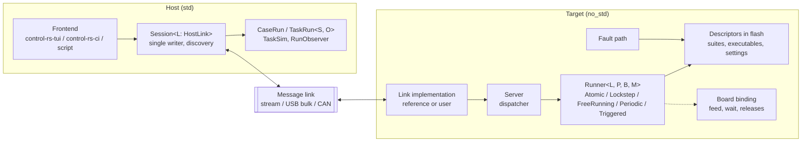
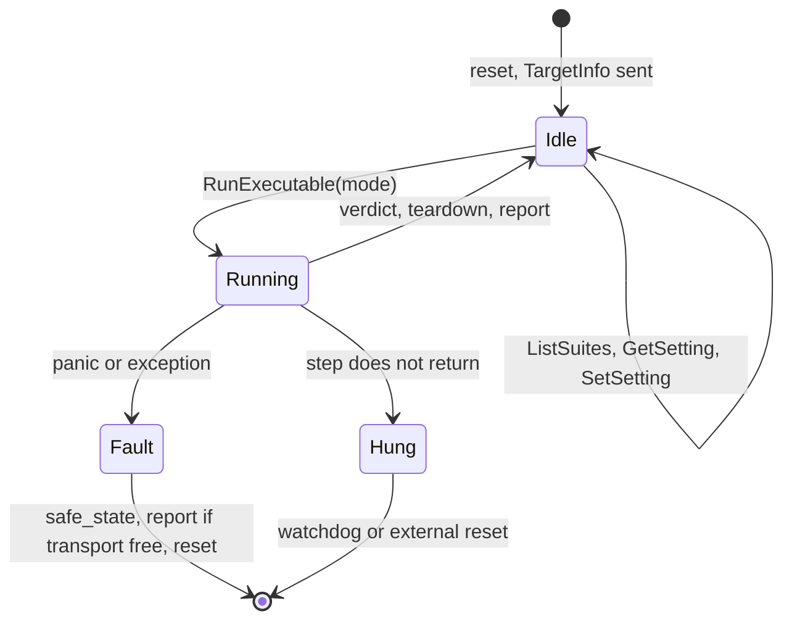

# Embedded Test Server (Design Document)


---

### 1. Introduction

While host-based unit tests execute quickly, they cannot capture physical timing constraints, register configurations or real-time hardware behavior. The Embedded Test Server (ETS) bridges this gap by operating directly on the target microcontroller (MCU) as a persistent execution substrate. Rather than running a static test binary that requires restarting the board between runs, the server stays resident on the device, servicing host commands, profiling kernels and running continuous lifecycle tasks. This document owns the ETS requirements, layers and component map. The target execution model is specified in `ets-executive-design.md`, which this document defers to for the server, runner, modes, settings, fault path and board binding; transport and framing are specified in `ets-link-design.md`.

Verification spans a multi-tier hierarchy:

- **Layer 0 (Host Algorithmic Math)**: Pure unit tests on host (`cargo test`) for matrix math, transfer functions and solvers.
- **Layer 0/1 (Target Kernel Benchmarking)**: Atomic cases executed on the MCU with interrupts masked to measure cycle budgets and stack watermarks.
- **Layer 1 (Real-Time In-the-Loop HIL and SysId)**: Target control kernels executing lifecycle tasks against a host plant simulation or frequency-response stimulus generator.
- **Layer 1/2 (Firmware Integration HIL)**: Complete target application firmware running with an internal ETS server between the hardware abstraction layer (HAL) and the control tasks.
- **Layer 1/2+ (Unmodified Firmware HIL)**: The device under test (DUT) runs production firmware with no on-target server and connects through its physical peripherals to a hardware test harness. The harness firmware implements `LifecycleTask`: its step writes stimulus to the DUT peripheral inputs and samples the DUT outputs. Harness design is outside this document.

Primary usage scenarios:

- **Atomic verification and profiling (Layer 0/1)**: A developer triggers a control kernel or math routine on target; failure is an assertion crash, a stack overflow or a cycle count above the timing budget.
- **Closed-loop HIL simulation (Layer 1)**: A developer runs a target controller against a host plant simulation over the link; failure is a mispaired step, a lost packet, a link loss or numerical divergence.
- **Online setting tuning (Layer 1 and 1/2)**: A developer inspects and changes gains or filter settings while idle or between steps; failure is an interrupted run, a value outside its bounds or an inconsistent setting.
- **Fault containment and recovery (all layers)**: Target firmware panics, faults, blocks or loses its host link; failure is an actuator left energized, a fault left unreported or a target that never recovers.
- **Unmodified DUT peripheral HIL (Layer 1/2+)**: An unmodified controller is validated against a host plant model through an external harness; failure is signal timing divergence, a peripheral lockup or a controller that does not stabilize the simulated dynamics.

---

### 2. Requirements

#### 2.1 Functional Requirements

- **FR-1 — Interactive Server Execution**: The target server runs persistently as an idle loop, listening for host commands and executing cases and tasks on command.
- **FR-2 — Distributed Test Discovery**: The system collects and registers test cases across modules through linker metadata without a centralized runtime registry.
- **FR-3 — Telemetry Stream**: The target transmits execution status, assertions, performance metrics and logs to the host over the active transport.
- **FR-4 — Crash Recovery**: On a panic or hardware exception the target drives the active task to its safe state and reports the fault when the transport is free; otherwise the host detects the unreported fault before recovery.
- **FR-5 — Lockup Recovery**: If a test stops responding, the target services a cooperative reset request from the host; if it is blocked and cannot, a board watchdog started in `#[ets_setup]` and fed through the board binding, or a host-triggered external reset, recovers it.
- **FR-6 — Lifecycle Task Execution**: The target supports continuous execution of `LifecycleTask` implementations with setup, reset, teardown and a fault-path safe state, at line rate, synchronized to input arrival, on a fixed period or released by a board event.
- **FR-7 — Online Setting Reflection**: The target exposes named primitive settings, discoverable with type, value and bounds, readable by name or index and writable by name while idle and between steps of an active task.
- **FR-8 — Multi-Layer Fixture Compatibility**: The execution interface decouples data exchange from transport mechanics, allowing execution against an internal firmware server over USB, UART or Ethernet (Layers 1 and 1/2).
- **FR-9 — Concurrent Out-of-Band Monitoring**: The ETS transport and host architecture support running an independent target monitor (for example, bootloader logs, panic traces, or hardware UART monitor) in a separate terminal concurrently with the interactive TUI or headless runner, either over separate physical/virtual interfaces (such as dual USB/UART on ESP32-C6) or via detached host log streams, without communication interference or port contention.

#### 2.2 Non-Functional Requirements

- **NFR-1 — Real-Time Determinism**: Telemetry and control operations keep microsecond-level timing budgets so they do not induce jitter in the test under execution.
- **NFR-2 — Timing-Critical Logging**: The logging system formats without blocking the CPU or performing expensive on-target string formatting during tests.
- **NFR-3 — Task Step Overhead**: In lifecycle task execution, round-trip processing and dispatch overhead on the target does not exceed $2.1\ \text{ms}$ per step on USB Full-Speed (12 Mbps) or serial links ($\le 2\times$ the USB 1 ms frame period); on High-Speed USB 2.0 (480 Mbps) links, dispatch overhead is $\le 250\ \mu\text{s}$ per step; on CAN / CAN-FD links, transport framing conforms to bus bitrates (for example, 500 kbps to 5 Mbps).

#### 2.3 Constraints

- **C-1 — Zero Dynamic Allocation**: The target server compiles under `#![no_std]` with zero dynamic heap allocation.
- **C-2 — Memory and Flash Efficiency**: The target server, excluding tests, consumes under 32 KB Flash and 8 KB RAM, with descriptors residing in ROM.
- **C-3 — Unsupported Small Targets**: Targets below the C-2 budget, including 8-bit parts, are not verified; fitting the ETS to them is the user's responsibility (`ets-executive-design.md` C-8).
- **C-4 — Transport-Owned Bandwidth**: Conforms to `ets-executive-design.md` C-7; the link (`ets-link-design.md`) owns link bandwidth, framing and any receive queue.
- **C-5 — CI Runs Cases Only**: `control-rs-ci` runs atomic cases and no lifecycle tasks; QEMU task capability stays available to other frontends.

---

### 3. Technical Overview

The ETS splits into data and behavior on both sides of one message link. On the target, suite modules compile into descriptors in flash; a `Server` dispatches host commands to a `Runner` parameterized by an execution mode, and a fault path settles any active run (`ets-executive-design.md`). On the host, one `Session` owns the link, runs one case or task at a time and lends the link to a run object (`ets-host-design.md`). Frontends sit above the session: `control-rs-tui` for interactive use and `control-rs-ci` for headless gates. The command and telemetry schema, version check and transport links are in `ets-link-design.md`; registration is in `test-suite-design.md` and `macros-design.md`; profiling is in `cpu-profiler-design.md`.



The ETS lives in `control-rs-ets` (target), `control-rs-ets-host` (host), `control-rs-tui`, `control-rs-ci` and `control-rs-macros`.

---

### 4. Architecture

#### 4.1 Workspace Structure

The workspace is a nested Cargo workspace split by target environment:

```
control-rs (root workspace)
├── control-rs-ets/       # Target server, runner, settings, board binding, links and fault path (no_std)
├── control-rs-ets-host/  # Host session, link, run objects and headless runner (publish = false)
├── control-rs-tui/       # Interactive terminal console binary (publish = false)
├── control-rs-ci/        # Repository quality-gate runner binary (publish = false)
├── control-rs-macros/    # #[ets_suite], #[ets_setup] and derive macros
├── examples/             # Target binaries (qemu, teensy4, esp32c6, uno_r4, xiao_nrf52840)
└── src/                  # Host-side library algorithms
```

#### 4.2 Object Ownership

Each object has one owning document; other documents link to it.

| Object | Owner |
|:-------|:------|
| `Server`, `Context`, `Runner`, `Mode`, descriptors, settings, fault path, board binding | `ets-executive-design.md` |
| `Command`, `Telemetry`, payload encoding, version check, `Link`, `ByteStream`, reference links | `ets-link-design.md` |
| `#[ets_suite]` expansion, linker sections, `LifecycleTask` registration | `test-suite-design.md`, `macros-design.md` |
| Cycle, time and stack measurement (`CPUProfiler`) | `cpu-profiler-design.md` |
| `Session`, `HostLink`, `CaseRun`, `TaskRun`, `TaskSim`, `RunObserver` | `ets-host-design.md` |
| Frontend views | `tui-design.md` |

Layers are defined here once; other documents link to this section.

#### 4.3 Target-Side Flow

The server is idle between commands and holds no execution logic. A case is a one-step `Atomic` executable: interrupts are masked, cycles and stack are measured and the run returns to idle. A lifecycle task runs `Lockstep`, `FreeRunning`, `Periodic` or `Triggered` with interrupts live, regains control at each step boundary and ends with one verdict. A fault from any state is settled from the run phase alone.



#### 4.4 Component Modularity and Custom Tooling Substitution

The ETS architecture enforces strict component modularity, allowing any subsystem to be used in isolation or substituted with custom user tooling without breaking the server or runner:

1. **Custom Transports (`Link` & `ByteStream`)**:
   The `Link` trait (`ets-link-design.md`) encapsulates all packetizing, framing, and transport buffering. A user with a custom telemetry radio, shared-memory buffer, multi-drop RS-485 bus, or proprietary CAN stack implements `Link` directly without modifying `Server`, `Runner`, or the test discovery macro.
2. **Custom Profiling (`CPUProfiler`)**:
   Silicon timing and stack watermarking hook into the `CPUProfiler` trait (`cpu-profiler-design.md`). Targets lacking DWT/CSRs or utilizing proprietary hardware trace buffers (for example, ETM, CoreSight, external logic analyzer GPIO toggles) substitute a custom profiler or use the zeroed `HostCPUProfiler`.
3. **Custom Board Bindings (`BoardBinding`)**:
   Watchdog servicing, low-power sleep hooks (`wfi`), and hardware release events (for example, ADC completion or timer ISRs) interface via `BoardBinding` (`ets-executive-design.md`). A user can substitute a proprietary hardware watchdog or event scheduler while retaining the standard ETS executive.
4. **Standalone Task Execution ("Franken-Prototypes")**:
   `LifecycleTask` implementations are pure `#![no_std]` algorithms decoupled from `Server`. A user can extract and execute an ETS lifecycle task directly inside an external RTOS thread (for example, FreeRTOS, Zephyr, RTIC) or a bare-metal custom cyclic loop without linking `Server` or `control-rs-ets-host`.

#### 4.5 Board Example Layout (Multi-Bin Verification Strategy)

To verify ETS as a complete, bomb-proof product across the hardware fleet, each board in `examples/` is organized with three distinct binary tiers:

- **Base Test Suite Bin (`src/bin/suite.rs` or `main.rs`)**:
  Exercises on-target mathematical verification: matrix multiplication, transfer functions, Kalman state estimation, and numerical stability kernels across compiler targets.
- **Hardware Lifecycle Bin (`src/bin/lifecycle.rs`)**:
  Demonstrates continuous `LifecycleTask` execution integrated with real target peripherals: high-rate streaming over native USB/UART/CAN, hardware timer pacing, and step-synchronized HIL simulation.
- **Franken Prototype Bin (`src/bin/franken_*.rs`)**:
  Validates component substitutability by deliberately replacing standard ETS pieces with custom tooling (for example, custom ring-buffer link, standalone RTOS task wrapper, or external event-driven step releases).

---

### 5. Alternatives

| Alternative | Rejected Because | Reference |
|:------------|:-----------------|:----------|
| Disjoint HIL and ETS frameworks | Duplicates board bring-up, clocks and drivers across two firmware images | ADR-0002 |
| Channelized framing (control plane and raw data plane) | A payload-level encoding flag declared at discovery gives the same raw option without a second framing layer or a framing break | ADR-0002 |
| Framing inside the server | Duplicates transport delimiting and integrity on USB bulk and CAN | `ets-link-design.md` |
| Lifecycle branches inside the server | Couples every execution model to the dispatcher; violates FR-1 | `ets-executive-design.md` |
| Coupling visualization into the simulation loop | Terminal redraws take tens of milliseconds and delay lockstep plant integration | ADR-0002 |
| `dyn Trait` in linker sections | Fat pointers and associated types are not dyn-compatible; violates C-1 | (linkme, 2026) |
| Hosted integration into an RTOS scheduler | Production firmware owns preemption; out of scope | (rtic, 2026) |
| Retained-RAM fault record in the server | Board-specific; the host detects unreported faults from session state | (panic-persist, 2026) |

---

### 6. Verification & Validation

#### 6.1 Verification

Each requirement is discharged by conditions that share targets with the owning design documents.

| Condition | Requirement | Method | Target | Criterion |
|:----------|:------------|:-------|:-------|:----------|
| VC-1.1 | FR-1 | `libtest` | `control_rs_ets::server::tests::case_and_task_share_run_command` | A case and a task start through the same command and the server returns to idle after each; FR-1 holds iff all conditions hold |
| VC-2.1 | FR-2 | `libtest` | `control_rs_ets::server::tests::discovery_lists_all_suites` | Discovery returns exactly the set of annotated suites, cases and tasks |
| VC-3.1 | FR-3 | `libtest` | `control_rs_ets::server::tests::telemetry_reaches_host` | Status, metrics and log messages reach the host in order |
| VC-4.1 | FR-4 | `libtest` | `control_rs_ets::fault::tests::phase_transition_calls_safe_state_once` | `safe_state` runs once from `Armed` and never from other phases; FR-4 holds iff all conditions hold |
| VC-4.2 | FR-4 | `libtest` | `control_rs_ets_host::session::tests::silent_reset_during_run_is_unreported_fault` | A silent or rebooted target during a run is recorded as an unreported fault |
| VC-5.1 | FR-5 | `libtest` | `control_rs_ets::board::tests::feed_at_idle_boundary_and_wait_only` | The feed hook runs at idle, at each boundary and around each wait and never during a step; FR-5 holds iff all conditions hold |
| VC-5.2 | FR-5 | `libtest` | `control_rs_ets_host::session::tests::blocked_step_resets_externally_and_reports_unresponsive` | A run that ignores `StopNow` is reset through the link after `stop_timeout` |
| VC-6.1 | FR-6 | `libtest` | `control_rs_macros::tests::missing_lifecycle_fn_fails_to_compile` | Omitting any of the five lifecycle functions is a compile error |
| VC-7.1 | FR-7 | `libtest` | `control_rs_ets::settings::tests::scalar_bounds_and_echo` | In-bounds writes store, out-of-bounds writes fail and both echo the stored value; FR-7 holds iff all conditions hold |
| VC-7.2 | FR-7 | `libtest` | `control_rs_ets_host::settings::tests::count_and_index_detect_missing_entry` | The host renders and encodes a reported setting from its type without the Rust type |
| VC-8.1 | FR-8 | `libtest` | `control_rs_ets_host::link::tests::fake_link_runs_session` | A session runs the same case and task against a fake link and a QEMU link |
| VC-9.1 | NFR-1 | `analysis` | — | DWT-measured boundary cost on Teensy 4.1 stays within the NFR-1 budget |
| VC-10.1 | NFR-2 | `inspection` | — | No on-target string formatting appears on the telemetry hot path |
| VC-11.1 | NFR-3 | `analysis` | — | DWT-measured round-trip dispatch overhead on Teensy 4.1 is at most $2.1\ \text{ms}$ per step |
| VC-12.1 | C-1 | `inspection` | — | The target crate builds `no_std` with no allocator symbols in the firmware disassembly |
| VC-13.1 | C-2 | `inspection` | — | The measured server footprint stays under 32 KB Flash and 8 KB RAM |
| VC-14.1 | C-3 | `review` | — | The documentation states that targets below C-2 are the user's responsibility |
| VC-15.1 | C-4 | `inspection` | — | No framing, receive interrupt, queue or link rate limiter exists in the server code |
| VC-16.1 | C-5 | `libtest` | `control_rs_ets_host::session::tests::run_cases_excludes_tasks` | Run all never starts a task |

Coverage: 90% line coverage of `control-rs-ets` `server`, `run`, `settings` and `fault`, measured with `cargo coverage`. Excluded: architecture-specific fault entry and interrupt masking.

#### 6.2 Acceptance

| Claim | Oracle | Measure | Bound |
|:------|:-------|:--------|:------|
| Discovery completeness | Source annotations | Suites, cases and tasks discovered | Exact set equality |
| Persistent execution | Mixed case and task suite | Target restarts during a suite run | 0, absent an injected fault |
| Task step overhead | 1 kHz lockstep simulation on Teensy 4.1 | Target processing overhead per step | At most $2.1\ \text{ms}$ (NFR-3) |
| Setting reflection | Setting write between steps | Steps until the new value is used | 1 |
| Fault containment | Injected panic during a task run | `safe_state` executions before reset | Exactly 1 |
| Allocation freedom | Firmware disassembly | Allocator symbols | 0 |

#### 6.3 Limits

QEMU timing is indicative; hardware timing is verified across the target fleet (Cortex-M7 Teensy 4.1, RISC-V ESP32-C6 DevKitC-1, Cortex-M4F Seeed XIAO nRF52840, and Cortex-M4 Arduino Uno R4 Minima). Emulator runs verify computation, not runtime behavior. Watchdog behavior is verified against a fake and on hardware only. Layer 1/2+ harness design is not verified here.

---

### 7. Performance & Resource Considerations

The server stays under 32 KB Flash and 8 KB RAM (C-2) with descriptors and setting metadata in ROM. Task step overhead is one command poll, two clock reads and one encode per step (`ets-executive-design.md`). Link implementations use DMA buffers to avoid CPU starvation at high link rates. Stack watermarking paints the stack and scans it after a case (Pendleton, 2023); the technique is weakly corroborated and is verified against `cargo-call-stack` bounds. Link bandwidth, framing and any receive queue belong to the link (C-4).

---

### 8. Risks & Open Questions

- **Small targets (C-3)**: Footprint on Cortex-M0 class and 8-bit parts is unmeasured; atomics and cycle counters differ there (`ets-executive-design.md` §8).
- **Blocking user code (FR-5)**: Recovery needs a fed board watchdog or a host-side external reset (`ets-executive-design.md` §4.6).
- **Layer 1/2+ harness**: Harness firmware and fixture design are deferred.
- **Link rate (NFR-3)**: Task step overhead scales with transport bandwidth: $\le 250\ \mu\text{s}$ for High-Speed USB (Teensy 4.0/4.1), $\le 2.1\ \text{ms}$ for Full-Speed USB (XIAO nRF52840, ESP32-C6 USB-JTAG), and transport-bounded rates for UART and CAN (Uno R4, ESP32-C6 TWAI).

---

### 9. Development Plan

| Phase | Delivers | Requirements | Effort | Status |
|:------|:---------|:-------------|:-------|:-------|
| 1. Target refactor | `Context`, `Server` dispatcher and `Runner` with `Atomic`, existing cases migrated | FR-1, FR-2, C-1 | 4 days | Planned |
| 2. Settings and lifecycle | Settings, `LifecycleTask`, `Lockstep`, `FreeRunning` (`Periodic` and `Triggered` in phase 3), wire revision 2, macros | FR-6, FR-7, FR-3 | 7 days | Planned |
| 3. Fault, recovery and board integration | Fault path, host unreported-fault detection, board binding, `Periodic` and `Triggered` | FR-4, FR-5, NFR-1 | 5 days | Planned |
| 4. Links, host and frontends | Reference links (`ets-link-design.md`), `Session`, `CaseRun`, `TaskRun`, TUI and CI on `Session`, examples and hardware timing | FR-8, NFR-3, C-2 | 8 days | Planned |

---

### 10. Revision History

| Revision | Date               | Author          | Description |
|:---------|:-------------------|:----------------|:------------|
| 1.0      | May 23, 2026       | @MitchellDScott | Initial specification for the embedded hardware-in-the-loop test harness.                                                                                                                                                                                                                               |
| 1.1      | July 18, 2026      | @MitchellDScott | Architecture & framing: integrated linker-section test discovery, watchdog multiplexing, and binary telemetry framing.                                                                                                                                                                                  |
| 1.2      | August 6, 2026     | @MitchellDScott | Wire protocol: adopted sync-byte/CRC-16 framing with `postcard`-encoded payloads and zero-copy dispatch.                                                                                                                                                                                                |
| 1.3      | August 25, 2026    | @MitchellDScott | Module renaming: retitled Embedded Test Server (ETS) and renamed crate `control-rs-hil` → `control-rs-ets`.                                                                                                                                                                                             |
| 1.4      | September 9, 2026  | @MitchellDScott | Packaging split: restructured host architecture into `control-rs-ets-host`, `control-rs-tui`, and private `control-rs-xtask`.                                                                                                                                                                           |
| 1.5      | September 9, 2026  | @MitchellDScott | Project split: relocated to `documentation/ets/`; host frontends retargeted to `control-rs-ci` and `control-rs-tui`.                                                                                                                                                                                    |
| 1.6      | September 9, 2026  | @MitchellDScott | Citation pass: converted numeric cites to author-year, standard IEEE reference list.                                                                                                                                                                                                                    |
| 1.7      | September 9, 2026  | @MitchellDScott | Hardening pass: demoted status badge to Draft, rebuilt traceability table.                                                                                                                                                                                                                              |
| 1.8      | September 15, 2026 | @MitchellDScott | Locator-only §6.4; FR-5 is cooperative reset; NFR-1 and C-2 listed in 6.7 until measured.                                                                                                                                                                                                               |
| 1.9      | September 24, 2026 | @MitchellDScott | Shipped `PROTOCOL_VERSION` = 1 and `TargetInfo`; tooling crates `publish = false`.                                                                                                                                                                                                                      |
| 2.0      | October 11, 2026   | @MitchellDScott | Architectural overhaul (ADR-0002): unified ETS and HIL/SysId substrate across Layer 0 to 1/2+; added FR-6 (lifecycle tasks), FR-7 (parameter reflection), FR-8 (multi-layer fixture compatibility), NFR-3 (low latency streaming), dual execution engines, and decoupled host simulation/visualization. |
| 3.0 | October 12, 2026 | @MitchellDScott | Replaced the channelized architecture with the single-job executive (`ets-executive-design.md`): FR-4 to FR-7 reworded, NFR-3 reworded, C-3 and C-4 added, section 4 reduced to ownership and flow, verification conditions restored. |
| 3.1 | October 12, 2026 | @MitchellDScott | Aligned to `ets-executive-design.md` rev 1.4 and `ets-link-design.md`: FR-5, FR-6 and C-4 reworded; board binding, `Triggered` and message links in the overview and ownership table. |
| 3.2 | October 12, 2026 | @MitchellDScott | Phase 2 notes that `Periodic` and `Triggered` follow in phase 3. |
| 3.3 | October 12, 2026 | @MitchellDScott | FR-7 reworded for named primitive settings; cites aligned to the research bibliography. |
| 3.4 | October 12, 2026 | @MitchellDScott | State diagram includes `GetSetting`. |
| 3.5 | October 12, 2026 | @MitchellDScott | Host sessions are generic over `HostLink`. |
| 3.6 | October 13, 2026 | Claude Sonnet 5.5 | Header migrated to the Approval and Doc Status badge grammar; Approval set to Stale pending re-review. Affects C-1, C-2, C-3, C-4, C-5, FR-1, FR-2, FR-3, FR-4, FR-5, FR-6, FR-7, FR-8, FR-9, NFR-1, NFR-2, NFR-3. |

---

## References

[1] D. Tolnay, "linkme," *dtolnay/linkme*. [Online]. Available: https://docs.rs/linkme/latest/linkme/struct.DistributedSlice.html. Accessed: Aug. 7, 2026.

[2] RTIC project, "Real-Time Interrupt-driven Concurrency (RTIC)," *rtic-rs/rtic*. [Online]. Available: https://github.com/rtic-rs/rtic. Accessed: Aug. 7, 2026.

[3] J. Munns, *panic-persist* (Version 0.3.0). [Online]. Available: https://docs.rs/panic-persist/latest/panic_persist/. Accessed: Aug. 7, 2026.

[4] N. Pendleton, "Measuring Stack Usage the Hard Way," *Interrupt (Memfault blog)*. [Online]. Available: https://interrupt.memfault.com/blog/measuring-stack-usage. Accessed: Aug. 7, 2026.
