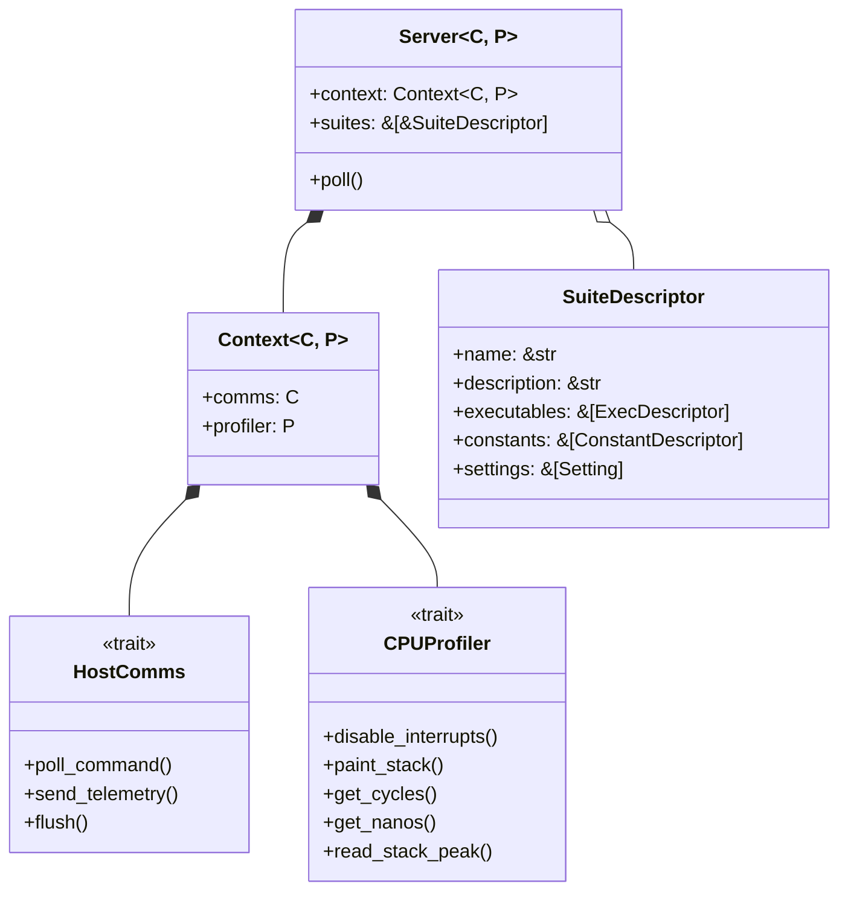

# Embedded Test Server (embedded-test-server)


---

### 1. Introduction

Host-based unit tests can provide thorough coverage line-by-line and
conceptually. However, they cannot capture physical processor constraints,
peripheral faults or real-time hardware behaviors. For basic numerical routines
that do not interface with hardware, an emulator can provide runtime assurances
by imitating the target processor. Verifying control algorithms and firmware
that interact with sensors and actuators requires executing directly on the
target processor.

Modern test harnesses [1] support distributed testing and HIL integration
pipelines [4], [5]. However, they either: do not provide CPU profiling [3]
or require using an RTOS.

This document is the lead architectural design document for the Embedded Test
Server (ETS) subsystem (`control-rs-ets`). The target outcome is to enable the
usage and scenarios described in [ConOps](ConOps.md).

---

### 2. Requirements

#### 2.1 Functional Requirements

- **FR-1 - Self-contained target discovery**: The target must report all
  compiled suites, test cases, compile-time constants, adjustable parameters
  and their source documentation over the communication link on request. The
  host must not require access to source files, debug symbols or the compiled
  ELF binary to discover or interpret tests and parameters.
- **FR-2 - On-demand selective execution**: The target must remain idle between
  commands and execute only the specific test or benchmark case requested by the
  host. Unrequested cases must never be executed automatically.
- **FR-3 - Verdict and fault attribution**: Every executed case must produce a
  pass or fail verdict attributed to that case over the host link. If a running
  case panics or triggers a hardware fault, the target must capture and transmit
  the fault location and diagnostic message attributed to that case before
  resetting or halting.
- **FR-4 - No central test suite registration**: Firmware binaries must
  automatically include all suites (user modules and opt-in `control-rs` library
  suites) without maintaining a central registration list in the application
  entrypoint.
- **FR-5 - Emulated target execution**: Target test firmware must execute under
  instruction-set emulation (QEMU) using a host byte-stream link with the same
  protocol and discovery behavior as physical silicon.
- **FR-6 - Remote lifecycle control**: The target must service host requests to
  perform a warm system reset on hardware with an exit code in virtualized
  environments.
- **FR-7 - Execution cycle and duration measurement**: When profiling is
  requested, the target must measure and report elapsed CPU clock cycles and
  monotonic wall-clock duration for the executed case. On architectures lacking
  a hardware cycle counter, the target must report clock absence rather than
  failing compilation or execution.
- **FR-8 - Peak stack consumption measurement**: When profiling is requested,
  the target must measure and report the maximum stack memory consumed during
  case execution without corrupting active stack frames.
- **FR-9 - Interrupt-isolated measurement**: Profiled case execution must mask
  preempting interrupts across the measured region so asynchronous interrupt
  service routines do not perturb cycle counts, elapsed time, or stack
  high-water marks.
- **FR-10 - Target hardware identity reporting**: The target must report its
  board identity, core clock frequency and hardware capability flags over the
  link so the host can interpret timing measurements and platform capabilities
  without out-of-band assumptions.
- **FR-11 - Closed-loop HIL I/O**: In closed-loop operation, the target must
  receive plant state vectors or electrical stimuli, execute the discrete
  controller step and return actuator commands and step telemetry within the
  configured control period.
- **FR-12 - Fail-safe communication-loss interlock**: During closed-loop
  operation, if no valid host command or heartbeat arrives within 500 ms, the
  target must immediately transition actuator outputs to a safe zero-energy
  state.
- **FR-13 - Resilient framed telemetry streaming**: The target must stream
  timestamped, labeled records over a framed byte link that detects byte
  corruption and resynchronizes on the next frame boundary without dropping
  the session.
- **FR-14 - Test Logging**: Tests cases must have a mechanism to stream logs
  from inside the tests back to the host.
- **FR-15 - Live type-checked parameter tuning**: The target must apply
  host-supplied parameter updates at runtime without halting execution, blocking
  the active reader or reflashing firmware.
- **FR-16 - Target build isolation from host dependencies**: The host-side
  tooling requires the `std` library, it must not 'leak' into the target builds.
- **FR-17 - Built-in diagnostic suite**: Every target firmware binary must
  expose a built-in diagnostic suite at reserved index `suite_id = 0` containing
  a no-op tare case to calibrate server dispatch and profiling overhead through
  the standard suite discovery and execution protocol. Without a built-in
  diagnostic suite, hosts cannot isolate test payload timing from server and
  profiler overhead unless user modules manually register calibration cases.

#### 2.2 Non-Functional Requirements

- **NFR-1 - Bounded control-loop telemetry jitter**: $\le 2\ \text{ms}$
  timing jitter in a 1 kHz control loop.
- **NFR-2 - Zero static RAM for immutable suite metadata**: Compiled suite,
  case and constant metadata must reside in read-only non-volatile memory
  (`Flash`), consuming zero bytes of static RAM at idle.

#### 2.3 Constraints

- **C-1 - Bare-metal `#![no_std]` and no heap allocation**: Target firmware
  crates must compile for ARM Cortex-M (`ARMv6-M`, `ARMv7-M`, `ARMv8-M`) and
  RISC-V (`RV32`, `RV64`) targets.
- **C-2 - On-Chip Memory Ceiling**: Target microcontrollers provide fixed
  on-chip memory budgets, bounding the target runtime (excluding user test
  payloads) to at most 32KB Flash and 8KB static RAM.

---

### 3. Technical Overview


**Figure 3.1**: Compile-time suite registration into read-only memory and
runtime command, measurement, and parameter flow on the target.



**Figure 3.2**: Ownership and interface boundaries between the server runtime,
hardware abstractions and registered test suites.

---

### 4. Architecture

#### 4.1. Workspace Structure & Cross-Compilation

Serves: FR-5, C-1, C-2

To prevent compilation friction and maintain clean dependency hygiene,
`control-rs` implements a dual-targeted Cargo workspace structure:

```
control-rs (Root Workspace)
├── control-rs-ets/       # Target-side server runtime, comms, and profiling (no_std)
├── control-rs-ets-host/  # Host transport, framing, and headless runner library
├── control-rs-macros/    # Procedural macros for test suite setup and registry generation
├── examples/             # Target binary examples (qemu/teensy4) executing on-device
└── src/                  # Standard host-side library algorithms and modules
```

#### 4.2. Subsystem Component Architecture & Interconnection

Serves: FR-1, FR-2, FR-3, FR-4, FR-6, FR-7, FR-8, FR-9, FR-10, FR-13, FR-15,
FR-17, NFR-2, C-1

The ETS subsystem coordinates five focused components, each governed by its own
dedicated component design document:

1. **`server-runtime`** ([server-runtime-design.md](server-runtime-design.md)):
   Owns `Server`, `Context`, `CURRENT_SUITE`, `CURRENT_TEST`, the main command
   polling loop, reserved diagnostic suite 0 indexing, test dispatch bounds,
   lifecycle state transitions, forensic panic formatting and dynamic setting
   mutation.
2. **`host-comm`** ([host-comm-design.md](host-comm-design.md)):
   Owns `HostComms`, wire packet framing (`0xAA 0x55` sync bytes + length
   prefix + CRC-16-IBM-SDLC trailer), non-blocking frame decoding and telemetry
   serialization.
3. **`cpu-profiler`** ([cpu-profiler-design.md](cpu-profiler-design.md)):
   Owns `CPUProfiler`, physical CPU cycle counters (ARM DWT / RISC-V `mcycle`),
   SysTick monotonic nanosecond timers, stack sentinel watermarking
   (`0xCDCD_CDCD`) and scoped critical section interrupt masking
   (`disable_interrupts`).
4. **`test-suite`** ([test-suite-design.md](test-suite-design.md)):
   Owns `SuiteDescriptor`, `ExecDescriptor`, `ConstantDescriptor`,
   `.ets_test_suites` linker boundary slice reconstruction, and lock-free
   triple-buffer parameter wrappers.
5. **`macros`** ([macros-design.md](macros-design.md)):
   Owns `#[ets_test]` and `#[ets_suite]`, generating static descriptors and
   linker placement attributes without manual registration tables.

#### 4.3. ConOps Operational Mode Allocation

Serves: FR-1, FR-2, FR-3, FR-5, FR-6, FR-7, FR-8, FR-9, FR-11, FR-12, FR-13,
FR-14, FR-15

The subsystem maps the six operational use cases from [ConOps.md](ConOps.md)
across its constituent components:

| ConOps Mode                   | Target Stack                      | Host Stack       | Operational Flow                                                                                                    |
|:------------------------------|:----------------------------------|:-----------------|:--------------------------------------------------------------------------------------------------------------------|
| **§3.1 Unit Test**            | `server-runtime` + `test-suite`   | `control-rs-ci`  | Host selects test index; server dispatches case and returns `Pass`/`Fail` verdict.                                  |
| **§3.2 Virtual Chip**         | `server-runtime` (QEMU target)    | `control-rs-ci`  | Headless automated runner boots QEMU, runs suites, and exits cleanly via exit trap.                                 |
| **§3.3 Silicon Benchmarking** | `server-runtime` + `cpu-profiler` | `control-rs-tui` | Server measures elapsed CPU clock cycles, microsecond duration, and peak stack RAM under IRQ masking.               |
| **§3.4 Closed-Loop HIL**      | `server-runtime` + `host-comm`    | `ETSBridge`      | Host streams simulated plant state; target computes control loop and streams drive telemetry within bounded period. |
| **§3.5 Data Acquisition**     | `host-comm` + peripheral drivers  | `ETSBridge`      | MCU samples physical sensors and streams high-rate telemetry records to host without frame loss.                    |
| **§3.6 Hand-Tuning**          | `server-runtime` + `test-suite`   | `control-rs-tui` | Operator adjusts parameter in TUI; server validates limits and applies mutation live without pausing loop.          |

#### 4.4. Component Interface Contracts

Serves: FR-1, FR-2, FR-3, FR-7, FR-8, FR-9, FR-13, FR-15, C-1

To preserve modularity, the components interface strictly through public traits
and static descriptors:

```rust
// Server generic over Comms and Profiler traits
pub struct Server<'a, C: HostComms, P: CPUProfiler> {
    pub context: Context<C, P>,
    pub suites: &'a [&'static SuiteDescriptor],
}
```

* `HostComms` decouples the server from UART, RTT or simulated socket hardware.
* `CPUProfiler` decouples the server from Cortex-M, RISC-V, or mock host timer
  registers.
* `SuiteDescriptor` decouples the server from how suites are included in
  binaries.

#### 4.5. Safety, Fail-Safe & Resource Allocation

Serves: FR-12, NFR-1, NFR-2, C-3

* **Memory Budgeting**: The complete target runtime allocates $\le 32\text{ KB}$
  Flash and $\le 8\text{ KB}$ RAM. Descriptors and test function pointers reside
  in Flash ROM.
* **Fail-Safe Interlock**: During active Hardware-in-the-Loop execution (ConOps
  §3.4), the controller loop monitors host communication heartbeats. If no
  command or state vector is received within 500 ms, actuator outputs transition
  immediately to the safe zero-energy state (`FR-12`).

---

### 5. Alternatives Considered

#### 5.1. Debug-Probe-Driven Execution (`probe-rs` + `embedded-test`)

* Instead of UART/RTT communication, host uses debug probes and ARM semihosting.
* *Rejected*: Semihosting halts the CPU pipeline during I/O operations,
  introducing millisecond-level timing overhead and destroying real-time
  determinism.

#### 5.2. Soft Reset (`SCB::sys_reset`) vs. Watchdog Starvation

* Using the CPU System Control Block to reboot.
* *Status*: Shipped as the MVP reset in `cpu-profiler` and `server-runtime`.
  Watchdog starvation provides cleaner external peripheral re-initialization and
  is deferred for future hardware integration.

#### 5.3. Third-Party Distributed Slice (`linkme`)

* Using `linkme::DistributedSlice` instead of hand-rolled `.ets_test_suites`.
* *Rejected*: The hand-rolled linker slice is already implemented and verified;
  `linkme` adds external dependencies without removing linker script placement
  requirements.

#### 5.4. COBS Byte-Stuffed Framing

* Delimiting frames with Consistent Overhead Byte Stuffing.
* *Rejected*: `host-comm` selected a sync-byte (`0xAA 0x55`) + length prefix +
  CRC-16 trailer to minimize target-side framing overhead.

---

### 6. Verification & Validation

#### 6.1 Verification

| Condition | Requirement | Method    | Target                                                                                                                           | Criterion                                                                                                                                                   |
|:----------|:------------|:----------|:---------------------------------------------------------------------------------------------------------------------------------|:------------------------------------------------------------------------------------------------------------------------------------------------------------|
| VC-1.1    | FR-1        | `link`    | `test-suite#FR-1`, `test-suite#FR-2`, `test-suite#FR-3`, `macros#FR-1`, `macros#FR-2`, `server-runtime#FR-2`, `host-comm#FR-2`   | Component suite, case, constant, macro, server discovery, and framing requirements hold; FR-1 holds iff all conditions hold                                 |
| VC-1.2    | FR-1        | `libtest` | `control_rs_ets::server::tests::test_server_discovery`                                                                           | Server discovery streams all registered suites, cases, settings, and docstrings over the transport without reading ELF symbols                              |
| VC-2.1    | FR-2        | `link`    | `test-suite#FR-2`, `server-runtime#FR-1`, `server-runtime#FR-2`, `host-comm#FR-2`                                                | Component case descriptor, command loop, dispatch, and framing requirements hold; FR-2 holds iff all conditions hold                                        |
| VC-2.2    | FR-2        | `libtest` | `control_rs_ets::server::tests::test_server_run_test`                                                                            | Server remains idle until commanded and dispatches only the requested suite and case index                                                                  |
| VC-3.1    | FR-3        | `link`    | `server-runtime#FR-3`, `server-runtime#FR-6`, `host-comm#FR-6`                                                                   | Component lifecycle tracking, failure handler, and panic wire schema requirements hold; FR-3 holds iff all conditions hold                                  |
| VC-3.2    | FR-3        | `libtest` | `control_rs_ets::util::tests::test_handle_failure_comms_active`                                                                  | Active test failure captures source location and diagnostic payload attributed to the running suite and case before reset                                   |
| VC-4.1    | FR-4        | `link`    | `test-suite#FR-5`, `macros#FR-1`                                                                                                 | Component decentralized inclusion and suite macro requirements hold; FR-4 holds iff all conditions hold                                                     |
| VC-4.2    | FR-4        | `libtest` | `control_rs_ets::util::tests::test_get_suites_fn`                                                                                | Suites enabled by the build configuration appear in the reconstructed suite slice without a central registration table                                      |
| VC-5.1    | FR-5        | `link`    | `server-runtime#FR-1`, `host-comm#FR-1`                                                                                          | Component event loop and transport abstraction requirements hold; FR-5 holds iff all conditions hold                                                        |
| VC-5.2    | FR-5        | `gate`    | `build`                                                                                                                          | Target test firmware builds and executes on emulated target architectures over the byte-stream transport                                                    |
| VC-6.1    | FR-6        | `link`    | `server-runtime#FR-7`, `cpu-profiler#FR-8`                                                                                       | Component target lifecycle and profiler reset/exit hook requirements hold; FR-6 holds iff all conditions hold                                               |
| VC-6.2    | FR-6        | `libtest` | `control_rs_ets::server::tests::test_server_exit`, `control_rs_ets::server::tests::test_server_ok_to_reset`                      | Host reset and exit commands flush telemetry and invoke the target reset or emulator exit hook                                                              |
| VC-7.1    | FR-7        | `link`    | `cpu-profiler#FR-1`, `cpu-profiler#FR-2`, `server-runtime#FR-4`                                                                  | Component cycle counter, wall-clock timer, and server profiling bracket requirements hold; FR-7 holds iff all conditions hold                               |
| VC-7.2    | FR-7        | `libtest` | `control_rs_ets::server::tests::test_host_cpu_profile_utils`                                                                     | Profiled test dispatch reports elapsed CPU cycles and microsecond duration for the executed case                                                            |
| VC-8.1    | FR-8        | `link`    | `cpu-profiler#FR-3`, `cpu-profiler#FR-4`, `server-runtime#FR-4`                                                                  | Component stack boundary, watermark painting, and server profiling bracket requirements hold; FR-8 holds iff all conditions hold                            |
| VC-8.2    | FR-8        | `libtest` | `control_rs_ets::profiler::tests::test_stack_paint_exhaustion_clamp`                                                             | Stack high-water mark measurement reports peak stack displacement within bounded stack limits                                                               |
| VC-9.1    | FR-9        | `link`    | `cpu-profiler#FR-7`, `server-runtime#FR-4`                                                                                       | Component interrupt isolation and server profiling bracket requirements hold; FR-9 holds iff all conditions hold                                            |
| VC-9.2    | FR-9        | `libtest` | `control_rs_ets::profiler::tests::test_default_profiler_methods`                                                                 | Profiled execution wraps the measured test body inside the scoped interrupt-masking bracket                                                                 |
| VC-10.1   | FR-10       | `link`    | `server-runtime#FR-7`, `host-comm#FR-5`                                                                                          | Component hardware identification and environment telemetry requirements hold; FR-10 holds iff all conditions hold                                          |
| VC-10.2   | FR-10       | `libtest` | `control_rs_ets::comms::tests::test_golden_wire_vector_target_info`                                                              | Target identity and clock metadata round-trip cleanly through the wire telemetry schema                                                                     |
| VC-11.1   | FR-11       | `link`    | `server-runtime#FR-1`, `host-comm#FR-1`, `host-comm#FR-2`                                                                        | Component server command loop, transport abstraction, and bidirectional packet framing requirements hold; FR-11 holds iff all conditions hold               |
| VC-11.2   | FR-11       | `libtest` | `control_rs_ets::comms::tests::test_frame_encoder_payload_and_command`                                                           | Host command inputs and target telemetry outputs encode and decode deterministically within a single control step                                           |
| VC-12.1   | FR-12       | `link`    | `server-runtime#FR-1`                                                                                                            | Component server transport error propagation requirement holds; FR-12 holds iff all conditions hold                                                         |
| VC-12.2   | FR-12       | `libtest` | `control_rs_ets::server::tests::test_server_poll_command_error`                                                                  | Transport loss or polling error exits the active driving loop so the target transitions to a safe zero-energy state                                         |
| VC-13.1   | FR-13       | `link`    | `host-comm#FR-2`, `host-comm#NFR-3`                                                                                              | Component framed packet exchange and stream resynchronization requirements hold; FR-13 holds iff all conditions hold                                        |
| VC-13.2   | FR-13       | `libtest` | `control_rs_ets::comms::tests::test_frame_telemetry_round_trip_and_corruption`                                                   | Corrupted wire bytes are rejected by CRC-16 and the frame reader resynchronizes on the next valid telemetry frame                                           |
| VC-14.1   | FR-14       | `link`    | `test-suite#FR-2`, `server-runtime#FR-2`                                                                                         | Component direct `fn()` case entry point and uninstrumented dispatch requirements hold; FR-14 holds iff all conditions hold                                 |
| VC-14.2   | FR-14       | `libtest` | `control_rs_ets::server::tests::test_server_run_test`                                                                            | Dispatched test case executes its body directly with zero per-iteration server instrumentation until returning                                              |
| VC-15.1   | FR-15       | `link`    | `test-suite#FR-4`, `macros#FR-4`, `server-runtime#FR-5`                                                                          | Component runtime-tunable parameter, macro promotion, and server setting mutation requirements hold; FR-15 holds iff all conditions hold                    |
| VC-15.2   | FR-15       | `libtest` | `control_rs_ets::server::tests::test_server_set_setting`, `control_rs_ets::server::tests::test_server_set_setting_type_mismatch` | Server applies valid live setting updates and rejects mismatched setting types without mutating stored values                                               |
| VC-16.1   | NFR-1       | `link`    | `host-comm#NFR-1`, `server-runtime#NFR-3`                                                                                        | Component single-pass framing latency and zero-allocation telemetry requirements hold; NFR-1 holds iff this condition holds                                 |
| VC-17.1   | NFR-2       | `link`    | `test-suite#NFR-1`, `macros#NFR-1`                                                                                               | Component Flash placement requirements for suite, case, and constant descriptors hold; NFR-2 holds iff all conditions hold                                  |
| VC-17.2   | NFR-2       | `libtest` | `control_rs_ets::tests::test_flash_descriptor_sizes`                                                                             | Suite and case descriptors reside in read-only memory and consume zero static RAM at idle                                                                   |
| VC-18.1   | C-1         | `gate`    | `build`                                                                                                                          | Target crate `control-rs-ets` compiles for ARM Cortex-M and RISC-V targets under `#![no_std]` with zero heap allocation; C-1 holds iff this condition holds |
| VC-19.1   | C-2         | `gate`    | `build`                                                                                                                          | Host crates and procedural macros build cleanly with `std` without leaking host dependencies into target builds; C-2 holds iff this condition holds         |
| VC-20.1   | C-3         | `link`    | `server-runtime#C-2`, `test-suite#NFR-1`, `host-comm#C-2`                                                                        | Component Flash, RAM, and frame-buffer bounds hold within 32 KB Flash and 8 KB RAM; C-3 holds iff this condition holds                                      |
| VC-21.1   | FR-17       | `link`    | `server-runtime#FR-8`, `server-runtime#FR-9`, `test-suite#FR-2`, `host-comm#FR-2`                                                | Component diagnostic suite reservation, tare case execution, descriptor, and framed protocol requirements hold; FR-17 holds iff both conditions hold        |
| VC-21.2   | FR-17       | `libtest` | `control_rs_ets::server::tests::test_server_diagnostic_suite_tare`                                                               | Discovery streams the built-in diagnostic suite at `suite_id = 0` and executes its tare case via `Command::RunExecutable { suite_id: 0, test_id: 0 }`       |

#### 6.2 Acceptance

| Claim                       | Oracle                   | Measure                               | Bound                      |
|:----------------------------|:-------------------------|:--------------------------------------|:---------------------------|
| Discovery completeness      | Source annotations       | Suites and cases reported to host     | Exact set equality         |
| Persistent execution        | Suite of *n* cases       | Target restarts during suite          | 0, absent injected fault   |
| Cycle telemetry attribution | Case boundaries          | Reports attributed to running case    | 1:1, no orphans            |
| Panic capture               | Injected panic           | Forensic record received before reset | Received, with location    |
| Cooperative reset           | Command listener         | Reset request serviced                | Acknowledged, clean reboot |
| Frame resynchronization     | Injected corrupted bytes | Frames lost before recovery           | At most one                |
| Allocation freedom          | Disassembly              | Dynamic allocator symbols             | 0                          |

#### 6.3 Limits

- **Single-threaded cooperative executive (`L-1`)**: Cases execute inside
  critical
  sections; a case that enters an infinite loop with interrupts masked cannot be
  preempted by `Command::TryReset`. Recovery requires external hardware watchdog
  timers.
- **Post-crash soft reset (`L-2`)**: Warm CPU reset does not reset external
  peripherals
  or active DMA channels.
- **Memory footprint check (`L-3`)**: Static memory bounds ($\le 32\text{ KB}$
  Flash,
  $\le 8\text{ KB}$ RAM) are evaluated via static analysis and `cargo size`.

---

### 7. Performance & Resource Considerations

* **Flash/RAM Footprint**: Target-side `control-rs-ets` consumes less than 32 KB
  Flash and 8 KB RAM. Descriptors reside in Flash ROM.
* **Zero Allocations**: All target telemetry paths operate with zero dynamic
  heap allocations.
* **Control Loop Determinism**: Hot-path telemetry transmission is framed
  without string formatting to prevent jitter in 1 kHz real-time loops.

---

### 8. Risks & Open Questions

* **RTT Buffer Overflow**: High-frequency logging over SEGGER RTT can overflow
  target buffers if the host probe does not service the channel quickly enough.
* **Watchdog Integration**: Hardware watchdog driver support will be
  incorporated to handle recovery from infinite loops in user test code.

---

### 9. Development Plan

| Phase                                  | Delivers                                                                            | Requirements                                                         | Effort | Status  |
|:---------------------------------------|:------------------------------------------------------------------------------------|:---------------------------------------------------------------------|:-------|:--------|
| 1. Test Discovery & Suite Model        | Test suite data model (`test-suite`) and procedural macros (`macros`) in `ETS-1`    | FR-4, NFR-2, C-1, C-3                                                | 5 days | Shipped |
| 2. CPU Profiling & Measurement         | Hardware performance profiling and stack watermarking (`cpu-profiler`) in `ETS-1`   | FR-7, FR-8, FR-9, C-1                                                | 3 days | Shipped |
| 3. Host Communications & Framing       | Packet-framed transport and Postcard serialization (`host-comm`) in `ETS-2`         | FR-10, FR-13, NFR-1, C-1                                             | 3 days | Planned |
| 4. Server Runtime & Execution Platform | Persistent command loop, dispatch, lifecycle tracking (`server-runtime`) in `ETS-3` | FR-1, FR-2, FR-3, FR-5, FR-6, FR-11, FR-12, FR-14, FR-15, FR-17, C-2 | 4 days | Planned |

---

### 10. Revision History

| Revision | Date              | Author                       | Description                                                                                                                                                                                                                                                  |
|:---------|:------------------|:-----------------------------|:-------------------------------------------------------------------------------------------------------------------------------------------------------------------------------------------------------------------------------------------------------------|
| 1.0      | August 29, 2026   | @MitchellDScott              | Embedded Test Server: linker-section discovery, CRC-16 `postcard` framing and the `control-rs-ets` crate.                                                                                                                                                    |
| 2.0      | November 8, 2026  | @MitchellDScott, Antigravity | Lead architecture coordinating ETS-1, ETS-2, and ETS-3; aligned high-level link conditions, phased development plan, and pure Platform data struct. Affects FR-7.                                                                                            |
| 2.1      | November 15, 2026 | @MitchellDScott, Antigravity | Derive product requirements from ConOps scenarios and verify each through component links and integration tests. Affects C-1, C-2, C-3, FR-1, FR-2, FR-3, FR-4, FR-5, FR-6, FR-7, FR-8, FR-9, FR-10, FR-11, FR-12, FR-13, FR-14, FR-15, FR-16, NFR-1, NFR-2. |

---

## References

[1] embedded-test, "embedded_test," *docs.rs*. [Online].
Available: https://docs.rs/embedded-test/latest/embedded_test/. Accessed: Aug.
7, 2026.

[2] David Tolnay, "linkme," *dtolnay/linkme*. [Online].
Available: https://docs.rs/linkme/latest/linkme/struct.DistributedSlice.html.
Accessed: Aug. 7, 2026.

[3] Noah Pendleton, "Measuring Stack Usage the Hard Way," *Interrupt (Memfault
blog)*. [Online].
Available: https://interrupt.memfault.com/blog/measuring-stack-usage. Accessed:
Aug. 7, 2026.

[4] Nick Miller, "How Golioth uses Hardware-in-the-Loop (HIL) Testing: Part 2,"
*The Golioth Developer Blog*, 2022. [Online].
Available: https://blog.golioth.io/golioth-hil-testing-part2/. Accessed: Aug. 7,

2026.

[5] National Instruments (Emerson), "Hardware-in-the-Loop (HIL) Testing," *NI
solutions pages*, 2026. [Online].
Available: https://www.ni.com/en/solutions/hardware-in-the-loop-testing.html.
Accessed: Aug. 7, 2026.
