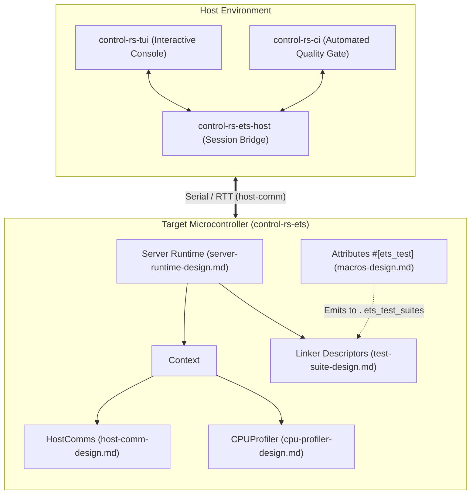

# Embedded Test Server (embedded-test-server)


---

### 1. Introduction

Host-based unit tests can provide thorough coverage line-by-line and
conceptually. However, they cannot capture physical processor constraints,
peripheral faults or real-time hardware behaviors. For basic numerical routines
that do not interface with hardware, an emulator can provide runtime assurances
by imitating the target processor. Verifying control algorithms and firmware
that interact with sensors and actuators requires executing directly on the
target processor.

Modern test harnesses [1] support distributed testing and HIL integration
pipelines [4], [5]. However, they do not provide CPU profiling [3] or a standard
interface to adjust parameters and re-run tests without re-compiling and
re-uploading.

This document is the lead architectural design document for the Embedded Test
Server (ETS) subsystem (`control-rs-ets`).

---

### 2. Requirements

#### 2.1 Functional Requirements

##### Subsystem Component Integration

- **FR-1 — Command Polling**: The server must implement a polling loop that
  processes commands from the transport.
- **FR-2.1 — Verdict Reporting**: The server must report test verdicts to the
  host (unless a transport failure occurs).
- **FR-2.2 — Test Suite Discovery**: The server must report all information
  required to run and parse results from a test (the host may not use the
  compiled elf to understand the test/settings).
- **FR-3.1 — Doc-String Reporting**: The server must report the same
  documentation
  from each test suite's source code (for modules, functions and settings).
- **FR-3.2 — Test Case Dispatch**: The server must dispatch test functions only
  when requested by the host.
- **FR-4 — Dynamic Settings**: Each test suite may have settings that can
  only be mutated by the host.
- **FR-5 — Target Hardware Profiling**: The server must provide an optional
  profiling tool to measure execution time, cycles and stack high-water mark.
- **FR-6 — Builtin Test Suites**: The server must provide pre-existing
  suites so users can opt in to `control-rs` tests.
- **FR-7 — Procedural Macro Suite Declaration**: The subsystem must provide
  procedural macros (`#[ets_suite]`, `#[ets_test]`) to generate static
  descriptors and linker placement attributes without manual registration
  tables.

##### ConOp Modes

- **FR-8 — Unit Test Execution**: The subsystem must execute isolated test
  functions sequentially and report each result.
- **FR-9 — Virtual Target Emulation**: The subsystem must compile
  and run under QEMU emulation using a semi-host transport.
- **FR-10 — Silicon Benchmark Execution**: The subsystem must benchmark
  execution performance on physical targets.
- **FR-11 — Hardware-in-the-Loop Simulation (ConOps §3.4)**: The subsystem must
  operate in closed-loop HIL configurations, receiving simulated plant state
  vectors, executing the discrete controller step and streaming actuator drive
  telemetry.
- **FR-12.1 — Sensor Telemetry Acquisition (Streaming)**: The subsystem must
  sample hardware sensors and stream continuous, labeled measurement records.
- **FR-12.2 — Sensor Telemetry Acquisition (Tight Loop)**: The subsystem must
  allow a tight loop to: read a sensor and save to non-volatile memory. In this
  use case the loop is too tight for any additional instructions.
- **FR-13 — Live Parameter Calibration**: The subsystem must apply dynamic gain
  and setpoint adjustments received from the host console to running control
  loops without halting execution or reprogramming target firmware.

##### Architecture & Platform Independence

- **FR-14 — Bare-Metal Target Portability**: Target firmware crates
  (`control-rs-ets`) must compile strictly under `#![no_std]` without dynamic
  memory allocators across ARM Cortex-M (`thumbv6m-none-eabi`,
  `thumbv7em-none-eabihf`) and RISC-V (`riscv32imac-unknown-none-elf`)
  architectures.
- **FR-15 — Host Tooling Isolation**: Host-side crates (`control-rs-tui`,
  `control-rs-ci`, `control-rs-ets-host`) and procedural macros
  (`control-rs-macros`) must build with standard library facilities (`std`)
  without leaking host ABI dependencies into target firmware builds.

#### 2.2 Non-Functional Requirements

- **NFR-1 — Real-Time Determinism & Zero Telemetry Jitter**: Subsystem execution
  and telemetry streaming shall operate without inducing timing jitter in the
  target control loop.

#### 2.3 Constraints

- **C-1 — Strict Bare-Metal `#![no_std]` and Zero Heap**: Target-side ETS
  firmware crates (`control-rs-ets`) shall compile without `std` and without
  dynamic heap allocation.
- **C-2 — Bounded Static Memory Footprint**: The complete target server
  implementation (excluding test payloads) shall consume $\le 32\text{ KB}$
  Flash and $\le 8\text{ KB}$ RAM.
- **C-3 — Fail-Safe Transport Drop Interlock**: In closed-loop operation, loss
  of
  communication heartbeat exceeding 500 ms shall transition controller targets
  to
  a safe zero-energy state.

---

### 3. Technical Overview

The ETS framework is structured as a dual-targeted system. `control-rs-tui` and
`control-rs-ci` are host frontends; `control-rs-ets-host::ETSBridge` drives
both.
The target-side `Server` runs on physical microcontrollers (for example, Teensy
4.0,
ESP32-C6) and inside virtual emulators under QEMU.



---

### 4. Architecture

#### 4.1. Workspace Structure & Cross-Compilation

Serves: C-1, FR-14, FR-15

To prevent compilation friction and maintain clean dependency hygiene,
`control-rs` implements a dual-targeted Cargo workspace structure:

```
control-rs (Root Workspace)
├── control-rs-ets/       # Target-side server runtime, comms, and profiling (no_std)
├── control-rs-ets-host/  # Host transport, framing, and headless runner library
├── control-rs-tui/       # Standalone interactive terminal console binary
├── control-rs-ci/        # Repository quality-gate runner binary
├── control-rs-macros/    # Procedural macros for test suite setup and registry generation
├── examples/             # Target binary examples (qemu/teensy4) executing on-device
└── src/                  # Standard host-side library algorithms and modules
```

#### 4.2. Subsystem Component Architecture & Interconnection

Serves: FR-1, FR-2.1, FR-2.2, FR-3.1, FR-3.2, FR-4, FR-5, FR-6, FR-7, C-1

The ETS subsystem coordinates five focused components, each governed by its own
dedicated component design document:

1. **`server-runtime`** ([server-runtime-design.md](server-runtime-design.md)):
   Owns `Server`, `Context`, `CURRENT_SUITE`, `CURRENT_TEST`, the main command
   polling loop, test dispatch bounds, lifecycle state transitions, forensic
   panic formatting and dynamic setting mutation.
2. **`host-comm`** ([host-comm-design.md](host-comm-design.md)):
   Owns `HostComms`, wire packet framing (`0xAA 0x55` sync bytes + length
   prefix + CRC-16-IBM-SDLC trailer), non-blocking frame decoding and telemetry
   serialization.
3. **`cpu-profiler`** ([cpu-profiler-design.md](cpu-profiler-design.md)):
   Owns `CPUProfiler`, physical CPU cycle counters (ARM DWT / RISC-V `mcycle`),
   SysTick monotonic nanosecond timers, stack sentinel watermarking
   (`0xCDCD_CDCD`) and scoped critical section interrupt masking
   (`disable_interrupts`).
4. **`test-suite`** ([test-suite-design.md](test-suite-design.md)):
   Owns `SuiteDescriptor`, `ExecDescriptor`, `.ets_test_suites` linker boundary
   slice reconstruction, and wait-free atomic parameter wrappers.
5. **`macros`** ([macros-design.md](macros-design.md)):
   Owns `#[ets_test]` and `#[ets_suite]`, generating static descriptors and
   linker placement attributes without manual registration tables.

#### 4.3. ConOps Operational Mode Allocation

Serves: FR-8, FR-9, FR-10, FR-11, FR-12.1, FR-12.2, FR-13

The subsystem maps the six operational use cases from [ConOps.md](ConOps.md)
across its constituent components:

| ConOps Mode                   | Target Stack                      | Host Stack       | Operational Flow                                                                                                    |
|:------------------------------|:----------------------------------|:-----------------|:--------------------------------------------------------------------------------------------------------------------|
| **§3.1 Unit Test**            | `server-runtime` + `test-suite`   | `control-rs-ci`  | Host selects test index; server dispatches case and returns `Pass`/`Fail` verdict.                                  |
| **§3.2 Virtual Chip**         | `server-runtime` (QEMU target)    | `control-rs-ci`  | Headless automated runner boots QEMU, runs suites, and exits cleanly via exit trap.                                 |
| **§3.3 Silicon Benchmarking** | `server-runtime` + `cpu-profiler` | `control-rs-tui` | Server measures elapsed CPU clock cycles, microsecond duration, and peak stack RAM under IRQ masking.               |
| **§3.4 Closed-Loop HIL**      | `server-runtime` + `host-comm`    | `ETSBridge`      | Host streams simulated plant state; target computes control loop and streams drive telemetry within bounded period. |
| **§3.5 Data Acquisition**     | `host-comm` + peripheral drivers  | `ETSBridge`      | MCU samples physical sensors and streams high-rate telemetry records to host without frame loss.                    |
| **§3.6 Hand-Tuning**          | `server-runtime` + `test-suite`   | `control-rs-tui` | Operator adjusts parameter in TUI; server validates limits and applies mutation live without pausing loop.          |

#### 4.4. Component Interface Contracts

Serves: FR-1, FR-2.1, FR-2.2, FR-3.1, FR-3.2, FR-4, C-1

To preserve modularity, the components interface strictly through public traits
and static descriptors:

```rust
// Server generic over Comms and Profiler traits
pub struct Server<'a, C: HostComms, P: CPUProfiler> {
    pub context: Context<C, P>,
    pub suites: &'a [&'static SuiteDescriptor],
}
```

* `HostComms` decouples the server from UART, RTT or simulated socket hardware.
* `CPUProfiler` decouples the server from Cortex-M, RISC-V, or mock host timer
  registers.
* `SuiteDescriptor` decouples the server from how suites are declared in user
  code.

#### 4.5. Safety, Fail-Safe & Resource Allocation

Serves: C-2, C-3, NFR-1

* **Memory Budgeting**: The complete target runtime allocates $\le 32\text{ KB}$
  Flash and $\le 8\text{ KB}$ RAM. Descriptors and test function pointers reside
  in Flash ROM.
* **Fail-Safe Interlock**: During active Hardware-in-the-Loop execution (ConOps
  §3.4), the controller loop monitors host communication heartbeats. If no
  command or state vector is received within 500 ms, actuator outputs transition
  immediately to the safe zero-energy state (`C-3`).

---

### 5. Alternatives Considered

#### 5.1. Debug-Probe-Driven Execution (`probe-rs` + `embedded-test`)

* Instead of UART/RTT communication, host uses debug probes and ARM semihosting.
* *Rejected*: Semihosting halts the CPU pipeline during I/O operations,
  introducing millisecond-level timing overhead and destroying real-time
  determinism.

#### 5.2. Soft Reset (`SCB::sys_reset`) vs. Watchdog Starvation

* Using the CPU System Control Block to reboot.
* *Status*: Shipped as the MVP reset in `cpu-profiler` and `server-runtime`.
  Watchdog starvation provides cleaner external peripheral re-initialization and
  is deferred for future hardware integration.

#### 5.3. Third-Party Distributed Slice (`linkme`)

* Using `linkme::DistributedSlice` instead of hand-rolled `.ets_test_suites`.
* *Rejected*: The hand-rolled linker slice is already implemented and verified;
  `linkme` adds external dependencies without removing linker script placement
  requirements.

#### 5.4. COBS Byte-Stuffed Framing

* Delimiting frames with Consistent Overhead Byte Stuffing.
* *Rejected*: `host-comm` selected a sync-byte (`0xAA 0x55`) + length prefix +
  CRC-16 trailer to minimize target-side framing overhead.

---

### 6. Verification & Validation

#### 6.1 Verification

| Condition | Requirement | Method    | Target                                                                             | Criterion                                                                                                                               |
|:----------|:------------|:----------|:-----------------------------------------------------------------------------------|:----------------------------------------------------------------------------------------------------------------------------------------|
| VC-1.1    | FR-1        | `link`    | `server-runtime#FR-1`                                                              | Validates server non-blocking command polling loop; FR-1 holds iff this condition holds                                                 |
| VC-2.1    | FR-2.1      | `link`    | `server-runtime#FR-2`                                                              | Validates test verdict reporting; FR-2.1 holds iff this condition holds                                                                 |
| VC-2.2    | FR-2.2      | `link`    | `server-runtime#FR-2`, `test-suite#FR-1`                                           | Validates test suite discovery from linker metadata; FR-2.2 holds iff this condition holds                                              |
| VC-3.1    | FR-3.1      | `link`    | `server-runtime#FR-2`                                                              | Validates doc-string reporting for suites, functions, and settings; FR-3.1 holds iff this condition holds                               |
| VC-3.2    | FR-3.2      | `link`    | `server-runtime#FR-2`, `server-runtime#FR-3`                                       | Validates test case dispatch on host command; FR-3.2 holds iff this condition holds                                                     |
| VC-4.1    | FR-4        | `link`    | `server-runtime#FR-5`, `test-suite#FR-5`                                           | Validates runtime parameter validation and dynamic atomic setting mutation; FR-4 holds iff this condition holds                         |
| VC-5.1    | FR-5        | `link`    | `cpu-profiler#FR-1`, `cpu-profiler#FR-2`, `cpu-profiler#FR-3`, `cpu-profiler#FR-4` | Validates cycle counting, monotonic nanosecond duration, stack watermarking, and interrupt masking; FR-5 holds iff this condition holds |
| VC-6.1    | FR-6        | `link`    | `test-suite#FR-1`, `test-suite#FR-2`                                               | Validates linker section discovery and ExecDescriptor case representation; FR-6 holds iff this condition holds                          |
| VC-7.1    | FR-7        | `link`    | `macros#FR-1`                                                                      | Validates compile-time macro expansion and static descriptor placement; FR-7 holds iff this condition holds                             |
| VC-8.1    | FR-8        | `link`    | `server-runtime#FR-1`                                                              | Fulfills ConOps §3.1 isolated math and algorithm unit test execution; FR-8 holds iff this condition holds                               |
| VC-9.1    | FR-9        | `link`    | `server-runtime#FR-7`                                                              | Fulfills ConOps §3.2 virtual processor emulation under QEMU with exit traps; FR-9 holds iff this condition holds                        |
| VC-10.1   | FR-10       | `link`    | `server-runtime#FR-4`, `cpu-profiler#FR-1`                                         | Fulfills ConOps §3.3 physical silicon benchmarking of cycles, duration, and stack RAM; FR-10 holds iff this condition holds             |
| VC-11.1   | FR-11       | `link`    | `server-runtime#FR-1`, `host-comm#FR-1`                                            | Fulfills ConOps §3.4 closed-loop HIL simulation within bounded control period; FR-11 holds iff this condition holds                     |
| VC-12.1   | FR-12.1     | `link`    | `host-comm#FR-2`                                                                   | Fulfills ConOps §3.5 continuous sensor data acquisition without frame loss; FR-12.1 holds iff this condition holds                      |
| VC-12.2   | FR-12.2     | `link`    | `server-runtime#FR-1`                                                              | Fulfills ConOps §3.5 fast-loop sensor acquisition and NVRAM storage; FR-12.2 holds iff this condition holds                             |
| VC-13.1   | FR-13       | `link`    | `server-runtime#FR-5`, `test-suite#FR-5`                                           | Fulfills ConOps §3.6 live parameter calibration without reprogramming target firmware; FR-13 holds iff this condition holds             |
| VC-14.1   | FR-14       | `gate`    | `build`                                                                            | Target crate compiles for bare-metal targets under #![no_std]; FR-14 holds iff this condition holds                                     |
| VC-15.1   | FR-15       | `gate`    | `build`                                                                            | Host crates and procedural macros build cleanly without leaking host ABI dependencies; FR-15 holds iff this condition holds             |
| VC-16.1   | NFR-1       | `link`    | `host-comm#NFR-1`                                                                  | Zero-jitter telemetry transmission bounds control loop disturbance; NFR-1 holds iff this condition holds                                |
| VC-26.1   | C-1         | `gate`    | `build`                                                                            | Target crate `control-rs-ets` compiles cleanly for bare-metal targets under `#![no_std]`; C-1 holds iff this condition holds            |
| VC-26.2   | C-2         | `link`    | `server-runtime#C-2`, `test-suite#NFR-2`                                           | Total static memory overhead remains within 32 KB Flash and 8 KB RAM bounds; C-2 holds iff both conditions hold                         |
| VC-26.3   | C-3         | `libtest` | `control_rs_ets::server::tests::test_server_poll_command_error`                    | Transport loss or unrecoverable error transitions runtime out of active driving loop; C-3 holds iff this condition holds                |

#### 6.2 Acceptance

| Claim                       | Oracle                   | Measure                               | Bound                      |
|:----------------------------|:-------------------------|:--------------------------------------|:---------------------------|
| Discovery completeness      | Source annotations       | Suites and cases reported to host     | Exact set equality         |
| Persistent execution        | Suite of *n* cases       | Target restarts during suite          | 0, absent injected fault   |
| Cycle telemetry attribution | Case boundaries          | Reports attributed to running case    | 1:1, no orphans            |
| Panic capture               | Injected panic           | Forensic record received before reset | Received, with location    |
| Cooperative reset           | Command listener         | Reset request serviced                | Acknowledged, clean reboot |
| Frame resynchronization     | Injected corrupted bytes | Frames lost before recovery           | At most one                |
| Allocation freedom          | Disassembly              | Dynamic allocator symbols             | 0                          |

#### 6.3 Limits

- **Single-threaded cooperative executive (`L-1`)**: Cases execute inside
  critical
  sections; a case that enters an infinite loop with interrupts masked cannot be
  preempted by `Command::TryReset`. Recovery requires external hardware watchdog
  timers.
- **Post-crash soft reset (`L-2`)**: Warm CPU reset does not reset external
  peripherals
  or active DMA channels.
- **Memory footprint check (`L-3`)**: Static memory bounds ($\le 32\text{ KB}$
  Flash,
  $\le 8\text{ KB}$ RAM) are evaluated via static analysis and `cargo size`.

---

### 7. Performance & Resource Considerations

* **Flash/RAM Footprint**: Target-side `control-rs-ets` consumes less than 32 KB
  Flash and 8 KB RAM. Descriptors reside in Flash ROM.
* **Zero Allocations**: All target telemetry paths operate with zero dynamic
  heap allocations.
* **Control Loop Determinism**: Hot-path telemetry transmission is framed
  without
  string formatting to prevent jitter in 1 kHz real-time loops.

---

### 8. Risks & Open Questions

* **RTT Buffer Overflow**: High-frequency logging over SEGGER RTT can overflow
  target
  buffers if the host probe does not service the channel quickly enough.
* **Watchdog Integration**: Hardware watchdog driver support will be
  incorporated
  to handle recovery from infinite loops in user test code.

---

### 9. Development Plan

| Phase                                  | Delivers                                                                            | Requirements                                                                                            | Effort | Status  |
|:---------------------------------------|:------------------------------------------------------------------------------------|:--------------------------------------------------------------------------------------------------------|:-------|:--------|
| 1. Test Discovery & Suite Model        | Test suite data model (`test-suite`) and procedural macros (`macros`) in `ETS-1`    | FR-6, FR-7, C-1, C-2                                                                                    | 5 days | Shipped |
| 2. CPU Profiling & Measurement         | Hardware performance profiling and stack watermarking (`cpu-profiler`) in `ETS-1`   | FR-5, C-1                                                                                               | 3 days | Shipped |
| 3. Host Communications & Framing       | Packet-framed transport and Postcard serialization (`host-comm`) in `ETS-2`         | FR-12.1, NFR-1                                                                                          | 3 days | Planned |
| 4. Server Runtime & Execution Platform | Persistent command loop, dispatch, lifecycle tracking (`server-runtime`) in `ETS-3` | FR-1, FR-2.1, FR-2.2, FR-3.1, FR-3.2, FR-4, FR-8, FR-9, FR-10, FR-11, FR-12.2, FR-13, FR-14, FR-15, C-3 | 4 days | Planned |

---

### 10. Revision History

| Revision | Date              | Author                       | Description                                                                                                                                                                                                                                    |
|:---------|:------------------|:-----------------------------|:-----------------------------------------------------------------------------------------------------------------------------------------------------------------------------------------------------------------------------------------------|
| 1.0      | August 29, 2026   | @MitchellDScott              | Embedded Test Server: linker-section discovery, CRC-16 `postcard` framing and the `control-rs-ets` crate.                                                                                                                                      |
| 2.0      | November 8, 2026  | @MitchellDScott, Antigravity | Lead architecture coordinating ETS-1, ETS-2, and ETS-3; aligned high-level link conditions, phased development plan, and pure Platform data struct. Affects FR-7.                                                                              |
| 2.1      | November 10, 2026 | Antigravity                  | Decomposed compound statements into atomic requirements, added explicit dynamic settings mutation (FR-3), specified linker discovery and macro code generation as strict functional contracts, and mapped 6 discrete ConOps operational modes. |

---

## References

[1] embedded-test, "embedded_test," *docs.rs*. [Online].
Available: https://docs.rs/embedded-test/latest/embedded_test/. Accessed: Aug.
7, 2026.

[2] David Tolnay, "linkme," *dtolnay/linkme*. [Online].
Available: https://docs.rs/linkme/latest/linkme/struct.DistributedSlice.html.
Accessed: Aug. 7, 2026.

[3] Noah Pendleton, "Measuring Stack Usage the Hard Way," *Interrupt (Memfault
blog)*. [Online].
Available: https://interrupt.memfault.com/blog/measuring-stack-usage. Accessed:
Aug. 7, 2026.

[4] Nick Miller, "How Golioth uses Hardware-in-the-Loop (HIL) Testing: Part 2,"
*The Golioth Developer Blog*, 2022. [Online].
Available: https://blog.golioth.io/golioth-hil-testing-part2/. Accessed: Aug. 7,

2026.

[5] National Instruments (Emerson), "Hardware-in-the-Loop (HIL) Testing," *NI
solutions pages*, 2026. [Online].
Available: https://www.ni.com/en/solutions/hardware-in-the-loop-testing.html.
Accessed: Aug. 7, 2026.
