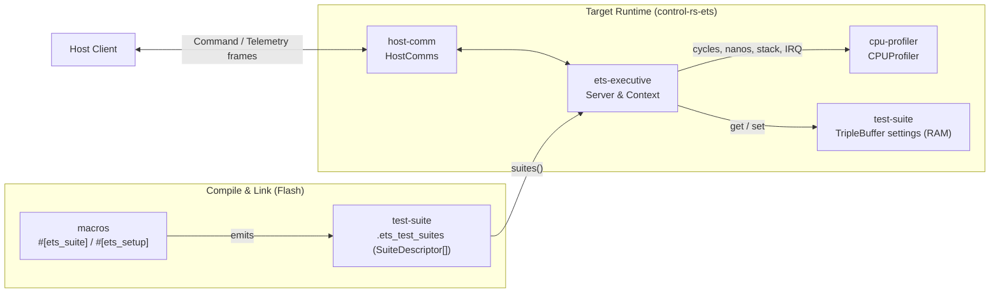
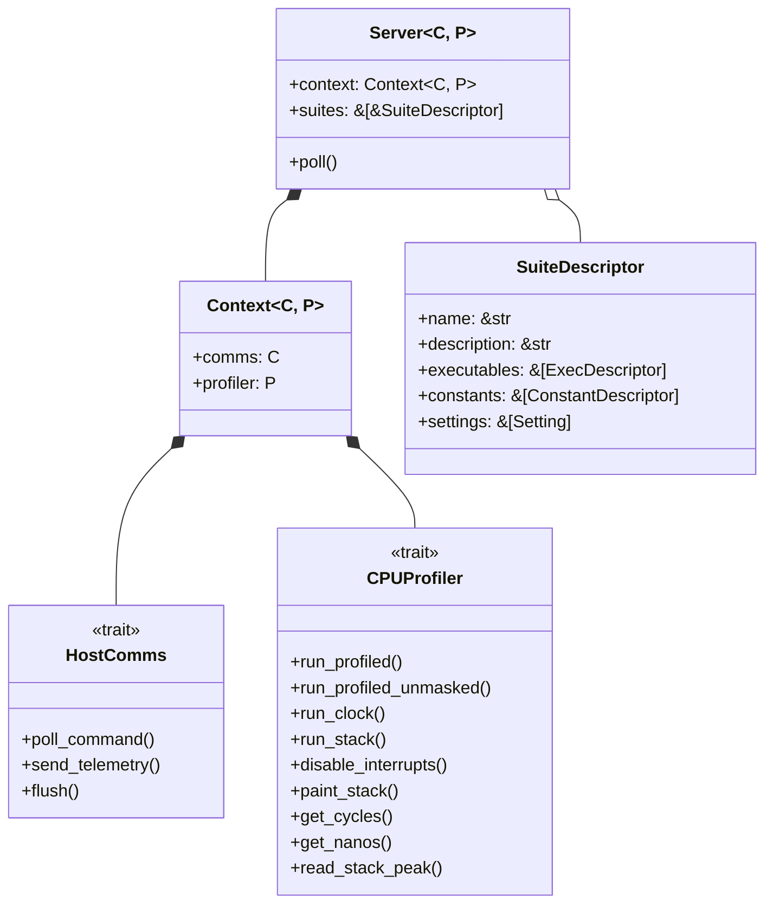

# Embedded Test Server (embedded-test-server)


---

### 1. Introduction

Host-based unit tests can provide thorough coverage line-by-line and
conceptually. However, they cannot capture physical processor constraints,
peripheral faults or real-time hardware behaviors. For basic numerical routines
that do not interface with hardware, an emulator can provide runtime assurances
by imitating the target processor. Verifying control algorithms and firmware
that interact with sensors and actuators requires executing directly on the
target processor.

Modern test harnesses [1] support distributed testing and HIL integration
pipelines [4], [5]. However, they either: do not provide CPU profiling [3]
or require using an RTOS.

This document is the lead architectural design document for the Embedded Test
Server (ETS) subsystem (`control-rs-ets`). The target outcome is to enable the
usage and scenarios described in [ConOps](ConOps.md).

---

### 2. Requirements

#### 2.1 Functional Requirements

- **FR-1 - Self-contained target discovery**: The target must report all
  compiled suites, test cases, compile-time constants, adjustable parameters
  and their source documentation over the communication link on request. The
  host must not require access to source files, debug symbols or the compiled
  ELF binary to discover or interpret tests and parameters.
- **FR-2 - On-demand selective execution**: The target must remain idle between
  commands and execute only the specific test or benchmark case requested by the
  host. Unrequested cases must never be executed automatically.
- **FR-3 - Verdict and fault attribution**: Every executed case must produce a
  pass or fail verdict attributed to that case over the host link. If a running
  case panics or triggers a hardware fault, the target must capture and transmit
  the fault location and diagnostic message attributed to that case before
  resetting or halting.
- **FR-4 - No central test suite registration**: Firmware binaries must
  automatically include all suites (user modules and opt-in `control-rs` library
  suites) without maintaining a central registration list in the application
  entrypoint.
- **FR-5 - Emulated target execution**: Target test firmware must execute under
  instruction-set emulation (QEMU) using a host byte-stream link with the same
  protocol and discovery behavior as physical silicon.
- **FR-6 - Remote lifecycle control**: The target must service host requests to
  perform a warm system reset on hardware with an exit code in virtualized
  environments.
- **FR-7 - Execution cycle and duration measurement**: When profiling is
  requested, the target must measure and report elapsed CPU clock cycles and
  monotonic wall-clock duration for the executed case. On architectures lacking
  a hardware cycle counter, the target must report clock absence rather than
  failing compilation or execution.
- **FR-8 - Peak stack consumption measurement**: When profiling is requested
  (`Profile::Full` or `Profile::Unmasked`), the target must measure and report
  the maximum stack memory consumed during case execution without corrupting
  active
  stack frames.
- **FR-9 - Interrupt-isolated measurement**: Under default `Profile::Full`
  profiling,
  case execution must mask preempting interrupts across the measured region;
  under
  `Profile::Unmasked`, execution leaves interrupts unmasked to permit
  interrupt-driven
  execution and capture real-world ISR latency; under `Profile::Off`, profiling
  is
  omitted.
- **FR-10 - Target hardware identity reporting**: The target must report its
  board identity, core clock frequency and hardware capability flags over the
  link so the host can interpret timing measurements and platform capabilities
  without out-of-band assumptions.
- **FR-11 - Resilient framed telemetry streaming**: The target must stream
  timestamped, labeled records over a framed byte link that detects byte
  corruption and resynchronizes on the next frame boundary without dropping
  the session.
- **FR-12 - Test Output Logging**: User test cases must have a mechanism to
  stream diagnostic logs from inside the tests back to the host over the
  communication link. A `HostComms` implementation may carry the firmware's
  own log output on the same link, and the host separates that text from
  telemetry frames. ETS defines no log API.
- **FR-13 - Live type-checked parameter tuning**: The target must apply
  host-supplied parameter updates at runtime without halting execution, blocking
  the active reader or reflashing firmware.
- **FR-14 - Target build isolation from host dependencies**: The host-side
  tooling requires the `std` library, it must not 'leak' into the target builds.
- **FR-15 - Built-in diagnostic suite**: Target firmware binaries built with
  diagnostic features enabled shall expose a built-in self-diagnostic suite at
  reserved index `suite_id = 0` containing calibration and diagnostic cases
  (including a no-op tare case) to calibrate dispatch overhead, verify profiling
  metrics, and validate platform capabilities through the standard suite
  discovery and execution protocol. When diagnostic features are disabled, the
  diagnostic suite shall be omitted with zero static memory overhead.

#### 2.2 Non-Functional Requirements

- **NFR-1 - Bounded control-loop telemetry jitter**: $\le 2\ \text{ms}$
  timing jitter in a 1 kHz control loop.
- **NFR-2 - Zero static RAM for immutable suite metadata**: Compiled suite,
  case and constant metadata must reside in read-only non-volatile memory
  (`Flash`), consuming zero bytes of static RAM at idle.

#### 2.3 Constraints

- **C-1 - Bare-metal `#![no_std]` and no heap allocation**: Target firmware
  crates must compile for ARM Cortex-M (`ARMv6-M`, `ARMv7-M`, `ARMv8-M`) and
  RISC-V (`RV32`, `RV64`) targets.
- **C-2 - On-Chip Memory Ceiling**: Target microcontrollers provide fixed
  on-chip memory budgets, bounding the target runtime (excluding user test
  payloads) to at most 32KB Flash and 8KB static RAM.

---

### 3. Technical Overview



**Figure 3.1**: Compile-time suite registration into read-only memory and
runtime command, measurement, and parameter flow on the target.



**Figure 3.2**: Ownership and interface boundaries between the server runtime,
hardware abstractions and registered test suites.

---

### 4. Architecture

#### 4.1. Workspace Structure & Cross-Compilation

Serves: FR-5, C-1, C-2

To prevent compilation friction and maintain clean dependency hygiene,
`control-rs` implements a dual-targeted Cargo workspace structure:

```
control-rs (Root Workspace)
├── control-rs-ets/       # Target-side server runtime, comms, and profiling (no_std)
├── control-rs-ets-host/  # Host transport, framing, and headless runner library
├── control-rs-macros/    # Procedural macros for test suite setup and registry generation
├── examples/             # Target binary examples (qemu/teensy4) executing on-device
└── src/                  # Standard host-side library algorithms and modules
```

#### 4.2. Subsystem Component Architecture & Interconnection

Serves: FR-1, FR-2, FR-3, FR-4, FR-6, FR-7, FR-8, FR-9, FR-10, FR-11, FR-13,
FR-15, NFR-2, C-1

The ETS subsystem coordinates five focused components, each governed by its own
dedicated component design document:

1. **`ets-executive`** ([ets-executive-design.md](ets-executive-design.md)):
   Owns `Server`, `Context`, `CURRENT_SUITE`, `CURRENT_TEST`, the main command
   polling loop, suite index resolution, test dispatch bounds, lifecycle state
   transitions, forensic panic formatting and dynamic setting mutation.
2. **`host-comm`** ([host-comm-design.md](host-comm-design.md)):
   Owns `HostComms`, wire packet framing (`0xAA 0x55` sync bytes + length
   prefix + CRC-16-IBM-SDLC trailer), non-blocking frame decoding and telemetry
   serialization.
3. **`cpu-profiler`** ([cpu-profiler-design.md](cpu-profiler-design.md)):
   Owns `CPUProfiler`, physical CPU cycle counters (ARM DWT / RISC-V `mcycle`),
   SysTick monotonic nanosecond timers, stack sentinel watermarking
   (`0xCDCD_CDCD`) and scoped critical section interrupt masking
   (`disable_interrupts`).
4. **`test-suite`** ([test-suite-design.md](test-suite-design.md)):
   Owns `SuiteDescriptor`, `ExecDescriptor`, `ConstantDescriptor`,
   `.ets_test_suites` linker boundary slice reconstruction, and lock-free
   triple-buffer parameter wrappers.
5. **`macros`** ([macros-design.md](macros-design.md)):
   Owns `#[ets_test]` and `#[ets_suite]`, generating static descriptors and
   linker placement attributes without manual registration tables.

#### 4.3. ConOps Operational Mode Allocation

Serves: FR-1, FR-2, FR-3, FR-5, FR-6, FR-7, FR-8, FR-9, FR-11, FR-12, FR-13

The subsystem maps the six operational use cases from [ConOps.md](ConOps.md)
across its constituent components:

| ConOps Mode                   | Target Stack                     | Host Stack       | Operational Flow                                                                                                    |
|:------------------------------|:---------------------------------|:-----------------|:--------------------------------------------------------------------------------------------------------------------|
| **§3.1 Unit Test**            | `ets-executive` + `test-suite`   | `control-rs-ci`  | Host selects test index; server dispatches case and returns `Pass`/`Fail` verdict.                                  |
| **§3.2 Virtual Chip**         | `ets-executive` (QEMU target)    | `control-rs-ci`  | Headless automated runner boots QEMU, runs suites, and exits cleanly via exit trap.                                 |
| **§3.3 Silicon Benchmarking** | `ets-executive` + `cpu-profiler` | `control-rs-tui` | Server measures elapsed CPU clock cycles, microsecond duration, and peak stack RAM under IRQ masking.               |
| **§3.4 Closed-Loop HIL**      | *Deferred*                       | *Deferred*       | Deferred to Layer 1/2+ HIL harness (`roadmap.md`); external rig harness and plant streaming outside ETS core scope. |
| **§3.5 Data Acquisition**     | `host-comm` + peripheral drivers | `ETSBridge`      | MCU samples physical sensors and streams high-rate telemetry records to host without frame loss.                    |
| **§3.6 Hand-Tuning**          | `ets-executive` + `test-suite`   | `control-rs-tui` | Operator adjusts parameter in TUI; server validates limits and applies mutation live without pausing loop.          |

#### 4.4. Component Interface Contracts

Serves: FR-1, FR-2, FR-3, FR-7, FR-8, FR-9, FR-11, FR-12, FR-13, C-1

To preserve modularity, the components interface strictly through public traits
and static descriptors:

```rust
// Server generic over Comms and Profiler traits
pub struct Server<'a, C: HostComms, P: CPUProfiler> {
    pub context: Context<C, P>,
    pub suites: &'a [&'static SuiteDescriptor],
}
```

* `HostComms` decouples the server from UART, RTT or simulated socket hardware.
* `CPUProfiler` decouples the server from Cortex-M, RISC-V, or mock host timer
  registers.
* `SuiteDescriptor` decouples the server from how suites are included in
  binaries.

#### 4.5. Safety, Fail-Safe & Resource Allocation

Serves: NFR-1, NFR-2

* **Memory Budgeting**: The complete target runtime allocates $\le 32\text{ KB}$
  Flash and $\le 8\text{ KB}$ RAM. Descriptors and test function pointers reside
  in Flash ROM.

#### 4.6. Built-in Self-Diagnostic Suite Architecture

Serves: FR-3, FR-6, FR-7, FR-8, FR-9, FR-10, FR-13, FR-15, NFR-1

To validate on-target runtime behavior, isolate harness overhead and verify
hardware capabilities without external user suites, the target runtime exposes
a built-in self-diagnostic suite (`__ets_diagnostics`) reserved at
`suite_id = 0`.

##### 4.6.1. Feature Gating & Zero-Cost Policy

The suite is partitioned behind two optional Cargo features in `control-rs-ets`:

* `diagnostics`: Enables 7 non-resetting calibration cases (`tare`, `spin`,
  `stack`, `encode`, `irq_masked`, `fpu`, `settings`).
* `diagnostics-fault`: Opt-in; enables 3 destructive fault-injection cases
  (`panic`, `exception`, `hang`) ending in a target reset.

When both features are disabled (the droppable-tare policy), `DIAGNOSTIC_SUITE`
is omitted from `.rodata`, contributing zero Flash and zero RAM
overhead, with user-registered suites indexed directly starting from `0`.

##### 4.6.2. Descriptors and Suite Resolution

To guarantee Flash ROM placement without dynamic memory allocation, the suite
descriptors and function pointers are statically retained. The target
executive resolves incoming `suite_id` values through `resolve_suite`:

```rust
pub static DIAGNOSTIC_SUITE: SuiteDescriptor = SuiteDescriptor {
    name: "__ets_diagnostics",
    description: "Built-in target self-diagnostic and calibration suite",
    executables: &DIAGNOSTIC_EXECS,
    settings: &DIAGNOSTIC_SETTINGS,
};

impl<'a, C, P> Server<'a, C, P> {
    #[inline]
    fn resolve_suite(&self, suite_id: u16) -> Option<&'static SuiteDescriptor> {
        #[cfg(feature = "diagnostics")]
        match suite_id {
            0 => Some(&DIAGNOSTIC_SUITE),
            n => self.suites.get(usize::from(n.saturating_sub(1))).copied(),
        }
        #[cfg(not(feature = "diagnostics"))]
        self.suites.get(usize::from(suite_id)).copied()
    }
}
```

* When `diagnostics` is enabled, `suite_id = 0` maps directly to
  `DIAGNOSTIC_SUITE`, and user suites map to `1..=N` via `n.saturating_sub(1)`.
  Discovery chains `TargetInfo` telemetry, followed by `DIAGNOSTIC_SUITE` at
  index `0`, followed by user suites at `1..=N`.
* When disabled, `DIAGNOSTIC_SUITE` is omitted from `.rodata` with zero
  overhead, and user suites index directly from `0..=N`.
* Out-of-bounds indices transmit an error diagnostic frame without panicking
  or aborting the server command loop.

##### 4.6.3. Tare Calibration Baseline

Executing `Command::RunExecutable { suite_id: 0, test_id: 0 }` runs `tare_noop`
($\delta_{\text{fn}} = 0$) through the standard dispatch and profiling bracket
to measure baseline harness latency:

$$\Delta c_{\text{tare}} = \delta_{\text{cyc}} + 2\,\delta_{\text{ns}} + \delta_{\text{dispatch}}$$

$$\Delta t_{\text{ns,tare}} = \delta_{\text{ns}} + \delta_{\text{dispatch}}$$

Because `tare_noop` shares identical calling conventions, stack-painting,
interrupt-masking, and framing paths with user test cases, the host subtracts
this baseline from measured metrics to isolate true net payload performance:
$c_{\text{net}} = \Delta c_{\text{measured}} - \Delta c_{\text{tare}}$ and
$t_{\text{net}} = \Delta t_{\text{measured}} - \Delta t_{\text{tare}}$.

##### 4.6.4. Diagnostic Case Manifest

| Case | Feature | Operational Verification | Serves |
|:---|:---|:---|:---|
| `tare` | `diagnostics` | Runs `tare_noop` ($\delta_{\text{fn}} = 0$); emits `Running`, `Passed`, and baseline `MetricReport` | FR-15 |
| `spin` | `diagnostics` | Loops `spin_iters` times; confirms cycle scaling linearity ($R^2 \ge 0.999$), clock agreement, and 32-bit rollover | FR-7, FR-9 |
| `stack` | `diagnostics` | Recurses `stack_depth` frames; confirms stack painting reports peak usage within $\le \pm 4$ bytes per level | FR-8 |
| `encode` | `diagnostics` | Frames `encode_records` telemetry records in a stack buffer; isolates serialization cost and jitter without I/O | NFR-1 |
| `irq_masked` | `diagnostics` | Inspects core interrupt registers; confirms interrupts are masked during `Profile::Full` execution | FR-9 |
| `fpu` | `diagnostics` | Executes floating-point instructions; confirms coprocessor is active matching `TargetInfo.fpu_flags` | FR-10 |
| `settings` | `diagnostics` | Asserts bit-for-bit fidelity across 8 probe types, including edge value `0x8000_0000_0000_0001` on `probe_u64` | FR-13 |
| `panic` | `diagnostics-fault` | Controlled panic; verifies forensic location formatting in `FailureBufWriter`, test attribution, and soft reset | FR-3, FR-6 |
| `exception` | `diagnostics-fault` | Executes illegal instruction; verifies hardware fault trap handling and crash reporting | FR-3 |
| `hang` | `diagnostics-fault` | Masked infinite loop; verifies target recovery via hardware watchdog timer | FR-6 |

##### 4.6.5. Diagnostic Probe Settings

The `settings` probe suite exercises parameter deserialization and mutation
across primitive variants using boundary conditions:

* `spin_iters`: `u32` (default: 10,000)
* `stack_depth`: `u32` (default: 16)
* `encode_records`: `u32` (default: 10)
* 8 boundary probe settings (`probe_bool`, `probe_i8`, `probe_i16`, `probe_i32`,
  `probe_i64`, `probe_u8`, `probe_u16`, `probe_u32`, `probe_u64`), where
  `probe_u64`
  uses edge values such as `0x8000_0000_0000_0001` to catch truncation on 32-bit
  targets (the F-T1 bug).

---

### 5. Alternatives Considered

#### 5.1. Debug-Probe-Driven Execution (`probe-rs` + `embedded-test`)

* Instead of UART/RTT communication, host uses debug probes and ARM semihosting.
* *Rejected*: Semihosting halts the CPU pipeline during I/O operations,
  introducing millisecond-level timing overhead and destroying real-time
  determinism.

#### 5.2. Soft Reset (`SCB::sys_reset`) vs. Watchdog Starvation

* Using the CPU System Control Block to reboot.
* *Status*: Shipped as the MVP reset in `cpu-profiler` and `ets-executive`.
  Watchdog starvation provides cleaner external peripheral re-initialization and
  is deferred for future hardware integration.

#### 5.3. Third-Party Distributed Slice (`linkme`)

* Using `linkme::DistributedSlice` instead of hand-rolled `.ets_test_suites`.
* *Rejected*: The hand-rolled linker slice is already implemented and verified;
  `linkme` adds external dependencies without removing linker script placement
  requirements.

#### 5.4. COBS Byte-Stuffed Framing

* Delimiting frames with Consistent Overhead Byte Stuffing.
* *Rejected*: `host-comm` selected a sync-byte (`0xAA 0x55`) + length prefix +
  CRC-16 trailer to minimize target-side framing overhead.

---

### 6. Verification & Validation

#### 6.1 Verification

| Condition | Requirement | Method    | Target                                                                                                                                                   | Criterion                                                                                                                                                   |
|:----------|:------------|:----------|:---------------------------------------------------------------------------------------------------------------------------------------------------------|:------------------------------------------------------------------------------------------------------------------------------------------------------------|
| VC-1.1    | FR-1        | `link`    | `test-suite#FR-1`, `test-suite#FR-2`, `test-suite#FR-3`, `macros#FR-1`, `macros#FR-2`, `ets-executive#FR-2`, `host-comm#FR-2`                            | Component suite, case, constant, macro, executive discovery, and framing requirements hold; FR-1 holds iff all conditions hold                              |
| VC-1.2    | FR-1        | `libtest` | `control_rs_ets::server::tests::test_server_discovery`                                                                                                   | Executive discovery streams all registered suites, cases, settings, and docstrings over the transport without reading ELF symbols                           |
| VC-2.1    | FR-2        | `link`    | `test-suite#FR-2`, `ets-executive#FR-1`, `ets-executive#FR-2`, `host-comm#FR-2`                                                                          | Component case descriptor, command loop, dispatch, and framing requirements hold; FR-2 holds iff all conditions hold                                        |
| VC-2.2    | FR-2        | `libtest` | `control_rs_ets::server::tests::test_server_run_test`                                                                                                    | Executive remains idle until commanded and dispatches only the requested suite and case index                                                               |
| VC-3.1    | FR-3        | `link`    | `ets-executive#FR-3`, `ets-executive#FR-6`, `host-comm#FR-6`                                                                                             | Component lifecycle tracking, failure handler, and panic wire schema requirements hold; FR-3 holds iff all conditions hold                                  |
| VC-3.2    | FR-3        | `libtest` | `control_rs_ets::util::tests::test_handle_failure_comms_active`                                                                                          | Active test failure captures source location and diagnostic payload attributed to the running suite and case before reset                                   |
| VC-4.1    | FR-4        | `link`    | `test-suite#FR-5`, `macros#FR-1`                                                                                                                         | Component decentralized inclusion and suite macro requirements hold; FR-4 holds iff all conditions hold                                                     |
| VC-4.2    | FR-4        | `libtest` | `control_rs_ets::util::tests::test_get_suites_fn`                                                                                                        | Suites enabled by the build configuration appear in the reconstructed suite slice without a central registration table                                      |
| VC-5.1    | FR-5        | `link`    | `ets-executive#FR-1`, `host-comm#FR-1`                                                                                                                   | Component event loop and transport abstraction requirements hold; FR-5 holds iff all conditions hold                                                        |
| VC-5.2    | FR-5        | `gate`    | `build`                                                                                                                                                  | Target test firmware builds and executes on emulated target architectures over the byte-stream transport                                                    |
| VC-6.1    | FR-6        | `link`    | `ets-executive#FR-7`, `cpu-profiler#FR-8`                                                                                                                | Component target lifecycle and profiler reset/exit hook requirements hold; FR-6 holds iff all conditions hold                                               |
| VC-6.2    | FR-6        | `libtest` | `control_rs_ets::server::tests::test_server_exit`, `control_rs_ets::server::tests::test_server_ok_to_reset`                                              | Host reset and exit commands flush telemetry and invoke the target reset or emulator exit hook                                                              |
| VC-7.1    | FR-7        | `link`    | `cpu-profiler#FR-1`, `cpu-profiler#FR-2`, `ets-executive#FR-4`                                                                                           | Component cycle counter, wall-clock timer, and executive profiling bracket requirements hold; FR-7 holds iff all conditions hold                            |
| VC-7.2    | FR-7        | `libtest` | `control_rs_ets::server::tests::test_host_cpu_profile_utils`                                                                                             | Profiled test dispatch reports elapsed CPU cycles and microsecond duration for the executed case                                                            |
| VC-8.1    | FR-8        | `link`    | `cpu-profiler#FR-3`, `cpu-profiler#FR-4`, `ets-executive#FR-4`                                                                                           | Component stack boundary, watermark painting, and executive profiling bracket requirements hold; FR-8 holds iff all conditions hold                         |
| VC-8.2    | FR-8        | `libtest` | `control_rs_ets::profiler::tests::test_stack_paint_exhaustion_clamp`                                                                                     | Stack high-water mark measurement reports peak stack displacement within bounded stack limits                                                               |
| VC-9.1    | FR-9        | `link`    | `cpu-profiler#FR-7`, `ets-executive#FR-4`                                                                                                                | Component interrupt isolation and executive profiling bracket requirements hold; FR-9 holds iff all conditions hold                                         |
| VC-9.2    | FR-9        | `libtest` | `control_rs_ets::profiler::tests::test_default_profiler_methods`                                                                                         | Profiled execution wraps the measured test body inside the scoped interrupt-masking bracket                                                                 |
| VC-10.1   | FR-10       | `link`    | `ets-executive#FR-7`, `host-comm#FR-5`                                                                                                                   | Component hardware identification and environment telemetry requirements hold; FR-10 holds iff all conditions hold                                          |
| VC-10.2   | FR-10       | `libtest` | `control_rs_ets::comms::tests::test_golden_wire_vector_target_info`                                                                                      | Target identity and clock metadata round-trip cleanly through the wire telemetry schema                                                                     |
| VC-11.1   | FR-11       | `link`    | `host-comm#FR-2`, `host-comm#NFR-3`                                                                                                                      | Component framed packet exchange and stream resynchronization requirements hold; FR-11 holds iff all conditions hold                                        |
| VC-11.2   | FR-11       | `libtest` | `control_rs_ets::comms::tests::test_frame_telemetry_round_trip_and_corruption`                                                                           | Corrupted wire bytes are rejected by CRC-16 and the frame reader resynchronizes on the next valid telemetry frame                                           |
| VC-12.1   | FR-12       | `link`    | `host-comm#FR-7`                                                                                                                                         | Component multiplexed firmware log stream requirement holds; FR-12 holds iff this condition holds                                                           |
| VC-12.2   | FR-12       | `libtest` | `control_rs_ets::comms::tests::test_frame_reader_interleaved_log_stream_and_telemetry`                                                                   | A byte stream mixing log text and frames comes out as exactly that text plus exactly those frames                                                           |
| VC-13.1   | FR-13       | `link`    | `test-suite#FR-4`, `macros#FR-4`, `ets-executive#FR-5`                                                                                                   | Component runtime-tunable parameter, macro promotion, and executive setting mutation requirements hold; FR-13 holds iff all conditions hold                 |
| VC-13.2   | FR-13       | `libtest` | `control_rs_ets::server::tests::test_server_set_setting`, `control_rs_ets::server::tests::test_server_set_setting_type_mismatch`                         | Executive applies valid live setting updates and rejects mismatched setting types without mutating stored values                                            |
| VC-14.1   | FR-14       | `gate`    | `build`                                                                                                                                                  | Host crates and procedural macros build cleanly with `std` without leaking host dependencies into target builds; FR-14 holds iff this condition holds       |
| VC-15.1   | FR-15       | `link`    | `ets-executive#FR-2`, `test-suite#FR-2`, `host-comm#FR-2`                                                                                                | Component diagnostic suite discovery, descriptor, and framed protocol requirements hold; FR-15 holds iff all conditions hold                               |
| VC-15.2   | FR-15       | `libtest` | `control_rs_ets::server::tests::test_server_diagnostic_suite_discovery`                                                                                  | Discovery always emits the built-in diagnostic suite at `suite_id = 0` followed by user suites at indices `1..=N` when `diagnostics` is enabled, even when the user suite slice is empty |
| VC-15.3   | FR-15       | `libtest` | `control_rs_ets::server::tests::test_server_diagnostic_suite_zero_cost_when_disabled`                                                                    | When diagnostic features are disabled, `DIAGNOSTIC_SUITE` is omitted from `.rodata` with 0 bytes Flash and 0 bytes RAM, and user suites index directly from 0 |
| VC-15.4   | FR-15       | `libtest` | `control_rs_ets::server::tests::test_server_user_suite_offset_dispatch_and_settings`                                                                     | Case dispatch and setting mutation resolve `suite_id = 0` to the built-in diagnostic suite, index `self.suites` via `suite_id.saturating_sub(1)` for `suite_id >= 1`, and report out-of-bounds indices without panicking |
| VC-15.5   | FR-15       | `libtest` | `control_rs_ets::server::tests::test_server_diagnostic_case_tare`                                                                                         | `Command::RunExecutable { suite_id: 0, test_id: 0 }` executes the built-in `tare` no-op case and emits `Running`, `Passed`, and `MetricReport` telemetry frames |
| VC-15.6   | FR-15       | `libtest` | `control_rs_ets::server::tests::test_server_tare_matches_empty_user_test`                                                                                | Executing `(suite_id: 0, test_id: 0)` and executing an empty user test at `suite_id = 1` invoke identical `CPUProfiler` hook sequences, context tracker transitions, and metric reports |
| VC-15.7   | FR-15       | `libtest` | `control_rs_ets::server::tests::test_server_diagnostic_case_spin`                                                                                         | Executing `spin` across multiple `spin_iters` counts confirms cycle counts scale linearly ($R^2 \ge 0.999$), duration agrees with cycles, and long runs survive counter wrap |
| VC-15.8   | FR-15       | `libtest` | `control_rs_ets::server::tests::test_server_diagnostic_case_stack`                                                                                        | Executing `stack` across varying `stack_depth` recursion levels confirms stack painting reports peak stack usage fitting depth within $\pm 4$ bytes per level |
| VC-15.9   | FR-15       | `libtest` | `control_rs_ets::server::tests::test_server_diagnostic_case_encode`                                                                                       | Executing `encode` frames `encode_records` telemetry records into a stack buffer without transport I/O, isolating frame encoding overhead and jitter |
| VC-15.10  | FR-15       | `libtest` | `control_rs_ets::server::tests::test_server_diagnostic_case_irq_masked`                                                                                  | Executing `irq_masked` asserts interrupts are disabled within the measured critical section |
| VC-15.11  | FR-15       | `libtest` | `control_rs_ets::server::tests::test_server_diagnostic_case_fpu`                                                                                         | Executing `fpu` on hardware-FPU builds verifies floating-point operations succeed and match `TargetInfo` capability flags |
| VC-15.12  | FR-15       | `libtest` | `control_rs_ets::server::tests::test_server_diagnostic_case_settings`                                                                                    | Asserts bit-for-bit equality and mutation across 8 probe setting types, including 64-bit edge value `0x8000_0000_0000_0001` for `probe_u64` without 32-bit truncation |
| VC-15.13  | FR-15       | `libtest` | `control_rs_ets::server::tests::test_server_diagnostic_fault_cases`                                                                                       | Under `diagnostics-fault`, executing `panic` captures forensic record with case attribution before reset, executing `exception` captures illegal instruction, and executing `hang` times out and triggers watchdog recovery |
| VC-16.1   | NFR-1       | `link`    | `host-comm#NFR-1`, `ets-executive#NFR-3`                                                                                                                 | Component single-pass framing latency and zero-allocation telemetry requirements hold; NFR-1 holds iff this condition holds                                 |
| VC-17.1   | NFR-2       | `link`    | `test-suite#NFR-1`, `macros#NFR-1`                                                                                                                       | Component Flash placement requirements for suite, case, and constant descriptors hold; NFR-2 holds iff all conditions hold                                  |
| VC-17.2   | NFR-2       | `libtest` | `control_rs_ets::tests::test_flash_descriptor_sizes`                                                                                                     | Suite and case descriptors reside in read-only memory and consume zero static RAM at idle                                                                   |
| VC-18.1   | C-1         | `gate`    | `build`                                                                                                                                                  | Target crate `control-rs-ets` compiles for ARM Cortex-M and RISC-V targets under `#![no_std]` with zero heap allocation; C-1 holds iff this condition holds |
| VC-18.2   | C-2         | `link`    | `ets-executive#C-2`, `test-suite#NFR-2`                                                                                                                  | Total static memory overhead remains within 32 KB Flash and 8 KB RAM bounds; C-2 holds iff both conditions hold                                             |

#### 6.2 Acceptance

| Claim                       | Oracle                   | Measure                               | Bound                        |
|:----------------------------|:-------------------------|:--------------------------------------|:-----------------------------|
| Discovery completeness      | Source annotations       | Suites and cases reported to host     | Exact set equality           |
| Persistent execution        | Suite of *n* cases       | Target restarts during suite          | 0, absent injected fault     |
| Cycle telemetry attribution | Case boundaries          | Reports attributed to running case    | 1:1, no orphans              |
| Panic capture               | Injected panic           | Forensic record received before reset | Received, with location      |
| Cooperative reset           | Command listener         | Reset request serviced                | Acknowledged, clean reboot   |
| Frame resynchronization     | Injected corrupted bytes | Frames lost before recovery           | At most one                  |
| Allocation freedom          | Disassembly              | Dynamic allocator symbols             | 0                            |
| `spin` scaling linearity    | Calibration runs         | Cycle correlation $R^2$ vs iterations | $R^2 \ge 0.999$              |
| `stack` frame displacement  | Host fit                 | Residual of peak stack vs depth fit   | $\le \pm 4$ bytes per level  |
| Settings bit fidelity       | Probe readback           | Bit-for-bit equality across 8 types   | 100%, 0 truncation on 32-bit |
| Tare calibration offset     | Executable dispatch      | Hook sequence and metric equivalence  | Identical to empty user test |
| Diagnostic suite zero cost  | Binary footprint         | Flash and RAM delta with features off | 0 bytes Flash, 0 bytes RAM   |
| Diagnostic fault capture    | Injected panic/exception | Forensic record received before reset | Received, with location      |

#### 6.3 Limits

- **Single-threaded cooperative executive (`L-1`)**: Cases execute inside
  critical
  sections; a case that enters an infinite loop with interrupts masked cannot be
  preempted by `Command::TryReset`. Recovery requires external hardware watchdog
  timers.
- **Post-crash soft reset (`L-2`)**: Warm CPU reset does not reset external
  peripherals
  or active DMA channels.
- **Memory footprint check (`L-3`)**: Static memory bounds ($\le 32\text{ KB}$
  Flash,
  $\le 8\text{ KB}$ RAM) are evaluated via static analysis and `cargo size`.

---

### 7. Performance & Resource Considerations

* **Flash/RAM Footprint**: Target-side `control-rs-ets` consumes less than 32 KB
  Flash and 8 KB RAM. Descriptors reside in Flash ROM.
* **Zero Allocations**: All target telemetry paths operate with zero dynamic
  heap allocations.
* **Control Loop Determinism**: Hot-path telemetry transmission is framed
  without string formatting to prevent jitter in 1 kHz real-time loops.

---

### 8. Risks & Open Questions

* **RTT Buffer Overflow**: High-frequency logging over SEGGER RTT can overflow
  target buffers if the host probe does not service the channel quickly enough.
* **Watchdog Integration**: Hardware watchdog driver support will be
  incorporated to handle recovery from infinite loops in user test code.

---

### 9. Development Plan

| Phase                                 | Delivers                                                                           | Requirements                                           | Effort | Status  |
|:--------------------------------------|:-----------------------------------------------------------------------------------|:-------------------------------------------------------|:-------|:--------|
| 1. Test Discovery & Suite Model       | Test suite data model (`test-suite`) and procedural macros (`macros`) in `ETS-1`   | FR-4, NFR-2, C-1                                       | 5 days | Shipped |
| 2. CPU Profiling & Measurement        | Hardware performance profiling and stack watermarking (`cpu-profiler`) in `ETS-1`  | FR-7, FR-8, FR-9, C-1                                  | 3 days | Shipped |
| 3. Host Communications & Framing      | Packet-framed transport and Postcard serialization (`host-comm`) in `ETS-2`        | FR-10, FR-11, FR-12, NFR-1, C-1                        | 3 days | Planned |
| 4. ETS Executive & Execution Platform | Persistent command loop, dispatch, lifecycle tracking (`ets-executive`) in `ETS-3` | FR-1, FR-2, FR-3, FR-5, FR-6, FR-12, FR-13, FR-15, C-2 | 4 days | Planned |

---

### 10. Revision History

| Revision | Date              | Author                       | Description                                                                                                                                                                                                                                           |
|:---------|:------------------|:-----------------------------|:------------------------------------------------------------------------------------------------------------------------------------------------------------------------------------------------------------------------------------------------------|
| 1.0      | August 29, 2026   | @MitchellDScott              | Embedded Test Server: linker-section discovery, CRC-16 `postcard` framing and the `control-rs-ets` crate.                                                                                                                                             |
| 2.0      | November 8, 2026  | @MitchellDScott, Antigravity | Lead architecture coordinating ETS-1, ETS-2, and ETS-3; aligned high-level link conditions, phased development plan, and pure Platform data struct. Affects FR-7.                                                                                     |
| 2.1      | November 15, 2026 | @MitchellDScott, Antigravity | Derive product requirements from ConOps scenarios and verify each through component links and integration tests. Affects C-1, C-2, C-3, FR-1, FR-2, FR-3, FR-4, FR-5, FR-6, FR-7, FR-8, FR-9, FR-10, FR-11, FR-12, FR-13, FR-14, FR-15, NFR-1, NFR-2. |
| 3.0 | November 17, 2026 | Antigravity | Align FR-8, FR-9 with 3-arm profiling model; relocate built-in diagnostic suite architecture, tare calibration model, and verification conditions from executive to lead. |

---

## References

[1] embedded-test, "embedded_test," *docs.rs*. [Online].
Available: https://docs.rs/embedded-test/latest/embedded_test/. Accessed: Aug.
7, 2026.

[2] David Tolnay, "linkme," *dtolnay/linkme*. [Online].
Available: https://docs.rs/linkme/latest/linkme/struct.DistributedSlice.html.
Accessed: Aug. 7, 2026.

[3] Noah Pendleton, "Measuring Stack Usage the Hard Way," *Interrupt (Memfault
blog)*. [Online].
Available: https://interrupt.memfault.com/blog/measuring-stack-usage. Accessed:
Aug. 7, 2026.

[4] Nick Miller, "How Golioth uses Hardware-in-the-Loop (HIL) Testing: Part 2,"
*The Golioth Developer Blog*, 2022. [Online].
Available: https://blog.golioth.io/golioth-hil-testing-part2/. Accessed: Aug. 7,

2026.

[5] National Instruments (Emerson), "Hardware-in-the-Loop (HIL) Testing," *NI
solutions pages*, 2026. [Online].
Available: https://www.ni.com/en/solutions/hardware-in-the-loop-testing.html.
Accessed: Aug. 7, 2026.
