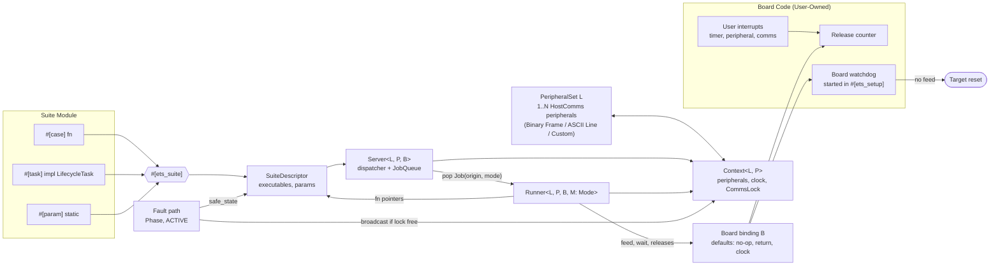

# ETS Executive (ets-executive)


---

### 1. Introduction

The Embedded Test Server (`embedded-test-server-design.md`) executes atomic test
cases and continuous lifecycle tasks on a target microcontroller. Extending a
single-peripheral request-response loop by branching inside the server couples
every execution model to the command dispatcher and prevents companion
peripherals from queuing work or observing live state. This design structures
the target runtime as a single-job cyclic executive [1] (`ADR-0002`): a
multi-peripheral `Server` with a static first-in, first-out (FIFO) `JobQueue`,
one `Runner` parameterized by a static `Mode`, data-only flash descriptors and
typed user contracts. Board resources (watchdog, timers, interrupts and sleep)
stay in user code and reach the executive only through a `Board` binding whose
hooks all have defaults. Hosted integration into a third-party real-time
operating system (RTOS) and concurrent active jobs are out of scope.

Primary usage scenarios:

- **Kernel profiling**: A developer runs one case on target with interrupts
  masked and reads cycles, wall-clock time and stack peak; failure is a panic, a
  stack overflow or a budget overrun.
- **Closed-loop simulation**: A developer runs a lifecycle task in lockstep
  against a host plant model; failure is a mispaired step, a lost sample, a link
  loss or numerical divergence.
- **Free-running and periodic execution**: A developer runs a task at line rate
  or on a fixed period and reads step and release timing; failure is release
  jitter beyond the sample period or an overrun.
- **Interrupt-driven execution**: A developer releases task steps from a board
  timer or peripheral interrupt and lets the target sleep between releases;
  failure is a missed release, a lost wake-up or a target that sleeps through a
  stop command.
- **Multi-peripheral and dual-endpoint operation**: A developer connects an
  automated runner or terminal dashboard (`control-rs-tui`) on a binary USB CDC
  endpoint while simultaneously inspecting suites, tuning parameters or queuing
  jobs from a plain serial monitor (`minicom` or `screen`) on a second text USB
  CDC or UART endpoint; failure is port contention, an unopened endpoint
  blocking the active loop, or unsolicited discovery frames corrupting an active
  session.
- **Online parameter tuning**: A developer reads and changes named parameters
  while idle or during a run; failure is a partially applied value, an
  interrupted run or a value outside its bounds.
- **Fault containment**: A run panics, faults or blocks; failure is an actuator
  left energized, a fault left unreported or a target that never recovers.

---

### 2. Requirements

#### 2.1 Functional Requirements

- **FR-1 — Single execution contract**: Atomic cases and lifecycle tasks are
  executables of one descriptor kind, discovered, listed and started through the
  same commands. Separate descriptor or dispatcher paths would duplicate
  discovery and fault handling.
- **FR-2 — Execution modes**: An executable runs in one of the modes it
  declares: `Atomic`, `Lockstep`, `FreeRunning`, `Periodic` or `Triggered`.
  Commands requesting a mode outside the allowed mask of the executable are
  rejected without starting a run.
- **FR-3 — Typed lifecycle**: A lifecycle task supplies `setup`, `step`,
  `reset`, `teardown` and a fault-path `safe_state`; omitting any one is a
  compile error.
- **FR-4 — Step-indexed data exchange**: Every task input and output carries the
  run's step index, and `Lockstep` step `k` consumes only input `k`. Sequence
  gaps terminate the run with an error verdict.
- **FR-5 — Supervised runs**: A run ends with exactly one verdict from `Pass`,
  `Fail`, `Error`, `Aborted`, `TimedOut`, `Bounded` or `Overrun`, and host stop,
  heartbeat timeout and step bound are serviced while the run waits for input or
  a release.
- **FR-6 — Named parameters**: Suite parameters are named primitive values
  (`u8`, `u16`, `u32`, `i32`, `f32`, `bool`) discoverable with value, type,
  bounds, description, index and count [17], [18]; the host reads one by name or
  index and writes one by name while idle or between steps of a run, and every
  write is echoed and broadcast to attached peripherals.
- **FR-7 — Fault settlement**: On a panic or exception the target drives the
  active task to its safe state at most once and broadcasts the fault report
  when the transport lock is free; otherwise the host detects the unreported
  fault from its tracked device state.
- **FR-8 — Release timing**: `Periodic` releases step `k` at `k·T` from the run
  start [6], [7] and `Triggered` releases one step per event of the board
  release source; both report minimum and maximum step duration and missed
  releases, `Periodic` also reports release jitter [8], and a missed release
  ends the run with `Overrun` [1], [10]; `Periodic` without a board release
  source requires a profiler clock.
- **FR-9 — Hang containment**: A step that does not return within the run
  deadline ends in a target reset, through a board watchdog that the user starts
  in `#[ets_setup]` and the executive feeds through the board binding [22]–[25]
  or, without one, a host-triggered external reset.
- **FR-10 — Board binding**: `#[ets_setup]` may supply a board binding with a
  feed hook, a wait hook and a release source; each has a default, so a board
  without a watchdog, a low-power wait or a release interrupt runs unchanged.
- **FR-11 — Multi-peripheral command polling and FIFO job queueing**: The server
  polls one or more `HostComms` peripherals, replies to discovery and parameter
  reads only on the originating peripheral, queues `RunExecutable` requests
  tagged with their originating peripheral index in a static FIFO `JobQueue`,
  and routes `TaskSample` output to the job's originating peripheral while
  broadcasting parameter writes, run state transitions, statistics, logs and
  fault reports across all attached peripherals.

#### 2.2 Non-Functional Requirements

- **NFR-1 — Boundary overhead**: Step-boundary supervision, peripheral polling
  and telemetry emission stay within the per-step dispatch budget of
  `embedded-test-server-design.md` NFR-3.

#### 2.3 Constraints

- **C-1 — Inherited target environment**: Conforms to
  `embedded-test-server-design.md` C-1 and C-2 (`#![no_std]`, zero dynamic heap
  allocation, descriptors in ROM).
- **C-2 — One active job**: At most one executable runs at a time; execution
  requests arriving while a job is active or queued wait in `JobQueue` in FIFO
  order.
- **C-3 — Static dispatch**: Target-side executables, runners, peripheral sets
  and board bindings use no `dyn` trait objects [2], [4].
- **C-4 — Global state**: No reference to a `static mut` [5]; conforms to
  `test-suite-design.md` C-3.
- **C-5 — Exclusions**: Hosted integration into a third-party scheduler and
  concurrent runs are out of scope [26].
- **C-6 — Interrupt isolation**: Interrupt handlers have no access to task state
  or parameter cells.
- **C-7 — Peripheral-owned framing and bandwidth**: `HostComms` implementations
  (`host-comm-design.md`) own wire framing, non-blocking port readiness and any
  interrupt receive buffer [12]; the executive does not frame bytes or
  rate-limit links.
- **C-8 — User-owned target sizing**: Fitting the ETS to a constrained target
  and selecting a peripheral topology and server binary rate matched to the
  intended workload are the user's responsibility.
- **C-9 — No executive interrupts**: The executive defines no interrupt handler,
  vector or priority [20], [26], and masks interrupts only through the
  `critical-section` implementation the binary selects [27].
- **C-10 — Atomic-free build**: Executive and parameter state compile on targets
  without atomic read-modify-write instructions and on targets without atomics
  [29]–[32].

---

### 3. Technical Overview

The executive splits data from behavior across three target components:
flash descriptors (`test-suite-design.md`, `macros-design.md`), a
multi-peripheral `Server` with a static FIFO `JobQueue`, and a `Runner`
parameterized by a static `Mode`. Typed contracts compile to monomorphic code at
zero dynamic dispatch cost [2]; the linker-section function pointer is the only
indirection. `Server` polls every attached `HostComms` peripheral (`PeripheralSet`),
answers immediate queries on the asking peripheral, queues execution requests
into `JobQueue` with the originating peripheral index (releasing the
`poll_command` borrow immediately), and pops one `Job` at a time into `Runner`.



---

### 4. Architecture

The target executive lives in the `control-rs-ets` crate across
`control-rs-ets/src/server.rs`, `control-rs-ets/src/run.rs`,
`control-rs-ets/src/board.rs` and `control-rs-ets/src/fault.rs`. It builds on
the descriptor, parameter and cell primitives in `control-rs-ets/src/exec.rs`,
`control-rs-ets/src/params.rs` and `control-rs-ets/src/cell.rs`
(`test-suite-design.md`, `macros-design.md`), the timing and stack profiler in
`control-rs-ets/src/profiler.rs` (`cpu-profiler-design.md`), and the
`HostComms` transport contract in `control-rs-ets/src/comms.rs`
(`host-comm-design.md`). Host-side session management lives in
`control-rs-ets-host` (`ets-host-design.md`).

#### 4.1 Executable Descriptor and Typed Contract

Serves: FR-1, FR-3, C-1, C-3, C-4

One descriptor kind (`ExecDescriptor`, defined in `test-suite-design.md` §4.1)
carries `name`, `description`, `allowed_modes`, `input` and `output`
`PacketSchema` metadata, and five function pointers: `setup`, `step`, `reset`,
`teardown` and `safe_state`. A plain `#[case]` function maps to a one-step
executable whose other four pointers are shared no-ops and whose allowed mode
mask is `ModeMask::ATOMIC`.

`LifecycleTask` (`test-suite-design.md` §4.2) is the typed contract above the
descriptor. `setup` returns `Result<Self, &'static str>` and `teardown` consumes
`self`, encoding run state in the type system so no step can precede setup or
follow teardown [3]. `safe_state` is an associated function (`fn safe_state()`)
because the fault handler cannot borrow state held by an interrupted step.
Because `LifecycleTask` carries associated constants and types, it is not
`dyn`-compatible [4]; `#[ets_suite]` erases it into monomorphic wrapper
functions backed by a static `TaskSlot<T>` (`StateCell`-guarded interior
mutability without `static mut` references [5]), satisfying C-3 and C-4.

#### 4.2 Multi-Peripheral Server, PeripheralSet and FIFO JobQueue

Serves: FR-1, FR-11, C-1, C-2, C-3, C-7

```rust
/// Static collection of one or more `HostComms` peripherals attached to `Server`.
pub trait PeripheralSet {
    /// Transport error type surfaced by the peripheral set.
    type Error;

    /// Number of attached peripherals.
    fn count(&self) -> usize;

    /// Polls peripheral `index` for the next incoming command.
    fn poll_at(&mut self, index: usize) -> PollResult<Self::Error>;

    /// Sends `telemetry` only to peripheral `index` (request-scoped replies and `TaskSample`).
    fn send_at(
        &mut self,
        index: usize,
        telemetry: &Telemetry<'_>,
    ) -> SendResult<Self::Error>;

    /// Broadcasts `telemetry` to every attached peripheral (state changes, stats, logs, faults).
    fn broadcast(&mut self, telemetry: &Telemetry<'_>) -> SendResult<Self::Error>;

    /// Flushes pending outbound bytes on peripheral `index`.
    fn flush_at(&mut self, index: usize) -> SendResult<Self::Error>;

    /// Flushes all attached peripherals.
    fn flush_all(&mut self) -> SendResult<Self::Error>;

    /// Closes all attached peripherals cleanly.
    fn close_all(&mut self);

    /// Closes all attached peripherals on failure.
    fn close_all_on_failure(&mut self);
}

/// Default capacity of the static FIFO job queue.
pub const MAX_QUEUED_JOBS: usize = 8;

/// A validated execution request waiting in `JobQueue` or running in `Runner`.
#[derive(Clone, Copy, Debug, PartialEq, Eq)]
pub struct Job {
    pub exec: &'static ExecDescriptor,
    pub item: u16,
    pub max_steps: u64,
    pub mode: ExecMode,
    pub origin: usize,
    pub params: ParamTable,
    pub period_ns: u32,
    pub suite: u16,
}

/// Fixed-capacity FIFO ring buffer of queued jobs across attached peripherals.
pub struct JobQueue<const N: usize = MAX_QUEUED_JOBS> {
    buf: [Option<Job>; N],
    head: usize,
    len: usize,
}

impl<const N: usize> JobQueue<N> {
    #[must_use]
    pub const fn new() -> Self;
    #[must_use]
    pub const fn is_empty(&self) -> bool;
    #[must_use]
    pub const fn is_full(&self) -> bool;
    #[must_use]
    pub const fn len(&self) -> usize;
    pub fn push(&mut self, job: Job) -> bool;
    pub fn pop(&mut self) -> Option<Job>;
    pub fn clear(&mut self);
}

/// Non-blocking lock serializing access to `PeripheralSet` between the main loop and fault path.
pub struct CommsLock {
    locked: StateCell<bool>,
}

/// Outcome of a single telemetry send attempt.
#[derive(Debug, Clone, Copy, PartialEq, Eq)]
pub enum SendOutcome {
    Sent,
    Busy,
    Dropped,
}

/// Execution context owning the peripheral set, `CommsLock` and `CPUProfiler`.
pub struct Context<L, P> {
    pub comms: L,
    pub comms_lock: CommsLock,
    pub cpu_utils: P,
}

/// Single-writer indicator tracking the active suite or item index for fault reporting.
pub struct TestIndexIndicator {
    state: StateCell<isize>,
}

pub static CURRENT_SUITE: TestIndexIndicator;
pub static CURRENT_TEST: TestIndexIndicator;

/// Target Embedded Test Server dispatcher.
pub struct Server<'a, L, P, B = NoBoard> {
    pub board: B,
    pub context: Context<L, P>,
    pub jobs: JobQueue,
    pub suites: &'a [&'static SuiteDescriptor],
}

impl<'a, L: PeripheralSet, P: CPUProfiler, B: Board> Server<'a, L, P, B> {
    #[must_use]
    pub const fn new(
        context: Context<L, P>,
        suites: &'a [&'static SuiteDescriptor],
    ) -> Self;

    #[must_use]
    pub const fn with_board(
        context: Context<L, P>,
        suites: &'a [&'static SuiteDescriptor],
        board: B,
    ) -> Self;

    /// Polls all attached peripherals once, services immediate commands, and executes at most
    /// one queued job from `JobQueue`.
    pub fn poll(&mut self) -> Result<(), L::Error>;
}
```

`PeripheralSet` is implemented for any single `C: HostComms` (`count() == 1`),
for heterogeneous pairs `(A, B)` where `A: HostComms<Error = E>` and
`B: HostComms<Error = E>` (`count() == 2`), and for homogeneous arrays
`[C; N]` (`count() == N`). Every implementation compiles via static dispatch
without `dyn` trait objects (C-3). Single-peripheral targets pass their
`HostComms` driver directly to `Context::new(comms, cpu_utils)`, while
dual-endpoint targets such as Teensy 4 pass `(cdc_binary, cdc_text)`.

On each `Server::poll` pass:

1. `Server` iterates `origin in 0..self.context.comms.count()` and calls
   `poll_at(origin)` under `CommsLock`.
2. **Request-scoped queries (`Command::ListSuites`, `Command::Param` read)** are
   answered exclusively on `origin` via `send_at(origin, ...)`. Typing `list` in
   a serial monitor on peripheral 1 does not inject unsolicited discovery frames
   into an idle `Session` on peripheral 0.
3. **Parameter writes (`Command::Param` write)** validate and update the target
   `ParamEntry` in the suite's `ParamTable` and broadcast
   `Telemetry::ParamValue` to all peripherals via `broadcast(...)` so companion
   dashboards and monitors stay synchronized.
4. **Execution requests (`Command::RunExecutable`)** validate the suite index,
   item index, allowed mode mask and timing prerequisites, then construct a
   `Copy` `Job` tagged with `origin` and push it into `self.jobs` (`JobQueue`).
   Because `Job` holds only `'static` descriptor references and scalar fields,
   the borrow of `self.context.comms` from `poll_at(origin)` ends immediately
   before any job runs or emits telemetry. If `JobQueue` is full, `Server` emits
   `Telemetry::Log` on `origin` and leaves existing queued jobs undisturbed.
5. When no run is active, `Server` pops the oldest `Job` from `self.jobs` and
   constructs `Runner<L, P, B, M>` for `job.mode`.

#### 4.3 Runner, Execution Modes and Release Pacing

Serves: FR-2, FR-4, FR-5, FR-8, NFR-1, C-2, C-3, C-5

```rust
/// How an execution mode releases task steps.
#[derive(Debug, Clone, Copy, PartialEq, Eq)]
pub enum Pacing {
    None,
    Periodic,
    Triggered,
}

/// Static compile-time contract for an execution mode.
pub trait Mode {
    const MODE: ExecMode;
    const ONE_STEP: bool = false;
    const NEEDS_INPUT: bool = false;
    const PACING: Pacing = Pacing::None;
}

#[derive(Debug, Clone, Copy, Default)]
pub struct Atomic;
#[derive(Debug, Clone, Copy, Default)]
pub struct Lockstep;
#[derive(Debug, Clone, Copy, Default)]
pub struct FreeRunning;
#[derive(Debug, Clone, Copy, Default)]
pub struct Periodic;
#[derive(Debug, Clone, Copy, Default)]
pub struct Triggered;

/// Executes a single `Job` in mode `M`.
pub struct Runner<'a, L, P, B, M> {
    board: &'a mut B,
    context: &'a mut Context<L, P>,
    jobs: &'a mut JobQueue,
    job: Job,
    mode: core::marker::PhantomData<M>,
    suites: &'a [&'static SuiteDescriptor],
}

impl<'a, L: PeripheralSet, P: CPUProfiler, B: Board, M: Mode>
    Runner<'a, L, P, B, M>
{
    pub fn run(
        context: &'a mut Context<L, P>,
        board: &'a mut B,
        suites: &'a [&'static SuiteDescriptor],
        jobs: &'a mut JobQueue,
        job: Job,
    ) -> Result<(), L::Error>;
}
```

`Runner<L, P, B, M>` executes one `Job` to completion and returns control to
`Server`. The server takes a single runtime `match` from `job.mode` to the
monomorphic `Runner<..., M>` entry point once per job.

```mermaid
stateDiagram-v2
    [*] --> Armed: ACTIVE set, Phase::Armed, broadcast ItemState::Running
    Armed --> Ready: setup() Ok, release source armed
    Armed --> Settling: setup() Err -> Verdict::Error
    Ready --> Stepping: input ready and release due
    Ready --> Waiting: awaiting Lockstep input or release
    Waiting --> Boundary: board.wait() returns
    Stepping --> Boundary: emit TaskSample k to job.origin
    Stepping --> Settling: Pass / Fail / Error
    Boundary --> Ready: no verdict, board.feed()
    Boundary --> Settling: Aborted / TimedOut / Bounded / Overrun
    Settling --> [*]: disarm, teardown(), Phase::Done, broadcast RunStats + ItemState::Done
```

At each step boundary, `Runner` drains commands across all attached peripherals:

- On `job.origin`: `Command::TaskInput` stores input `k` (a sequence gap yields
  `Verdict::Error` with `"input sequence gap"`), `Command::Heartbeat` refreshes
  the link deadline, `Command::Param` reads or writes a parameter,
  `Command::StopNow` ends the run with `Verdict::Aborted`, and
  `Command::TryReset` invokes `CPUProfiler::reset()`.
- On non-origin peripherals (`i != job.origin`): `Command::ListSuites` and
  `Command::Param` reads reply on `i`, `Command::Param` writes apply at the step
  boundary (calling `reset` once on the active task if the write targets the
  running suite) and broadcast `Telemetry::ParamValue`, `Command::StopNow`
  aborts the active run, and `Command::RunExecutable` enqueues the requested job
  into `self.jobs` (`JobQueue`) for execution after the current run settles.
- Outbound `Telemetry::TaskSample` frames are sent only to `job.origin` via
  `send_at(job.origin, ...)`: in `Lockstep` mode the runner holds until the frame
  is accepted, whereas in `FreeRunning`, `Periodic` and `Triggered` modes a busy
  transport increments the dropped-sample counter and continues without blocking
  the control loop (`host-comm-design.md` FR-7). Run lifecycle messages
  (`Telemetry::ItemState`, `Telemetry::RunStats`, `Telemetry::Log`) broadcast to
  all attached peripherals.

`Periodic` and `Triggered` take releases from `Board` (§4.6). `Periodic`
releases step `k` at the absolute time $k \cdot T$ from the run start, matching
`xTaskDelayUntil` [6]; a relative delay of $T$ after each step would drift by
the step duration [7]. The difference between the scheduled release time and the
actual step start is release jitter [8]. `Triggered` releases one step per
event reported by `Board::releases` and has no nominal period, reporting step
duration and missed releases without jitter. Without a board release source,
`Periodic` derives release times from `CPUProfiler::get_nanos`
(`cpu-profiler-design.md` FR-2); if `CPUProfiler::has_clock` is `false`, the
server rejects the `Periodic` request before arming. At each boundary `Runner`
reads the elapsed release count; a count above one indicates that a release
passed while the step was executing, matching Linux `timerfd` expiration counts
[9] and FreeRTOS late-release detection [6], and terminates the run with
`Verdict::Overrun` [1], [10], [41].

#### 4.4 Named Parameter Dictionary

Serves: FR-6, C-3, C-4, C-6

Each `#[param]` static in an `#[ets_suite]` module expands to a `ParamEntry`
collected in a flat `ParamTable` (`&'static [ParamEntry]`, defined in
`test-suite-design.md` §4.3), free of `dyn` trait objects [4]. Every parameter
stores its value in a `StateCell` (volatile load and store, no atomic
read-modify-write) mutated only by `Server` while idle or by `Runner` at a step
boundary when no user step is executing (C-2). Because `Cell` is not `Sync`
[14], [16] and Rust requires static items to implement `Sync` [15], `StateCell`
implements `Sync` under the single-writer executive invariant and C-6 interrupt
isolation, avoiding seqlock reader retries [33] and `static mut` references [5].

Parameters form a flat dictionary per suite modeled on the MAVLink parameter
protocol [17], [18]. Discovery and `Command::Param` reads emit
`Telemetry::ParamValue` carrying `suite`, `index`, `count`, `name`, `value`,
`bounds` and `description`. `Command::Param` writes look up the parameter by
name in `ParamTable`, validate the primitive variant (`u8`, `u16`, `u32`, `i32`,
`f32`, `bool`) and optional bounds, update the `StateCell` when valid, and
always echo the stored `Telemetry::ParamValue` so the caller can confirm the
effective state [17]. If a valid write targets the currently running suite at a
step boundary, `Runner` calls the task's `reset` hook once before the next step.

#### 4.5 Fault Path and Safe-State Settlement

Serves: FR-7, C-4, C-10

```rust
/// Run lifecycle phase inspected by the fault handler.
#[derive(Debug, Clone, Copy, PartialEq, Eq)]
pub enum Phase {
    Armed,
    Done,
    Idle,
    TearingDown,
}

/// Outcome of calling `fault::settle()` from a panic or exception handler.
#[derive(Debug, Clone, Copy, PartialEq, Eq)]
pub enum Settled {
    FailedTeardown,
    Nothing,
    SafeState,
}

#[must_use]
pub fn phase() -> Phase;
pub fn arm(exec: &'static ExecDescriptor);
pub fn set_phase(phase: Phase);
pub fn clear();
pub fn settle() -> Settled;
```

Rust `#[panic_handler]` functions diverge (`-> !`) [19], so stack unwinding and
`Drop` destructors never run on a target fault. The fault handler masks
interrupts via `critical-section` [27] and calls `fault::settle()`:

- From `Phase::Armed`: transitions to `Phase::TearingDown`, invokes the
  `(exec.safe_state)()` function pointer of the active descriptor once,
  transitions to `Phase::Done`, and returns `Settled::SafeState`.
- From `Phase::TearingDown`: transitions directly to `Phase::Done` without
  re-entering `safe_state` or `teardown` and returns `Settled::FailedTeardown`.
- From `Phase::Idle` or `Phase::Done`: performs no action and returns
  `Settled::Nothing`.

If `CommsLock::try_lock()` succeeds, the fault handler broadcasts
`Telemetry::FaultReport` (including panic file, line, message, active suite/item
indices from `CURRENT_SUITE`/`CURRENT_TEST`, and stacked Cortex-M exception
registers [20] when applicable) across `PeripheralSet::broadcast`. If the lock
is already held by an interrupted transmission, the handler skips transmission
rather than deadlocking, and the host `Session` detects the unreported fault
from its tracked run state (`ets-host-design.md`).

#### 4.6 Board Binding, Hang Containment and Target Server Topologies

Serves: FR-8, FR-9, FR-10, FR-11, C-6, C-7, C-8, C-9

```rust
/// Optional hooks connecting the executive to board watchdog, low-power sleep and release timers.
pub trait Board {
    /// Reloads the hardware watchdog started by user setup code.
    fn feed(&mut self) {}

    /// Waits until an interrupt or event may make work runnable.
    fn wait(&mut self) {}

    /// Returns `true` when the board provides a hardware release counter.
    fn has_release_source(&self) -> bool {
        false
    }

    /// Arms the hardware release source (`Some(period_ns)` for `Periodic`, `None` for `Triggered`).
    fn arm(&mut self, _period_ns: Option<u32>) {}

    /// Returns the number of release events since the last call and clears the counter.
    fn releases(&mut self) -> u32 {
        0
    }

    /// Disarms the hardware release source at run settlement.
    fn disarm(&mut self) {}
}

/// Default board binding with no watchdog, no sleep and no hardware release source.
#[derive(Debug, Clone, Copy, Default)]
pub struct NoBoard;

impl Board for NoBoard {}
```

`embedded-hal` 1.0 removed portable watchdog and timer traits [21], and silicon
watchdog peripherals differ in start, feed and disable semantics [22]–[25].
The user therefore initializes any hardware watchdog in `#[ets_setup]` and
supplies `Board::feed`, which the executive calls at idle, at each step boundary
and around `Board::wait`, but never inside a step or `Atomic` case. A step that
stops responding stops feeding the watchdog and triggers a hardware reset (FR-9). User
release interrupts increment a user-owned counter protected by
`critical-section` [27]; `Board::releases` reads and clears that counter in
executive context so no interrupt handler touches task slots or parameters (C-6,
C-9) [20], [26].

To support diverse rate and interface requirements on hardware (C-8, FR-11),
`examples/teensy4` provides three reference server binaries built on the same
`Server` and suites:

1. **`teensy4_fast_cdc`**: Single high-speed binary USB CDC peripheral
   (`FrameReader`/`FrameEncoder`) tuned for low-overhead `Lockstep`,
   `FreeRunning` and `Periodic` HIL tasks.
2. **`teensy4_text`**: Single USB CDC peripheral using `Command::from_str` and
   `Telemetry::fmt` (`Display`) line I/O for standalone human interaction from
   any serial terminal (`minicom`, `screen`, `tio`).
3. **`teensy4_dual`**: Composite USB device (`UsbDeviceBuilder::composite_with_iads()`,
   `EndpointMemory<2048>`) exposing two simultaneous USB CDC ports passed to
   `Context::new((cdc_binary, cdc_text), profiler)`. Each CDC port gates
   outbound writes on `dtr()` (Data Terminal Ready) plus a non-blocking write
   budget so an unopened or paused terminal on one port drops frames for that
   port without stalling the active port or the control loop.

#### 4.7 Atomic-Free Targets

Serves: C-10

Executive fault-path state (`ACTIVE`, `PHASE`, `CURRENT_SUITE`, `CURRENT_TEST`,
`CommsLock`) is mutated only in executive context or inside the fault handler
after masking interrupts via `critical-section` [27], so it requires only load
and store operations and never atomic compare-and-swap (CAS). Targets such as
`thumbv6m-none-eabi` (ARMv6-M) provide atomic load/store without CAS [29], [30],
while targets such as AVR lack atomic instructions entirely [32]. `StateCell<T>`
uses plain volatile loads and stores inside a `UnsafeCell<T>` [14]–[16] paired
with `core::sync::atomic::compiler_fence(Ordering::SeqCst)` around phase
transitions, avoiding unsound single-core polyfills [31].

#### 4.8 Error Handling

Serves: FR-2, FR-5, FR-6, FR-8, FR-11

Run-time task failures are reported as `Verdict::Error` with a `'static str`
message (from `LifecycleTask::setup`, `reset`, `teardown`, packet decoding or
input sequence checks) inside `Telemetry::ItemState`. Dispatcher-level command
rejections (unknown suite or item index, mode outside `allowed_modes`,
`Triggered` when `!board.has_release_source()`, `Periodic` when neither
`board.has_release_source()` nor `cpu_utils.has_clock()` holds, or a full
`JobQueue`) emit `Telemetry::Log` on the originating peripheral and leave the
server state unchanged. Parameter writes (`ParamTable::set`) return
`Result<ParamValue, ParamError>` (`ParamError::{Unknown, TypeMismatch, OutOfBounds}`)
and always echo the stored value. Transport failures from `PeripheralSet`
propagate as `Result<(), L::Error>` from `Server::poll` and `Runner::run`.

#### 4.9 Dependencies

Serves: C-1, C-9, C-10

`control-rs-ets` depends only on `no_std`-compatible crates already in the
workspace (`serde`, `postcard`, `crc`, `heapless` [12], and architecture-gated
`cortex-m` / `riscv`), adding zero new third-party dependencies.

---

### 5. Alternatives

| Alternative | Rejected Because |
|:------------|:-----------------|
| Separate case and task runners | Duplicates arming, reporting and fault settlement; violates FR-1 [1]. |
| Single-peripheral `Server` or external `DualComms` wrapper | Cannot queue jobs across peripherals or route `TaskSample` to the originating endpoint while broadcasting state updates; violates FR-11. |
| `&mut [&mut dyn HostComms]` peripheral slice | Introduces fat-pointer vtable indirection in target code; violates C-3 [4]. |
| Byte-slice `Link` / `ByteStream` / `StreamLink` layer | Duplicates framing already provided by `HostComms` (`FrameReader`/`FrameEncoder` and `FromStr`/`Display`); violates C-7. |
| Run loop inside macro-generated trampoline | Forces flash descriptors to name the transport and board types; violates C-3 [4]. |
| `Drop` guard for task teardown | Panic handlers never return, so destructors do not run on a fault; violates FR-7 [19]. |
| Raw pointer writes into a borrowed settings struct | Aliases a live reference; violates C-4 [5]. |
| Field-addressed parameter groups with seqlock storage | Seqlock readers retry around concurrent writers [13], [33], whereas the executive is the sole writer at idle or step boundaries. |
| Target-side JSON or dynamic schema reflection for parameters | Requires `serde-json-core` [34] or `postcard-schema` / `postcard-dyn` [35] flash and stack overhead when six primitive variants suffice. |
| Preemptive scheduler with concurrent jobs | Outside C-2 and C-5; production firmware owns preemption [26]. |
| Executive-owned receive interrupt and queue | Couples board-specific ISR vectors into `Server` [12], [13]; violates C-7 and C-9. |
| Executive-owned watchdog trait with `start(period)` | Board watchdogs differ in start, feed and disable semantics and some cannot be stopped [21]–[25]; a `Board::feed` hook covers all of them. |
| Relative delay of $T$ between periodic steps | Drifts by the step execution duration; violates FR-8 [7]. |
| Compare-and-swap polyfill for executive state | Single-core polyfills are unsound on multi-core parts [31]; executive state needs only load, store and compiler fences. |
| Zero-copy raw payload cast | Fails on misaligned frame buffers [28]. |

---

### 6. Verification & Validation

#### 6.1 Verification

| Condition | Requirement | Method | Target | Criterion |
|:----------|:------------|:-------|:-------|:----------|
| VC-1.1 | FR-1 | `libtest` | `control_rs_ets::server::tests::atomic_run_reports_state_and_stats` | A case and a task in one suite start through `RunExecutable` and report through the same state message; FR-1 holds iff all conditions hold. |
| VC-1.2 | FR-1 | `libtest` | `control_rs_macros::tests::generate_suite_descriptors_emits_wrappers_and_registry` | A plain `#[case]` function expands to an `ExecDescriptor` whose allowed mode mask is `ModeMask::ATOMIC`. |
| VC-2.1 | FR-2 | `libtest` | `control_rs_ets::server::tests::requests_the_server_cannot_serve_are_answered_with_a_log` | A mode outside the allowed mask of the descriptor is rejected with an error log and the executive stays idle; FR-2 holds iff all conditions hold. |
| VC-2.2 | FR-2 | `libtest` | `control_rs_ets::run::tests::atomic_runs_one_step_masked` | `Atomic` runs exactly one step between interrupt mask and unmask. |
| VC-2.3 | FR-2 | `libtest` | `control_rs_ets::run::tests::triggered_runs_one_step_per_release` | With a mock release source, `Triggered` runs exactly one step per reported release. |
| VC-3.1 | FR-3 | `libtest` | `control_rs_macros::tests::missing_lifecycle_fn_fails_to_compile` | Omitting any of the five `LifecycleTask` functions fails compilation; FR-3 holds iff all conditions hold. |
| VC-4.1 | FR-4 | `libtest` | `control_rs_ets::run::tests::lockstep_waits_for_input_k` | `Lockstep` step `k` runs only after input `k`, every output carries `seq = k`, and an input sequence gap ends the run with `Verdict::Error`; FR-4 holds iff all conditions hold. |
| VC-5.1 | FR-5 | `libtest` | `control_rs_ets::run::tests::free_running_is_bounded_and_the_first_verdict_wins` | Each verdict source ends the run with that verdict and a subsequent source does not overwrite it; FR-5 holds iff all conditions hold. |
| VC-5.2 | FR-5 | `libtest` | `control_rs_ets::run::tests::stop_and_timeout_while_waiting` | `StopNow` and heartbeat timeout terminate a run while waiting for lockstep input or a release. |
| VC-6.1 | FR-6 | `libtest` | `control_rs_ets::server::tests::param_table_get_set_echo` | In-bounds parameter writes store, out-of-bounds writes fail, and both echo and broadcast the stored `ParamValue`; FR-6 holds iff all conditions hold. |
| VC-6.2 | FR-6 | `libtest` | `control_rs_ets::params::tests::a_table_is_addressed_by_position` | Reading a parameter by name and by index returns the same entry, and an unknown name or type mismatch leaves all entries unchanged. |
| VC-6.3 | FR-6 | `libtest` | `control_rs_ets::run::tests::a_parameter_write_during_a_run_is_followed_by_one_reset` | A valid parameter write for the running suite at a step boundary invokes `reset` once before the next step. |
| VC-7.1 | FR-7 | `libtest` | `control_rs_ets::fault::tests::phase_transition_calls_safe_state_once` | `fault::settle()` invokes `safe_state` once from `Phase::Armed` and never from `Phase::TearingDown`, `Phase::Idle` or `Phase::Done`; FR-7 holds iff all conditions hold. |
| VC-8.1 | FR-8 | `libtest` | `control_rs_ets::run::tests::release_count_above_one_is_overrun` | A step boundary that observes more than one elapsed release ends the run with `Verdict::Overrun` and reports the missed count in both `Periodic` and `Triggered`; FR-8 holds iff all conditions hold. |
| VC-8.2 | FR-8 | `libtest` | `control_rs_ets::run::tests::periodic_release_is_absolute` | `Periodic` schedules release times at $k \cdot T$ from run start regardless of step duration below $T$. |
| VC-8.3 | FR-8 | `libtest` | `control_rs_ets::server::tests::periodic_without_clock_or_source_is_rejected` | `Periodic` is rejected when `CPUProfiler::has_clock` is `false` and `Board::has_release_source` is `false`. |
| VC-8.4 | FR-8 | `libtest` | `control_rs_ets::run::tests::periodic_release_jitter_bounded` | Reported release jitter on Teensy 4.1 equals measured step start minus $k \cdot T$ within one clock tick. |
| VC-9.1 | FR-9 | `libtest` | `control_rs_ets::run::tests::feed_at_boundaries_and_wait_only_when_nothing_is_runnable` | `Board::feed` is called at idle, at each step boundary and around each `Board::wait`, and never inside a step or `Atomic` case; FR-9 holds iff all conditions hold. |
| VC-9.2 | FR-9 | `gate` | `clippy` | Documentation states that user setup starts the watchdog, the executive only feeds it, and hung steps without a watchdog require a host reset. |
| VC-10.1 | FR-10 | `libtest` | `control_rs_ets::server::tests::default_binding_runs_all_but_triggered` | With `NoBoard` every mode except `Triggered` runs and `Triggered` is rejected; FR-10 holds iff all conditions hold. |
| VC-10.2 | FR-10 | `libtest` | `control_rs_ets::run::tests::feed_at_boundaries_and_wait_only_when_nothing_is_runnable` | `Board::wait` is called only when idle, waiting for lockstep input or waiting for a release. |
| VC-11.1 | FR-11 | `libtest` | `control_rs_ets::server::tests::multi_peripheral_job_queue_and_routing` | Queries reply only on the asking peripheral, `RunExecutable` requests from multiple peripherals execute in FIFO order via `JobQueue`, `TaskSample` routes only to `job.origin`, and parameter updates and run state transitions broadcast to all peripherals; FR-11 holds iff all conditions hold. |
| VC-12.1 | NFR-1 | `libtest` | `control_rs_ets::run::tests::step_boundary_dispatch_overhead_bounded` | Step-boundary supervision and peripheral polling overhead stay within the configured real-time timing budget. |
| VC-13.1 | C-1 | `gate` | `clippy` | `control-rs-ets` builds `#![no_std]` with zero allocator symbols and fits within the flash and RAM bounds. |
| VC-14.1 | C-2 | `libtest` | `control_rs_ets::server::tests::multi_peripheral_job_queue_and_routing` | A `RunExecutable` command arriving during an active run is queued in `JobQueue` rather than starting a second concurrent runner. |
| VC-15.1 | C-3 | `gate` | `clippy` | Zero `dyn` trait objects appear in `control-rs-ets` target modules. |
| VC-16.1 | C-4 | `gate` | `clippy` | Zero `static mut` references appear in `control-rs-ets` or macro expansion output. |
| VC-17.1 | C-5 | `gate` | `deny` | No RTOS scheduler integration or concurrent-job API exists in `control-rs-ets`. |
| VC-18.1 | C-6 | `gate` | `clippy` | No interrupt handler in `control-rs-ets` or macro output accesses a `TaskSlot` or `ParamEntry`. |
| VC-19.1 | C-7 | `gate` | `clippy` | `server.rs` and `run.rs` contain no byte-level framing, receive ISR queue or link rate limiter. |
| VC-20.1 | C-8 | `gate` | `clippy` | Documentation assigns target sizing and server binary selection (`teensy4_fast_cdc`, `teensy4_text`, `teensy4_dual`) to the user. |
| VC-21.1 | C-9 | `gate` | `clippy` | No `#[interrupt]` handler, vector entry or priority configuration appears in `control-rs-ets` library code; interrupt masking uses only `critical-section`. |
| VC-22.1 | C-10 | `gate` | `build` | `control-rs-ets` cross-compiles for `thumbv6m-none-eabi` without a compare-and-swap polyfill dependency; C-10 holds iff all conditions hold. |
| VC-22.2 | C-10 | `libtest` | `control_rs_ets::fault::tests::phase_transition_calls_safe_state_once` | Fault-path `Phase` transitions use `StateCell` loads, stores and compiler fences without atomic read-modify-write instructions. |

Coverage: 90% line coverage of `control-rs-ets` (`server`, `run`, `params`,
`board` and `fault`), measured with `cargo coverage`. Excluded:
architecture-specific fault register capture and inline assembly interrupt
masking.

#### 6.2 Acceptance

| Claim | Oracle | Measure | Bound |
|:------|:-------|:--------|:------|
| Unified executive for cases and tasks | Mixed suite on QEMU and Teensy 4.1 | Runs requiring a separate dispatcher or runner | 0 |
| Multi-peripheral FIFO queueing and routing | 2-peripheral `(BinaryComms, TextComms)` server | Unsolicited discovery/sample leaks onto idle peripheral | 0 |
| Periodic release accuracy | 1 kHz `Periodic` run on Teensy 4.1 with DWT samples | Reported release jitter vs. measured step start minus $k \cdot T$ | Within 1 clock tick |
| Overrun detection | Step exceeding its nominal period $T$ | Verdict and missed-release count | `Verdict::Overrun`, count $\ge 1$ |
| Fault settlement | Panic injected during an armed task step | `safe_state` executions before reset | Exactly 1 |
| Atomic-free build | Cross-compilation for `thumbv6m-none-eabi` | CAS polyfill dependencies | 0 |

#### 6.3 Limits

QEMU runs verify functional execution and protocol sequencing, not physical
real-time timing: Cortex-M SysTick and RISC-V machine timers in QEMU are driven
by `QEMU_CLOCK_VIRTUAL` instruction counting [36]–[40]. Real-time periodic
release jitter and USB CDC `dtr()` non-blocking write behavior are verified on
physical Teensy 4.1 hardware. Interrupt isolation (C-6, C-9) is verified by
inspection of `control-rs-ets`; user interrupt handlers and release counters in
board binaries are user-owned.

---

### 7. Performance & Resource Considerations

`control-rs-ets` is `#![no_std]` with zero heap allocation (C-1). Descriptors
and parameter metadata live in flash; mutable runtime state consists of
`JobQueue` (`8 * size_of::<Option<Job>>()` bytes), one `TaskSlot<T>` per task,
one `StateCell` per parameter, and a single stack-allocated `Runner` frame with
one `MAX_PACKET_SIZE` input buffer during an active run. `PeripheralSet` and
`Board` are monomorphic generic parameters (C-3) whose default hooks inline to
no-ops. `Atomic` cases add two cycle-counter reads and one stack high-water scan
per run; streaming task modes add two clock reads per step and accumulate
running `min`, `max`, `sum` and `count` statistics in constant memory.

---

### 8. Risks & Open Questions

- **Blocking user code (FR-9, §4.6)**: A step that never returns blocks
  cooperative polling, `StopNow` and `TryReset`. Recovery requires a user-started
  hardware watchdog fed via `Board::feed` or an external host reset.
- **Overrun allowance (FR-8)**: The executive terminates on the first missed
  release [1], [10]. Simulink Real-Time supports a configurable overload count
  before halting [41]; adding an overrun allowance to `RunExecutable` remains a
  future candidate if hardware noise triggers false overruns.
- **Unopened composite USB CDC endpoints (§4.6)**: On a composite USB device
  such as `teensy4_dual`, the host operating system configures the USB device as
  soon as the cable is attached even when only one serial port is open in an
  application. `teensy4_dual` must gate writes per port on `dtr()` and return
  `SendOutcome::Dropped` on `UsbError::WouldBlock` so an unopened companion port
  never stalls the active endpoint.
- **Small-target footprint (C-8)**: Placing descriptor tables in Harvard
  program memory (`progmem`) on 8-bit AVR targets [32] remains unresearched.

---

### 9. Development Plan

| Phase | Delivers | Requirements | Effort | Status |
|:------|:---------|:-------------|:-------|:-------|
| 1. Executive core & `JobQueue` | `PeripheralSet`, `JobQueue`, `Context`, `Server` dispatcher and `Runner` with `Atomic` mode | FR-1, FR-2, FR-11, C-1, C-2, C-3, C-7 | 3 days | Planned |
| 2. Named parameter dictionary | `ParamTable` lookup, bounds checking, `StateCell` storage, origin echo and multi-peripheral broadcast | FR-6, C-4, C-6 | 2 days | Planned |
| 3. Lifecycle task modes | `Lockstep`, `FreeRunning`, `Periodic` and `Triggered` runners, step-boundary supervision and multi-peripheral polling | FR-3, FR-4, FR-5, FR-8, NFR-1, C-5 | 4 days | Planned |
| 4. Board binding, fault path & target binaries | `Board` trait, `fault::settle` atomic-free phase machine, QEMU suite updates, and `teensy4_fast_cdc`, `teensy4_text` and `teensy4_dual` servers | FR-7, FR-9, FR-10, C-8, C-9, C-10 | 4 days | Planned |

---

### 10. Revision History

| Revision | Date | Author | Description |
|:---------|:-----|:-------|:------------|
| 1.0 | October 12, 2026 | @MitchellDScott | Initial design document: single-job executive, unified `Runner`, `Mode` types, `ParamTable`, `Board` binding and phase-based `fault::settle`. |
| 2.0 | October 31, 2026 | @MitchellDScott | Replaced single-link `Context` with multi-peripheral `PeripheralSet` and static FIFO `JobQueue` (FR-11); aligned transport boundary to `HostComms` (`host-comm-design.md`); added Teensy 4 multi-server topologies (`teensy4_fast_cdc`, `teensy4_text`, `teensy4_dual`) and §4 component traceability. Affects FR-1, FR-2, FR-3, FR-4, FR-5, FR-6, FR-7, FR-8, FR-9, FR-10, FR-11, NFR-1, C-1, C-2, C-3, C-4, C-5, C-6, C-7, C-8, C-9, C-10. |

---

## References

[1] P. E. Hood, "Ada and cyclic runtime scheduling," in *Proc. 1st Int. Conf. Ada Programming Language Applications for the NASA Space Station, Vol. 1*, Houston, TX, USA, 1986.

[2] S. Klabnik and C. Nichols, "Generic Data Types: Performance of Code Using Generics," *The Rust Programming Language*. [Online]. Available: https://doc.rust-lang.org/book/ch10-01-syntax.html. Accessed: Oct. 12, 2026.

[3] Rust Embedded Working Group, "Typestate Programming," *The Embedded Rust Book*. [Online]. Available: https://docs.rust-embedded.org/book/static-guarantees/typestate-programming.html. Accessed: Oct. 12, 2026.

[4] The Rust Project, "Traits: Dyn compatibility," *The Rust Reference*. [Online]. Available: https://doc.rust-lang.org/reference/items/traits.html. Accessed: Oct. 12, 2026.

[5] The Rust Project, "Disallow references to static mut," *The Rust Edition Guide*. [Online]. Available: https://doc.rust-lang.org/edition-guide/rust-2024/static-mut-references.html. Accessed: Oct. 12, 2026.

[6] FreeRTOS, "include/task.h," in *FreeRTOS-Kernel* (tag V11.1.0). [Online]. Available: https://github.com/FreeRTOS/FreeRTOS-Kernel/blob/V11.1.0/include/task.h. Accessed: Oct. 12, 2026.

[7] Embassy, "embassy_time::Ticker," *docs.embassy.dev*. [Online]. Available: https://docs.embassy.dev/embassy-time/git/default/struct.Ticker.html. Accessed: Oct. 12, 2026.

[8] N. Audsley, A. Burns, M. Richardson, K. Tindell, and A. Wellings, "Applying New Scheduling Theory to Static Priority Pre-emptive Scheduling," *Software Engineering Journal*, pp. 284–292, 1993.

[9] Linux man-pages project, "timerfd_create(2)," *man7.org*. [Online]. Available: https://man7.org/linux/man-pages/man2/timerfd_create.2.html. Accessed: Oct. 12, 2026.

[10] MathWorks, "Troubleshoot Overloaded CPU from Executing Real-Time Application," *Simulink Real-Time Documentation*. [Online]. Available: https://www.mathworks.com/help/slrealtime/ug/troubleshoot-overloaded-cpu-from-executing-real-time-application.html. Accessed: Oct. 12, 2026.

[11] Schneider Electric, "Unity Pro: Cyclic and Periodic Execution," *Schneider Electric FAQ FA276001*. [Online]. Available: https://www.se.com/be/en/faqs/FA276001/. Accessed: Oct. 12, 2026.

[12] heapless, *heapless::spsc*: fixed-capacity SPSC lock-free queue (Version 0.9.3). [Online]. Available: https://docs.rs/heapless/0.9.3/heapless/spsc/index.html. Accessed: Oct. 12, 2026.

[13] H.-J. Boehm, "Can Seqlocks Get Along With Programming Language Memory Models?," HP Laboratories, Tech. Rep. HPL-2012-68, 2012. [Online]. Available: https://www.hpl.hp.com/techreports/2012/HPL-2012-68.pdf. Accessed: Oct. 12, 2026.

[14] The Rust Project, "Struct core::cell::Cell," *The Rust Core Library*. [Online]. Available: https://doc.rust-lang.org/core/cell/struct.Cell.html. Accessed: Oct. 12, 2026.

[15] The Rust Project, "Static items," *The Rust Reference*. [Online]. Available: https://doc.rust-lang.org/reference/items/static-items.html. Accessed: Oct. 12, 2026.

[16] The Rust Project, "Module core::cell," *The Rust Core Library*. [Online]. Available: https://doc.rust-lang.org/core/cell/index.html. Accessed: Oct. 12, 2026.

[17] MAVLink Development Team, "Parameter Protocol," *MAVLink Developer Guide*. [Online]. Available: https://mavlink.io/en/services/parameter.html. Accessed: Oct. 12, 2026.

[18] MAVLink Development Team, "MAVLINK Common Message Set (common.xml)," *MAVLink Developer Guide*. [Online]. Available: https://mavlink.io/en/messages/common.html. Accessed: Oct. 12, 2026.

[19] The Rust Project, "#[panic_handler]," *The Rustonomicon*. [Online]. Available: https://doc.rust-lang.org/nomicon/panic-handler.html. Accessed: Oct. 12, 2026.

[20] Rust Embedded Working Group Cortex-M team, *cortex-m-rt*: startup and runtime for Cortex-M (Version 0.7.7). [Online]. Available: https://docs.rs/cortex-m-rt/0.7.7/cortex_m_rt/. Accessed: Oct. 12, 2026.

[21] embedded-hal, "docs/migrating-from-0.2-to-1.0.md," in *rust-embedded/embedded-hal* (master). [Online]. Available: https://github.com/rust-embedded/embedded-hal/blob/master/docs/migrating-from-0.2-to-1.0.md. Accessed: Oct. 12, 2026.

[22] rp2040-hal, *rp2040-hal*: rp2040_hal::watchdog (Version 0.12.0). [Online]. Available: https://docs.rs/rp2040-hal/0.12.0/rp2040_hal/watchdog/struct.Watchdog.html. Accessed: Oct. 12, 2026.

[23] Embassy, "embassy-stm32/src/wdg/mod.rs," in *embassy-rs/embassy* (main). [Online]. Available: https://github.com/embassy-rs/embassy/blob/main/embassy-stm32/src/wdg/mod.rs. Accessed: Oct. 12, 2026.

[24] embedded-hal, *embedded-hal::watchdog*: watchdog traits (Version 0.2.7). [Online]. Available: https://pigweed.googlesource.com/third_party/rust_crates/+/HEAD/crates/vendor/embedded-hal-0.2.7/src/watchdog.rs. Accessed: Oct. 12, 2026.

[25] Tock Project, "kernel::platform::watchdog," *Tock kernel documentation*. [Online]. Available: https://docs.tockos.org/src/kernel/platform/watchdog.rs.html. Accessed: Oct. 12, 2026.

[26] RTIC, "The RTIC book," *rtic.rs*. [Online]. Available: https://rtic.rs/2/book/en/. Accessed: Oct. 12, 2026.

[27] critical-section, *critical-section*: cross-platform critical sections (Version 1.2.0). [Online]. Available: https://docs.rs/critical-section/1.2.0/critical_section/. Accessed: Oct. 12, 2026.

[28] bytemuck, *bytemuck*: byte reinterpretation utilities (Version 1.25.2). [Online]. Available: https://docs.rs/bytemuck/1.25.2/bytemuck/fn.try_from_bytes.html. Accessed: Oct. 12, 2026.

[29] The Rust Project, "Module core::sync::atomic," *The Rust Core Library*. [Online]. Available: https://doc.rust-lang.org/core/sync/atomic/index.html. Accessed: Oct. 12, 2026.

[30] The Rust Project, "Struct core::sync::atomic::AtomicU32," *The Rust Core Library*. [Online]. Available: https://doc.rust-lang.org/core/sync/atomic/struct.AtomicU32.html. Accessed: Oct. 12, 2026.

[31] portable-atomic, *portable-atomic*: portable atomic types (Version 1.15.0). [Online]. Available: https://docs.rs/portable-atomic/1.15.0/portable_atomic/. Accessed: Oct. 12, 2026.

[32] The Rust Project, "avr-none," *The rustc book: Platform Support*. [Online]. Available: https://doc.rust-lang.org/rustc/platform-support/avr-none.html. Accessed: Oct. 12, 2026.

[33] The Linux Kernel Documentation, "Sequence counters and sequential locks," *The Linux Kernel documentation*. [Online]. Available: https://docs.kernel.org/locking/seqlock.html. Accessed: Oct. 12, 2026.

[34] serde-json-core, *serde-json-core*: serde-json for no_std programs (Version 0.6.0). [Online]. Available: https://docs.rs/serde-json-core/0.6.0/serde_json_core/. Accessed: Oct. 12, 2026.

[35] postcard-schema, *postcard-schema*: reflection-like schemas for postcard types (Version 0.2.5). [Online]. Available: https://docs.rs/postcard-schema/0.2.5/postcard_schema/. Accessed: Oct. 12, 2026.

[36] QEMU Project, "hw/timer/armv7m_systick.c," in *qemu* (tag v8.1.2). [Online]. Available: https://qemu.googlesource.com/qemu/+/refs/tags/v8.1.2/hw/timer/armv7m_systick.c. Accessed: Oct. 12, 2026.

[37] QEMU Project, "hw/core/ptimer.c," in *qemu* (tag v8.1.2). [Online]. Available: https://qemu.googlesource.com/qemu/+/refs/tags/v8.1.2/hw/core/ptimer.c. Accessed: Oct. 12, 2026.

[38] QEMU Project, "hw/intc/riscv_aclint.c," in *qemu* (tag v8.1.2). [Online]. Available: https://qemu.googlesource.com/qemu/+/refs/tags/v8.1.2/hw/intc/riscv_aclint.c. Accessed: Oct. 12, 2026.

[39] QEMU Project, "TCG Instruction Counting," *QEMU Documentation*. [Online]. Available: https://www.qemu.org/docs/master/devel/tcg-icount.html. Accessed: Oct. 12, 2026.

[40] QEMU Project, "softmmu/icount.c," in *qemu* (tag v8.1.2). [Online]. Available: https://qemu.googlesource.com/qemu/+/refs/tags/v8.1.2/softmmu/icount.c. Accessed: Oct. 12, 2026.

[41] MathWorks, "SLRT Overload Options," *Simulink Real-Time Documentation*. [Online]. Available: https://www.mathworks.com/help/slrealtime/io_ref/slrtoverloadoptions.html. Accessed: Oct. 12, 2026.
