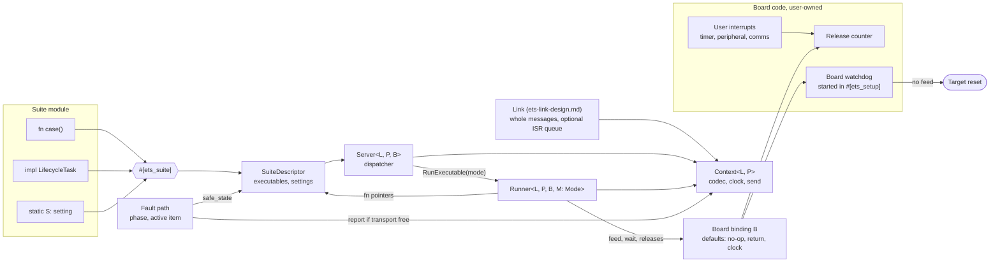
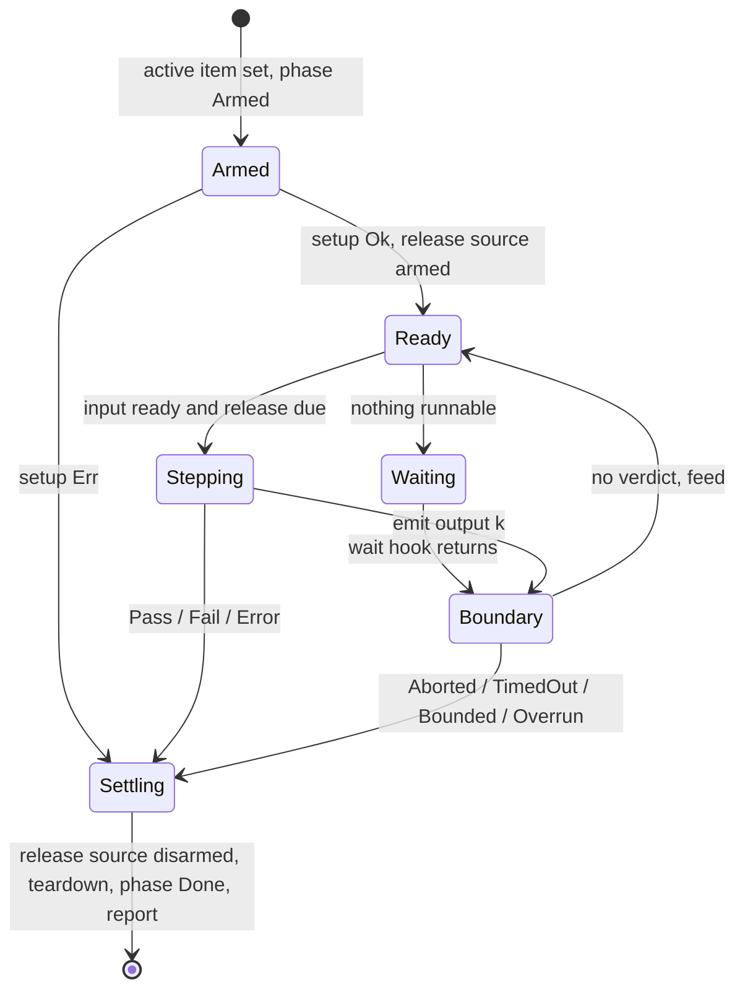

# ETS Executive (ets-executive)

---

### 1. Introduction

The Embedded Test Server (`embedded-test-server-design.md`) runs atomic cases inside a persistent target loop. Extending it with continuous tasks by adding branches to `Server` couples every execution model to the dispatcher. This design restructures the ETS as a single-job executive: one dispatcher, one runner parameterized by an execution mode, data-only descriptors and typed user contracts. The structure follows the cyclic-executive model of a predetermined ordering of processing events (Hood, 1986), restricted to one active job. Board resources (watchdog, timers, interrupts and sleep) stay in user code and reach the executive only through a board binding whose hooks all have defaults. Hosted integration into a third-party RTOS and concurrent jobs are out of scope.

Primary usage scenarios:

- **Kernel profiling**: A developer runs one case on target with interrupts masked and reads cycles, time and stack peak; failure is a panic, a stack overflow or a budget overrun.
- **Closed-loop simulation**: A developer runs a lifecycle task in lockstep against a host plant model; failure is a mispaired step, a lost sample, a link loss or numerical divergence.
- **Free-running and periodic execution**: A developer runs a task at line rate or on a fixed period and reads step and release timing; failure is jitter beyond the sample period or an overrun.
- **Interrupt-driven execution**: A developer releases task steps from a board timer or peripheral interrupt and lets the target sleep between releases; failure is a missed release, a lost wake-up or a target that sleeps through a stop command.
- **Online tuning**: A developer reads and changes named settings while idle or during a run; failure is a partially applied value, an interrupted run or a value outside its bounds.
- **Fault containment**: A run panics, faults or blocks; failure is an actuator left energized, a fault left unreported or a target that never recovers.

---

### 2. Requirements

#### 2.1 Functional Requirements

- **FR-1 — Single execution contract**: Atomic cases and lifecycle tasks are executables of one descriptor kind, discovered, listed and started through the same commands.
- **FR-2 — Execution modes**: An executable runs in one of the modes it declares: `Atomic`, `Lockstep`, `FreeRunning`, `Periodic` or `Triggered`.
- **FR-3 — Typed lifecycle**: A lifecycle task supplies setup, step, reset, teardown and a fault-path safe state; omitting any one is a compile error.
- **FR-4 — Step-indexed data exchange**: Every task input and output carries the run's step index, and lockstep step `k` consumes only input `k`.
- **FR-5 — Supervised runs**: A run ends with exactly one verdict from `Pass`, `Fail`, `Error`, `Aborted`, `TimedOut`, `Bounded` or `Overrun`, and host stop, heartbeat timeout and step bound are serviced while the run waits for input or a release.
- **FR-6 — Named settings**: Suite settings are named primitive parameters (`u8`, `u16`, `u32`, `i32`, `f32`, `bool`) discoverable with value, type, bounds, description, index and count; the host reads one by name or index and writes one by name, each write applies while idle or between steps of a run, and every write is echoed with the stored value.
- **FR-7 — Fault settlement**: On a panic or exception the target drives the active task to its safe state at most once and reports the fault when the transport is free; otherwise the host detects the unreported fault from its tracked device state.
- **FR-8 — Release timing**: `Periodic` releases step `k` at `k·T` from the run start and `Triggered` releases one step per event of the board release source; both report minimum and maximum step duration and missed releases, `Periodic` also reports release jitter, and a missed release ends the run with `Overrun`; `Periodic` without a board release source requires a profiler clock.
- **FR-9 — Hang containment**: A step that does not return within the run deadline ends in a target reset, through a board watchdog that the user starts in `#[ets_setup]` and the executive feeds through the board binding or, without one, a host-triggered external reset, and the host reports the run as unresponsive.
- **FR-10 — Board binding**: `#[ets_setup]` may supply a board binding with a feed hook, a wait hook and a release source; each has a default, so a board without a watchdog, a low-power wait or a release interrupt runs unchanged.
- **FR-11 — Firmware-independent host**: Discovery, setting display and setting edits work from target-reported information alone; the host needs no copy of the firmware image or its debug information.

#### 2.2 Non-Functional Requirements

- **NFR-1 — Boundary overhead**: Executive overhead between two steps stays within `embedded-test-server-design.md` NFR-3.
- **NFR-2 — Torn-read freedom (withdrawn)**: Withdrawn in revision 1.1; whole-value replacement at idle or a boundary is covered by FR-6.

#### 2.3 Constraints

- **C-1 — Inherited target environment**: Conforms to `embedded-test-server-design.md` C-1 and C-2.
- **C-2 — One active job**: At most one executable runs at a time.
- **C-3 — Static dispatch**: Target-side executables, runners, transports and board bindings use no trait objects.
- **C-4 — Global state**: No reference to a `static mut`; conforms to `test-suite-design.md` C-3.
- **C-5 — Exclusions**: Hosted integration into a third-party scheduler and concurrent runs are out of scope.
- **C-6 — Interrupt isolation**: Interrupt handlers have no access to task state or settings.
- **C-7 — Transport-owned bandwidth**: The link (`ets-link-design.md`) owns link bandwidth, framing and any receive queue; the executive and the host session do not budget the link.
- **C-8 — User-owned target sizing**: Fitting the ETS to a constrained target and choosing a link fast enough for the intended rate are the user's responsibility.
- **C-9 — No executive interrupts**: The executive defines no interrupt handler, vector or priority, and masks interrupts only through the critical-section implementation the binary selects.
- **C-10 — Atomic-free build**: Executive and setting state compile on targets without atomic read-modify-write instructions and on targets without atomics.

---

### 3. Technical Overview

The executive splits data from behavior. `#[ets_suite]` erases typed user code into descriptors in flash. The `Server` resolves a command to a descriptor and a mode and constructs a `Runner`. The runner owns the only execution loop and returns to the server when the run settles. Typed contracts compile to monomorphic code at no runtime cost (Klabnik and Nichols, 2026); the linker-section function pointer is the only indirection. The board binding is the only path from board resources into the executive, and user interrupts reach it only through state the user owns.

Sibling designs: `ets-link-design.md` (wire schema, transport and framing), `test-suite-design.md` (registration), `macros-design.md` (expansion), `cpu-profiler-design.md` (cycles and stack), `ets-host-design.md` (host session). Code lives in `control-rs-ets` (`server`, `exec`, `run`, `settings`, `board`, `fault`) and `control-rs-macros`.

---

### 4. Architecture

#### 4.1 Executable Descriptor and Typed Contract

One descriptor kind carries name, description, allowed modes, input and output packet info and five function pointers: `setup`, `step`, `reset`, `teardown` and `safe_state`. A plain case maps to a one-step executable whose other four pointers are shared no-ops and whose allowed mode is `Atomic`.

`LifecycleTask` is the typed contract above the descriptor. `setup` returns `Self` and `teardown` consumes `self`, encoding run state in the type so no step can precede setup or follow teardown (Rust Embedded Working Group, 2026). `safe_state` is an associated function because the fault path cannot borrow the state a faulting step holds. The trait carries associated constants, so it is not dyn-compatible (Rust Project, 2026c); the macro erases it into monomorphic wrappers, consistent with C-3.

Task state lives in one `TaskSlot<T>` per task: an interior-mutable static, as the 2024 edition requires instead of `static mut` (Rust Project, 2026a). C-2 and the run phase justify its `Sync` implementation.

#### 4.2 Runner and Modes

`Runner<L, P, B, M: Mode>` executes one run. `Mode` supplies the per-mode decisions: step bound, input readiness, whether to poll the host between steps, entry and exit around a step (interrupt masking and stack painting for `Atomic`) and release timing for `Periodic` and `Triggered`. The server takes the one runtime branch, from the commanded mode to the mode type, once per run.

The boundary drains received commands: input `k` is stored, a gap ends the run with `Error`, a heartbeat refreshes the deadline, a setting write for the running suite is applied then followed by `reset`, and stop yields `Aborted`. The first verdict wins.

`Periodic` and `Triggered` take releases from the release source (§4.6). `Periodic` releases step `k` at the absolute time `k·T` from the run start, as `xTaskDelayUntil` unblocks at an absolute time (FreeRTOS, 2024); a relative delay of `T` after each step would drift by the step duration (Embassy, 2026c). The gap between a release time and the actual step start is release jitter (Audsley et al., 1993). `Triggered` releases one step per event that the board release source reports and has no period, so it reports step duration and missed releases but no jitter.

Without a board release source, `Periodic` takes release times from `CPUProfiler::get_nanos` (`cpu-profiler-design.md` FR-2), counted in 64-bit nanoseconds from the run start. A profiler that reports no clock, such as a mock that returns zero, cannot pace `Periodic` and the server rejects the run (§4.8). The profiler keeps `get_nanos` monotonic across hardware counter wrap, as it does for cycles (`cpu-profiler-design.md` FR-1) (assumption: the profiler implementations extend wrap handling to `get_nanos`; to verify per architecture).

At each boundary the runner takes the number of releases since the previous boundary. A count above one means a release passed while the step ran: the same expiration count that a Linux `timerfd` read returns (Linux man-pages project, 2026) and that `xTaskDelayUntil` signals by not delaying (FreeRTOS, 2024). The run then ends with `Overrun` and reports the missed count. Terminating on the first overrun is one cyclic-executive policy (Hood, 1986) and the default of Simulink Real-Time, which halts on a CPU overload (MathWorks, 2026b). PLC periodic tasks instead flag the overrun and halt only at the watchdog limit (Schneider Electric, 2026); an overrun allowance remains an option (§8).

#### 4.3 Receive Path

The executive receives whole messages through the `Link` (`ets-link-design.md`) at idle and at each boundary and owns no framing, no receive queue and no receive interrupt. A link that receives in an interrupt buffers messages in its own fixed-capacity queue, for example a single-producer single-consumer queue such as `heapless::spsc` (heapless, 2026), and the target may sleep between interrupts while the executive waits (Embassy, 2026a) through the wait hook (§4.6). That integration is board-specific and stays with the link (C-7). The queue never reaches task state or settings (C-6). A step that blocks stops all polling, so a link with a small hardware buffer loses data during a long step; this is a limitation of cooperative execution (§4.6).

#### 4.4 Settings

Each `static` in a suite module is a setting. The macro emits a data descriptor per setting (name, description, type, bounds and `get`/`set` function pointers), replacing the trait-object settings slice, consistent with C-3 (Rust Project, 2026c).

All settings share one storage rule: an interior-mutable cell written only by the server while idle or at a step boundary, when no executable code runs (C-2). Executable code reads a copy; interrupt handlers have no access (C-6). The server is the master loop and the only writer, so the cells need no atomics, locks or sequence counters. `SettingCell<T>` is a plain cell with the layout of `T`, as `Cell<T>` has the in-memory representation of its inner type (Rust Project, 2026h). A non-`mut` static must be `Sync` (Rust Project, 2026i) and `Cell` is not (Rust Project, 2026g), so `SettingCell` asserts `Sync` on the single-writer rule above. Each setting holds one primitive: `u8`, `u16`, `u32`, `i32`, `f32` or `bool`.

Settings form a dictionary in the style of the MAVLink parameter protocol, which exchanges configuration as named parameters (MAVLink, 2026a). Discovery emits one value message per setting carrying its name, type, value, bounds, index and the suite's setting count, which lets the host detect a missed entry, as MAVLink's value message does with its count and index (MAVLink, 2026b). The host reads one setting by name or by index (MAVLink, 2026b) and writes one by name with a typed value. The target looks the name up in the suite's descriptor table, checks the type and bounds, stores the value at idle or at a step boundary and echoes the stored value whether or not the write succeeded, following MAVLink's acknowledgement rule (MAVLink, 2026a).

Values travel as typed primitives, so the target formats and parses no text and the host renders and edits each value from its type alone (FR-11). A write changes one setting; multiple writes that the boundary drains together apply in the same boundary (§4.2). The messages are specified in `ets-link-design.md` §4.8.

#### 4.5 Fault Path

`#[panic_handler]` functions never return (Rust Project, 2026d), so no destructor runs on a fault and teardown cannot depend on `Drop`. The handler masks interrupts through the critical section and then reads and writes the phase with plain loads and stores (§4.9): from `Armed` it calls `safe_state` of the active item, from `TearingDown` it records a failed teardown without re-entry, from `Idle` or `Done` it does nothing.

If the transport lock is free, the fault is reported immediately with its location, message, fault status and active executable. Cortex-M exception entry stacks the faulting registers (cortex-m-rt, 2026), which the report includes. Otherwise nothing is sent. The host session tracks device state (idle, running a given item, resetting), so a target that goes silent or reboots during an active run is classified as an unreported fault or a comms failure by elimination, since every other failure reports something. Board-specific capture (retained RAM, fault registers beyond the common set, probes) is left to the implementors of ETS binaries.

#### 4.6 Board Integration and Blocking Steps

The runner and the executive are cooperative: control returns to the server only at a step boundary, so a step or case that does not return blocks the executive, including stop, heartbeat and `TryReset`. `Atomic` also masks interrupts for the whole case. This is a contract on user code, stated in the `LifecycleTask` and case documentation: a step must return, and a case should be bounded.

Board resources are configured in user code. No portable watchdog or timer trait exists to bind to: embedded-hal 1.0 removed its watchdog and timer traits with no replacement (embedded-hal, 2024), and board HALs differ in shape. rp2040-hal starts and feeds its watchdog and can pause it under a debugger (rp2040-hal, 2026); embassy-stm32 creates, unleashes and pets an independent watchdog with no disable, and its window watchdog cannot be stopped without a reset (Embassy, 2026b). `#[ets_setup]` therefore returns the server with an optional board binding `B` of three hooks, each with a default:

| Hook | Called by the executive | Default | Typical board use |
|:-----|:------------------------|:--------|:------------------|
| `feed` | At idle, at each boundary and around each wait; never inside a step or an `Atomic` case | No-op | Reload the watchdog that setup started |
| `wait` | When nothing is runnable: idle with no command, waiting for lockstep input or waiting for a release | Return immediately | Sleep until an interrupt (comms receive, release timer) |
| `releases` | Armed with the period (`Periodic`) or without one (`Triggered`) at run start, read and cleared at each boundary, disarmed at settle | `Periodic` from `CPUProfiler::get_nanos` when the profiler has a clock; `Triggered` unsupported | Count of timer or peripheral events since the last read |

**Watchdog-backed server.** The feed hook reloads a watchdog that setup already started; the executive never starts, configures or disables it, which fits both HAL shapes and watchdogs that cannot be stopped. The embedded-hal 0.2 `Watchdog` trait (embedded-hal, 2026) and both HAL shapes reduce to a closure over the board's feed call. The period is the user's choice: not shorter than the longest legitimate step or `Atomic` case, during which no feed occurs and not so long that a fault goes undetected (Tock Project, 2026). A step that blocks stops the feed and the hardware resets the target, which also covers a hang in `safe_state`.

**Interrupt-driven execution.** The executive owns no interrupt (C-9). The user binds vectors through the device runtime: `#[interrupt]` overrides a device handler (cortex-m-rt, 2026), and an RTIC task binds to a vector, where some devices fix priorities outside user code (RTIC, 2026). A release interrupt only increments a counter that the user owns; the `releases` hook reads and clears it in executive context, so no interrupt touches task state or settings (C-6). Mutual exclusion on the counter is the user's, typically through the `critical-section` implementation the binary selects (critical-section, 2026). A `wait` hook that sleeps must leave a wake source enabled: the comms receive interrupt while idle or waiting for input, and the release interrupt while waiting for a release.

`Atomic` masks interrupts through `critical-section`, whose bare-metal single-core implementation disables interrupts on the current core (critical-section, 2026), so user interrupts are deferred for the whole case and neither `feed` nor `wait` runs.

Without a watchdog the executive cannot recover from a blocked step by itself. The host then sends `StopNow`, waits for `stop_timeout` and resets the target externally through its `HostLink` (power, reset line or debug probe); the cooperative `TryReset` cannot be serviced by a blocked target. In both cases the host records the run as `Unresponsive`. A PLC scan that exceeds its watchdog limit is likewise treated as a fault (Schneider Electric, 2026).

#### 4.7 Wire Effects

`StartTask` merges into `RunExecutable { suite, item, mode, max_steps, period_ns }`; `period_ns` is ignored for `Triggered`. Case and task state messages merge into one item-state message, and metric and task statistics merge into one run-statistics message that carries the missed-release count. `TargetInfo` reports whether the board binding provides a release source, so the host offers `Triggered` only when it does. Payload encoding is declared once per executable at discovery. A raw encoding reinterprets bytes in place and fails on misaligned or wrong-length buffers (bytemuck, 2026), so raw packets decode by copy. Framing belongs to the link (`ets-link-design.md`). The link, which knows the real rate of its USB, UART, I2C, SPI or CAN transport, reports busy; the server then holds commands and lockstep samples and drops free-running samples, visible as gaps in `seq`. Setting messages form a dictionary: `GetSetting` reads by name or index, `SetSetting` writes by name with a typed `Param`, and `SettingInfo` carries index, count and bounds (§4.4). The item-state message ends a run with `Done` carrying one verdict of FR-5. Higher rates come from a smaller ETS on a lower-overhead link, which is the user's sizing decision (C-8). That holding commands and lockstep samples and dropping free-running samples keeps a run within its step budget is an assumption to confirm on hardware.

#### 4.8 Error Handling

Run errors are verdicts, not Rust errors: `Error` carries a static message from setup, reset, teardown, decode or sequence checks. Server-side rejections (unknown item, disallowed mode, `Triggered` without a board release source, `Periodic` with neither a release source nor a profiler clock, setting write with an unknown name, a mismatched type or an out-of-bounds value) are error logs and leave the executive idle. Setting writes return `SettingError::{Unknown, TypeMismatch, OutOfBounds}` and are always echoed (§4.4). A hang produces no target verdict; the host records `Unresponsive` (§4.6).

#### 4.9 Atomic-Free Targets

Executive state is the run phase, the active item and the current item index. Every write happens in executive context, and the fault path reads and writes it only after masking interrupts (§4.5), so the state needs plain loads and stores and no compare-and-swap. ARMv6-M and ARMv8-M baseline provide atomic load and store but no compare-and-swap (Rust Project, 2026e). Where `target_has_atomic` reports the width (Rust Project, 2026e), the state uses atomic load and store. Elsewhere it compiles to a plain cell of the raw primitive with the same layout (Rust Project, 2026h), as an atomic integer already has the size and bit validity of its integer (Rust Project, 2026f). On these targets the executive places a compiler fence (`core::sync::atomic::compiler_fence`) after each phase write and around the step call, so the compiler cannot move a phase write across the call into or out of the fault path. Settings use plain cells on every target (§4.4).

A compare-and-swap polyfill is not used: the single-core mode of portable-atomic is unsound on multi-core parts (portable-atomic, 2026), and the executive needs no read-modify-write. The executive builds for these targets; whether a given part fits remains the user's sizing decision (C-8). AVR, one such target, is Tier 3 and needs `avr-gcc` (Rust Project, 2026j).

---

### 5. Alternatives

| Alternative | Rejected Because | Reference |
|:------------|:-----------------|:----------|
| Separate case and task runners | Duplicates arming, reporting and fault settlement; violates FR-1 | (Hood, 1986) |
| Run loop inside the macro-generated trampoline | Forces the descriptor to name the transport; violates C-3 | (Rust Project, 2026c) |
| `Drop` guard for teardown | Panic handlers never return, so destructors do not run on a fault; violates FR-7 | (Rust Project, 2026d) |
| Raw pointer writes into a borrowed settings struct | Aliasing a live reference; violates C-4 | (Rust Project, 2026a) |
| Field-addressed parameter groups with seqlock storage | Readers retry around concurrent writers; the server is the only writer, so plain cells suffice | (Linux Kernel Documentation, 2026) |
| Target-side text settings | The target formats and parses text, including floats | (serde-json-core, 2026) |
| Struct-valued settings with a reported schema | Needs a schema format, its flash cost and host-side decoding of the schema | (postcard-schema, 2026) |
| Preemptive scheduler with concurrent jobs | Outside C-2 and C-5; production firmware owns preemption | (RTIC, 2026) |
| Executive-owned receive interrupt and queue | Adds board-specific interrupt integration to the server; the link can already buffer in its own interrupt | (heapless, 2026) |
| Cooperative `TryReset` as the only hang recovery | A blocked step cannot service it; violates FR-9 | (embedded-hal, 2026) |
| Executive-owned watchdog binding with `start(period)` | Board watchdogs differ in start, feed and disable shape and some cannot be stopped; the feed hook alone covers all of them | (rp2040-hal, 2026; Embassy, 2026b) |
| embedded-hal traits for the board hooks | 1.0 has no watchdog or timer traits and 0.2 ties the executive to a legacy API; a closure binds any HAL version | (embedded-hal, 2024) |
| Executive-defined release interrupt or handler API | Vector binding and priorities belong to the device runtime or the user; violates C-9 | (cortex-m-rt, 2026; RTIC, 2026) |
| Relative delay of `T` between steps | Drifts by the step duration; violates FR-8 | (Embassy, 2026c) |
| Compare-and-swap polyfill for executive state | Single-core polyfill is unsound on multi-core parts; the state needs only load and store | (portable-atomic, 2026) |
| Retained-RAM fault record in the executive | Needs board-specific linker and reset support; host state tracking detects the same silent failures | (cortex-m-rt, 2026) |
| Executive-side link rate limiting | The executive does not know the link rate; violates C-7 | (Embassy, 2026a) |
| Zero-copy raw payload cast | Fails on misaligned frame buffers | (bytemuck, 2026) |

---

### 6. Verification & Validation

#### 6.1 Verification

| Condition | Requirement | Method | Target | Criterion |
|:----------|:------------|:-------|:-------|:----------|
| VC-1.1 | FR-1 | `libtest` | `control_rs_ets::server::tests::case_and_task_share_run_command` | A case and a task in one suite start through `RunExecutable` and report through the same state message; FR-1 holds iff all conditions hold |
| VC-1.2 | FR-1 | `libtest` | `control_rs_macros::tests::case_expands_to_atomic_executable` | A plain `fn()` expands to a descriptor whose allowed modes are exactly `Atomic` |
| VC-2.1 | FR-2 | `libtest` | `control_rs_ets::server::tests::disallowed_mode_is_rejected` | A mode outside the descriptor's allowed set is rejected and the executive stays idle; FR-2 holds iff all conditions hold |
| VC-2.2 | FR-2 | `libtest` | `control_rs_ets::run::tests::atomic_runs_one_step_masked` | `Atomic` runs exactly one step between mask and unmask |
| VC-2.3 | FR-2 | `libtest` | `control_rs_ets::run::tests::triggered_runs_one_step_per_release` | With a fake release source, `Triggered` runs exactly one step per reported release |
| VC-3.1 | FR-3 | `libtest` | `control_rs_macros::tests::missing_lifecycle_fn_fails_to_compile` | Each of the five omitted functions produces a compile error |
| VC-4.1 | FR-4 | `libtest` | `control_rs_ets::run::tests::lockstep_waits_for_input_k` | Lockstep step `k` runs only after input `k` and a gap yields `Error`; FR-4 holds iff all conditions hold |
| VC-4.2 | FR-4 | `libtest` | `control_rs_ets::run::tests::output_seq_equals_step` | Every emitted output carries `seq = k` |
| VC-5.1 | FR-5 | `libtest` | `control_rs_ets::run::tests::verdicts_first_wins` | Each verdict source ends the run with that verdict and a later source does not overwrite it; FR-5 holds iff all conditions hold |
| VC-5.2 | FR-5 | `libtest` | `control_rs_ets::run::tests::stop_and_timeout_while_waiting` | Stop and heartbeat timeout end a run that is waiting for lockstep input or for a release |
| VC-6.1 | FR-6 | `libtest` | `control_rs_ets::settings::tests::scalar_bounds_and_echo` | In-bounds scalar writes store, out-of-bounds writes fail, and both echo the stored value; FR-6 holds iff all conditions hold |
| VC-6.2 | FR-6 | `libtest` | `control_rs_ets::settings::tests::lookup_by_name_and_index` | A read by name and a read by index return the same entry, and an unknown name or a type mismatch leaves every setting unchanged and is echoed |
| VC-6.3 | FR-6 | `libtest` | `control_rs_ets::run::tests::setting_write_calls_reset` | A write for the running suite at a boundary is followed by one `reset` |
| VC-6.4 | FR-6 | `libtest` | `control_rs_ets_host::settings::tests::count_and_index_detect_missing_entry` | Discovery with one dropped value message is detected from index and count, and the host recovers the entry by index |
| VC-7.1 | FR-7 | `libtest` | `control_rs_ets::fault::tests::phase_transition_calls_safe_state_once` | `safe_state` runs once from `Armed` and never from `TearingDown`, `Idle` or `Done`; FR-7 holds iff all conditions hold |
| VC-7.2 | FR-7 | `libtest` | `control_rs_ets_host::session::tests::silent_reset_during_run_is_unreported_fault` | A target that goes silent or reboots during an active run is recorded as an unreported fault against that item |
| VC-8.1 | FR-8 | `libtest` | `control_rs_ets::run::tests::periodic_overrun_verdict` | A step longer than its period ends the run with `Overrun`; FR-8 holds iff all conditions hold |
| VC-8.2 | FR-8 | `analysis` | — | Reported release jitter on Teensy 4.1 equals measured start time minus `k·T` from DWT samples |
| VC-8.3 | FR-8 | `libtest` | `control_rs_ets::run::tests::release_count_above_one_is_overrun` | A boundary that takes more than one release ends the run with `Overrun` and reports the missed count, in both `Periodic` and `Triggered` |
| VC-8.4 | FR-8 | `libtest` | `control_rs_ets::run::tests::periodic_release_is_absolute` | Release times are `k·T` from the run start for any step duration below `T` |
| VC-8.5 | FR-8 | `libtest` | `control_rs_ets::server::tests::periodic_without_clock_or_source_is_rejected` | `Periodic` is rejected when the profiler reports no clock and the board binding has no release source |
| VC-9.1 | NFR-1 | `analysis` | — | DWT-measured boundary cost on Teensy 4.1 stays within `embedded-test-server-design.md` NFR-3 |
| VC-11.1 | C-1 | `inspection` | — | The crate builds `no_std` with no allocator and fits the inherited flash and RAM bounds |
| VC-12.1 | C-2 | `libtest` | `control_rs_ets::server::tests::second_run_rejected` | A run command while a run is active is rejected |
| VC-13.1 | C-3 | `inspection` | — | No `dyn` appears in `control-rs-ets` target code |
| VC-14.1 | C-4 | `inspection` | — | No `static mut` reference appears in the crate or macro output |
| VC-15.1 | C-5 | `review` | — | No hosted-integration or concurrent-run API exists |
| VC-16.1 | C-6 | `inspection` | — | No interrupt handler in the crate or macro output references a task slot or setting cell |
| VC-17.1 | FR-9 | `libtest` | `control_rs_ets::board::tests::feed_at_idle_boundary_and_wait_only` | The feed hook is called at idle, at each boundary and around each wait, and never during a step or an `Atomic` case; FR-9 holds iff all conditions hold |
| VC-17.2 | FR-9 | `libtest` | `control_rs_ets_host::session::tests::blocked_step_resets_externally_and_reports_unresponsive` | With no watchdog, a run that ignores `StopNow` is reset through the `HostLink` after `stop_timeout` and recorded as `Unresponsive` |
| VC-17.3 | FR-9 | `inspection` | — | The documentation states that setup starts the watchdog, that the executive only feeds it and the no-watchdog behavior |
| VC-18.1 | C-7 | `inspection` | — | No receive interrupt, receive queue or link rate limiter exists in the executive code |
| VC-19.1 | C-8 | `review` | — | The documentation assigns target sizing and link selection to the user |
| VC-20.1 | FR-10 | `libtest` | `control_rs_ets::board::tests::default_binding_runs_all_but_triggered` | With the default binding every mode except `Triggered` runs, and `Triggered` is rejected; FR-10 holds iff all conditions hold |
| VC-20.2 | FR-10 | `libtest` | `control_rs_ets::board::tests::wait_called_only_when_nothing_runnable` | The wait hook is called when idle, when waiting for lockstep input and when waiting for a release, and at no other point |
| VC-20.3 | FR-10 | `analysis` | — | A Teensy 4.1 `Triggered` run released by a board timer interrupt with a sleeping wait hook reports the commanded step count and no missed release |
| VC-21.1 | C-9 | `inspection` | — | No interrupt handler, vector entry or priority setting appears in the crate or macro output; masking uses only `critical-section` |
| VC-22.1 | C-10 | `compile` | `cargo ci` cross builds for `thumbv6m-none-eabi` and a target without atomics | `control-rs-ets` builds with no compare-and-swap polyfill dependency |
| VC-22.2 | C-10 | `analysis` | — | A panic forced inside a step on a target without atomics runs `safe_state` exactly once |
| VC-23.1 | FR-11 | `libtest` | `control_rs_ets_host::session::tests::discovery_and_setting_edit_without_elf` | A session with no firmware image discovers every suite and setting, renders each setting and writes an edited value; FR-11 holds iff all conditions hold |

Coverage: 90% line coverage of `control-rs-ets` `server`, `run`, `settings`, `board` and `fault`, measured with `cargo coverage`. Excluded: architecture-specific fault entry and interrupt masking.

#### 6.2 Acceptance

| Claim | Oracle | Measure | Bound |
|:------|:-------|:--------|:------|
| One executive for cases and tasks | Mixed suite on QEMU and Teensy 4.1 | Runs that need a separate runner or dispatcher arm | 0 |
| Periodic release | 1 kHz `Periodic` run on Teensy 4.1 with DWT samples | Reported release jitter against measured start minus `k·T` | Equal within one clock tick |
| Overrun detection | Step that sleeps past its period | Verdict and missed-release count | `Overrun`, count of at least 1 |
| Interrupt-driven release | `Triggered` run released by a board timer interrupt with a sleeping wait hook | Steps run against releases delivered | Equal, no missed release |
| Hang containment | Step that never returns, with and without a fed watchdog | Target reset and host record | Reset and `Unresponsive` in both cases |
| Fault settlement | Panic injected during a task step | `safe_state` executions before reset | Exactly 1 |
| Atomic-free build | `thumbv6m-none-eabi` and a target without atomics | Build result | Builds with no compare-and-swap polyfill |

#### 6.3 Limits

QEMU runs verify computation, not physical timing. On the CI machines the Cortex-M SysTick runs on a ptimer driven by `QEMU_CLOCK_VIRTUAL` (QEMU Project, 2026b; QEMU Project, 2026c) and the RISC-V machine timer reads the same clock (QEMU Project, 2026d). Instruction counting derives that clock from executed instructions without modeling instruction timing (QEMU Project, 2026e) and correlates it with real time only approximately (QEMU Project, 2026a). `Periodic` and timer-released `Triggered` runs therefore execute on QEMU and are verified there in virtual time; real-time release is verified on hardware only. Watchdog behavior is verified by libtest against a fake board binding and on hardware, not on QEMU. Interrupt isolation (C-6, C-9) is checked by inspection of ETS code only; user interrupt handlers and release counters are not analyzed. A blocked step on a target without a watchdog is recovered only by the host's external reset, whose mechanism depends on the board and link. A sleeping wait hook with no enabled wake source stops responding until a watchdog or host reset.

---

### 7. Performance & Resource Considerations

The crate is `no_std` with zero heap; descriptors live in flash and run state in one `RunState` plus one input buffer. The executive adds no receive queue; a link-side queue is sized by the link. The board binding is a monomorphic type parameter, and the default hooks are empty or clock-based functions (assumption: the defaults inline to no code beyond the clock read). `Atomic` adds two cycle reads and a stack scan per run; streaming modes add two clock reads per step and keep min, max, count and total instead of per-step samples, and `Periodic` and `Triggered` add one release read per boundary. On targets without atomics, executive state is a plain cell and costs no extra instruction. A setting write costs one decode, one name lookup in the suite's table and one bounds check; a read costs one copy. Names, descriptions and bounds live in flash.

---

### 8. Risks & Open Questions

- **Blocking user code (FR-9, §4.6)**: A step that blocks defeats stop, heartbeat and `TryReset`. A fed watchdog or the host's external reset is the only recovery, and a mis-sized watchdog period either resets healthy long cases or hides a hang. No lint can detect blocking; the contract is documented.
- **Overrun policy (FR-8)**: Terminate on the first missed release is chosen. Simulink Real-Time allows a configured number of overloads before halting and ignores overloads for a startup duration (MathWorks, 2026a); an allowance field in `RunExecutable` is the candidate extension.
- **Wake sources (FR-10)**: A sleeping wait hook depends on the user leaving the right interrupt enabled. The executive cannot check it; a missing wake source turns a wait into a hang (§6.3).
- **Release counter (C-6, C-9)**: The counter shared between a user interrupt and the `releases` hook is user code. A torn or lost update shows as a missed or extra release; documentation must state the exclusion rule.
- **Phase ordering on atomic-free targets (C-10)**: Compiler fences order the plain-cell phase writes on a single core (§4.9); VC-22.2 checks the fault path on a target without atomics.
- **Multi-setting consistency (FR-6)**: A write changes one setting. Writes that arrive between two boundaries apply together, but a group of related settings is not guaranteed to change in the same boundary when the link splits the group across a boundary.
- **Unreported fault detection (FR-7)**: The host infers faults from session state. Its classification of silence versus a comms failure, and fault report content and symbolication, belong to `ets-host-design.md` and the `ets-fault-diagnostics` research.
- **Small-target footprint (C-8)**: No flash or RAM budget is set for 8-bit or Cortex-M0 class parts. Placing descriptors in AVR program memory is unresearched.
- **Wire break**: Merged messages, the setting dictionary, `ItemState::Done`, the `Triggered` mode, the release-source flag and the missed-release count change the schema once, as revision 2 in `ets-link-design.md` §4.8.

---

### 9. Development Plan

| Phase | Delivers | Requirements | Effort | Status |
|:------|:---------|:-------------|:-------|:-------|
| 1. Executive core | `Server` dispatcher, `Context`, `Runner` with `Atomic`, unified descriptor, existing cases migrated | FR-1, FR-2, C-1, C-2, C-3 | 4 days | Planned |
| 2. Settings | Setting descriptors without `dyn`, named primitive settings, read by name or index, write by name | FR-6, FR-11, C-4, C-6, C-7 | 3 days | Planned |
| 3. Lifecycle modes | `LifecycleTask`, `TaskSlot`, `Lockstep` and `FreeRunning` (`Periodic` and `Triggered` follow in phase 4), boundary supervision, wire revision | FR-3, FR-4, FR-5 | 5 days | Planned |
| 4. Board integration, fault and timing | Board binding (`feed`, `wait`, `releases`), `Periodic` and `Triggered`, phase-based fault path with atomic-free state, host unreported-fault detection, hardware timing analysis | FR-7, FR-8, FR-9, FR-10, NFR-1, C-5, C-8, C-9, C-10 | 6 days | Planned |

---

### 10. Revision History

| Revision | Date | Author | Description |
|:---------|:-----|:-------|:------------|
| 1.0 | October 12, 2026 | @MitchellDScott | Initial design document: FR-1 to FR-8, NFR-1, NFR-2, C-1 to C-5. |
| 1.1 | October 12, 2026 | @MitchellDScott | Replaced parameter groups with typed settings and target-reported schemas: FR-6 changed, NFR-2 withdrawn, C-6 added. |
| 1.2 | October 12, 2026 | @MitchellDScott | Removed the executive-owned receive queue and retained-RAM record: FR-7 changed. Added watchdog binding and blocking-step handling: FR-9 added. Added transport-owned bandwidth and user-owned sizing: C-7 and C-8 added. |
| 1.3 | October 12, 2026 | @MitchellDScott | Replaced the watchdog binding with a board binding (feed, wait, release source): FR-9 changed, FR-10 added. Added `Triggered` mode and missed-release counting: FR-2, FR-5 and FR-8 changed. Added executive interrupt exclusion and atomic-free build: C-3 changed, C-9 and C-10 added. |
| 1.4 | October 12, 2026 | @MitchellDScott | Replaced `HostComms` with the message `Link` of `ets-link-design.md`: C-7 changed; `Context<L, P>`. |
| 1.5 | October 12, 2026 | @MitchellDScott | Named `CPUProfiler::get_nanos` as the default `Periodic` clock and rejected `Periodic` without a clock or release source: FR-8 changed. Added §6.2 Acceptance. |
| 1.6 | October 12, 2026 | @MitchellDScott | Added FR-11: the host operates from target-reported discovery without the firmware image. |
| 1.7 | October 12, 2026 | @MitchellDScott | Settings are named primitive parameters in a dictionary: FR-6 changed; text and struct settings rejected. |
| 1.8 | October 12, 2026 | @MitchellDScott | Phase writes on atomic-free targets are ordered by compiler fences: §4.9 changed, VC-22.2 added. |
| 1.9 | October 12, 2026 | @MitchellDScott | Wire effects and error handling aligned to the setting dictionary and `ItemState::Done`. |
| 1.10 | October 12, 2026 | @MitchellDScott | `RunExecutable` carries `period_ns`; FR-11 in the development plan; the host resets through `HostLink`. |
| 1.11 | October 13, 2026 | Claude Sonnet 5.5 | Header migrated to the Approval and Doc Status badge grammar; Approval set to Stale pending re-review. Affects C-1, C-2, C-3, C-4, C-5, C-6, C-7, C-8, C-9, C-10, FR-1, FR-2, FR-3, FR-4, FR-5, FR-6, FR-7, FR-8, FR-9, FR-10, FR-11, NFR-1, NFR-2. |

---

## References

[1] P. E. Hood, "Ada and cyclic runtime scheduling," in *Proc. 1st Int. Conf. Ada Programming Language Applications for the NASA Space Station, Vol. 1*, Houston, TX, USA, 1986.

[2] S. Klabnik and C. Nichols, "Generic Data Types: Performance of Code Using Generics," *The Rust Programming Language*. [Online]. Available: https://doc.rust-lang.org/book/ch10-01-syntax.html. Accessed: Oct. 12, 2026.

[3] Rust Embedded Working Group, "Typestate Programming," *The Embedded Rust Book*. [Online]. Available: https://docs.rust-embedded.org/book/static-guarantees/typestate-programming.html. Accessed: Oct. 12, 2026.

[4] The Rust Project, "Traits: Dyn compatibility," *The Rust Reference*. [Online]. Available: https://doc.rust-lang.org/reference/items/traits.html. Accessed: Oct. 12, 2026.

[5] The Rust Project, "Disallow references to static mut," *The Rust Edition Guide*. [Online]. Available: https://doc.rust-lang.org/edition-guide/rust-2024/static-mut-references.html. Accessed: Oct. 12, 2026.

[6] FreeRTOS, "include/task.h," in *FreeRTOS-Kernel* (tag V11.1.0). [Online]. Available: https://github.com/FreeRTOS/FreeRTOS-Kernel/blob/V11.1.0/include/task.h. Accessed: Oct. 12, 2026.

[7] Embassy, "embassy_time::Ticker," *docs.embassy.dev*. [Online]. Available: https://docs.embassy.dev/embassy-time/git/default/struct.Ticker.html. Accessed: Oct. 12, 2026.

[8] N. Audsley, A. Burns, M. Richardson, K. Tindell, and A. Wellings, "Applying New Scheduling Theory to Static Priority Pre-emptive Scheduling," *Software Engineering Journal*, pp. 284–292, 1993.

[9] Linux man-pages project, "timerfd_create(2)," *man7.org*. [Online]. Available: https://man7.org/linux/man-pages/man2/timerfd_create.2.html. Accessed: Oct. 12, 2026.

[10] MathWorks, "Troubleshoot Overloaded CPU from Executing Real-Time Application," *Simulink Real-Time Documentation*. [Online]. Available: https://www.mathworks.com/help/slrealtime/ug/troubleshoot-overloaded-cpu-from-executing-real-time-application.html. Accessed: Oct. 12, 2026.

[11] Schneider Electric, "Unity Pro: Cyclic and Periodic Execution," *Schneider Electric FAQ FA276001*. [Online]. Available: https://www.se.com/be/en/faqs/FA276001/. Accessed: Oct. 12, 2026.

[12] heapless, *heapless::spsc*: fixed-capacity SPSC lock-free queue (Version 0.9.3). [Online]. Available: https://docs.rs/heapless/0.9.3/heapless/spsc/index.html. Accessed: Oct. 12, 2026.

[13] Embassy project, *embassy-executor*: async executor for embedded devices. [Online]. Available: https://docs.embassy.dev/embassy-executor/git/cortex-m/index.html. Accessed: Oct. 12, 2026.

[14] The Rust Project, "Struct core::cell::Cell," *The Rust Core Library*. [Online]. Available: https://doc.rust-lang.org/core/cell/struct.Cell.html. Accessed: Oct. 12, 2026.

[15] The Rust Project, "Static items," *The Rust Reference*. [Online]. Available: https://doc.rust-lang.org/reference/items/static-items.html. Accessed: Oct. 12, 2026.

[16] The Rust Project, "Module core::cell," *The Rust Core Library*. [Online]. Available: https://doc.rust-lang.org/core/cell/index.html. Accessed: Oct. 12, 2026.

[17] MAVLink Development Team, "Parameter Protocol," *MAVLink Developer Guide*. [Online]. Available: https://mavlink.io/en/services/parameter.html. Accessed: Oct. 12, 2026.

[18] MAVLink Development Team, "MAVLINK Common Message Set (common.xml)," *MAVLink Developer Guide*. [Online]. Available: https://mavlink.io/en/messages/common.html. Accessed: Oct. 12, 2026.

[19] The Rust Project, "#[panic_handler]," *The Rustonomicon*. [Online]. Available: https://doc.rust-lang.org/nomicon/panic-handler.html. Accessed: Oct. 12, 2026.

[20] Rust Embedded Working Group Cortex-M team, *cortex-m-rt*: startup and runtime for Cortex-M (Version 0.7.7). [Online]. Available: https://docs.rs/cortex-m-rt/0.7.7/cortex_m_rt/. Accessed: Oct. 12, 2026.

[21] embedded-hal, "docs/migrating-from-0.2-to-1.0.md," in *rust-embedded/embedded-hal* (master). [Online]. Available: https://github.com/rust-embedded/embedded-hal/blob/master/docs/migrating-from-0.2-to-1.0.md. Accessed: Oct. 12, 2026.

[22] rp2040-hal, *rp2040-hal*: rp2040_hal::watchdog (Version 0.12.0). [Online]. Available: https://docs.rs/rp2040-hal/0.12.0/rp2040_hal/watchdog/struct.Watchdog.html. Accessed: Oct. 12, 2026.

[23] Embassy, "embassy-stm32/src/wdg/mod.rs," in *embassy-rs/embassy* (main). [Online]. Available: https://github.com/embassy-rs/embassy/blob/main/embassy-stm32/src/wdg/mod.rs. Accessed: Oct. 12, 2026.

[24] embedded-hal, *embedded-hal::watchdog*: watchdog traits (Version 0.2.7). [Online]. Available: https://pigweed.googlesource.com/third_party/rust_crates/+/HEAD/crates/vendor/embedded-hal-0.2.7/src/watchdog.rs. Accessed: Oct. 12, 2026.

[25] Tock Project, "kernel::platform::watchdog," *Tock kernel documentation*. [Online]. Available: https://docs.tockos.org/src/kernel/platform/watchdog.rs.html. Accessed: Oct. 12, 2026.

[26] RTIC, "The RTIC book," *rtic.rs*. [Online]. Available: https://rtic.rs/2/book/en/. Accessed: Oct. 12, 2026.

[27] critical-section, *critical-section*: cross-platform critical sections (Version 1.2.0). [Online]. Available: https://docs.rs/critical-section/1.2.0/critical_section/. Accessed: Oct. 12, 2026.

[28] bytemuck, *bytemuck*: byte reinterpretation utilities (Version 1.25.2). [Online]. Available: https://docs.rs/bytemuck/1.25.2/bytemuck/fn.try_from_bytes.html. Accessed: Oct. 12, 2026.

[29] The Rust Project, "Module core::sync::atomic," *The Rust Core Library*. [Online]. Available: https://doc.rust-lang.org/core/sync/atomic/index.html. Accessed: Oct. 12, 2026.

[30] The Rust Project, "Struct core::sync::atomic::AtomicU32," *The Rust Core Library*. [Online]. Available: https://doc.rust-lang.org/core/sync/atomic/struct.AtomicU32.html. Accessed: Oct. 12, 2026.

[31] portable-atomic, *portable-atomic*: portable atomic types (Version 1.15.0). [Online]. Available: https://docs.rs/portable-atomic/1.15.0/portable_atomic/. Accessed: Oct. 12, 2026.

[32] The Rust Project, "avr-none," *The rustc book: Platform Support*. [Online]. Available: https://doc.rust-lang.org/rustc/platform-support/avr-none.html. Accessed: Oct. 12, 2026.

[33] The Linux Kernel Documentation, "Sequence counters and sequential locks," *The Linux Kernel documentation*. [Online]. Available: https://docs.kernel.org/locking/seqlock.html. Accessed: Oct. 12, 2026.

[34] serde-json-core, *serde-json-core*: serde-json for no_std programs (Version 0.6.0). [Online]. Available: https://docs.rs/serde-json-core/0.6.0/serde_json_core/. Accessed: Oct. 12, 2026.

[35] postcard-schema, *postcard-schema*: reflection-like schemas for postcard types (Version 0.2.5). [Online]. Available: https://docs.rs/postcard-schema/0.2.5/postcard_schema/. Accessed: Oct. 12, 2026.

[36] QEMU Project, "hw/timer/armv7m_systick.c," in *qemu* (tag v8.1.2). [Online]. Available: https://qemu.googlesource.com/qemu/+/refs/tags/v8.1.2/hw/timer/armv7m_systick.c. Accessed: Oct. 12, 2026.

[37] QEMU Project, "hw/core/ptimer.c," in *qemu* (tag v8.1.2). [Online]. Available: https://qemu.googlesource.com/qemu/+/refs/tags/v8.1.2/hw/core/ptimer.c. Accessed: Oct. 12, 2026.

[38] QEMU Project, "hw/intc/riscv_aclint.c," in *qemu* (tag v8.1.2). [Online]. Available: https://qemu.googlesource.com/qemu/+/refs/tags/v8.1.2/hw/intc/riscv_aclint.c. Accessed: Oct. 12, 2026.

[39] QEMU Project, "TCG Instruction Counting," *QEMU Documentation*. [Online]. Available: https://www.qemu.org/docs/master/devel/tcg-icount.html. Accessed: Oct. 12, 2026.

[40] QEMU Project, "softmmu/icount.c," in *qemu* (tag v8.1.2). [Online]. Available: https://qemu.googlesource.com/qemu/+/refs/tags/v8.1.2/softmmu/icount.c. Accessed: Oct. 12, 2026.

[41] MathWorks, "SLRT Overload Options," *Simulink Real-Time Documentation*. [Online]. Available: https://www.mathworks.com/help/slrealtime/io_ref/slrtoverloadoptions.html. Accessed: Oct. 12, 2026.
