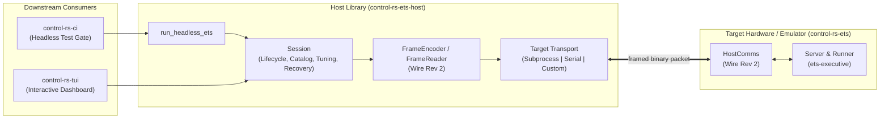

# Host ETS Library (ets-host)


---

### 1. Introduction

`control-rs-ets-host` provides the host-side orchestration and communication
runtime for interacting with the on-target Embedded Test Server (`control-rs-ets`).
It manages physical and emulated transport streams, implements Wire Rev 2
binary frame encoding and decoding (`PROTOCOL_VERSION = 2`), drives target
metadata and test suite discovery, coordinates real-time parameter tuning
with automatic crash recovery, steps continuous closed-loop simulation tasks,
and provides a bounded headless test runner for continuous integration (CI)
pipelines.

Prior revisions routed communication through an intermediate `ETSBridge` thread
pair, an action-queue dispatch layer, and per-run wrapper types (`CaseRun`,
`TaskRun`). In accordance with `ADR-0002`, this design consolidates the host
architecture around a unified `Session` struct. The `Session` directly owns the
target I/O connection, eliminating intermediate thread boundaries, action
queues, and run-wrapper allocations. Host crates maintain strictly zero
hardware compile-time feature flags, ensuring that a single host artifact drives
both emulated targets (for example, QEMU child processes) and physical hardware
boards (for example, USB CDC serial devices). User presentation is strictly
delegated to downstream crates (`control-rs-tui`), while automated test execution
is consumed by `control-rs-ci`.

Primary usage scenarios:

- **Headless automated test execution (CI)**: A CI runner builds a target
  firmware executable, launches an emulated QEMU instance via a subprocess target
  or connects to an attached board over serial, discovers registered test suites
  and cases, executes all cases to completion under a wall-clock timeout and reset
  budget, and outputs a structured `RunRecord` without terminal dependencies.
  Failure is a timeout, unhandled panic, broken frame sequence, or protocol
  version mismatch.
- **Interactive host session and live parameter tuning**: The terminal dashboard
  (`control-rs-tui`) or an interactive script connects to a running target over
  USB CDC serial, queries discovered suites and parameter tables, mutates
  parameter values in real time (`set_param`), and automatically reapplies mutated
  values if the target restarts. Failure is an unacknowledged write, dropped
  serial connection, or corrupted parameter table.
- **Closed-loop hardware-in-the-loop (HIL) simulation**: A host simulation harness
  coordinates with a target running a `LifecycleTask` in lockstep mode
  (`Mode::Lockstep`), transmitting synthesized plant state inputs (`send_input`)
  and polling actuator telemetry outputs (`poll_sample`) on each discrete step.
  Failure is a lost step, sequence identifier gap, deadline overrun, or target
  fault.
- **Panic containment and target recovery**: A target firmware encounters an
  assertion failure, hardware fault, or watchdog timeout during test execution.
  The host detects the panic or link drop, issues `Command::TryReset` or resets
  the subprocess, re-establishes discovery, reapplies cached parameter mutations,
  and resumes subsequent queued tests without losing previously recorded outcomes.
  Failure is an unhandled hang, lost test history, or exhausted reset budget.

---

### 2. Requirements

#### 2.1 Functional Requirements

- **FR-1 — Unified Session Lifecycle**: The crate must provide a unified `Session`
  struct that directly owns the target I/O connection, driving lifecycle management,
  discovery, execution, parameter synchronization, and fault recovery through a
  single interface without intermediary bridge or action indirection layers.
- **FR-2 — Pluggable Target Transports**: The crate must support bidirectional
  communication across target transport variants: `Target::Subprocess` for spawned
  processes and QEMU instances via standard input/output pipes, `Target::Serial`
  for physical microcontrollers via USB CDC and UART serial streams (`serial2`),
  and custom in-memory streams for testing, with zero hardware feature flags in
  the host crate.
- **FR-3 — Framed Binary Packet Exchange**: The crate must implement frame
  encoding and decoding using `FrameEncoder` and `FrameReader` with a 2-byte sync
  header (`0xAA 0x55`), 2-byte big-endian length prefix, postcard-serialized
  payload ($\le 512$ bytes), and 2-byte CRC-16 checksum (`CRC_16_IBM_SDLC`),
  mirroring the Wire Rev 2 (`PROTOCOL_VERSION = 2`) contract defined in
  `host-comm-design.md`. Corrupted or partial frames must be discarded without
  breaking stream synchronization.
- **FR-4 — Target Suite and Metadata Discovery**: The `Session` must issue
  `Command::ListSuites` to discover target platform metadata (`TargetInfo`: board
  identifier, CPU clock frequency, FPU flags, protocol version) and enumerate
  registered test suites (`SuiteInfo`), test cases (`CaseInfo`), lifecycle tasks
  (`TaskInfo`), and configurable parameters (`ParamInfo`), validating readiness
  upon receiving `Telemetry::DiscoveryComplete`.
- **FR-5 — Parameter Catalog and Mutation Caching**: The `Session` must maintain
  a live in-memory catalog of all target parameters, expose methods to read
  (`get_param`) and write (`set_param`) values, and cache all user-applied
  mutations so that parameter modifications can be automatically re-applied to the
  target upon reconnection or reset.
- **FR-6 — Panic Detection and Target Recovery**: The `Session` must detect
  target panics and unhandled exceptions (`Telemetry::TargetPanic`,
  `Telemetry::FaultReport`) or transport disconnects, attribute the failure to the
  active test or task, issue `Command::TryReset` or terminate and restart the
  target process, re-establish connection and discovery, and restore cached
  parameter state without discarding previously collected test results.
- **FR-7 — Bounded Headless Test Execution**: The crate must expose a standalone
  `run_headless_ets(target, options)` entrypoint that executes a targeted set or
  all discovered suites and cases to completion under a caller-specified wall-clock
  timeout and maximum reset budget, returning a structured `RunRecord` containing
  all outcomes, pending cases, elapsed time, reset counts, and raw console logs.
- **FR-8 — Closed-Loop Lifecycle Task Stepping**: The `Session` must support
  interactive and lockstep execution of continuous `LifecycleTask` instances,
  providing methods to start a task (`start_task`), transmit periodic input frames
  (`send_input`), poll output samples (`poll_sample`), and stop task execution
  (`stop_task`), enabling closed-loop simulation against host plant models.
- **FR-9 — Target ELF Construction and QEMU Shorthand**: The crate must provide
  utilities to build a target firmware binary for a specified target triple and
  binary name, and support shorthand architecture identifiers (for example, `arm`,
  `riscv`, `thumbv7em`) that resolve and execute the corresponding QEMU example
  firmware.
- **FR-10 — Protocol Revision Enforcement**: The `Session` must verify during
  discovery that the target's `TargetInfo.protocol_version` matches the host
  `PROTOCOL_VERSION` (version 2), terminating the session and returning
  `SessionError::ProtocolMismatch` if versions differ or if discovery completes
  without valid `TargetInfo`.

#### 2.2 Non-Functional Requirements

- **NFR-1 — Zero Presentation Dependencies**: The host crate dependency graph must
  exclude terminal-rendering (`ratatui`), terminal-event (`crossterm`), and UI
  frameworks. User presentation is strictly relegated to downstream consumer
  crates (`control-rs-tui`).
- **NFR-2 — Structured Error Propagation**: All failures (subprocess spawning,
  serial transport, protocol mismatch, encoding/decoding, timeout, reset budget
  exhaustion) must be expressed as variants of a typed, crate-local error enum
  (`SessionError`), with zero panics or process abortions outside unit tests.

#### 2.3 Constraints

- **C-1 — Host-Only Execution Environment**: The crate requires standard library
  facilities (`std`), operating system threads, subprocess management
  (`std::process::Command`), and system serial port APIs, and is marked
  `publish = false`.
- **C-2 — Wire Specification Alignment**: Framing formats, payload bounds, command
  discriminants, and telemetry structures must strictly mirror the target-side
  contracts specified in `host-comm-design.md` and `ets-executive-design.md`.
- **C-3 — Minimal Third-Party Dependencies**: External runtime dependencies must
  be limited to `serial2`, `postcard`, `crc`, and `thiserror`.

---

### 3. Technical Overview

`control-rs-ets-host` provides a synchronous, thread-safe session runtime that
bridges host-side tools and on-target test servers. A `Target` descriptor
specifies either a child process (QEMU emulator under `cargo run`) or a USB CDC
serial port. The unified `Session` manages the transport handle, framing
buffers, command dispatch, telemetry receipt, parameter synchronization, and
panic recovery within a single abstraction.



Two distinct consumers sit above the host library:

1. `control-rs-ci`: Uses the headless entrypoint `run_headless_ets` to execute
   test suites automatically, collecting structured `RunRecord` summaries for CI
   pass/fail reporting and artifact archival.
2. `control-rs-tui`: Instantiates `Session` directly, consuming its synchronous
   polling and parameter mutation APIs to render an interactive terminal dashboard
   with live telemetry streams and tuning controls.

---

### 4. Architecture

`control-rs-ets-host` is organized into focused modules within the crate:

| Module    | Responsibility                                                                                         |
|:----------|:-------------------------------------------------------------------------------------------------------|
| `target`  | `Target` enum, `SubprocessTarget`, `SerialTarget`, architecture resolution, and `build_target_elf`.    |
| `framing` | `FrameEncoder`, `FrameReader`, Wire Rev 2 sync header detection, and CRC-16 calculation.              |
| `session` | `Session` lifecycle, discovery state machine, parameter catalog, mutation caching, and fault recovery. |
| `runner`  | `run_headless_ets`, `RunOptions`, `RunRecord`, and timeout/budget supervision.                        |
| `error`   | `SessionError` and `TargetError` typed error definitions.                                              |

#### 4.1 Unified Session & Target Transport Abstraction

Serves: FR-1, FR-2, C-1

The core of the crate is `Session`, which directly owns a `TargetTransport`
handle without intermediate bridge threads or action queues:

```rust
use std::collections::BTreeMap;
use std::io::{Read, Write};
use std::path::PathBuf;
use std::time::Duration;
use control_rs_ets::comms::{Command, ParamValue, Telemetry};

/// Specification of a target communication endpoint.
#[derive(Debug, Clone)]
pub enum Target {
    /// Child process running an emulator or simulator.
    Subprocess(SubprocessTarget),
    /// USB CDC or UART physical serial port.
    Serial(SerialTarget),
    /// Custom bidirectional stream for in-memory testing.
    Custom(PathBuf),
}

/// Parameters for spawning a target subprocess.
#[derive(Debug, Clone)]
pub struct SubprocessTarget {
    pub program: PathBuf,
    pub args: Vec<String>,
    pub current_dir: Option<PathBuf>,
}

/// Parameters for opening a physical serial port.
#[derive(Debug, Clone)]
pub struct SerialTarget {
    pub port: String,
    pub baud_rate: u32,
    pub timeout: Duration,
}

/// Unified host session driving an on-target Embedded Test Server.
pub struct Session {
    transport: Box<dyn TargetTransport>,
    target_info: Option<TargetInfo>,
    suites: Vec<SuiteInfo>,
    param_catalog: BTreeMap<(u16, u16), ParamInfo>,
    param_mutations: BTreeMap<(u16, u16), ParamValue>,
    results: Vec<TestOutcome>,
    console_buffer: String,
    resets_performed: u32,
}

/// Trait implemented by host target transports.
pub trait TargetTransport: Read + Write + Send {
    /// Attempts to reset or restart the target.
    fn reset(&mut self) -> Result<(), SessionError>;
    /// Checks whether the target process is still running.
    fn is_alive(&mut self) -> bool;
}

impl Session {
    /// Connects to a target and initializes the session.
    pub fn open(target: Target) -> Result<Self, SessionError>;

    /// Executes discovery handshake and populates suite and parameter catalogs.
    pub fn discover(&mut self) -> Result<&TargetInfo, SessionError>;

    /// Returns discovered test suite metadata.
    pub fn suites(&self) -> &[SuiteInfo];

    /// Retrieves a parameter value from the catalog.
    pub fn get_param(&self, suite_id: u16, param_id: u16) -> Option<&ParamValue>;

    /// Updates a parameter value, sends the update to the target, and caches the mutation.
    pub fn set_param(
        &mut self,
        suite_id: u16,
        param_id: u16,
        val: ParamValue,
    ) -> Result<(), SessionError>;

    /// Executes an atomic test case to completion.
    pub fn run_case(&mut self, suite_id: u16, case_id: u16) -> Result<TestOutcome, SessionError>;

    /// Starts a continuous lifecycle task in the requested execution mode.
    pub fn start_task(
        &mut self,
        suite_id: u16,
        task_id: u16,
        mode: control_rs_ets::comms::ExecMode,
    ) -> Result<(), SessionError>;

    /// Transmits an input frame to a lockstep lifecycle task.
    pub fn send_input(&mut self, seq: u32, payload: &[u8]) -> Result<(), SessionError>;

    /// Polls for a telemetry sample from an active lifecycle task.
    pub fn poll_sample(&mut self, timeout: Duration) -> Result<Option<TaskSample>, SessionError>;

    /// Stops the active lifecycle task and retrieves execution summary telemetry.
    pub fn stop_task(&mut self) -> Result<TaskSummary, SessionError>;

    /// Manually triggers a target reset, re-discovers metadata, and reapplies cached parameters.
    pub fn reset_and_reconnect(&mut self) -> Result<(), SessionError>;

    /// Polls the transport for pending telemetry frames and raw console output.
    pub fn poll(&mut self) -> Result<Option<SessionEvent>, SessionError>;
}
```

The `Session` struct owns the transport stream directly. All I/O operations are
performed synchronously with configurable read timeouts, allowing single-threaded
event loops (such as `control-rs-tui` render ticks) to drive communication
deterministically.

#### 4.2 Framing, Wire Rev 2 & Protocol Revision Gate

Serves: FR-3, FR-10, C-2

The communication layer follows Wire Rev 2 as defined in `host-comm-design.md`:

| Field          | Width    | Value                                 |
|:---------------|:---------|:--------------------------------------|
| Sync Header    | 2 B      | `0xAA 0x55`                           |
| Payload Length | 2 B      | Big-endian unsigned 16-bit integer    |
| Payload        | variable | Postcard-encoded message ($\le 512$ B)|
| Checksum       | 2 B      | Big-endian CRC-16 (`CRC_16_IBM_SDLC`) |

`postcard` is utilized for binary serialization [1]. Framing delimitation relies
on the length prefix and sync header rather than byte stuffing to minimize
target overhead.

```rust
/// Encodes commands into framed byte sequences.
pub struct FrameEncoder;

impl FrameEncoder {
    /// Encodes a command into a caller-supplied frame buffer.
    pub fn encode(cmd: &Command, buf: &mut [u8]) -> Result<usize, SessionError>;
}

/// Deframes incoming byte streams into telemetry messages.
pub struct FrameReader {
    buffer: Vec<u8>,
    max_payload: usize,
}

impl FrameReader {
    pub fn new(max_payload: usize) -> Self;
    /// Feeds raw bytes into the deframer and extracts complete telemetry frames.
    pub fn feed(&mut self, bytes: &[u8]) -> Vec<Result<Telemetry, SessionError>>;
}
```

**Protocol Revision Check (FR-10)**: The target transmits `Telemetry::TargetInfo`
as the initial frame of the discovery sequence. `TargetInfo` carries the target's
`PROTOCOL_VERSION` (currently `2`). If the received version differs from the
host's compiled `PROTOCOL_VERSION`, or if discovery completes without a
`TargetInfo` packet, `Session::discover` aborts immediately and returns
`SessionError::ProtocolMismatch { host: 2, target: version }`. The session
refuses to decode subsequent frames, preventing silent data misinterpretation.

#### 4.3 Discovery, Metadata Catalog & Parameter Mutation Caching

Serves: FR-4, FR-5

Discovery follows an explicit query-response sequence:

1. `Session::discover` issues `Command::ListSuites`.
2. Target replies with `Telemetry::TargetInfo` containing platform descriptors
   (board ID, clock frequency, FPU capabilities, protocol version).
3. Target streams `Telemetry::SuiteInfo`, followed by `Telemetry::CaseInfo`,
   `Telemetry::TaskInfo`, and `Telemetry::ParamInfo` descriptors.
4. Target concludes discovery with `Telemetry::DiscoveryComplete`.

Readiness is tracked via atomic integer bitmasks (`SUITE_INFO_READY`,
`TESTS_READY`, `SETTINGS_READY`). `Session` verifies that each discovered suite
satisfies `suite.ready_mask == SUITE_READY_MASK`. Incomplete suite declarations
trigger an automatic discovery retry before proceeding.

**Parameter Mutation Caching (FR-5)**:
Parameters are stored in an in-memory catalog indexed by `(suite_id, param_id)`.
When a user or frontend invokes `Session::set_param`, the session:
1. Validates the type and bounds of the value against `ParamInfo`.
2. Transmits `Command::WriteParam(suite_id, param_id, value)` to the target.
3. Updates the local catalog value upon receiving `Telemetry::ParamUpdated`.
4. Inserts the mutation into `self.param_mutations`.

When the target resets (due to a panic or explicit reset command), the target's
RAM state reverts to compile-time defaults. During the subsequent reconnection
sequence, `Session` iterates over `self.param_mutations` and automatically
re-sends `Command::WriteParam` for every modified entry, restoring live tuning
state transparently.

#### 4.4 Panic Containment, Fault Recovery & Headless Runner

Serves: FR-6, FR-7

When an on-target assertion or exception occurs, the target's fault handler
broadcasts `Telemetry::TargetPanic` or `Telemetry::FaultReport` before resetting
or halting. Alternatively, a hardware crash may cause an abrupt transport disconnect.

The `Session` fault recovery state machine operates as follows:

```mermaid
stateDiagram-v2
    [*] --> Idle
    Idle --> RunningTest: run_case / start_task
    RunningTest --> Completed: Telemetry::TestOutcome / TaskSummary
    RunningTest --> FaultDetected: TargetPanic / FaultReport / Disconnect
    FaultDetected --> DrainAndReset: Attribute failure to active test
    DrainAndReset --> Reconnecting: Issue TryReset / Restart Subprocess
    Reconnecting --> ReDiscovery: Establish transport link (1 s delay)
    ReDiscovery --> ReapplyParams: Verify PROTOCOL_VERSION & Suite Masks
    ReapplyParams --> Idle: Replay param_mutations (prior results retained)
```

1. **Attribution**: The active test case or task is marked as failed with the
   captured panic message and backtrace.
2. **Drain & Reset**: Host transmits `Command::TryReset`, pauses 50 ms to allow
   the UART/USB FIFO to drain, and resets the target transport.
3. **Reconnection & Discovery**: Host waits 1.0 s for target boot, verifies
   `TargetInfo`, and rebuilds the suite catalog.
4. **State Replay**: Host iterates through `self.param_mutations`, restoring all
   custom parameter values.
5. **Resume**: Test execution resumes with the next queued test case. All
   outcomes collected before the crash are preserved in `self.results`.

**Headless Runner (`run_headless_ets`)**:
`control-rs-ci` invokes the headless runner to supervise automated runs:

```rust
/// Execution options for headless runs.
#[derive(Debug, Clone)]
pub struct RunOptions {
    /// Whole-session wall-clock timeout.
    pub timeout: Duration,
    /// Maximum allowed panic reset cycles before aborting.
    pub max_resets: u32,
    /// Optional suite or test name filter.
    pub filter: Option<String>,
}

/// Comprehensive record of a completed or aborted headless run.
#[derive(Debug, Clone)]
pub struct RunRecord {
    pub results: Vec<TestOutcome>,
    pub pending: Vec<(u16, u16)>,
    pub resets: u32,
    pub abort: Option<Completion>,
    pub elapsed: Duration,
    pub console: String,
}

/// Reason for premature headless run termination.
#[derive(Debug, Clone, PartialEq, Eq)]
pub enum Completion {
    TimedOut,
    ResetBudgetExhausted,
    SendFailed,
    ReconnectFailed,
    TargetExited,
}

/// Executes a target to completion under a timeout bound.
pub fn run_headless_ets(
    target: Target,
    options: RunOptions,
) -> Result<RunRecord, SessionError>;
```

If the wall-clock timeout expires or `max_resets` is exceeded, `run_headless_ets`
terminates the target and returns `Ok(RunRecord)` with `abort: Some(...)` and
all partial results collected up to the abort point.

#### 4.5 Closed-Loop Lifecycle Task Stepping

Serves: FR-8

`control-rs-ets` supports continuous `LifecycleTask` routines (for example,
state estimation filters and control loops) operating under `Mode::Lockstep`,
`Mode::FreeRunning`, or `Mode::Periodic` (`ets-executive-design.md`).

For closed-loop simulation (HIL/SIL), `Session` provides lockstep stepping:

1. Host calls `Session::start_task(suite_id, task_id, ExecMode::Lockstep)`.
2. Target initializes task state and enters the `Armed` phase.
3. On each discrete simulation time step $k$:
   - Host evaluates the external plant model (for example, sensor physics).
   - Host calls `Session::send_input(seq = k, input_bytes)`.
   - Target executes `LifecycleTask::step(k, input)` and emits `Telemetry::TaskSample(seq = k, sample_bytes)`.
   - Host calls `Session::poll_sample()` to receive actuator output commands.
4. When simulation completes, host calls `Session::stop_task()`, which commands
   `Command::StopNow`, settles task state via `teardown`, and returns a
   `TaskSummary` containing execution duration, cycle count, step jitter, and
   peak stack usage.

#### 4.6 Target ELF Construction & QEMU Shorthand

Serves: FR-9

`control-rs-ets-host` includes target compilation utilities:

```rust
/// Compiles a target firmware ELF using `cargo build`.
pub fn build_target_elf(triple: &str, bin: &str) -> Result<PathBuf, SessionError>;

/// Resolves a shorthand architecture name (e.g. "arm", "riscv") to a QEMU target descriptor.
pub fn resolve_qemu_shorthand(arch: &str) -> Result<SubprocessTarget, SessionError>;
```

`resolve_qemu_shorthand` locates example binaries under `examples/qemu` or
target subprograms, setting up appropriate emulator flags and memory layouts
automatically.

#### 4.7 Error Handling

Serves: NFR-2

Library errors are encapsulated in a crate-local `thiserror` enum:

```rust
use thiserror::Error;

#[derive(Debug, Error)]
pub enum SessionError {
    #[error("Failed to build target ELF for {target}: {source}")]
    Build { target: String, source: std::io::Error },

    #[error("Failed to spawn target subprocess: {source}")]
    Spawn { source: std::io::Error },

    #[error("Failed to open serial port {port} after {attempts} attempts: {source}")]
    SerialOpen { port: String, attempts: u32, source: serial2::Error },

    #[error("Transport I/O failure: {source}")]
    Transport { source: std::io::Error },

    #[error("Protocol version mismatch: host expects v{host}, target reported v{target}")]
    ProtocolMismatch { host: u8, target: u8 },

    #[error("Frame deserialization failure: {source}")]
    FrameDecode { source: postcard::Error },

    #[error("Session wall-clock timeout exceeded ({elapsed:?})")]
    Timeout { elapsed: Duration },

    #[error("Target reset budget exhausted ({resets} resets performed)")]
    ResetBudgetExhausted { resets: u32 },

    #[error("Target process terminated unexpectedly with code {code:?}")]
    TargetExited { code: Option<i32> },

    #[error("Command rejected by target: {reason}")]
    CommandRejected { reason: String },
}
```

#### 4.8 Dependencies

Serves: NFR-1, C-3

| Crate            | Features          | `no_std` | Justification                                                  |
|:-----------------|:------------------|:---------|:---------------------------------------------------------------|
| `control-rs-ets` | `comms`           | Yes      | Shared Wire Rev 2 `Command`, `Telemetry`, and framing schemas. |
| `serial2`        | default           | No       | Cross-platform host USB CDC and UART serial communication.     |
| `postcard`       | `alloc`           | Yes      | Compact binary serialization mirroring target firmware.        |
| `crc`            | default           | Yes      | CRC-16 checksum computation (`CRC_16_IBM_SDLC`).               |
| `thiserror`      | default           | No       | Ergonomic, structured error derive macros.                     |
| `serde`          | `derive`          | Yes      | Serde traits required for postcard data exchange.              |

Terminal dependencies (`ratatui`, `crossterm`) are strictly absent.

---

### 5. Alternatives

| Alternative | Rejected Because | Reference |
|:------------|:-----------------|:----------|
| Embed host layer in `control-rs-ets` | Violates C-1. `control-rs-ets` is `#![no_std]` and `#![no_alloc]` for embedded microcontrollers; host orchestration requires threads, OS child processes, and platform serial drivers. | `host-comm-design.md` |
| Retain `ETSBridge` thread pair and action queues | Rejected per `ADR-0002`. Synchronous ownership in `Session` eliminates thread synchronization overhead, prevents race conditions, and simplifies integration into single-threaded UI run loops. | `ADR-0002` |
| Adopt `probe-rs`/`embedded-test` harness | Flashes firmware and resets hardware between every test case [2], [3]. ETS preserves runtime state across suites, supports live parameter tuning, and avoids flash wear. | [2], [3] |
| Adopt `postcard-rpc` protocol layer | Introduces an 8-byte endpoint routing header and topic dispatcher [4] that adds unnecessary bandwidth overhead to a fixed, statically known command enum. | [4] |
| J-Link RTT as primary transport | Restricts the harness to proprietary SEGGER debug probes [5], [6]. USB CDC and QEMU stdio provide universally available transport on all evaluation targets. | [5], [6] |
| Python-based serial test harness (`pytest-embedded`) | Moves the host test driver outside the Rust/Cargo ecosystem [7], requiring secondary runtime virtual environments and foreign dependency management in CI. | [7] |

---

### 6. Verification & Validation

#### 6.1 Verification

| Condition | Requirement | Method | Target | Criterion |
|:----------|:------------|:-------|:-------|:----------|
| VC-1.1 | FR-1 | `libtest` | `control_rs_ets_host::session::tests::session_open_and_lifecycle` | A unified `Session` opens, manages lifecycle state transitions, and shuts down without intermediate bridge threads; FR-1 holds iff all conditions hold. |
| VC-1.2 | FR-1 | `libtest` | `control_rs_ets_host::session::tests::session_direct_target_ownership` | The `Session` directly owns the underlying target I/O handle and processes incoming messages without an external action queue. |
| VC-2.1 | FR-2 | `libtest` | `control_rs_ets_host::target::tests::subprocess_target_spawns_and_pipes` | The `Target::Subprocess` variant successfully spawns a target executable and pipes standard input/output streams; FR-2 holds iff all conditions hold. |
| VC-2.2 | FR-2 | `libtest` | `control_rs_ets_host::target::tests::serial_target_configuration` | The `Target::Serial` variant configures baud rate, flow control, and port paths without hardware-specific compile-time feature flags. |
| VC-3.1 | FR-3 | `libtest` | `control_rs_ets_host::framing::tests::frame_encoder_and_reader_roundtrip` | Serialized command frames and received telemetry frames round-trip across `FrameEncoder` and `FrameReader` with exact byte preservation; FR-3 holds iff all conditions hold. |
| VC-3.2 | FR-3 | `libtest` | `control_rs_ets_host::framing::tests::corrupted_frame_is_dropped` | A frame with a mutated payload or invalid CRC-16 checksum is dropped without corrupting subsequent frame decoding. |
| VC-4.1 | FR-4 | `libtest` | `control_rs_ets_host::session::tests::discovery_populates_suite_and_param_catalog` | Issuing `ListSuites` populates `TargetInfo`, test suites, test cases, tasks, and parameter metadata; FR-4 holds iff all conditions hold. |
| VC-4.2 | FR-4 | `libtest` | `control_rs_ets_host::session::tests::discovery_bitmask_validates_readiness` | The discovery phase asserts complete suite descriptor readiness bitmasks before entering the execution phase. |
| VC-5.1 | FR-5 | `libtest` | `control_rs_ets_host::session::tests::param_get_set_and_mutation_cache` | Writing a parameter value updates the in-memory catalog, transmits `WriteParam`, and records the mutation in `param_mutations`; FR-5 holds iff all conditions hold. |
| VC-5.2 | FR-5 | `libtest` | `control_rs_ets_host::session::tests::cached_param_mutations_replayed_after_reset` | Following target reset and rediscovery, all cached parameter mutations are retransmitted to the target automatically. |
| VC-6.1 | FR-6 | `libtest` | `control_rs_ets_host::session::tests::panic_detection_and_fault_attribution` | Target panic telemetry or unhandled exceptions attribute a failure verdict to the active test case or task; FR-6 holds iff all conditions hold. |
| VC-6.2 | FR-6 | `libtest` | `control_rs_ets_host::session::tests::reset_reconnect_retains_prior_results` | A target reset and reconnection cycle preserves all test outcomes recorded before the fault. |
| VC-7.1 | FR-7 | `libtest` | `control_rs_ets_host::runner::tests::run_headless_executes_queue_to_completion` | `run_headless_ets` executes queued suites and cases and returns a complete `RunRecord`; FR-7 holds iff all conditions hold. |
| VC-7.2 | FR-7 | `libtest` | `control_rs_ets_host::runner::tests::headless_timeout_and_budget_bounds` | Exceeding the wall-clock timeout or reset budget aborts the headless run while returning all accumulated outcomes. |
| VC-8.1 | FR-8 | `libtest` | `control_rs_ets_host::session::tests::lifecycle_task_lockstep_stepping` | Starting a `LifecycleTask` in lockstep mode pairs `send_input` with `poll_sample` across sequential steps; FR-8 holds iff all conditions hold. |
| VC-8.2 | FR-8 | `libtest` | `control_rs_ets_host::session::tests::stop_task_retrieves_summary_telemetry` | Halting a running task via `stop_task` retrieves execution duration, cycles, step jitter, and peak stack metrics. |
| VC-9.1 | FR-9 | `libtest` | `control_rs_ets_host::target::tests::build_target_elf_invokes_cargo` | `build_target_elf` compiles target firmware for a specified architecture triple and binary name; FR-9 holds iff all conditions hold. |
| VC-9.2 | FR-9 | `libtest` | `control_rs_ets_host::target::tests::qemu_shorthand_resolves_example_binary` | Shorthand architecture identifiers map to the corresponding QEMU example firmware ELF path. |
| VC-10.1 | FR-10 | `libtest` | `control_rs_ets_host::session::tests::protocol_version_mismatch_fails_closed` | Discovery receiving a mismatched `protocol_version` or missing `TargetInfo` terminates the session with `SessionError::ProtocolMismatch`. |
| VC-11.1 | NFR-1 | `gate` | `clippy` | The crate dependency closure contains zero terminal-rendering or UI framework dependencies. |
| VC-12.1 | NFR-2 | `libtest` | `control_rs_ets_host::error::tests::error_variants_name_failure_stages` | All error conditions produce structured `SessionError` variants naming the failing stage with zero panics outside tests. |
| VC-13.1 | C-1 | `gate` | `build` | The crate compiles successfully on host platforms with standard library and threading support enabled. |
| VC-14.1 | C-2 | `libtest` | `control_rs_ets_host::framing::tests::golden_wire_vectors_match_target_schema` | Checked-in binary wire vectors match host serialization for all `Command` and `Telemetry` variants under Wire Rev 2. |
| VC-15.1 | C-3 | `gate` | `deny` | External runtime dependencies are restricted to `serial2`, `postcard`, `crc`, and `thiserror`. |

Coverage target: 85% line coverage of `control-rs-ets-host`, measured with
`cargo coverage`. Excluded: hardware-dependent serial port opening on physical
devices without attached hardware and OS-level subprocess spawn aborts.

#### 6.2 Acceptance

| Claim | Oracle | Measure | Bound |
|:------|:-------|:--------|:------|
| Frame round trip | Encoder output re-read by `FrameReader` | Byte equality | Exact |
| Corrupted frame rejection | Frame with flipped payload byte | Frames delivered to session | 0 |
| Golden vector stability | Checked-in bytes per variant | Byte equality | Exact |
| Protocol mismatch abort | Stream with invalid `protocol_version` | Return value | `Err(SessionError::ProtocolMismatch)` |
| Panic recovery outcome retention | Stream with panic after $n$ cases | Results present after reset | Exactly $n$ preserved |
| Parameter mutation restoration | Reconnection after target reset | Target parameter value | Exactly equals cached mutation |
| Reset budget enforcement | Stream panicking on every case | Reset cycles performed | Exactly `max_resets` |
| Timeout enforcement | Unresponsive target stream | Wall-clock elapsed time | Within timeout + 1.0 s |
| Child process containment | Terminated or timed-out session | Surviving child processes | 0 |

#### 6.3 Limits

- Forward and backward protocol compatibility across distinct `PROTOCOL_VERSION`
  values is not supported; mismatched versions fail closed.
- Serial port behaviour is verified on Linux and macOS; platform-specific USB
  driver quirks on Windows are unverified.
- Concurrent multi-session access to a single physical serial endpoint is
  unsupported.

---

### 7. Performance & Resource Considerations

- Host CPU consumption is bounded: transport polling blocks on OS read calls
  with timeouts rather than busy-waiting.
- Memory consumption is strictly bounded: frame buffers are capped at the
  maximum payload length (512 bytes) plus framing overhead (6 bytes).
- Discovery validation executes in $O(1)$ per suite using bitmask assertions
  against `SUITE_READY_MASK`.

---

### 8. Risks & Open Questions

- **Automatic serial port enumeration**: Serial port paths currently require
  explicit specification or interactive selection. Automated vendor/product ID
  filtering across differing USB-to-UART bridges is deferred to `control-rs-tui`.
- **Non-exhaustive protocol variants**: Appending future variants to `Command`
  or `Telemetry` requires careful discriminant assignment to maintain Wire Rev 2
  synchronization across host and target.

---

### 9. Development Plan

| Phase | Delivers | Requirements | Effort | Status |
|:------|:---------|:-------------|:-------|:-------|
| 1. Transport & Framing | `Target`, `TargetTransport`, `FrameEncoder`, `FrameReader`, Wire Rev 2 golden vectors | FR-2, FR-3, C-1, C-2, C-3 | 3 days | Planned |
| 2. Unified Session & Discovery | `Session`, discovery state machine, bitmask validation, protocol version check | FR-1, FR-4, FR-10 | 3 days | Planned |
| 3. Parameter Catalog & Caching | In-memory catalog, `get_param`, `set_param`, crash mutation replay | FR-5 | 2 days | Planned |
| 4. Fault Recovery & Headless Runner | Panic detection, `TryReset`, `run_headless_ets`, timeout supervision | FR-6, FR-7, NFR-2 | 3 days | Planned |
| 5. Closed-Loop Tasks & QEMU Runner | `start_task`, `send_input`, `poll_sample`, `build_target_elf`, QEMU shorthand | FR-8, FR-9, NFR-1 | 2 days | Planned |

---

### 10. Revision History

| Revision | Date               | Author          | Description                                                                                                                                                                          |
|:---------|:-------------------|:----------------|:-------------------------------------------------------------------------------------------------------------------------------------------------------------------------------------|
| 1.0      | September 18, 2026 | @MitchellDScott | Host ETS session library extracted from `control-rs-xtask`; `ETSBridge` and `RunRecord`.                                                                                             |
| 2.0      | September 25, 2026 | @MitchellDScott | `ets` gate cutover; `TargetInfo` protocol check.                                                                                                                                     |
| 3.0      | October 1, 2026    | @MitchellDScott | Testability seams and the `fake-link` in-memory link.                                                                                                                                |
| 4.0      | October 31, 2026   | @MitchellDScott | Unified `Session` architecture directly owning `Target`; drop `ETSBridge` and action queues per `ADR-0002`; parameter mutation caching across resets; closed-loop task stepping; Wire Rev 2. |

---

## References

[1] J. Munns, *postcard*: `no_std` Serde serializer and deserializer (Version 1.1.3). [Online]. Available: https://docs.rs/postcard. Accessed: Aug. 7, 2026.

[2] probe-rs, "README.md," in *probe-rs/embedded-test*, v0.7.1. [Online]. Available: https://github.com/probe-rs/embedded-test. Accessed: Aug. 7, 2026.

[3] Knurling-rs and Ferrous Systems, *defmt-test*: test harness for embedded devices (Version 0.2.2). [Online]. Available: https://lib.rs/crates/defmt-test. Accessed: Aug. 7, 2026.

[4] J. Munns, "docs/overview.md," in *jamesmunns/postcard-rpc*. [Online]. Available: https://github.com/jamesmunns/postcard-rpc/blob/main/docs/overview.md. Accessed: Aug. 7, 2026.

[5] SEGGER Microcontroller GmbH, "Real Time Transfer (RTT)," *SEGGER product pages*. [Online]. Available: https://www.segger.com/products/debug-probes/j-link/technology/about-real-time-transfer/. Accessed: Aug. 7, 2026.

[6] P. Curtis, "J-Run: Automating performance tests on real hardware," *SEGGER Blog*, 2018. [Online]. Available: https://blog.segger.com/j-run-automating-performance-tests/. Accessed: Aug. 7, 2026.

[7] Espressif Systems, "README.md," in *espressif/pytest-embedded*. [Online]. Available: https://github.com/espressif/pytest-embedded. Accessed: Aug. 7, 2026.
