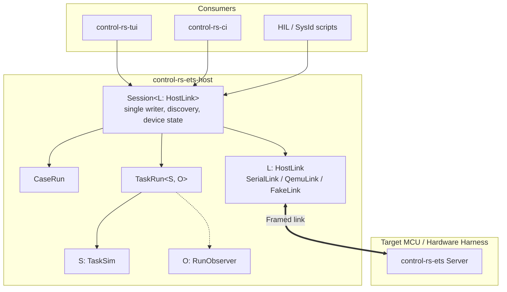

# Host ETS Library (Design Document)


---

### 1. Introduction

`control-rs-ets-host` is the host-side counterpart to the on-target Embedded
Test Server. It owns the connection to a target through host links, the single command and
telemetry session and the run objects that execute cases and lifecycle tasks
(including host-side plant simulation). It renders nothing and runs no repository
quality gates.

The host orchestration layer began inside the removed `control-rs-xtask`,
compiled alongside the terminal dashboard and the CI runner, so no consumer
could take the transport without also taking `ratatui`, `crossterm` and the
repository's lint tasks. This document specifies that layer as an independent
library crate, consumed by `control-rs-tui`, by the `ets` gate binary of
`control-rs-ci` and by downstream HIL simulation scripts.

**Scenario 1: Headless target execution.** A CI runner builds a target ELF,
opens a session, discovers suites, runs them to completion and receives a
structured result, with no terminal attached.

**Scenario 2: Interactive session.** The terminal dashboard opens the same
session and consumes the same message stream, adding presentation and online
parameter tuning.

**Scenario 3: Downstream adoption.** An external firmware project depending
on `control-rs-ets` drives its own on-target suites from an integration test
without vendoring this repository.

**Scenario 4: Hardware-in-the-Loop (HIL) simulation.** A host runner attaches
to an active target lifecycle task, executing a host-side `TaskSim` in lockstep or free-running
mode over the same session, while observers record and display the run.

---

### 2. Requirements

#### 2.1 Functional Requirements

- **FR-1 — Target session lifecycle**: Open, poll and close a session against
  a target identified at run time. Session setup is not required to know
  whether the target is emulated or physical.

- **FR-2 — Host links**: Carry the session over a spawned subprocess
  (QEMU under `cargo run`) or a USB CDC serial port, and over the USB bulk and
  CAN links of `ets-link-design.md` FR-7 behind cargo features.

- **FR-3 — Message exchange**: Serialize commands and deserialize telemetry as
  whole messages delivered by the host link, which frames them for its
  transport and drops messages that fail its integrity check rather than
  surfacing partial payloads.

- **FR-4 — Suite discovery and run queue**: Enumerate the suites and cases a
  target registers, and drive a queue of run requests through to per-case
  results.

- **FR-5 — Panic recovery**: Detect a target panic during any case or task run,
  tear down the link, reset the target and re-establish discovery without
  losing already-collected results; Run all continues with the next case.

- **FR-6 — Bounded headless run**: Expose a single entrypoint that runs a
  target to completion under a caller-supplied wall-clock timeout and returns a
  structured result. A run that exceeds the bound terminates the target and
  reports the timeout.

- **FR-7 — Target ELF construction**: Build a target binary for a given triple
  and binary name so that a caller can go from source tree to running session
  in one step.

- **FR-8 — Wire-contract compatibility check**: Establish at session open that
  the target speaks the same protocol revision as this crate, and fail the
  session with a named mismatch rather than decoding. A CRC-valid frame carries
  no evidence that the two sides agree on the meaning of its payload.

- **FR-9 — QEMU shorthand names the example crate**: A shorthand architecture
  name (arm, risc-v, …) builds and runs the QEMU example firmware, not a
  workspace-root `cargo run` for that triple. A documented shorthand that
  starts from `.` with no binary is not a session.

- **FR-10 — Channel Demultiplexing (withdrawn)**: Withdrawn in revision 3.0;
  the wire has no channels and the single-writer `Session` covers ordering.

- **FR-11 — Pluggable Task Simulation**: Support executing host-side plant
  dynamics or a stimulus through a typed `TaskSim` trait that maps task output
  `k` to task input `k + 1`, or runs a task with no simulation.

- **FR-12 — Run Observers**: Deliver every step and the final record of a run to
  one or more `RunObserver` implementations (in-memory and CSV are provided)
  without stalling the run.

- **FR-13 — Online Setting Tuning**: Expose host methods to query and update
  target settings over the session while idle and between steps of an active
  task: read one setting by name or index and write one by name with a typed
  value, rendered and parsed from the value's type (`ets-link-design.md` FR-11).

- **FR-14 — Device State Tracking**: Track the target's state (idle, running a
  given item, resetting) so that silence or a reboot during an active run is
  recorded as an unreported fault or a comms failure by elimination.

- **FR-15 — Unresponsive Run Recovery**: A run whose target ignores `StopNow`
  is reset through the `HostLink` after `stop_timeout` and recorded as `Unresponsive`.

- **FR-16 — Release-paced runs**: Offer `Triggered` only when
  `TargetInfo.release_source` is set, start `Periodic` with a period and
  `Triggered` without one, and record release jitter and
  `RunStats.missed_releases` in the run record (`ets-executive-design.md` §4.7).

#### 2.2 Non-Functional Requirements

- **NFR-1 — No presentation dependencies**: The dependency closure contains no
  terminal-rendering or terminal-event crates. This is the property that makes
  the crate usable from a headless container and from a library consumer.

- **NFR-2 — Structured errors**: Transport, build and subprocess failures
  return typed errors naming the failing stage. The crate does not abort the
  host process and does not panic outside tests.

- **NFR-3 — Low Latency Task Dispatch**: Host-side frame handling, task
  simulation stepping and response framing add at most $50\ \mu\text{s}$ per
  step on the task data path.

#### 2.3 Constraints

- **C-1 — Host-only execution**: The crate requires `std`, OS threads,
  `std::process::Command` and platform serial drivers. It is not `no_std` and
  cannot be merged into `control-rs-ets`, which is a `no_std`, `no_alloc`
  firmware library.

- **C-2 — Wire compatibility**: The framing and message schemas are fixed by
  the target-side implementation in `ets-link-design.md`. This crate is the mirror
  of that contract, not an independent protocol.

- **C-3 — Minimal dependencies**: Default transport and codec dependencies are
  limited to `control-rs-ets`, `serial2` and `postcard`; the USB bulk and CAN
  host links add their transport crates only behind their features. The stream
  frame and its CRC-16 live in `control-rs-ets`. `thiserror` is admitted in addition, because the crate
  error rule requires library errors to be a crate-local `thiserror` enum; it
  is a compile-time derive with no runtime dependency of its own.

---

### 3. Technical Overview

The crate is a transport and session driver. One `Session<L: HostLink>` owns the
link and is the only writer on it. It runs one case or task at a time and
lends the link to a run object: `CaseRun` for a case and `TaskRun<S, O>` for a
lifecycle task, where `S: TaskSim` closes the loop and `O: RunObserver` records
it. Frontends issue requests to the session; they own no transport or session
state. The target counterpart is `ets-executive-design.md`.



---

### 4. Architecture

#### 4.1 Module Structure

| Module       | Responsibility                                                                                                       |
|:-------------|:---------------------------------------------------------------------------------------------------------------------|
| `target`     | `Target`, `SubprocessTarget`, `SerialTarget`, QEMU architecture descriptors, ELF path resolution, `build_target_elf` |
| `link`       | `HostLink` trait, `SerialLink`, `QemuLink`, `UsbBulkLink`, `CanLink`, `FakeLink`, `LinkEvent`; each owns its framing, reader thread and channel |
| `owned`      | `OwnedTelemetry`, the owned form of target telemetry                                                                 |
| `catalog`    | `Catalog` of suites, cases, settings and tasks built at discovery                                                    |
| `session`    | `Session<L>`, `SessionError`, `ResultStore`, recovery, device state tracking                                         |
| `case_run`   | `CaseRun`, `CaseOutcome`; Run all is a sequence of `CaseRun`                                                         |
| `task_run`   | `TaskRun<S, O>`, `TaskSim`, `RunObserver`, `RunControl`, `TaskRecord`, in-memory and CSV observers                    |
| `headless`   | `run_headless(target, options) -> RunRecord` for cases                                                               |

#### 4.2 Transport

* **Subprocess**: Spawn `cargo run --bin <bin> --target <triple>` inside the
  QEMU example crate with piped stdin, stdout and stderr. Semihosting is not
  used for data transport (see §5). Shorthand architecture names resolve that
  crate path and the matching binary name (FR-9).
* **Serial**: Open a USB CDC port at a configured baud rate, defaulting to
  115200 (or higher, e.g. 921600 or native USB CDC line rate), through `serial2`.

* **USB bulk** (feature `usb`): A vendor bulk interface, one message per transfer
  ended by a short or zero-length packet (`ets-link-design.md` §4.4).
* **CAN** (feature `can`): SocketCAN with the segmentation of
  `ets-link-design.md` §4.5.

Every link delivers whole messages to the session, so sessions remain
transport-agnostic.

#### 4.3 Framing & Version Check

The serial and subprocess links use the stream link frame of `ets-link-design.md` §4.3: sync
header `0xAA 0x55`, big-endian payload length (at most 512 B), a Postcard
`Command` or `Telemetry` payload (postcard, 2026) and a big-endian CRC-16 (`CRC_16_IBM_SDLC`).
There are no channels. Task payloads are opaque bytes tagged with a step index
whose encoding was declared at discovery.

Protocol version compatibility (`FR-8`) is verified upon session start: the
target emits `Telemetry::TargetInfo` carrying `PROTOCOL_VERSION = 2`. Skewed
revisions immediately terminate the session with `HostError::ProtocolMismatch`.

#### 4.4 Session and Run Objects

##### 4.4.1. Session

```rust
impl<L: HostLink> Session<L> {
    pub fn open(link: L) -> Result<Self, SessionError>;           // TargetInfo, revision check, discovery
    pub fn catalog(&self) -> &Catalog;
    pub fn results(&self) -> &ResultStore;                        // survives recovery
    pub fn run_case(&mut self, id: ItemId) -> CaseOutcome;
    pub fn run_cases<O: CaseObserver>(&mut self, ids: impl IntoIterator<Item = ItemId>, obs: &mut O);
    pub fn get_setting(&mut self, suite: u16, key: SettingKey) -> Result<SettingEntry, SessionError>;
    pub fn set_setting(&mut self, suite: u16, name: &str, value: Param) -> Result<SettingEntry, SessionError>;
    pub fn run_task<S: TaskSim, O: RunObserver>(&mut self, id: ItemId, opts: TaskOptions,
                                                sim: S, obs: O, ctl: &RunControl) -> TaskRecord;
    fn recover(&mut self) -> Result<(), SessionError>;            // TryReset, link reset, revision check, rediscover
}
```

1. **Discovery**: Send `ListSuites`; verify `TargetInfo` protocol revision;
   build the `Catalog` from `SuiteInfo`, `ExecutableInfo` and `SettingInfo`
   until `DiscoveryComplete`. Each executable id is `(suite, item)`; cases and
   the task share one id space per suite.
2. **Run all**: `run_cases` iterates `CaseRun` and never includes tasks. A
   `TargetPanic` during any `CaseRun` records the fault against that case and
   calls `recover`; the sequence continues with the next id. This is the shared
   panic path.
3. **Device state**: The session tracks idle, running `(suite, item)` and
   resetting. Silence or a reboot while an item is running, with no report, is
   recorded as an unreported fault or a comms failure by elimination (FR-14).
4. **Recovery**: On `TargetPanic`, link loss or an unresponsive run, send
   `TryReset` (cooperative), reset the link (`HostLink::reset`: reopen serial or
   respawn QEMU, or an external reset line or probe), recheck the revision and
   rediscover.

##### 4.4.2. Task Run

```rust
pub trait TaskSim {
    type Input: Packet;
    type Output: Packet;
    const DRIVES_INPUT: bool = true;
    fn initial(&mut self) -> Self::Input;
    fn advance(&mut self, k: u64, y: &Self::Output) -> Self::Input;
}

pub trait RunObserver {
    fn on_step(&mut self, _k: u64, _y: &[u8]) {}
    fn on_state(&mut self, _s: ItemState, _m: Option<&str>) {}
    fn on_end(&mut self, _r: &TaskRecord) {}
}

pub struct RunControl { stop: AtomicBool, settings: Mutex<Vec<(u16, String, Param)>> }
```

1. **Start**: Compare the task's `PacketInfo` with `S::Input::INFO` and
   `S::Output::INFO` and warn on mismatch; send `RunExecutable` with mode and
   bound; if `S::DRIVES_INPUT`, send `TaskInput` with `seq` 0.
2. **Event loop**: Each iteration handles one of: a link event, a 100 ms
   heartbeat tick, a `RunControl` request (stop or queued setting write), the
   duration bound or the stop timeout. A `TaskSample(k, y)` goes to
   `O::on_step`; if `S::DRIVES_INPUT`, `S::advance(k, y)` produces `TaskInput`
   `k + 1`.
3. **Stop and escalation**: A stop request or the elapsed duration sends
   `StopNow` and arms `stop_timeout`. If it expires, send `TryReset`, reset the
   link through `HostLink::reset` and record the run as `Unresponsive` (FR-15).
4. **End**: `TeardownReport`, `RunStats` and the final `ItemState` produce a
   `TaskRecord` and `O::on_end`.

Observers receive raw bytes so they need not know the packet type; `TaskRun`
decodes once for `S`. Link bandwidth is the link's concern: the
session does not budget it, and gaps in `seq` on free-running samples are
reported in the record.

##### 4.4.3. Threading

`Session` is single-threaded and blocking. A frontend that must stay responsive
runs it on a worker thread: the TUI sends requests and receives updates, while
stop and mid-run setting writes go through the shared `RunControl`. A stalled
terminal cannot backpressure the session. `control-rs-ci` calls `run_headless`
on its own thread and runs no tasks (`embedded-test-server-design.md` C-5).

#### 4.5 Error Type

`HostError` is a crate-local `thiserror` enum:

| Variant | Raised when |
|:--|:--|
| `Build { target, source }` | `cargo build` for the target ELF cannot be spawned, or exits non-zero |
| `SerialOpen { port, attempts, source }` | The serial port cannot be opened after the retry budget |
| `SerialClone { source }` | The reader half of an opened port cannot be cloned |
| `Spawn { source }` | The subprocess transport cannot be spawned, or its pipes cannot be taken |
| `Transport { source }` | A read or write on an established link fails |
| `ProtocolMismatch { host, target }` | `TargetInfo.protocol_version` differs from host's `PROTOCOL_VERSION` (2) |
| `Simulation { source }` | An error occurs in the host-side `TaskSim` during a task run |
| `Discovery` | A session fails to discover registered suites |
| `Unresponsive { suite, item }` | A run ignores `StopNow` past `stop_timeout` and the link is reset |
| `UnreportedFault { suite, item }` | The target goes silent or reboots during an active run |

#### 4.6 Run Results

##### Atomic Suite Run (`RunRecord`)

```rust
pub struct RunRecord {
    pub results: Vec<TestOutcome>,
    pub pending: Vec<(u16, u16)>,
    pub resets:  u32,
    pub abort:   Option<Completion>,
    pub elapsed: Duration,
    pub console: String,
}
```

##### Task Run (`TaskRecord`)

```rust
pub struct TaskRecord {
    pub steps: u64,
    pub wall_time: Duration,
    pub step_min_ns: u32,
    pub step_max_ns: u32,
    pub seq_gaps: u64,
    pub verdict: Verdict, // from the final `ItemState::Done` (`ets-link-design.md` §4.8)
    pub teardown_ok: Option<bool>,
}
```

#### 4.7 Headless Entrypoints

- `run_headless(target, options) -> Result<RunRecord, HostError>`: Executes the
  suites' cases to completion. It never runs tasks: `control-rs-ci` runs cases only (`embedded-test-server-design.md` C-5).

Task runs are driven through `Session::run_task` by the TUI and by scripts.

#### 4.8 Component Impact

| Component                               | Change     | Detail                                                                       |
|:----------------------------------------|:-----------|:-----------------------------------------------------------------------------|
| `control-rs-ets-host/src/target.rs`     | Maintained | Target descriptors and ELF build                                             |
| `control-rs-ets-host/src/link.rs`       | New        | `HostLink` trait and implementations replacing `ETSBridge` and `BridgeInner`     |
| `control-rs-ets-host/src/session.rs`    | Rewritten  | `Session<L>` replacing the `SessionState` action machine                      |
| `control-rs-ets-host/src/case_run.rs`   | New        | `CaseRun`, replacing `HeadlessRun::drive` and queue logic                    |
| `control-rs-ets-host/src/task_run.rs`   | New        | `TaskRun`, `TaskSim`, `RunObserver`, `RunControl`                             |
| `control-rs-ets-host/src/headless.rs`   | Updated    | `run_headless` over `Session`                                                |

---

### 5. Alternatives

* **Embed the host layer in `control-rs-ets`**: Rejected. `control-rs-ets` is
  `no_std` and `no_alloc`; the host layer needs process spawning, threads, and
  platform serial drivers (C-1).
* **Keep the host layer inside `control-rs-xtask`**: Rejected. It forces every
  consumer of the transport to accept the terminal stack and the repository's
  quality gates, which contradicts NFR-1 and Scenario 3.
* **`probe-rs`/`embedded-test` as the harness**: Rejected. That harness reads
  tests from the ELF, flashes them together and resets the device between
  cases (embedded-test, 2026). ETS instead keeps a persistent idle server and
  dispatches cases over the link, which preserves target state across a suite
  and avoids per-case flash wear. `defmt-test` shares the same
  reset-per-binary model (defmt-test, 2021).
* **`postcard-rpc`**: Rejected. It layers an eight-byte key and sequence number
  over each `postcard` message to route RPC endpoints and topics (postcard-rpc, 2026).
  The ETS command set is small and statically known, so the header cost
  buys no routing the enum dispatch does not already provide.
* **RTT via a J-Link probe**: Rejected as the primary transport. RTT moves data
  without halting the core (SEGGER, 2026) and J-Run demonstrates
  reset-run-capture automation over it (Curtis, 2018), but it binds the crate
  to a vendor probe and SDK. USB CDC and QEMU stdio are already present on
  every target in the matrix.
* **Separate sessions for cases and tasks**: Rejected. Two sessions duplicate
  discovery, recovery and link ownership and violate the single-writer rule.
* **Channel demultiplexing on the host**: Rejected. The wire has no channels
  (`ets-link-design.md`).
* **A Python harness over the serial port**: Rejected. `pytest-embedded`
  bundles serial, flashing and QEMU services behind an expect-style API
  (pytest-embedded, 2026), but it puts the host driver in a second language and
  outside `cargo`.

---

### 6. Verification & Validation

#### 6.1 Verification

The implementation must produce evidence that the crate speaks the target's
wire contract exactly, that a session survives a target panic without losing
collected results, that every failure path returns a named error instead of
aborting, and that the dependency closure stays free of presentation crates.

| Condition | Requirement | Method | Target | Criterion |
|:----------|:------------|:-------|:-------|:----------|
| VC-1.1 | FR-1 | `libtest` | `control_rs_ets_host::session::tests::open_poll_close` | `FakeLink` session opens, polls and closes without leaking threads |
| VC-2.1 | FR-2 | On-target execution | QEMU matrix and one physical serial session | Both transports carry a full session |
| VC-2.2 | FR-2 | `libtest` | `control_rs_ets_host::link::tests::host_target_pairs_interoperate` | Each feature-gated host link exchanges messages with its target link over an in-memory transport (`ets-link-design.md` VC-7.1) |
| VC-3.1 | FR-3 | `libtest` | golden wire vectors beside the encoder | One byte sequence per `Command` and `Telemetry` variant matches |
| VC-3.2 | FR-3 | Metamorphic relation | `control_rs_ets_host::link::tests::corrupt_byte_dropped` | A corrupted payload byte on a stream link drops the message |
| VC-4.1 | FR-4 | `libtest` | `control_rs_ets_host::session::tests::discovery_and_run_queue` | Discovery lists the declared items and the queue runs each once |
| VC-5.1 | FR-5 | `libtest` | `control_rs_ets_host::session::tests::panic_restart_keeps_results` | Collected results survive a target panic during a case or a task |
| VC-6.1 | FR-6 | Verdict evaluation | `ets` CI gate over every QEMU target | Each `RunRecord` drains with at least one case and none failed or pending (`ci-design.md` FR-19) |
| VC-7.1 | FR-7 | `libtest` | `control_rs_ets_host::build::tests::elf_for_triple` | A target ELF builds for the requested triple |
| VC-8.1 | FR-8 | `libtest` | `control_rs_ets_host::session::tests::wire_revision_mismatch` | A mismatched revision is refused at open with a named error |
| VC-9.1 | FR-9 | `libtest` | `control_rs_ets_host::qemu::tests::shorthand_names_example_crate` | The shorthand resolves to the example crate |
| VC-11.1 | FR-11 | `libtest` | `control_rs_ets_host::task::tests::task_sim_exchange` | A `TaskSim` receives samples and returns input each step |
| VC-12.1 | FR-12 | `libtest` | `control_rs_ets_host::observer::tests::steps_and_final_record` | An observer sees every step and the final record |
| VC-13.1 | FR-13 | `libtest` | `control_rs_ets_host::session::tests::setting_query_and_update` | A read by name and by index returns the same entry, and a write is echoed with the stored value |
| VC-14.1 | FR-14 | `libtest` | `control_rs_ets_host::session::tests::device_state_tracking` | State follows `ItemState` and detects an unreported fault by elimination |
| VC-15.1 | FR-15 | `libtest` | `control_rs_ets_host::session::tests::blocked_step_resets_externally_and_reports_unresponsive` | After `StopNow` and `stop_timeout` the link resets and `Unresponsive` is recorded |
| VC-16.1 | FR-16 | `libtest` | `control_rs_ets_host::task_run::tests::triggered_gated_by_release_source` | `Triggered` is refused for a target whose `TargetInfo` reports no release source and started otherwise |
| VC-16.2 | FR-16 | `libtest` | `control_rs_ets_host::task_run::tests::missed_releases_recorded` | `RunStats.missed_releases` and release jitter appear in the run record |
| VC-21.1 | NFR-1 | Static analysis | `cargo tree -p control-rs-ets-host -e normal` | No presentation crate in the closure |
| VC-22.1 | NFR-2 | `libtest` | `control_rs_ets_host::error::tests::failure_paths_named` | Each transport, build and subprocess failure returns a named error |
| VC-22.2 | NFR-2 | Resource usage evaluation | process and thread accounting after a killed session | No orphaned process or thread |
| VC-23.1 | NFR-3 | `libtest` | `control_rs_ets_host::reader::tests::scripted_byte_source` | Reader bodies handle shutdown, timeout and end of stream over a scripted source |
| VC-31.1 | C-1 | Inspection | crate manifest | Requires `std` and OS threads; no `no_std` claim |
| VC-32.1 | C-2 | `libtest` | golden wire vectors | A target-side discriminant shift fails the vector test first |
| VC-33.1 | C-3 | Static analysis | `cargo tree -p control-rs-ets-host -e normal` | Dependencies limited to transport and codec crates |

The golden vectors are the mechanism that makes C-2 testable. They live beside
the encoder in `control-rs-ets` so a target-side change that shifts a
discriminant fails there first, rather than in a board session.

Target: 85% line coverage of `control-rs-ets-host`, measured with
`cargo coverage`.

The in-memory link is compiled for this crate's own tests and, for downstream
crates that test against `Session`, behind the `fake-link` cargo feature. It
is not part of the production API and is unavailable on non-Unix hosts.

Excluded: the serial transport, whose open path requires a physical device and
is exercised by validation rather than unit tests; reader-thread teardown
races, which are not deterministically reachable from a test; and the
`SerialClone` variant, reachable only from an OS-level failure.

1. **QEMU matrix**: Run every virtual ETS target through
   `run_headless` in the `ets` CI gate (`ci-design.md` §4.9);
   every target must drain with at least one case and none failed or pending.
2. **Hardware session**: Run a physical serial session end to end, including a
   deliberate target panic and recovery.
3. **Downstream consumption (Scenario 3)**: Build a crate outside this
   workspace that depends only on `control-rs-ets-host` and drives a test ELF.

#### 6.2 Acceptance

| Claim | Oracle | Measure | Bound |
|:------|:-------|:--------|:------|
| Frame round trip | The encoder's own output re-read by `FrameReader` | Byte equality | Exact |
| Corrupted frame rejection | A frame with one flipped payload byte | Frames delivered to the session | 0 |
| Golden vector stability | Checked-in bytes per variant | Byte equality | Exact |
| Protocol mismatch detection | Scripted stream with a foreign `protocol_version`, and one with no `TargetInfo` before `DiscoveryComplete` | Session behaviour | Loop exits; later frames ignored; runner returns `ProtocolMismatch` |
| Panic recovery retains results | Scripted stream with a panic after *n* cases | Results present after reset | *n*, none lost |
| Reset budget | Stream that panics on every case | Reset cycles performed | Exactly `max_resets`, with `abort: Some(Completion::ResetBudgetExhausted)` |
| Timeout bound | Target that never completes | Wall-clock time to return | Within the supplied bound plus 1 s, `abort: Some(Completion::TimedOut)` |
| Orphan processes | Killed session | Child processes surviving return | 0 |
| QEMU shorthand path | Architecture name without `--manifest-path` | Spawn directory and binary | QEMU example crate and its target binary, not workspace root |
| Send failure | Broken transport on `ListSuites` | `RunRecord.abort` | `Some(Completion::SendFailed)`, results retained |
| Dependency floor | `cargo tree` output | Terminal-rendering or terminal-event crates present | 0 |
| Outcome completeness | `ets` gate over every declared QEMU target | Cases passed, pending, aborted | $\ge 1$ passed, 0 pending, no abort, per target |
| Task step dispatch latency | Host simulation benchmarks | Host-side frame handling, step and dispatch overhead | $\le 50\ \mu\text{s}$ (NFR-3) |
| Observer decoupling | Slow file observer injected | Task step period jitter | Unperturbed by observer latency |
| Unresponsive recovery | Target that ignores `StopNow` | Link reset and recorded outcome | Reset after `stop_timeout`, `Unresponsive` |
| Unreported fault detection | Target that reboots mid-run without a report | Recorded outcome | `UnreportedFault` |

Cycle, duration and stack-peak telemetry are passed through unmodified from the
target, so this plan states no numeric bound on them; their accuracy is
established by `cpu-profiler-design.md`, not here.

#### 6.3 Limits

- Wire compatibility against any `control-rs-ets` revision other than the
  pinned one. The golden vectors prove the two agree at one version; they say
  nothing about forward or backward compatibility across a protocol change.
- Serial behaviour on Windows and macOS. `serial2` is cross-platform, but the
  matrix runs Linux only, so platform-specific port semantics are unestablished.
- Throughput and latency of the link. No requirement states a bound, and none
  is measured.
- Recovery from a target that corrupts the stream continuously rather than
  panicking. Resynchronization is tested for a single corrupted frame only.
- Concurrent sessions against distinct targets. The crate is synchronous and
  single-session; nothing establishes that two sessions in one process are
  independent.

### 7. Performance & Resource Considerations

* Reader threads block on the transport rather than polling, so an idle session
  costs no host CPU.
* Removing the terminal stack from this crate's closure is what lets a headless
  container skip building it; the reduction is a packaging consequence, not a
  runtime one.
* Framing cost is bounded by the 512-byte payload cap.
* Task steps allocate nothing on the hot path beyond the observer's own buffers;
  host turnaround stays within $50\ \mu\text{s}$ (NFR-3). Observers run off the
  step path.

---

### 8. Risks & Open Questions

* **Release versioning**: FR-8 rejects wire skew at session open, but the
  crate depends on `control-rs-ets` `0.1.0` (Cargo caret). How crate versions
  move together at release time is undecided. `TargetInfo` has not been
  exercised on a physical target (PR10).
* **Serial enumeration**: Port paths are supplied by the caller. Automatic
  device discovery, as offered by board-aware harnesses (pytest-embedded,
  2026), is unspecified.
* **`#[non_exhaustive]` on the protocol enums**: Marking `Command` and
  `Telemetry` non-exhaustive would let a variant be appended without a breaking
  change to downstream matches, at the cost of forcing a wildcard arm on every
  consumer. Not decided; it is a `control-rs-ets` change, not one this crate
  can make.
* **Emulator scope**: The subprocess transport currently assumes QEMU. Renode
  models peripherals QEMU does not (Renode, 2026); the CI design does not use it.
  Whether it becomes a third transport or stays a CI-level concern is
  unresolved.

---

### 9. Development Plan

| Phase | Delivers | Requirements | Effort | Status |
|:------|:---------|:-------------|:-------|:-------|
| 1. Crate, session, headless runner and cutover | Package and typed errors, discovery and run-queue session, headless entrypoint with timeout and structured result, `control-rs-tui` and `control-rs-ci` on this crate | FR-1, FR-3, FR-4, FR-6, FR-7, NFR-1, NFR-2, C-1 | Shipped | Complete |
| 2. Shorthand, protocol and send errors | QEMU shorthand to the example crate (FR-9), `PROTOCOL_VERSION` and `TargetInfo` (done), send-failure reporting, ETS JSON always written, one default serial port, QEMU wall-clock headroom | FR-8, FR-9, NFR-2 | 4/10 | Planned |
| 3. Session objects and task runs | `HostLink`, `Session<L>`, `CaseRun`, `TaskRun<S, O>`, `TaskSim`, `RunObserver`, device state tracking and unresponsive recovery | FR-5, FR-11, FR-12, FR-13, FR-14, FR-15, NFR-3 | 6/10 | Planned |
| 4. Host links and release-paced runs | USB bulk and CAN host links behind features (`ets-link-design.md`); `Triggered` gated on `TargetInfo.release_source`; release jitter and missed releases recorded | FR-2, FR-16 | 4/10 | Planned |

---

### 10. Revision History

| Revision | Date              | Author          | Description                                                                |
|:---------|:------------------|:----------------|:---------------------------------------------------------------------------|
| 1.0      | September 9, 2026 | @MitchellDScott | Initial draft: host ETS session library extracted from `control-rs-xtask`. |
| 1.1      | September 9, 2026 | @MitchellDScott | Implementability pass: defined `HostError` and `EtsRunResult`, fixed the timeout return contract, stated the reset delay and reset budget, added FR-8 wire-contract check, admitted `thiserror` under C-3, restructured §6 per `vv-standards.md`. |
| 1.2      | September 9, 2026 | @MitchellDScott | Hardening pass: updated badge to brightgreen, clarified serial session reset semantics, integrated TargetInfo protocol check, clarified xtask as deprecated parity baseline, and normalized §6.4 catalogue method names. |
| 1.3      | September 16, 2026 | @MitchellDScott | Retired `vv-standards.md`: §6 authoring rules are `design-template.md` §6. |
| 1.4      | September 16, 2026 | @MitchellDScott | FR-9 QEMU shorthand names the example crate; 6.2 shorthand and send-failure rows; §9 Phase 5. |
| 1.5      | September 18, 2026 | @MitchellDScott | Renamed `ServerBridge` to `ETSBridge`, and updated execution result to recorded `RunRecord` data model. |
| 1.6      | September 18, 2026 | @MitchellDScott | FR-8 marked outstanding (no `PROTOCOL_VERSION` / `TargetInfo` on the wire); `terminate` teardown; send and reconnect keep partial `RunRecord`s; host `crc` dropped. |
| 1.7      | September 24, 2026 | @MitchellDScott | Phase 4 consumer cutover completed for `control-rs-ci`: the `ets` gate drives `run_headless_ets_with_options` and writes `ets-results.json` (per-target entries, §4.6); the §6.1 QEMU matrix step runs in CI instead of against the removed `control-rs-xtask`; §1, §6.1 back-to-back row, §6.2 outcome row and §8 Renode note no longer cite the removed crate or a Renode CI use. |
| 1.8      | September 24, 2026 | @MitchellDScott | FR-8 implemented: `TargetInfo` first in discovery, `SessionState::target_info` / `protocol_mismatch`, runner returns `ProtocolMismatch`; §4.3, error table, §6.2 row and §8 updated. |
| 1.9      | September 28, 2026 | @MitchellDScott | Testability seams without behavior change: reader loops and the `cargo build` command are free functions, and a Unix in-memory `ETSBridge` link (`fake-link` feature) backs runner tests; §6.1 rows added. |
| 2.0      | October 11, 2026  | @MitchellDScott | Overhaul for unified ETS and HIL (ADR-0002): added Channelized Transport demux (FR-10), `PlantSimulation` trait (FR-11), decoupled `TelemetrySink` (FR-12), online parameter tuning (FR-13), low-latency HIL dispatch bound (NFR-3), and `HilSession`. |
| 3.0      | October 12, 2026  | @MitchellDScott | Aligned to the single-job executive: `Session<L: Link>` with `CaseRun` and `TaskRun<S, O>` replace `ETSBridge`, `AtomicSession` and `HilSession`; FR-10 withdrawn, FR-11 to FR-13 and NFR-3 reworded, FR-14 and FR-15 added. |
| 3.1      | October 12, 2026  | @MitchellDScott | Host links follow `ets-link-design.md`: FR-2, FR-3 and C-3 reworded; USB bulk and CAN links added behind features; framing moved into each link. |
| 3.2 | October 12, 2026 | @MitchellDScott | Converted numeric citations to author-year and cited postcard; FR-16 added for `Periodic` and `Triggered` runs; style fixes. |
| 3.3 | October 12, 2026 | @MitchellDScott | Settings read by name or index and written by name with typed values: FR-13 reworded; run verdict taken from `ItemState::Done`. |
| 3.4 | October 12, 2026 | @MitchellDScott | Headless entrypoint named `run_headless` throughout; observers receive the wire `ItemState`. |
| 3.5 | October 12, 2026 | @MitchellDScott | Development plan in the standard phase table. |
| 3.6 | October 12, 2026 | @MitchellDScott | The host link trait is `HostLink`, distinct from the target `Link` of `ets-link-design.md`. |
| 3.7 | October 13, 2026 | Claude Sonnet 5.5 | Header migrated to the Approval and Doc Status badge grammar; Approval set to Stale pending re-review. Affects C-1, C-2, C-3, FR-1, FR-2, FR-3, FR-4, FR-5, FR-6, FR-7, FR-8, FR-9, FR-10, FR-11, FR-12, FR-13, FR-14, FR-15, FR-16, NFR-1, NFR-2, NFR-3. |

---

## References

[1] J. Munns, *postcard*: `no_std` Serde serializer and deserializer
(Version 1.1.3). [Online]. Available: https://docs.rs/postcard. Accessed:
Aug. 7, 2026.

[2] probe-rs, "README.md," in *probe-rs/embedded-test*, v0.7.1. [Online].
Available: https://github.com/probe-rs/embedded-test. Accessed: Aug. 7, 2026.

[3] Knurling-rs and Ferrous Systems, *defmt-test*: test harness for embedded
devices (Version 0.2.2). [Online]. Available:
https://lib.rs/crates/defmt-test. Accessed: Aug. 7, 2026.

[4] J. Munns, "docs/overview.md," in *jamesmunns/postcard-rpc*. [Online].
Available:
https://github.com/jamesmunns/postcard-rpc/blob/main/docs/overview.md.
Accessed: Aug. 7, 2026.

[5] SEGGER Microcontroller GmbH, "Real Time Transfer (RTT)," *SEGGER product
pages*. [Online]. Available:
https://www.segger.com/products/debug-probes/j-link/technology/about-real-time-transfer/.
Accessed: Aug. 7, 2026.

[6] P. Curtis, "J-Run: Automating performance tests on real hardware," *SEGGER
Blog*, 2018. [Online]. Available:
https://blog.segger.com/j-run-automating-performance-tests/. Accessed:
Aug. 7, 2026.

[7] Espressif Systems, "README.md," in *espressif/pytest-embedded*. [Online].
Available: https://github.com/espressif/pytest-embedded. Accessed:
Aug. 7, 2026.

[8] Antmicro, *Renode*: functional simulation framework for embedded systems.
[Online]. Available: https://github.com/renode/renode. Accessed: Aug. 7, 2026.
