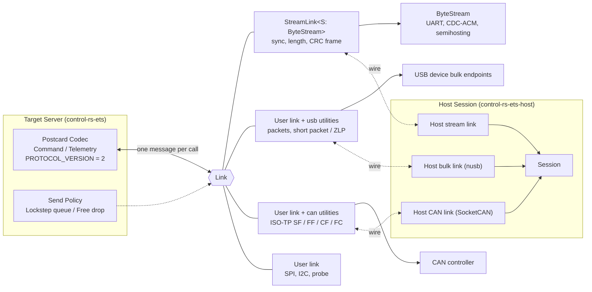

# ETS Link (ets-link)


---

### 1. Introduction

The Embedded Test Server (ETS) exchanges Postcard-encoded `Command` and `Telemetry` messages with the host over a single message link (ADR-0002). This design specifies the whole-message wire protocol (command and telemetry schema, protocol versioning, payload encoding, parameter exchange and fault reporting), the transport link seam and the reference links.

When the transport seam carries typed messages, every board implementation repeats the same sequence: read bytes, reassemble the frame, decode and the reverse on send. Moving the seam to whole encoded messages keeps the server free of transport framing: the server encodes, decodes and applies send policy; a `Link` delimits, verifies and moves one complete message per call using the framing native to its transport. The server contains no framing code.

`control-rs-ets` provides one reference link for byte streams (UART, CDC-ACM, semihosting) and the protocol utilities for USB vendor bulk endpoints and classical CAN. A user's `Link` for a device composes these utilities with the device driver. The core crate has no feature and no dependency beyond `serde`, `postcard` and `crc`. The stream link preserves the 6-byte sync, length and CRC-16 frame (§4.3); packet transports map messages onto their native transfers.

Primary usage scenarios:

- **Command and telemetry exchange**: The host lists suites, runs an executable and reads state, metrics, logs and parameters over one message link; failure is a lost, duplicated or misordered message.
- **Task data exchange**: The host feeds task input and reads task samples at the step rate; failure is a mispaired step or a message that cannot be attributed to its run.
- **Schema evolution & version check**: A host and a target built from different revisions connect; failure is a payload decoded under the wrong schema before compatibility is confirmed.
- **Catastrophic failure capture**: The target panics mid-run; failure is a fault that never reaches the host.
- **High-rate lockstep over USB**: A developer runs a lockstep task over a USB vendor bulk interface; failure is a message split or merged across transfers or framing overhead that limits the step rate.
- **CAN-attached target**: An ESC or small node communicates over CAN; failure is a multi-frame message that arrives incomplete, out of order, or without flow control.
- **Serial target**: A developer connects a UART or USB CDC-ACM port; failure is a lost or corrupted message when one read returns partial or multiple frames.

---

### 2. Requirements

#### 2.1 Functional Requirements

- **FR-1 — Message link**: The server sends and receives exactly one complete encoded message per link call and never observes a partial or corrupted message.
- **FR-2 — Non-blocking link**: Link receive and send calls return without waiting; a send that cannot be accepted whole reports busy and transmits nothing.
- **FR-3 — Transport-native framing**: Each link delimits and verifies messages with its transport's own mechanism and adds no ETS framing bytes where the transport provides delimiting and integrity.
- **FR-4 — Reference link and utilities**: `control-rs-ets` provides a stream link and the USB bulk and CAN protocol utilities that a user's `Link` composes; none needs a cargo feature or an added dependency.
- **FR-5 — Lossless in-order reception**: The stream link and the USB bulk and CAN utilities deliver every complete, valid message it receives exactly once and in arrival order, however the transport chunks the bytes or frames.
- **FR-6 — Byte stream input**: The stream link reads and writes through an ETS-defined non-blocking byte stream trait; adapters for external driver traits belong to the user's crate.
- **FR-7 — Host counterparts**: `control-rs-ets-host` provides host-side links for the stream, USB bulk and CAN transports with their dependencies, so prebuilt host tools drive common devices without a rebuild.
- **FR-8 — Message Schema**: Host-to-target commands and target-to-host telemetry share an append-only, externally tagged Postcard schema (`Command<'a>`, `Telemetry<'a>`) and travel as whole messages over one link.
- **FR-9 — Explicit Wire-Contract Revision**: The protocol carries an explicit `PROTOCOL_VERSION = 2` in `Telemetry::TargetInfo` that a host checks before decoding or acting on any subsequent payload.
- **FR-10 — Payload Encoding Declaration**: Each executable declares the encoding of its input and output packets (`Postcard` or `Raw`) once at discovery via `PacketInfo`, and task payloads travel as opaque bytes tagged with the run's step index (`seq`).
- **FR-11 — Parameter Table Exchange**: A suite's parameters form a flat table of named primitives. Discovery emits one `ParamValue` per entry with name, typed value, bounds, index and count; one `Param` command reads an entry by name or index or writes it with a typed value, and every request is answered with a `ParamValue` carrying the stored value.
- **FR-12 — Catastrophic Failure Capture**: The target captures panics and hardware exceptions, formats them with location, message, fault status and active item, and transmits them as prioritized `TargetPanic` telemetry when the transport is free.
- **FR-13 — Link Supervision**: The protocol detects link loss through host heartbeat and a per-task link timeout declared at discovery; a `StopNow` command immediately halts active execution.
- **FR-14 — Host link extensibility**: `HostLink` is public and the host tools build against it, so a user adds a host link for a new comms device and rebuilds the host tools with it.

#### 2.2 Non-Functional Requirements

- **NFR-1 — Framing overhead**: Per-message framing overhead is 0 bytes on the USB bulk link apart from a terminating zero-length packet, 1 byte per CAN frame on the CAN link and 6 bytes on the stream link.
- **NFR-2 — Single verification point**: Reassembly, segmentation and integrity logic of each reference link is verified once in `control-rs-ets`, not per board.
- **NFR-3 — Low Latency and Determinism**: Telemetry serialization and transmission introduce at most $10\ \mu\text{s}$ of jitter into a nominal 1 kHz control loop deadline.
- **NFR-4 — Task Data Throughput**: Task input and sample messages sustain 1 kHz round trips over USB, with framing overhead as specified by NFR-1.

#### 2.3 Constraints

- **C-1 — Target environment**: `#![no_std]`, zero heap; conforms to `embedded-test-server-design.md` C-1 and C-2.
- **C-2 — Message size**: An encoded message is at most 512 bytes on every link.
- **C-3 — Static dispatch**: Links and byte streams are generic parameters; no trait objects (`ets-executive-design.md` C-3).
- **C-4 — Framing-free server**: The server and runner contain no delimiting, segmentation or integrity code.
- **C-5 — Link-owned bandwidth**: Conforms to `ets-executive-design.md` C-7; the link owns link rate, back-pressure and any receive queue.
- **C-6 — No executive interrupts**: Conforms to `ets-executive-design.md` C-9; an interrupt-fed link owns its interrupt.
- **C-7 — Append-only enum evolution**: Tagged union discriminants follow declaration order in Postcard, requiring variant ordering to be strictly append-only across revisions after Revision 2.
- **C-8 — Dependency-free core**: `control-rs-ets` declares no cargo feature and no dependency beyond `serde`, `postcard` and `crc`.

---

### 3. Technical Overview

The server interacts with exactly one `Link`. A reference link or user link maps whole messages onto the underlying physical transport. The server maintains the encode and decode buffers, enforces protocol version checks, looks up parameters by name and executes the send policy. The host mirrors this architecture via `control-rs-ets-host`.



---

### 4. Architecture

#### 4.1 Link Contract

```rust
pub trait Link {
    type Error;
    /// Copies one complete, verified message into `buf`; returns `None` when none is ready.
    fn recv(&mut self, buf: &mut [u8]) -> Result<Option<usize>, Self::Error>;
    /// Accepts all of `msg` or nothing; `false` indicates transport busy / back-pressure.
    fn send(&mut self, msg: &[u8]) -> Result<bool, Self::Error>;
}
```

Both calls are non-blocking (FR-2). `send` is all-or-nothing: a link that cannot transmit a whole message at once queues it internally or returns `Ok(false)`. The server encodes into a fixed buffer of one maximum message (512 bytes, C-2) and decodes from the buffer that `recv` populates. Postcard carries no self-describing schema headers, so decoding relies entirely on mutual understanding of the schema and explicit protocol version negotiation (postcard, 2026). The fault path transmits `TargetPanic` reports through the same `send` call when the link is free (`ets-executive-design.md` §4.5).

Dropping a link closes it (for example, a semihosting link ends the session in `Drop`); `Link::close_on_failure` is a provided method with an empty body that a link overrides to signal a failed run, because the fault path cannot drop the link. The `Link` trait forms the sole transport surface of the server. `Context<L: Link, P>` binds the server generic over any link implementation without dynamic allocation or virtual dispatch (C-1, C-3).

#### 4.2 Byte Stream Trait

The stream link requires non-blocking byte-level I/O. `embedded-io` specifies that `Read` and `Write` are blocking by contract, using `ReadReady` and `WriteReady` for non-blocking readiness checks (embedded-io, 2026a): `read` blocks until at least one byte is available (embedded-io, 2026b), and only a `true` readiness result guarantees the next call will not block (embedded-io, 2026c; embedded-io, 2026e). Expressing a single non-blocking stream in `embedded-io` therefore requires four traits. The ETS defines one direct trait:

```rust
pub trait ByteStream {
    type Error;
    fn read(&mut self, buf: &mut [u8]) -> Result<usize, Self::Error>;  // 0 = nothing ready
    fn write(&mut self, buf: &[u8]) -> Result<usize, Self::Error>;     // short count = back-pressure
}
```

Partial transfers are standard: `read` returns available bytes up to the buffer capacity without blocking, and `write` returns the slice prefix accepted by hardware or driver buffers (embedded-io, 2026b; embedded-io, 2026d). A driver that implements `Read`, `Write`, `ReadReady` and `WriteReady` from `embedded-io` adapts to `ByteStream` in the user's crate, which keeps the core free of that dependency. Embedded-hal 1.0 delegates serial communication to `embedded-io` (embedded-hal, 2024), and CDC-ACM ports such as `usbd-serial` implement these traits directly (usbd-serial, 2026).

#### 4.3 Stream Link Frame

`StreamLink<S: ByteStream>` wraps whole encoded messages in a lightweight delimiter frame:

```
┌──────────────┬───────────────┬─────────────────┬──────────────┐
│  Sync Bytes  │ Payload Length│  Payload Data   │    CRC-16    │
│  0xAA  0x55  │ 2 Bytes (BE)  │   N Bytes       │ 2 Bytes (BE) │
└──────────────┴───────────────┴─────────────────┴──────────────┘
```

- **Sync Header**: 2 bytes (`0xAA 0x55`).
- **Payload Length**: 2 bytes big-endian, bounded to 512 bytes (C-2).
- **Payload Data**: A Postcard-encoded `Command` or `Telemetry` buffer (postcard, 2026).
- **Integrity Check**: 2-byte CRC-16 (`CRC_16_IBM_SDLC`) computed over the payload (crc, 2026).
- **Overhead**: Exactly 6 bytes per message (NFR-1).

`StreamLink` owns a 518-byte reassembly buffer and a read cursor that retains unconsumed bytes across non-blocking reads. If a single read yields the tail of one message and the start of another, neither is lost (FR-5). postcard-rpc applies this same remainder retention in its byte-stream transports (postcard-rpc, 2026c). On transmission, the link writes through `ByteStream::write`, buffering unwritten tails across invocations and reporting busy (`Ok(false)`) until the tail clears. This link serves UART, USB CDC-ACM, semihosting and debug probes.

#### 4.4 USB Bulk Link

The `usb` module serves a user's `Link` over a dedicated vendor bulk interface pair (one IN endpoint, one OUT endpoint) with zero ETS framing bytes (FR-3). `usb::Packets` splits a message into endpoint packets and appends the zero-length packet; `usb::Assembler` joins received packets and yields the message at the short packet or zero-length packet. Messages are written in packets up to the endpoint maximum packet size ($W_{\text{MaxPacketSize}}$). Transfers complete upon receiving a short packet ($< W_{\text{MaxPacketSize}}$); messages whose length is an exact integer multiple of the packet size are terminated with a zero-length packet (ZLP), matching the framing convention in postcard-rpc's USB transport (postcard-rpc, 2026b). The USB 2.0 specification ends a bulk transfer on a short packet or a ZLP and permits a short packet as an in-band end-of-data delimiter (Compaq et al., 2000); Windows and illumos host drivers report that completion (Microsoft, 2026a; illumos, 2026).

Full-speed USB bulk endpoints support up to 64 bytes and high-speed endpoints support up to 512 bytes (Compaq et al., 2000). Under high-speed USB (for example, NXP i.MX RT1062 on Teensy 4.0/4.1), a 512-byte message occupies one 512-byte data packet followed by a ZLP. Because USB data packets carry a 16-bit CRC and bulk transactions are retried on bus errors with data-toggle sequencing (Compaq et al., 2000), The `usb` module adds no software checksum or sequence fields.

CDC-ACM and USB-to-serial ports (such as the native USB-C Serial/JTAG controller on the ESP32-C6 DevKitC-1, the USBD CDC peripheral on the Seeed Studio XIAO nRF52840, and the SCI2 UART/USB bridge on the Arduino Uno R4 Minima) cannot use the `usb` utilities directly because host OS serial drivers decouple packet boundaries from tty reads (Linux kernel, 2026a; Linux man-pages project, 2026; Microsoft, 2026b). These USB-C and UART targets use `StreamLink` with its 6-byte sync/length/CRC framing instead.

#### 4.5 CAN Link

Classical CAN carries 0 to 8 data bytes per frame (Robert Bosch GmbH, 1991; embedded-can, 2026), while CAN FD carries up to 64 data bytes (Linux Kernel Documentation, 2026a). The `can` module uses classical 8-byte frames, which a CAN FD controller also sends; a link that uses 64-byte CAN FD frames is a user link (§4.6) without the `can` module. The CAN physical layer enforces CRC verification, hardware acknowledgement and automatic frame retransmission (Robert Bosch GmbH, 1991), eliminating the need for software checksums.

Messages exceeding single-frame capacity are segmented according to ISO-TP (ISO 15765-2) protocol rules (Linux Kernel Documentation, 2026b; Linux kernel, 2026b):
- **Single Frame (SF)**: Carries payloads up to 7 bytes on classical CAN with a 1-byte Protocol Control Information (PCI) header.
- **First Frame (FF)**: Initiates multi-frame transfers, carrying a 2-byte PCI header declaring the total 12-bit message length (up to 4095 bytes, well exceeding C-2's 512-byte bound).
- **Flow Control (FC)**: The receiver answers the First Frame with an FC frame specifying Block Size and Separation Time ($ST_{\min}$). A Block Size of 0 lets the sender transmit every Consecutive Frame without a further FC frame (Linux kernel, 2026b).
- **Consecutive Frame (CF)**: Carries remaining payload segments, spending 1 byte per frame on its PCI (Linux kernel, 2026b). Assumption to verify: the PCI holds a 4-bit sequence counter. A sequence gap or timeout discards the partial message without corruption (FR-5).

The link operates on user-configured host and target CAN identifiers. Maintaining standard ISO-TP flow control allows the host link to bind directly to Linux kernel SocketCAN ISO-TP sockets (Linux Kernel Documentation, 2026b).

#### 4.6 Interrupt-Fed and User Links

A link driver may receive bytes or frames inside a hardware interrupt service routine (ISR) and push complete messages into an internal single-producer single-consumer (SPSC) queue. `Link::recv` then dequeues verified messages during cyclic executive polling. All ISR routines, peripheral registers and queue buffers belong exclusively to the link driver (C-5, C-6). Custom transports (SPI, I2C, JTAG/SWD memory buffers) implement `Link` directly or wrap raw byte streams in `StreamLink`.

#### 4.7 Host Side

`control-rs-ets-host` implements a host counterpart for each target transport through its own `HostLink` trait (`ets-host-design.md`), distinct from the target `Link`. The host crate carries the dependencies of its links so prebuilt host tools drive common devices without a rebuild; a user adds a link for a new comms device by implementing `HostLink` and rebuilding the host tools (FR-14):
- **Stream Link**: Communicates over serial ports (via `serial2`) or child process pipes using the 6-byte sync/length/CRC frame.
- **USB Bulk Link**: Communicates over vendor bulk interfaces using `nusb`, supporting asynchronous and non-blocking bulk transfers across Windows, Linux and macOS (nusb, 2026).
- **CAN Link**: Communicates over SocketCAN ISO-TP sockets (`AF_CAN`, `CAN_ISOTP`) on Linux (Linux Kernel Documentation, 2026b).

#### 4.7.1 Independent Diagnostic Monitor Channel

Targets frequently expose independent physical or virtual ports for diagnostic serial output (for example, bootloader logs, panic prints, or hardware UART monitor) alongside the primary ETS transport (for example, native USB-C Serial/JTAG on ESP32-C6 DevKitC-1, secondary CDC endpoint on USB-enabled MCUs, or ARM SWD/RTT). The ETS link architecture guarantees strict protocol isolation: raw UTF-8 text and bootloader frames on the diagnostic monitor never pollute Postcard frames on the ETS link, enabling operators to keep a continuous serial monitor running in one terminal while driving interactive tests in the TUI or CI runner in another.

#### 4.8 Command and Telemetry Schema (Revision 2)

Variant declaration order defines the serialized Postcard discriminant tag (postcard, 2026; Serde, 2026). Revision 2 represents a clean break: obsolete channel multiplexing is eliminated, run commands and execution modes are unified, and parameters travel as named, typed primitives. Postcard schemas are externally tagged, enabling `#![no_std]` execution without dynamic allocation (Serde, 2026).

```rust
pub const PROTOCOL_VERSION: u8 = 2;

#[derive(Serialize, Deserialize)]
pub enum Command<'a> {
    ListSuites,
    RunExecutable {
        suite: u16,
        item: u16,
        mode: ExecMode,
        max_steps: u64,
        period_ns: u32,
    },
    Param {
        suite: u16,
        key: ParamKey<'a>,
        value: Option<Param>,
    },
    TaskInput {
        suite: u16,
        item: u16,
        seq: u64,
        payload: &'a [u8],
    },
    Heartbeat,
    StopNow {
        suite: u16,
        item: u16,
    },
    TryReset,
}

#[derive(Serialize, Deserialize)]
pub enum Telemetry<'a> {
    TargetInfo {
        protocol_version: u8,
        board_id: u16,
        core_clock_hz: u32,
        fpu_flags: u8,
        release_source: bool,
    },
    SuiteInfo {
        suite: u16,
        name: &'a str,
        description: &'a str,
        executable_count: u16,
        param_count: u16,
    },
    ExecutableInfo {
        suite: u16,
        item: u16,
        name: &'a str,
        description: &'a str,
        modes: u8,
        input: PacketInfo<'a>,
        output: PacketInfo<'a>,
        link_timeout_ms: u32,
    },
    ParamValue {
        suite: u16,
        index: u16,
        count: u16,
        name: &'a str,
        description: &'a str,
        value: Param,
        min: Param,
        max: Param,
    },
    DiscoveryComplete,
    ItemState {
        suite: u16,
        item: u16,
        state: ItemState,
        message: Option<&'a str>,
    },
    RunStats {
        suite: u16,
        item: u16,
        steps: u64,
        time_ns: u64,
        step_min_ns: u32,
        step_max_ns: u32,
        cycles: u64,
        stack_peak: u32,
        jitter_max_ns: u32,
        missed_releases: u32,
    },
    TaskSample {
        suite: u16,
        item: u16,
        seq: u64,
        payload: &'a [u8],
    },
    TeardownReport {
        suite: u16,
        item: u16,
        ok: bool,
        message: Option<&'a str>,
    },
    Log(LogMessage<'a>),
    TargetPanic {
        file: &'a str,
        line: u32,
        message: &'a str,
        fault_status: u32,
        suite: Option<u16>,
        item: Option<u16>,
    },
}

#[derive(Serialize, Deserialize, Clone, Copy)]
pub enum ExecMode {
    Atomic,
    Lockstep,
    FreeRunning,
    Periodic,
    Triggered,
}

#[derive(Serialize, Deserialize, Clone, Copy)]
pub enum ItemState {
    Idle,
    Running,
    Done(Verdict),
    Faulted,
}

#[derive(Serialize, Deserialize, Clone, Copy)]
pub enum Verdict {
    Pass,
    Fail,
    Error,
    Aborted,
    TimedOut,
    Bounded,
    Overrun,
}

#[derive(Serialize, Deserialize, Clone, Copy)]
pub enum Param {
    U8(u8),
    U16(u16),
    U32(u32),
    I32(i32),
    F32(f32),
    Bool(bool),
}

#[derive(Serialize, Deserialize, Clone, Copy)]
pub enum ParamKey<'a> {
    Name(&'a str),
    Index(u16),
}

#[derive(Serialize, Deserialize)]
pub struct PacketInfo<'a> {
    pub type_name: &'a str,
    pub encoding: PayloadEncoding,
}

#[derive(Serialize, Deserialize, Clone, Copy)]
pub enum PayloadEncoding {
    Postcard,
    Raw,
}

#[derive(Serialize, Deserialize)]
pub struct LogMessage<'a> {
    pub level: u8,
    pub target: &'a str,
    pub message: &'a str,
}
```

Key wire semantics:
1. **Explicit Version Negotiation (FR-9)**: `Telemetry::TargetInfo` is the first message transmitted upon connection or reset. The host must inspect `protocol_version == PROTOCOL_VERSION` before decoding any subsequent message. If versions mismatch, the host refuses the connection without attempting further deserialization.
2. **Parameter Table (FR-11)**: Parameters are named primitives in a flat table; the `Param` variant carries the type, so the host renders and edits a value from its type alone and the target formats and parses no text. Discovery sends `ParamValue` with `index` and `count` for every entry, so the host detects a missing entry and requests it with a `Param` command by index. A `Param` command with a value writes; the target rejects an unknown name or index, a type that differs from the stored type or a value outside `min` and `max`, and always answers with `ParamValue` carrying the stored value, so a refused write is visible as an unchanged value.
3. **Payload Encodings (FR-10)**: Task input and output packets declare their encoding in `ExecutableInfo`. Postcard encodes numeric structs with little-endian floats and integers (postcard, 2026). Raw encoding uses packed, padding-free little-endian binary representations. Because message payloads begin at variable byte offsets in the receive buffer, raw payloads are decoded via explicit memory copy, never in-place reference casting.
4. **Catastrophic Failure Capture (FR-12)**: Target panics and hardware faults are formatted into `Telemetry::TargetPanic`. `fault_status` encodes the architecture hardware fault register (Cortex-M CFSR/HFSR or RISC-V `mcause`), and `(suite, item)` identifies the active test or task at the time of failure.
5. **Field values**: `ExecutableInfo.modes` has bit `n` set when `ExecMode` variant `n` is allowed, so an atomic case reports `0b00001`. An executable without packets reports an empty `type_name` with `Postcard` for both `PacketInfo`. `Log.level` is `0` for error, `1` for warning and `2` for information. An atomic run reports `RunStats` with `steps = 1`, `step_min_ns = step_max_ns = time_ns` (saturated to `u32`), `jitter_max_ns = 0` and `missed_releases = 0`. A parameter without declared bounds reports the minimum and maximum of its `Param` type as `min` and `max`.

#### 4.9 Send Policy and Error Handling

The server implements a prioritized send policy based on message type:
- **Command Replies & State Updates**: Discovery messages, state transitions, teardown reports and parameter echoes must be transmitted reliably. If `Link::send` returns `Ok(false)` (busy), the server pauses executive progression until the message is accepted.
- **Lockstep Task Samples**: In `Lockstep` mode, the target produces one `TaskSample` per step and awaits the corresponding `TaskInput`. The sample must not be dropped; if the link is busy, the step blocks until the sample transmits.
- **Free-Running Task Samples**: In `FreeRunning` mode, task execution does not block on transport delays. If the link reports busy, the sample is discarded. The host detects dropped samples via non-consecutive `seq` counters.
- **Fault Reports**: When a panic occurs, the runtime attempts to send `TargetPanic` immediately if the link is available; if the link is blocked, it settles the safe state and resets (`ets-executive-design.md` §4.5).

Transport errors (`Link::Error`) log a warning if communication remains operational. Data integrity failures (CRC mismatch, malformed length prefix, invalid sync bytes, lost CAN frames) cause silent packet drops without server state corruption. Recovery occurs through protocol timeouts or host retry mechanisms (FR-13).

#### 4.10 File Impact

| File | Change | Content |
|:-----|:-------|:--------|
| `control-rs-ets/src/params.rs` | New | `ParamEntry` table entry, `ParamTable` |
| `control-rs-ets/src/wire.rs` | Updated | `Command<'a>`, `Telemetry<'a>`, `PacketInfo<'a>`, `PROTOCOL_VERSION = 2`, Postcard codec |
| `control-rs-ets/src/link/mod.rs` | New | `Link` trait, `ByteStream` trait |
| `control-rs-ets/src/link/stream.rs` | New | `StreamLink`, 6-byte sync/length/CRC frame, reassembly cursor |
| `control-rs-ets/src/link/usb.rs` | New | `Packets` and `Assembler` for bulk transfers |
| `control-rs-ets/src/link/can.rs` | New | ISO-TP `Segmenter` and `Reassembler` |
| `control-rs-ets/src/server.rs` | Updated | `Context<L: Link, P>`, version check, and send policy |
| `control-rs-ets/src/comms.rs` | Removed | Replaced by `link/` and `wire.rs` |
| `control-rs-ets-host/src/bridge.rs` | Updated | Host decoding of Revision 2 telemetry and framing of commands |
| `control-rs-ets-host/src/link/` | Updated | `HostLink`, `MessageLink`, USB bulk (`nusb`) and CAN (`SocketCAN` ISO-TP) links |

---

### 5. Alternatives

| Alternative | Rejected Because | Reference |
|:------------|:-----------------|:----------|
| Keep the typed `HostComms` trait | Every implementation repeats reassembly and decoding, verifying FR-5 per board and violating NFR-2 | (postcard, 2026) |
| Byte-level port with server-owned framing | Forces transport-specific framing into the executive (C-4) and wastes 6 bytes per message on USB bulk and CAN | (Compaq et al., 2000; Robert Bosch GmbH, 1991) |
| `embedded-io` as the core target trait | Blocking by contract; non-blocking use requires four distinct traits; adapted in the user's crate so the core keeps no dependency | (embedded-io, 2026a) |
| `embedded-hal-nb` serial | Operates strictly word-at-a-time, incurring severe function call overhead on multi-byte frames | (embedded-hal-nb, 2026) |
| `postcard-rpc` as the message layer | Imposes opinionated header structures and endpoint routing that duplicate ETS suite/item indexing | (postcard-rpc, 2026d) |
| Channelized framing with a raw data plane | Separate channel identifiers break length-prefixed sync framing and bypass the protocol version check; `PacketInfo` accomplishes raw payload typing within single messages | (postcard, 2026) |
| Multi-endpoint USB with separate control/data pipes | UART, semihosting and debug probes cannot support multiple physical endpoints; a single message link serves all transports uniformly | — |
| COBS for stream link framing | Adds variable-time byte-stuffing and replaces the established sync/length/CRC frame without measurable benefit | (postcard, 2026) |
| ETS software CRC on every link | Redundantly computes CRCs on USB and CAN, both of which enforce hardware CRC verification | (Compaq et al., 2000; Robert Bosch GmbH, 1991) |
| Schema reflection or text strings for parameters | A schema needs runtime type descriptors in `#![no_std]`, and text makes the target format and parse floats; typed primitives in an externally tagged enum carry their type | (Serde, 2026) |

---

### 6. Verification & Validation

#### 6.1 Verification

| Condition | Requirement | Method | Target | Criterion |
|:----------|:------------|:-------|:-------|:----------|
| VC-1.1 | FR-1 | `libtest` | `control_rs_ets::server::tests::fake_link_round_trip` | Over a mock link, every command decodes and every telemetry message is sent as one complete call |
| VC-2.1 | FR-2 | `libtest` | `control_rs_ets::link::tests::busy_send_transmits_nothing` | A busy `send` leaves the transport untouched; a subsequent call sends the complete message |
| VC-3.1 | FR-3 | `libtest` | `control_rs_ets::link::usb::tests::message_bytes_equal_payload` | Bytes written to the bulk endpoint equal payload length, partitioned at packet size, with ZLP following exact multiples |
| VC-3.2 | FR-3 | `libtest` | `control_rs_ets::link::can::tests::segments_carry_one_pci_byte` | Each consecutive CAN frame carries one PCI byte and payload; zero ETS CRCs are appended |
| VC-3.3 | FR-3 | `libtest` | `control_rs_ets::link::can::tests::first_frame_answered_with_flow_control` | A received first frame triggers exactly one Flow Control frame before consecutive frames are accepted |
| VC-4.1 | FR-4 | `inspection` | — | The `usb`, `can` and `stream` modules compile unconditionally and `control-rs-ets` declares no feature |
| VC-5.1 | FR-5 | `libtest` | `control_rs_ets::link::stream::tests::any_chunking_delivers_all` | For arbitrary slice fragmentations of multi-frame streams, all frames are delivered in-order without loss |
| VC-5.2 | FR-5 | `libtest` | `control_rs_ets::link::stream::tests::corrupt_frame_dropped` | A frame with bit errors or CRC mismatch is dropped and the stream synchronizes on the next sync header |
| VC-5.3 | FR-5 | `libtest` | `control_rs_ets::link::can::tests::lost_segment_discards_message` | A missing or out-of-order ISO-TP sequence frame discards the partial message without delivering corrupt data |
| VC-6.1 | FR-6 | `libtest` | `control_rs_ets::link::stream::tests::short_write_reports_busy_until_drained` | A short `ByteStream::write` leaves the tail pending, `send` reports busy until it drains and a stream that accepts nothing never blocks `recv` or `send` |
| VC-7.1 | FR-7 | `libtest` | `control_rs_ets_host::link::tests::host_target_pairs_interoperate_stream`, `control_rs_ets_host::link::tests::host_target_pairs_interoperate_usb`, `control_rs_ets_host::link::tests::host_target_pairs_interoperate_can` | Each host link implementation exchanges messages bidirectionally with its target counterpart over in-memory buffers |
| VC-8.1 | FR-8 | `libtest` | `control_rs_ets::wire::tests::command_and_telemetry_round_trip` | Every `Command` and `Telemetry` variant survives encoding, link transport and decoding |
| VC-9.1 | FR-9 | `libtest` | `control_rs_ets_host::session::tests::version_mismatch_refused` | Host rejects a target reporting `protocol_version != 2` before decoding any other payload |
| VC-9.2 | FR-9 | `libtest` | `control_rs_ets::server::tests::target_info_sent_at_boot` | `TargetInfo` is the first message transmitted upon startup and reset |
| VC-10.1 | FR-10 | `libtest` | `control_rs_ets::wire::tests::golden_vectors` | Each message variant encodes to its canonical byte sequence and `PacketInfo` round-trips correctly |
| VC-10.2 | FR-10 | `libtest` | `control_rs_ets::run::tests::output_seq_equals_step` | Every `TaskSample` carries a `seq` counter equal to its execution step index |
| VC-11.1 | FR-11 | `libtest` | `control_rs_ets::server::tests::param_table_get_set_echo` | A `Param` read by name and by index returns the same `ParamValue`, and a write with an unknown name or index, a mismatched type or an out-of-bounds value leaves the parameter unchanged and is answered with its stored value |
| VC-12.1 | FR-12 | `libtest` | `control_rs_ets::util::tests::test_handle_failure_comms_active` | `TargetPanic` correctly reports file, line, message and hardware fault status when the transport is free |
| VC-13.1 | FR-13 | `libtest` | `control_rs_ets::run::tests::stop_and_timeout_while_waiting` | `StopNow` and heartbeat expiration promptly terminate an active task waiting for input |
| VC-14.1 | FR-14 | `libtest` | `control_rs_ets_host::link::tests::custom_link_drives_discovery` | A user-defined `HostLink` drives discovery through the same entry point as the built-in links |
| VC-21.1 | NFR-1 | `analysis` | Logic analyzer captures | Framing overhead matches 0 bytes (USB bulk), 1 byte/frame (CAN), and 6 bytes (stream link) |
| VC-22.1 | NFR-2 | `inspection` | Codebase audit | Board support packages contain zero reassembly, segmentation, or CRC algorithms |
| VC-23.1 | NFR-3 | `analysis` | Cycle timing on target hardware | DWT/CSR-measured telemetry serialization overhead does not exceed $10\ \mu\text{s}$ |
| VC-24.1 | NFR-4 | `analysis` | Hardware session logging | 1 kHz lockstep task over USB on Teensy 4.1 runs continuously without buffer overflow |
| VC-31.1 | C-1 | `compile` | `cargo ci` target builds | `control-rs-ets` compiles under `#![no_std]` with zero allocator symbols |
| VC-32.1 | C-2 | `libtest` | `control_rs_ets::link::tests::oversize_send_is_error` | Messages exceeding 512 bytes fail `send` on the stream link and the `usb` and `can` utilities |
| VC-33.1 | C-3 | `inspection` | Codebase audit | No dynamic trait objects (`dyn`) in `control-rs-ets` link or wire modules |
| VC-34.1 | C-4 | `inspection` | Codebase audit | `server` and `run` modules contain zero framing or CRC code |
| VC-35.1 | C-5 | `review` | Architecture audit | Link bandwidth, back-pressure, and queue allocations remain internal to link modules |
| VC-36.1 | C-6 | `inspection` | Codebase audit | No interrupt handlers declared in `control-rs-ets` link implementations |
| VC-37.1 | C-7 | `libtest` | `control_rs_ets::wire::tests::largest_variant_fits_512` | The maximum serialized length of every enum variant fits within 512 bytes |
| VC-38.1 | C-8 | `inspection` | — | `control-rs-ets/Cargo.toml` declares no `[features]` and no dependency beyond `serde`, `postcard` and `crc` |

Coverage: 90% line coverage of `control-rs-ets` `link` and `wire` modules, measured via `cargo coverage`.

#### 6.2 Acceptance

- **USB bulk session**: A Teensy 4.1 target runs a lockstep task over a `Link` composed from the `usb` utilities at line rate without message drops or frame desynchronization.
- **CAN session**: A host CAN link and a target `Link` composed from the `can` utilities, joined by an in-memory transport, complete discovery and exchange lockstep task messages.
- **Serial regression**: The QEMU semihosting and Teensy CDC-ACM examples pass test gates through `StreamLink`.
- **Version mismatch refusal**: A host cleanly rejects targets transmitting non-matching protocol versions before processing further commands.
- **Panic delivery**: A target encountering an intentional panic delivers `TargetPanic` telemetry before system reboot.

#### 6.3 Limits

The USB bulk and CAN links are verified against in-memory transports and on Teensy 4.1; QEMU test environments exercise `StreamLink` via semihosting. Per-board link checks belong to `board-examples-design.md`. Host CAN functionality requires Linux SocketCAN support. Raw binary payload layouts require compile-time layout agreement between host and target code.

---

### 7. Performance & Resource Considerations

| Link | Framing Overhead | Integrity | Target Memory Buffers |
|:-----|:-----------------|:----------|:----------------------|
| Stream | 6 bytes per message | CRC-16 | One 518-byte reassembly buffer, one send tail buffer |
| USB Bulk | 0 bytes (+ ZLP if multiple of max packet size) | Hardware USB CRC-16 | One endpoint packet buffer |
| CAN | 1 byte per frame (plus First Frame header) | Hardware CAN CRC | One 512-byte reassembly buffer, ISO-TP state machine |

Memory footprint on target is strictly bounded: the server maintains one 512-byte encode buffer and one 512-byte decode buffer, avoiding dynamic allocation. Parameters travel as typed primitives, so the target uses no text formatting buffers.

---

### 8. Risks & Open Questions

- **UART FIFO Starvation During Cooperative Steps (C-5)**: At 115,200 baud, one byte arrives every $86.8\ \mu\text{s}$. If an atomic test or cooperative task step executes for 2.1 ms without yielding, approximately 24 bytes arrive. On microcontrollers with an 8- or 16-byte hardware FIFO, an unserviced FIFO overruns. Receive buffering belongs to the board's `ByteStream` (§4.6); a board without an interrupt-driven ring buffer or DMA channel loses bytes.
- **Version Check Handshake (FR-9)**: Postcard is not self-describing, so a Revision 1 host rejects a Revision 2 `TargetInfo` only if discriminant decoding fails. Golden vectors from both revisions test this rejection.
- **Raw Payload Layout Alignment (FR-10)**: Raw binary payloads decode correctly only when host and target struct definitions match. The discovery check of `PacketInfo.type_name` detects a name mismatch, not a layout mismatch.
- **ISO-TP Flow Control Separation Time (§4.5)**: The target specifies $ST_{\min} = 0$, so the host streams consecutive frames without inter-frame delay. Whether resource-constrained CAN controllers keep up is unverified.
- **Windows Bulk Driver Binding (§4.7)**: A device with a custom bulk interface binds to WinUSB on Windows without an INF only if it supplies the matching descriptors.

---

### 9. Development Plan

| Phase | Delivers | Requirements | Effort | Status |
|:------|:---------|:-------------|:-------|:-------|
| 1. Wire Schema Rev 2 | `wire.rs` with `Command`, `Telemetry`, `PacketInfo`, `PROTOCOL_VERSION = 2`, golden vectors | FR-8, FR-9, FR-10, FR-11, FR-12, C-7 | 2 days | Planned |
| 2. Link Contract & Stream | `Link` and `ByteStream` traits, `StreamLink` with sync/len/CRC frame, server migration | FR-1, FR-2, FR-5, FR-6, NFR-2, C-1 to C-6 | 3 days | Planned |
| 3. USB Bulk Utilities | `usb::Packets` and `usb::Assembler`, host `nusb` bulk link, Teensy bulk session | FR-3, FR-4, FR-7, NFR-1, NFR-4 | 3 days | Planned |
| 4. CAN Utilities | `can::Segmenter` and `can::Reassembler`, host SocketCAN link, in-memory CAN session | FR-3, FR-4, FR-7, NFR-1 | 4 days | Planned |
| 5. Supervision | Heartbeat supervision, Teensy 1 kHz throughput verification | FR-13, NFR-3, FR-14 | 2 days | Planned |

---

### 10. Revision History

| Revision | Date | Author | Description |
|:---------|:-----|:-------|:------------|
| 1.0 | October 12, 2026 | @MitchellDScott | Initial draft outlining `Link` trait, `ByteStream`, and stream/USB/CAN reference links. |
| 1.1 | October 12, 2026 | @MitchellDScott | Applied CDC-ACM, CAN FD, flow control, and host USB evidence. |
| 1.2 | October 12, 2026 | @MitchellDScott | Consolidated wire protocol from retired `host-comm-design.md`: added FR-8 to FR-13, NFR-3, NFR-4, C-7, §4.8 wire schema, setting parameter string exchange model, and panic reporting. |
| 1.3 | October 12, 2026 | @MitchellDScott | Settings exchanged as a named dictionary of typed primitives: FR-11 changed, `GetSetting`, `Param` and `SettingKey` added; `ItemState::Done` carries the run verdict. |
| 1.4 | October 12, 2026 | @MitchellDScott | The reference CAN link uses classical frames; CAN FD framing is a user link. |
| 1.5 | October 12, 2026 | @MitchellDScott | USB claims cite the USB 2.0 specification and ISO-TP claims cite `isotp.c`; host links implement `HostLink`; §8 states risks rather than instructions. |
| 1.6 | October 13, 2026 | Claude Sonnet 5.5 | Header migrated to the Approval and Doc Status badge grammar; Approval set to Stale pending re-review. Affects C-1, C-2, C-3, C-4, C-5, C-6, C-7, FR-1, FR-2, FR-3, FR-4, FR-5, FR-6, FR-7, FR-8, FR-9, FR-10, FR-11, FR-12, FR-13, NFR-1, NFR-2, NFR-3, NFR-4. |

---

## References

[1] J. Munns, "Wire format," *The postcard wire specification*. [Online]. Available: https://postcard.jamesmunns.com/wire-format. Accessed: Sep. 9, 2026.

[2] embedded-io, *embedded-io*: embedded_io (Version 0.7.1). [Online]. Available: https://docs.rs/embedded-io/0.7.1/embedded_io/. Accessed: Oct. 12, 2026.

[3] embedded-io, *embedded-io*: embedded_io::Read (Version 0.7.1). [Online]. Available: https://docs.rs/embedded-io/0.7.1/embedded_io/trait.Read.html. Accessed: Oct. 12, 2026.

[4] embedded-io, *embedded-io*: embedded_io::ReadReady (Version 0.7.1). [Online]. Available: https://docs.rs/embedded-io/0.7.1/embedded_io/trait.ReadReady.html. Accessed: Oct. 12, 2026.

[5] embedded-io, *embedded-io*: embedded_io::WriteReady (Version 0.7.1). [Online]. Available: https://docs.rs/embedded-io/0.7.1/embedded_io/trait.WriteReady.html. Accessed: Oct. 12, 2026.

[6] embedded-io, *embedded-io*: embedded_io::Write (Version 0.7.1). [Online]. Available: https://docs.rs/embedded-io/0.7.1/embedded_io/trait.Write.html. Accessed: Oct. 12, 2026.

[7] embedded-hal, "docs/migrating-from-0.2-to-1.0.md," in *rust-embedded/embedded-hal* (master). [Online]. Available: https://github.com/rust-embedded/embedded-hal/blob/master/docs/migrating-from-0.2-to-1.0.md. Accessed: Oct. 12, 2026.

[8] usbd-serial, *usbd-serial*: usbd_serial::SerialPort (Version 0.2.2). [Online]. Available: https://docs.rs/usbd-serial/0.2.2/usbd_serial/struct.SerialPort.html. Accessed: Oct. 12, 2026.

[9] crc-rs contributors, "*crc*: Rust implementation of CRC with support of various standards." [Online]. Available: https://docs.rs/crc. Accessed: Sep. 9, 2026.

[10] postcard-rpc, "source/postcard-rpc/src/server/impls/embedded_io_async_v0_6.rs," in *jamesmunns/postcard-rpc* (main). [Online]. Available: https://github.com/jamesmunns/postcard-rpc/blob/main/source/postcard-rpc/src/server/impls/embedded_io_async_v0_6.rs. Accessed: Oct. 12, 2026.

[11] postcard-rpc, "source/postcard-rpc/src/server/impls/embassy_usb_v0_5.rs," in *jamesmunns/postcard-rpc* (main). [Online]. Available: https://github.com/jamesmunns/postcard-rpc/blob/main/source/postcard-rpc/src/server/impls/embassy_usb_v0_5.rs. Accessed: Oct. 12, 2026.

[12] Microsoft, "_URB_BULK_OR_INTERRUPT_TRANSFER structure (usb.h)," *Microsoft Learn*. [Online]. Available: https://learn.microsoft.com/en-us/windows-hardware/drivers/ddi/usb/ns-usb-_urb_bulk_or_interrupt_transfer. Accessed: Oct. 12, 2026.

[13] illumos, "usb_bulk_req(9S)," *Tribblix manual pages*. [Online]. Available: https://www.tribblix.org/man/man9s/usb_bulk_req_t.html. Accessed: Oct. 12, 2026.

[14] Compaq, Hewlett-Packard, Intel, Lucent, Microsoft, NEC and Philips, "Universal Serial Bus Specification," USB Implementers Forum, Rep. Revision 2.0, 2000. [Online]. Available: https://www.usb.org/document-library/usb-20-specification. Accessed: Oct. 12, 2026.

[15] Linux kernel, "drivers/usb/class/cdc-acm.c," in *torvalds/linux* (master). [Online]. Available: https://github.com/torvalds/linux/blob/master/drivers/usb/class/cdc-acm.c. Accessed: Oct. 12, 2026.

[16] Linux man-pages project, "termios(3)," *man7.org*. [Online]. Available: https://man7.org/linux/man-pages/man3/termios.3.html. Accessed: Oct. 12, 2026.

[17] Microsoft, "USB device driver installation based on compatible IDs," *Microsoft Learn*. [Online]. Available: https://learn.microsoft.com/en-us/windows-hardware/drivers/usbcon/usb-driver-installation-based-on-compatible-ids. Accessed: Oct. 12, 2026.

[18] Robert Bosch GmbH, "CAN Specification Version 2.0," Robert Bosch GmbH, Stuttgart, Germany, 1991. [Online]. Available: https://acoustics.sabanciuniv.edu/ee308/doc/can2spec.pdf. Accessed: Oct. 12, 2026.

[19] embedded-can, *embedded-can*: embedded_can::Frame (Version 0.4.1). [Online]. Available: https://docs.rs/embedded-can/0.4.1/embedded_can/trait.Frame.html. Accessed: Oct. 12, 2026.

[20] Linux Kernel Documentation, "SocketCAN - Controller Area Network," *The Linux Kernel documentation*. [Online]. Available: https://docs.kernel.org/networking/can.html. Accessed: Oct. 12, 2026.

[21] Linux Kernel Documentation, "ISO 15765-2 (ISO-TP)," *The Linux Kernel documentation*. [Online]. Available: https://docs.kernel.org/networking/iso15765-2.html. Accessed: Oct. 12, 2026.

[22] Linux kernel, "net/can/isotp.c," in *torvalds/linux* (master). [Online]. Available: https://github.com/torvalds/linux/blob/master/net/can/isotp.c. Accessed: Oct. 12, 2026.

[23] nusb, *nusb*: cross-platform USB host access in pure Rust (Version 0.2.7). [Online]. Available: https://docs.rs/nusb/0.2.7/nusb/. Accessed: Oct. 12, 2026.

[24] Serde contributors, "Enum representations," *Serde documentation*. [Online]. Available: https://serde.rs/enum-representations.html. Accessed: Sep. 9, 2026.

[25] embedded-hal-nb, *embedded-hal-nb*: embedded_hal_nb::serial::Read (Version 1.0.0). [Online]. Available: https://docs.rs/embedded-hal-nb/1.0.0/embedded_hal_nb/serial/trait.Read.html. Accessed: Oct. 12, 2026.

[26] postcard-rpc, *postcard-rpc*: postcard_rpc::header::VarHeader (Version 0.12.1). [Online]. Available: https://docs.rs/postcard-rpc/0.12.1/postcard_rpc/header/struct.VarHeader.html. Accessed: Oct. 12, 2026.
