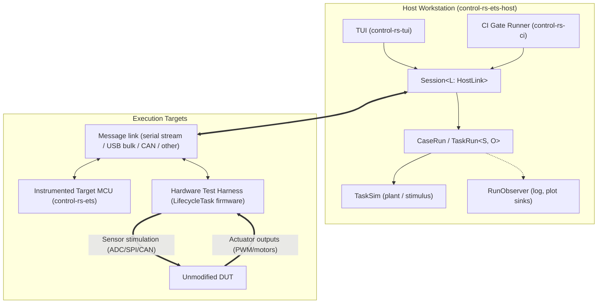

# Embedded Test Server (ETS) & Hardware-in-the-Loop (HIL)


---

### 1. Introduction

`control-rs` provides a unified testing and simulation architecture (ADR-0002)
spanning from host-side math verification to embedded atomic kernel benchmarks,
Hardware-in-the-Loop (HIL) plant simulation and unmodified Device Under Test
(DUT) execution. Layers are defined once, in `embedded-test-server-design.md`.

#### 1.1 The Verification Spectrum

| Testing Layer | Scope & Objective | Target Execution Context | Communication & Tooling |
|:---|:---|:---|:---|
| **Layer 0** | Algorithm & math verification | Host workstation (`cargo test`) | Native host execution, no transport |
| **Layer 0/1** | Kernel cycle & stack profiling | Bare-metal MCU (`control-rs-ets`) | `Atomic` case, interrupts masked, DWT profiling |
| **Layer 1** | Real-time HIL & SysID ($u \leftrightarrow y$) | On-target `LifecycleTask` | `Lockstep`, `FreeRunning`, `Periodic` or `Triggered` task against a host `TaskSim` |
| **Layer 1/2** | Firmware integration HIL | Production firmware + ETS server | Internal server stepping tasks, setting tuning |
| **Layer 1/2+** | Unmodified DUT HIL | External hardware test harness | Harness firmware implements `LifecycleTask`; writes sensors and reads actuators |

In **Layer 1/2+ (Unmodified DUT)**, the production firmware runs without
modification or instrumentation. The microcontroller is connected to a hardware
test harness (an FPGA or dedicated I/O fixture) whose firmware implements
`LifecycleTask`: its step writes stimulus to the DUT peripheral inputs and samples
the DUT outputs. Harness design is outside the current documents.

---

### 2. Architecture & Component Mapping

The ETS infrastructure is decomposed into specialized crates and architectural
domains, each specified by an authoritative design document:

1. **Architecture Decision Record**: [0002-single-job-executive-for-ets-and-hil.md](../adr/0002-single-job-executive-for-ets-and-hil.md)
   records the single-job executive decision and the review ground rules.
2. **ETS Requirements and Layers**: [embedded-test-server-design.md](embedded-test-server-design.md)
   owns the ETS requirements, the layer vocabulary and the component map.
3. **Target Executive**: [ets-executive-design.md](ets-executive-design.md)
   specifies the `Server`, `Context`, `Runner` and modes, settings, fault path and
   board binding (watchdog feed, wait, release source) under `#![no_std]`.
4. **Wire Protocol and Link**: [ets-link-design.md](ets-link-design.md)
   specifies the command and telemetry schema, payload encoding, version check,
   setting parameter exchange, the message `Link` trait, the `ByteStream` trait,
   and the stream, USB bulk and CAN reference links.
5. **Profiling Instrumentation**: [cpu-profiler-design.md](cpu-profiler-design.md)
   specifies cycle-accurate benchmarking, step timing and stack high-water marks.
6. **Test Case & Task Registration**: [test-suite-design.md](test-suite-design.md)
   and [macros-design.md](macros-design.md) specify linker-section discovery,
   `#[ets_suite]` expansion and typed settings.
7. **Host Session**: [ets-host-design.md](ets-host-design.md)
   specifies `control-rs-ets-host`: `Session`, `HostLink`, `CaseRun`, `TaskRun`,
   `TaskSim` and `RunObserver`.
8. **Interactive Presentation**: [tui-design.md](tui-design.md)
   specifies `control-rs-tui`, a terminal frontend over `Session`.
9. **CI Quality Gates**: [../ci/ci-design.md](../ci/ci-design.md) specifies
   `control-rs-ci`, running headless case sweeps across QEMU and hardware.

---

### 3. Technical Overview

`control-rs` does not re-export the tooling crates. Its `ets` feature enables
`control-rs-ets` and `control-rs-macros` as optional dependencies so the
library's own suites compile for on-target execution.

**Workspace crates:**

* **`control-rs`**: Implementations of types, models, controllers and estimators.
* **`control-rs-ets`**: Single-job executive running cases and lifecycle tasks (`no_std`).
* **`control-rs-macros`**: `#[ets_suite]`, `#[ets_setup]` and derive macros.
* **`control-rs-ets-host`**: Host session, link and run objects.
* **`control-rs-tui`**: Interactive terminal frontend over `Session`.
* **`control-rs-ci`**: Repository quality-gate runner over `Session` (cases only).



---

### 4. Architecture

#### 4.1 Execution Context

The target server requires the user to initialize a hardware-agnostic platform context:
* **`Link`**: Moves whole messages over the physical transport (UART, USB CDC or bulk, CAN, SPI, I2C, RTT) with that transport's framing. A reference link or a user link owns bandwidth, framing and any receive queue (`ets-link-design.md`).
* **`CPUProfiler`**: Low-level hooks for cycle counting, nanosecond timers, stack watermarking and reset.
* **Board binding (optional)**: Hooks that feed a watchdog the user started in `#[ets_setup]`, sleep while nothing is runnable and report release events for `Periodic` and `Triggered` runs. Interrupts stay user configuration. Without a watchdog, a blocked step is recovered only by a host-triggered external reset.

#### 4.2 Framing and Payload Encoding

The server exchanges whole messages; each link frames them natively (sync,
length and CRC-16 on serial streams, packets on USB bulk, segments on CAN). Each
executable declares its packet encoding once at discovery (Postcard or raw bytes);
payloads stay opaque bytes with a step index. The wire has no channels.

#### 4.3 End-User Integration Model

This is the primary user-facing benefit. Users can easily set up and run
benchmarks using their hardware's specific HAL.

##### 4.3.1. `Cargo.toml`

```toml
[dependencies]
control-rs = { version = "1.0", features = ["ets"] }
teensy4-bsp = "0.4" # User's specific hardware HAL (Teensy 4.1)

[[bin]]
path = 'src/bin/custom_drone_benchmarks.rs'
```

##### 4.3.2. `.cargo/config.toml`

```toml
[target.thumbv7em-none-eabihf]
runner = [
    "bash",
    "-c",
    "rust-objcopy -O ihex \"$0\" \"${0}.hex\" && teensy_loader_cli -w -v --mcu=TEENSY41 \"${0}.hex\""
]
rustflags = [
    "-C", "link-arg=-Tt4link.x",
]
```

##### 4.3.3. Application: `src/bin/custom_board.rs`

Users can invoke the harness from the command line:

```bash
cargo run --release \
    --bin custom_board \
    --target thumbv7em-none-eabihf
```