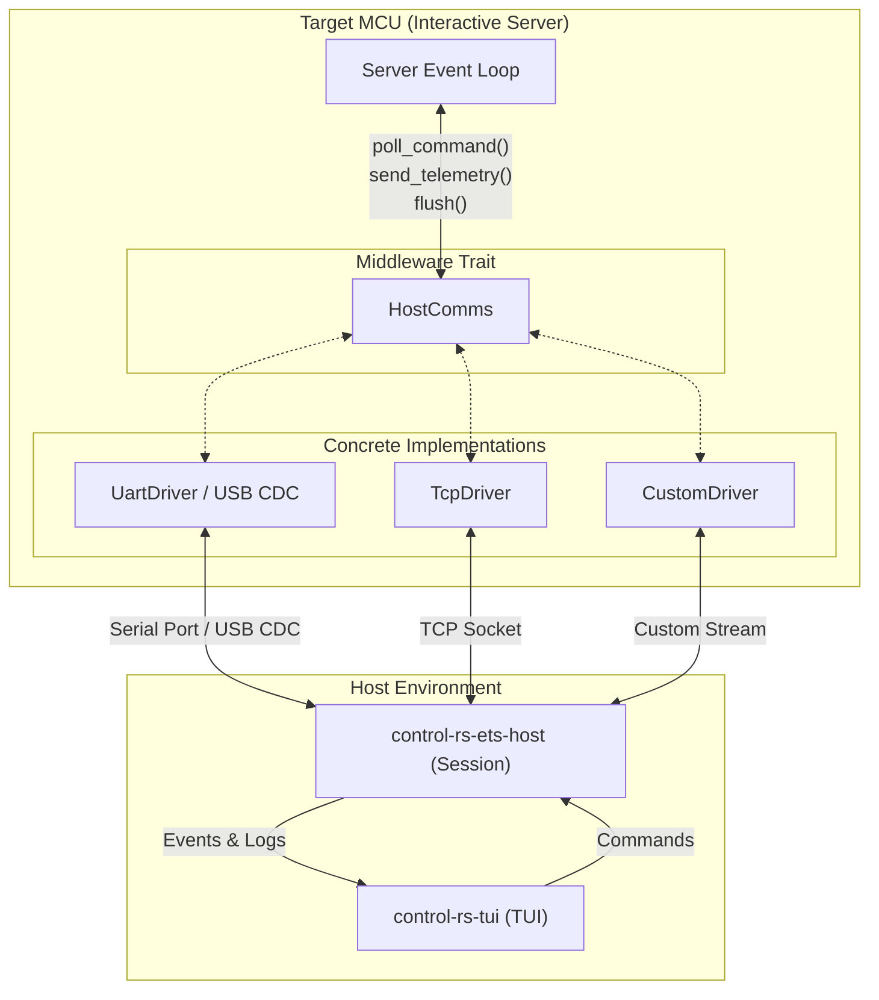

# HostComms Trait and Wire Protocol (host-comm)


---

### 1. Introduction

The `HostComms` trait provides a unified, hardware-agnostic communication
abstraction
for target firmware operating in resource-constrained environments. This allows
the
Embedded Test Server (ETS) running on-target to separate physical transport
mechanics (such as UART, USB CDC, TCP, or debug probes) from test execution and
telemetry dispatch.
Host-side demultiplexing, session management, and decoding are owned by
`control-rs-ets-host::Session` (`ets-host-design.md`), while user presentation
is handled by `control-rs-tui` (`tui/tui-design.md`).

---

### 2. Requirements

#### 2.1 Functional Requirements

- **FR-1 — Target Transport Abstraction**: The target firmware must expose a
  hardware-agnostic trait (`HostComms`) to poll commands, transmit telemetry,
  and flush data without coupling test execution logic to physical peripheral
  hardware.
- **FR-2 — Bidirectional Framed Packet Exchange**: The system must support
  host-to-target command packets and target-to-host telemetry packets over a
  shared byte stream using compact binary framing (`0xAA 0x55` sync header,
  2-byte big-endian length, `postcard` payload, and 2-byte CRC-16 checksum).
- **FR-4 — Explicit Wire-Contract Revision**: The protocol carries an explicit
  `PROTOCOL_VERSION` revision identifier in target telemetry that a host checks
  before acting on any payload, preventing misinterpretation of schema changes.
- **FR-5 — Target Hardware and Environment Telemetry**: The target must transmit
  hardware identity and environment metadata—including board identifier, core
  clock frequency, and FPU capability flags—enabling the host to interpret
  timing and platform capabilities without local out-of-band assumptions.
- **FR-6 — Catastrophic Failure and Panic Capture**: The target wire schema must
  represent panics and hardware exceptions (`PanicReport` with source file, line
  number, and diagnostic message) for transmission as prioritized telemetry
  before halting or rebooting.
- **FR-9 — Wire Contract Golden Vectors**: The wire protocol defines stable,
  append-only `postcard` schemas for `Command` and `Telemetry`, verified against
  checked-in golden byte vectors.

#### 2.2 Non-Functional Requirements

- **NFR-1 — Low Latency & Determinism**: Telemetry serialization and framing
  execute deterministically in bounded single-pass operations
  without unbounded loops, introducing $\le 10\ \mu\text{s}$ jitter into the
  nominal 1 kHz control loop deadline.
- **NFR-2 — Bounded Stack & Predictable Footprint**: Serialization and framing
  paths operate within bounded, pre-allocated stack envelopes without recursion
  or dynamic heap allocation.
- **NFR-3 — Stream Resynchronization & Framing Integrity**: Corrupted or
  truncated bytes before or between sync headers are discarded cleanly, and
  `FrameReader` resynchronizes automatically on the next valid sync header.

#### 2.3 Constraints

- **C-1 - Strict `#![no_std]` and Zero Heap Allocation**: The target firmware
  library must compile under `#![no_std]` with strictly zero dynamic heap
  allocation.
- **C-2 — Frame Size Envelope**: Maximum payload length is bounded at
  `MAX_PAYLOAD_SIZE = 512` bytes (`MAX_FRAME_SIZE = 518` bytes) to prevent
  buffer
  overruns on memory-constrained microcontrollers.
- **C-3 — Physical Interface Scope**: Target transport implementations are
  restricted to standard embedded peripherals (UART, USB CDC, Ethernet MAC/PHY)
  or hardware debug probes (SWD/JTAG).

---

### 3. Technical Overview

The `HostComms` architecture focuses on the **target-side (microcontroller)**
execution environment:

1. **Target-side Trait & Drivers**: A zero-cost abstraction trait (`HostComms`)
   and associated concrete peripheral drivers (UART DMA, USB CDC, TCP)
   that pack telemetry data, frame packets, and poll for inbound commands
   without dynamic
   allocation.
2. **Wire Framing & Postcard Payloads**: Compact binary framing (`0xAA 0x55`
   sync header, length,
   payload, CRC-16) wrapping `postcard`-serialized Rust enum
   schemas [1], [3], [4].
3. **Serial Monitor Text Compatibility**: Built-in ASCII parsing (`FromStr`) and
   formatting (`Display`)
   for commands and telemetry directly on the enum schemas, allowing standard
   serial terminal interaction.
4. **Host Counterpart**: The target-side stream is consumed on the PC host by
   `control-rs-ets-host::Session` (`ets-host-design.md`), which
   feeds decoded events to `control-rs-tui` (`tui/tui-design.md`) or automated
   CI runners.



---

### 4. Architecture

#### 4.1. Middleware Trait

Serves: FR-1

The core of the abstraction is the `HostComms` trait. Implementations of this
trait encapsulate the hardware-specific details of reading and writing bytes:

```rust
pub trait HostComms {
    /// The error type associated with transport failures.
    type Error;

    /// Closes the communication interface (for example, signaling semihosting exit).
    fn close(&mut self) {}

    /// Closes the communication interface with a failure or error status.
    fn close_on_failure(&mut self) {}

    /// Flush any pending buffered data out to the physical interface.
    fn flush(&mut self) -> SendResult<Self::Error>;

    /// Read incoming bytes and try to parse a Command.
    ///
    /// This should be non-blocking.
    fn poll_command(&mut self) -> PollResult<Self::Error>;

    /// Send a telemetry message to the host.
    fn send_telemetry(
        &mut self,
        telemetry: &Telemetry<'_>,
    ) -> SendResult<Self::Error>;
}
```

The associated type `Error` allows concrete drivers to bubble up
hardware-specific failures (for example, framing errors, overflow flags, or
socket
disconnects) to the calling Server loop.

#### 4.2. Command Schema & Binary Serialization

Serves: FR-2, FR-4, FR-5, FR-6, FR-9, C-1, C-2

Commands originating from the host are defined by a strict, shared Rust schema
to ensure structural alignment:

```rust
#[derive(Debug, Clone, PartialEq, Eq, serde::Serialize, serde::Deserialize)]
pub enum Command {
    ListSuites,
    RunExecutable {
        suite_id: u16,
        test_id: u16,
    },
    SetSetting {
        setting_id: u16,
        suite_id: u16,
        value: SettingValue,
    },
    TryReset,
    StartTask {
        suite_id: u16,
        task_id: u16,
        ticks: Option<u32>,
    },
    TaskInput {
        payload: heapless::Vec<u8, 64>,
    },
    StopTask,
}

#[derive(Debug, Clone, PartialEq, Eq, serde::Serialize, serde::Deserialize)]
pub enum Telemetry<'a> {
    DiscoveryComplete,
    Log(LogMessage<'a>),
    MetricReport(MetricReport),
    SettingInfo(SettingInfo<'a>),
    SuiteInfo(SuiteInfo<'a>),
    TargetPanic(PanicReport<'a>),
    TestInfo(TestInfo<'a>),
    TestStateChange(TestStateChange),
    TargetInfo {
        protocol_version: u8,
        board_id: u16,
        core_clock_hz: u32,
        fpu_flags: u8,
    },
    TaskSample {
        timestamp_us: u64,
        sample_count: u32,
        dropped_count: u32,
        payload: &'a [u8],
    },
    TaskStopped {
        reason: StopReason,
    },
}
```

To minimize parsing overhead and memory usage in a `#![no_std]` environment, the
architecture uses the `postcard` crate [1].

Postcard achieves a minimal wire footprint through:

* **Varints**: Variable-length integer encoding that compresses smaller
  numbers into fewer bytes [1].
* **Endianness**: Explicit Little-Endian byte ordering matching native
  microcontroller architectures (ARM Cortex-M, RISC-V).
* **Zero Allocation**: Serialization directly into pre-allocated static
  buffers [1].

##### 4.2.1. Discriminant Stability and `PROTOCOL_VERSION`

`postcard` encodes a tagged union as a `varint(u32)` discriminant followed by
the variant value [1], [2]. Variant order and field order are therefore part of
the wire contract: inserting a variant ahead of an existing one renumbers every
later discriminant.

FR-4 and FR-5 are discharged by `PROTOCOL_VERSION = 2` and
`Telemetry::TargetInfo`.
The target transmits `Telemetry::TargetInfo` carrying `protocol_version`,
`board_id`,
`core_clock_hz`, and `fpu_flags` as the first frame of discovery. A host that
receives
a mismatching protocol version terminates the session immediately.

FR-4 and FR-5 are discharged by `PROTOCOL_VERSION` and
`Telemetry::TargetInfo` (§9 Step 4), both in `control-rs-ets::comms`.
`PROTOCOL_VERSION` is a `u8` constant in `control-rs-ets::comms` incremented
whenever `Command` or `Telemetry` gains, loses, or reorders a variant, or
whenever a variant's payload changes shape. The target transmits
`Telemetry::TargetInfo` carrying `protocol_version`, `board_id`,
`core_clock_hz`,
and `fpu_flags` (from `Platform`, `embedded-test-server-design.md` §4.7) as the
first frame of discovery. A host
that receives a `protocol_version` value other than its own compiled constant
terminates the session immediately and reports the mismatch; it does not attempt
to decode further frames. `control-rs-ets-host` implements the host half of this
check (`../ets-host/ets-host-design.md` §4.3), while `control-rs-tui`
(`../tui/tui-design.md` FR-1) consumes the board and clock metadata to populate
the header.

- Variants are appended, never inserted or reordered.
- Existing variant payload fields and their order are immutable.

#### 4.3. Direct Text Line Compatibility

Serves: FR-3

Serves: FR-2, NFR-2

Standard string formatting on a microcontroller is computationally and
space-expensive,
bloating target flash memory with static templates and consuming excessive CPU
cycles
to interpolate values. In this baseline, log messages are captured as structured
byte
or string slices within `postcard`-serialized enums with no on-target string
formatting (see `embedded-test-server-design.md` §7). Deferred formatting via
external compression
crates is deferred to future work (see §6.3):

- `Command::from_str` parses plain human commands:
    - `list` -> `Command::ListSuites`
    - `run <suite> <test>` -> `Command::RunExecutable`
    - `set <suite> <param> <val>` -> `Command::SetSetting`
    - `start <suite> <task> [ticks]` -> `Command::StartTask`
    - `stop` -> `Command::StopTask`
    - `reset` -> `Command::TryReset`
- `Telemetry::fmt` writes human-readable ASCII lines:
    - `INFO: <suite_name> test_count=<N>`
    - `PASS: <suite_id>.<test_id> (cycles=<C>, time_us=<T>, stack=<S>)`
    - `PANIC: <file>:<line>: <message>`
    - `SAMPLE: count=<N> dropped=<D> data=<bytes>`

#### 4.4. Packet Framing & Consistency

Serves: FR-2, NFR-1, NFR-2, NFR-3, C-2

Serial channels like UART operate as continuous byte streams without packet
boundaries. To segment individual commands and telemetry logs, the system
uses a custom framed binary packet structure with Sync Headers and CRC-16
integrity validation:

* **Sync Header**: 2 bytes (`0xAA 0x55`) used to identify the beginning of a
  frame.
* **Payload Length**: 2 bytes (big-endian) defining the size of the serialized
  postcard payload.
* **Postcard Payload**: The serialized data block (limited to a maximum of 512
  bytes).
* **Integrity Check**: A 2-byte (big-endian) CRC-16 checksum (calculated using
  `CRC_16_IBM_SDLC`) appended at the end of the frame payload.
* **Single-Pass Decoding**: The host `FrameReader` processes incoming streams
  statefully byte-by-byte, checking for the sync header, validating lengths and
  confirming the CRC-16 checksum before deserializing.

Serial channels operate as continuous byte streams without packet
boundaries [4].
The binary protocol segments packets using sync headers and CRC-16 checksums:

Serves: FR-1, C-3

Users are responsible for implementing the `HostComms` trait for their target
board.

#### 4.5. Outbound Send Policy and CommsLock

Serves: FR-7, FR-8

```rust
fn poll_command(&mut self) -> Result<Option<Command>, Self::Error> {
    // Non-blocking read and framing parsing logic
    Ok(None)
}

fn send_telemetry(&mut self, telemetry: &Telemetry<'_>) -> Result<(), Self::Error> {
    // Serialize via postcard, add sync headers and CRC-16 checksum and write to UART DMA buffer
    Ok(())
}

fn flush(&mut self) -> Result<(), Self::Error> {
    // Wait for DMA write to complete
    Ok(())
}

}

```

#### 4.6. Host Interoperability

Serves: FR-4, FR-5, C-3

On the host side, `control-rs-ets-host::ETSBridge`
(`../ets-host/ets-host-design.md`) consumes the byte stream generated by
`HostComms`. Standard environments use `serial2` for direct serial (UART/USB
CDC) port communication and a spawned subprocess for QEMU
(`ets-host-design.md` FR-2). RTT buffer polling over SWD/JTAG (for example
through `probe-rs`) is not an `ETSBridge` transport; `ets-host-design.md` §5
rejects it as the primary link. The target-side `HostComms` implementation
remains agnostic to which host mechanism reads its framed stream.

---

### 5. Alternatives

* **Text-Based Serialization (JSON, XML)**: Considered for ease of debugging but
  rejected as primary wire format due to bandwidth and allocation overhead.
  Text compatibility is instead provided through zero-allocation `FromStr` and
  `Display`
  methods on the native enum types.
* **Protobuf & FlatBuffers**: Protobuf requires a memory-allocation-heavy
  deserialization step, which is unacceptable under strict `#![no_std]`.
  Postcard was selected for its native Rust type mapping, zero-allocation design
  and variable-length integer compression [1].
* **Standard Printing (`printf`)**: Rejected for primary telemetry because it
  stores
  large static format string templates in Flash and consumes excessive CPU
  cycles.

---

### 6. Verification & Validation

#### 6.1 Verification

| Condition | Requirement | Method    | Target                                                                                                                                                                                                                     | Criterion                                                                                                                     |
|:----------|:------------|:----------|:---------------------------------------------------------------------------------------------------------------------------------------------------------------------------------------------------------------------------|:------------------------------------------------------------------------------------------------------------------------------|
| VC-1.1    | FR-1        | `libtest` | `control_rs_ets::comms::tests::test_host_comms_defaults`                                                                                                                                                                   | `HostComms` trait methods (`poll_command`, `send_telemetry`, `flush`, `close`, `close_on_failure`) execute cleanly on drivers |
| VC-2.1    | FR-2        | `libtest` | `control_rs_ets::comms::tests::test_frame_encoder_payload_and_command`, `control_rs_ets::comms::tests::test_frame_telemetry_round_trip_and_corruption`, `control_rs_ets::comms::tests::test_frame_reader_invalid_checksum` | All variants round-trip through `FrameEncoder` and `FrameReader`; corrupted frames are rejected                               |
| VC-2.2    | FR-2        | `libtest` | `control_rs_ets::comms::tests::test_frame_telemetry_byte_layout`                                                                                                                                                           | State transition telemetry packets serialize with exact byte layout and CRC-16 checksum verification                          |
| VC-2.3    | FR-2        | `libtest` | `control_rs_ets::comms::tests::test_frame_telemetry_length_accounting_across_variants`                                                                                                                                     | Telemetry payload variants serialize within wire format length bounds without truncation                                      |
| VC-2.4    | FR-2        | `libtest` | `control_rs_ets::comms::tests::the_length_field_is_big_endian_across_both_bytes`                                                                                                                                           | Frame header length fields serialize in big-endian byte order with CRC-16 integrity verification                              |
| VC-4.1    | FR-4        | `libtest` | `control_rs_ets::comms::tests::test_golden_wire_vector_target_info`                                                                                                                                                        | `Telemetry::TargetInfo` carries `PROTOCOL_VERSION` at a fixed discriminant so version mismatches are detectable               |
| VC-5.1    | FR-5        | `libtest` | `control_rs_ets::comms::tests::test_golden_wire_vector_target_info`                                                                                                                                                        | `Telemetry::TargetInfo` serializes `protocol_version`, `board_id`, `core_clock_hz`, and `fpu_flags`                           |
| VC-6.1    | FR-6        | `libtest` | `control_rs_ets::comms::tests::test_golden_wire_vectors_telemetry`                                                                                                                                                         | `Telemetry::TargetPanic` captures source file, line number, and message and matches its golden wire encoding                  |
| VC-6.2    | FR-6        | `libtest` | `control_rs_ets::comms::tests::test_frame_telemetry_round_trip_and_corruption`                                                                                                                                             | Panic telemetry frame serialization round-trips through postcard encoding with CRC-16 checksum integrity                      |
| VC-9.1    | FR-9        | `libtest` | `control_rs_ets::comms::tests::test_golden_wire_vectors_telemetry`, `control_rs_ets::comms::tests::test_golden_wire_vector_list_suites`                                                                                    | Serialized byte representations of `Telemetry` and `Command::ListSuites` match checked-in golden vectors                      |
| VC-9.2    | FR-9        | `libtest` | `control_rs_ets::comms::tests::test_golden_wire_vector_run_executable`                                                                                                                                                     | `Command::RunExecutable` wire representation matches its golden byte vector                                                   |
| VC-9.3    | FR-9        | `libtest` | `control_rs_ets::comms::tests::test_golden_wire_vector_try_reset`                                                                                                                                                          | `Command::TryReset` wire representation matches its golden byte vector                                                        |
| VC-10.1   | NFR-1       | `libtest` | `control_rs_ets::comms::tests::test_frame_telemetry_byte_layout`                                                                                                                                                           | Single-pass framing and CRC-16 calculation execute in bounded linear time over the payload slice                              |
| VC-11.1   | NFR-2       | `gate`    | `clippy`                                                                                                                                                                                                                   | Serialization and frame decoding allocate zero heap memory and operate within bounded stack space                             |
| VC-12.1   | NFR-3       | `libtest` | `control_rs_ets::comms::tests::test_frame_reader_resync_after_orphan_start_byte`, `control_rs_ets::comms::tests::test_frame_reader_invalid_start_bytes`                                                                    | `FrameReader` resynchronizes on valid sync bytes after encountering arbitrary garbage or orphan start bytes                   |
| VC-13.1   | C-1         | `gate`    | `clippy`                                                                                                                                                                                                                   | Code compiles under `#![no_std]` without external allocator                                                                   |
| VC-14.1   | C-2         | `libtest` | `control_rs_ets::comms::tests::a_maximum_size_payload_frames_and_decodes`, `control_rs_ets::comms::tests::framing_needs_room_for_the_whole_frame`                                                                          | Enforces `MAX_PAYLOAD_SIZE = 512` and `MAX_FRAME_SIZE = 518` bounds                                                           |
| VC-14.2   | C-2         | `libtest` | `control_rs_ets::comms::tests::an_oversized_payload_is_refused`, `control_rs_ets::comms::tests::test_frame_telemetry_rejects_short_buffers`                                                                                | Payloads exceeding `MAX_PAYLOAD_SIZE` or buffers shorter than the frame length are refused before framing                     |
| VC-15.1   | C-3         | `gate`    | `virtual-ets`                                                                                                                                                                                                              | Target firmware streams framed `HostComms` telemetry over serial/semihosting links across QEMU targets                        |

Target: 90% line coverage of the `comms` module, measured with
`cargo coverage`.

#### 6.2 Acceptance

| Claim                     | Oracle                                             | Measure                             | Bound         |
|:--------------------------|:---------------------------------------------------|:------------------------------------|:--------------|
| Round-trip fidelity       | Serializer output re-read by deserializer          | Field equality across every variant | Exact         |
| Golden vector stability   | Checked-in bytes per variant                       | Byte equality                       | Exact         |
| Corrupted frame rejection | Frame with flipped payload byte                    | Frames delivered upward             | 0             |
| Version mismatch refused  | Discovery response with foreign `PROTOCOL_VERSION` | Session outcome                     | Refused       |
| Serialization stack cost  | Stack measurement across encode path               | Peak bytes                          | Within budget |
| Allocation freedom        | Source inspection                                  | Allocator symbols on transport path | 0             |

#### 6.3 Limits

- Compatibility across protocol revisions. Cross-revision compatibility is not
  supported; differing `PROTOCOL_VERSION` values result in session termination.
- Hardware watchdog integration. Target reset operates cooperatively via
  `Command::TryReset`.

### 7. Performance & Resource Considerations

* **Buffer Bounds**: Message buffers are sized to `MAX_FRAME_SIZE = 518` bytes,
  fitting comfortably in small embedded RAM targets without dynamic heap.
* **Non-Blocking Telemetry**: In high-rate `FreeRunning` mode, samples that
  cannot
  be queued immediately are counted and dropped to prevent real-time deadline
  misses.

---

### 8. Risks & Open Questions

* **Line Noise**: Asynchronous serial links may experience noise bursts. The
  combination
  of sync headers and CRC-16 ensures corrupted packets are dropped rather than
  executed.

---

### 9. Development Plan

| Phase | Delivers | Requirements | Effort | Status |
|:---|:---|:---|:---|:---|
| 1. Core Serialization & Framing | Postcard schemas, sync-header framing, and CRC-16 verification in `control-rs-ets::comms` | FR-1, FR-2, NFR-1, NFR-2, NFR-3, C-1, C-2, C-3 | 2 days | Shipped |
| 2. Wire Contract & Golden Vectors | `PROTOCOL_VERSION`, `TargetInfo`, `TargetPanic`, and golden byte vectors | FR-4, FR-5, FR-6, FR-9 | 2 days | Shipped |

---

### 10. Revision History

| Revision | Date             | Author          | Description                                                                                                                                                        |
|:---------|:-----------------|:----------------|:-------------------------------------------------------------------------------------------------------------------------------------------------------------------|
| 1.0      | August 29, 2026  | @MitchellDScott | `HostComms` transport trait, telemetry framing and the `serial2` host transport.                                                                                   |
| 2.0      | November 8, 2026 | @MitchellDScott | Requirement traceability matrix, PROTOCOL_VERSION and TargetInfo wire contract, and golden wire vectors. Affects C-2, FR-2, FR-3, FR-6, FR-9, NFR-1, NFR-2, NFR-3. |

---

## References

[1] J. Munns, "Wire format," *The postcard wire specification*, 2026. [Online].
Available: https://postcard.jamesmunns.com/wire-format. Accessed: Sep. 9, 2026.

[2] Serde contributors, "Enum representations," *Serde documentation*, 2026.
[Online]. Available: https://serde.rs/enum-representations.html. Accessed:
Sep. 9, 2026.

[3] crc-rs contributors, "*crc*: Rust implementation of CRC with support of
various standards," 2026. [Online]. Available: https://docs.rs/crc. Accessed:
Sep. 9, 2026.

[4] L. L. Peterson and B. S. Davie, *Computer Networks: A Systems Approach*, 6th
ed., 2024. [Online].
Available: https://book.systemsapproach.org/. Accessed: Jun. 27, 2026.
