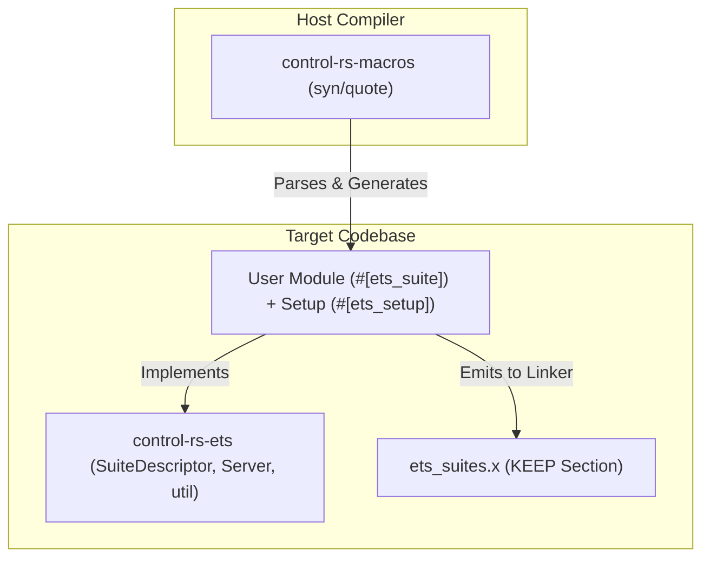

# Procedural Macros for Distributed Test Discovery (macros)


### 1. Introduction

Bare-metal embedded systems lack traditional operating system loaders, making
dynamic test discovery and runtime test registration difficult. Procedural
macros provide a compile-time solution by automatically analyzing source code
and generating the underlying test registry metadata and target runtime hooks.

This design document establishes the architecture for `control-rs-macros`, a
procedural macro library containing `#[ets_suite]`, `#[ets_setup]`,
`ets_entrypoint!`, `ets_panic!`, and `ets_exception!`. `#[ets_suite]` enables
developers to declare ETS tests and configurable parameters directly in their
modules with zero boilerplate. Rather than requiring explicit per-item marker
attributes on every declaration, `#[ets_suite]` operates under an
inference-first contract: the suite contains what the user defines in the module
(plus the ETS wrapping), promoting primitive `static` items into lock-free
atomic settings and identifying zero-argument functions as test cases. It
generates all registration hooks and places them in custom linker sections,
permitting automated discovery without a centralized registry. `#[ets_setup]`
(an attribute procedural macro) and its companion function-like procedural macros
(`ets_entrypoint!`, `ets_panic!`, `ets_exception!`) generate the bare-metal `main`
entrypoint, wire the server context, and register panic and hardware fault handlers.

---

### 2. Requirements

#### 2.1 Functional Requirements

- **FR-1 — Distributed Module Annotation (#[ets_suite])**: Developers declare a suite by
  tagging a module with `#[ets_suite]`, generating a `SuiteDescriptor` and registering it in `.ets_test_suites`.
- **FR-2 — Inferred Test Case Identification**: The macro automatically identifies zero-argument
  functions within the module and generates `ExecDescriptor` entries with doc-comment metadata.
- **FR-4 — Static Parameter Promotion**: The macro identifies module `static` items of supported
  primitive types (`bool`, `u8`, `u16`, `u32`, `u64`, `i8`, `i32`, `f32`), rewriting them into
  `Atomic*Setting` wrappers registered in the suite's `settings` slice while passing `const` items and non-setting items through unchanged.
- **FR-5 — Target Entrypoint and Fault Handler Generation (`#[ets_setup]`, `ets_entrypoint!`, `ets_panic!`, `ets_exception!`)**: The macro crate must provide `#[ets_setup]` and its companion macros (`ets_entrypoint!`, `ets_panic!`, `ets_exception!`) to generate the bare-metal `main` entrypoint, bind the `ETS_SERVER` atomic pointer, and register panic and hardware exception handlers that route diagnostics through `control-rs-ets::util`.
- **FR-6 — Ignored Module Functions**: The macro excludes functions with a leading underscore
  or parameters from test case generation, allowing internal helper functions within the module.
- **FR-7 — Compile Error Reporting**: Invalid syntax, non-inline modules, and invalid `#[ets_setup]` signatures produce
  spanned compiler errors pointing to the offending code without macro panics.

#### 2.2 Non-Functional Requirements

- **NFR-1 — Zero Static RAM at Idle**: Emitted test descriptors and registration
  tables reside entirely in read-only Flash/ROM (`.ets_test_suites`), consuming
  0 bytes of static RAM at idle.
- **NFR-2 — Linker Retention Safety**: Generated descriptors survive aggressive
  linker garbage collection (`--gc-sections`) via `KEEP` directives and link section attributes.
- **NFR-3 — Rust 2024/2027 Compliance**: Generated structures eliminate
  `static mut` usage in favor of type-safe atomic `Atomic*Setting` wrappers and `AtomicPtr`.

#### 2.3 Constraints

- **C-1 — Strict `#![no_std]` and Zero Runtime Allocation**: Code emitted by the
  macros compiles on bare-metal targets without standard library or dynamic heap allocator support.
- **C-2 — Target Architecture Independence**: `#[ets_suite]` emits target-agnostic Rust code, while `ets_entrypoint!` and `ets_exception!` emit conditional bare-metal entry and trap bindings for ARM Cortex-M and RISC-V.

---

### 3. Technical Overview

The procedural macros are contained within the `control-rs-macros` library. This
library depends on standard compiler crates (`proc-macro`, `syn`, `quote`) and
operates as a compiler plugin. It interacts with other workspace crates to form
the test registry and target runtime harness:



---

### 4. Architecture

#### 4.1. `#[ets_suite]` Module Inference and Code Generation

Serves: FR-1, FR-2, FR-4, FR-6, FR-7, NFR-1, NFR-3, C-1, C-2

When the compiler encounters `#[ets_suite]` on an inline module, the macro operates on
an inference contract: the generated suite contains what the user declared
in the module, with wrapping for ETS runtime registration. Developers do not need
to decorate items with specific markers; the macro infers semantics from item types
and positions:

1. **Test Case Inference**: The macro scans functions within the module. Every function
   without a leading underscore and without parameters is recognized as an executable test case.
   The macro wraps the function pointer into an `ExecDescriptor`, capturing the function
   name and doc comments as the test description.
2. **Ignored Helper Functions**: Functions prefixed with a leading underscore `_` or defining
   parameters are excluded from test case generation and treated as internal helper routines.
3. **Static Parameter Promotion**: The macro scans `static` items in the module
   (for example, `pub static KP: f32 = 1.2;` or `pub static TIMEOUT_MS: u32 = 500;`).
   Statics of supported primitive types (`bool`, `u8`, `u16`, `u32`, `u64`, `i8`, `i32`, `f32`)
   are rewritten into `::control_rs_ets::settings::Atomic*Setting` statics (`AtomicBoolSetting`,
   `AtomicU8Setting`, `AtomicU16Setting`, `AtomicU32Setting`, `AtomicU64Setting`,
   `AtomicI8Setting`, `AtomicI32Setting`, `AtomicF32Setting`) and registered
   in the suite's `SETTINGS` slice with their initial values and doc comments. `const` items
   and non-primitive statics pass through unchanged.
4. **Registry Pointer Emission**: The macro emits a static `SuiteDescriptor` that
   aggregates the inferred `ExecDescriptor`s and `Setting` references, placing a
   `&'static SuiteDescriptor` in the `.ets_test_suites` linker section (or `__DATA,__ets_suites` on Apple targets):
    ```rust
    #[cfg_attr(not(target_vendor = "apple"), unsafe(link_section = ".ets_test_suites"))]
    #[cfg_attr(target_vendor = "apple", unsafe(link_section = "__DATA,__ets_suites"))]
    #[used]
    pub static SUITE_DESCRIPTOR_PTR: &::control_rs_ets::SuiteDescriptor = &SUITE_DESCRIPTOR;
    ```

#### 4.2. Conformance to the Suites Section ABI

Serves: FR-1, NFR-2

The expansion of `#[ets_suite]` is equivalent to the hand-written suite form of
`test-suite-design.md` §4.6. The section name, element type, linker fragment and
retention strategy are owned by `test-suite-design.md` §4.1 and §4.2; the macro
emits only the `#[used]` pointer static with `#[unsafe(link_section)]`. The
attribute is unsafe because it "allows users to place data and code into
sections of memory not expecting them" [3], which is why the macro never
chooses a section name or element type of its own.

#### 4.3. Target Entrypoint and Fault Handler Procedural Macros (`#[ets_setup]`, `ets_entrypoint!`, `ets_panic!`, `ets_exception!`)

Serves: FR-5, FR-7, NFR-3, C-1, C-2

To eliminate target startup and trap boilerplate on bare-metal builds (`#[cfg(target_os = "none")]`), `control-rs-macros` provides four procedural macros:

1. **`#[ets_setup]`**: An attribute procedural macro applied to a hardware initialization function returning `control_rs_ets::server::Context<C, P>` (for example, `fn setup() -> Context<MyComms, CortexMProfiler>`). The macro extracts the transport type `C` and profiler type `P` from the return type, emits `static ETS_SERVER: core::sync::atomic::AtomicPtr<Server<'static, C, P>> = AtomicPtr::new(core::ptr::null_mut());`, and invokes `ets_entrypoint!(setup_fn)`, `ets_panic!()`, and `ets_exception!()`. If the annotated function does not return `Context<C, P>`, the macro emits a spanned `compile_error!`.
2. **`ets_entrypoint!(setup_fn)`**: A function-like procedural macro generating the bare-metal `main() -> !` entrypoint (`#[cortex_m_rt::entry]` on ARM, `#[riscv_rt::entry]` on RISC-V). At startup, `main` declares the linker section boundary symbols `__ets_test_suites_start` and `__ets_test_suites_end`, reconstructs the suite slice via `control_rs_ets::util::get_suites`, calls `setup_fn()`, instantiates `Server::new(ctx, suites)`, stores `&mut server` into `ETS_SERVER` with `Ordering::Release`, executes `server.run()`, and terminates via `server.exit()`.
3. **`ets_panic!()`**: A function-like procedural macro generating the bare-metal `#[panic_handler] fn panic(info: &core::panic::PanicInfo) -> !`. It formats the panic message into a 128-byte stack buffer using `control_rs_ets::util::FailureBufWriter`, loads the `ETS_SERVER` pointer with `Ordering::Acquire`, and delegates to `control_rs_ets::util::handle_failure` to transmit the failure frame and reset or halt the target.
4. **`ets_exception!()`**: A function-like procedural macro generating bare-metal hardware fault handlers: `#[cortex_m_rt::exception] unsafe fn HardFault(ef: &cortex_m_rt::ExceptionFrame) -> !` on ARM (formatting `pc` and `lr` into a 64-byte stack buffer) and `#[unsafe(no_mangle)] unsafe fn ExceptionHandler(trap_frame: &riscv_rt::TrapFrame) -> !` on RISC-V (reading `mcause` and `mepc` CSRs into a 64-byte stack buffer). Both handlers load `ETS_SERVER` with `Ordering::Acquire` and delegate to `control_rs_ets::util::handle_exception`.

---

### 5. Alternatives

* **Constructor-based runtime registries (`inventory`, `ctor`)**: Rejected on
  mechanism. `inventory` registers types from "any source file linked into your
  application" with no central list [2], but relies on runtime initialization
  functions similar to `__attribute__((constructor))` in C [2]. Its documented
  platform support is restricted to hosted operating systems; bare-metal targets
  are not supported.
* **`linkme::DistributedSlice`**: Not adopted. `linkme` handles distributed slices [1], but on bare metal a custom `SECTIONS` script must still place the section explicitly, so `linkme` would add a proc-macro dependency without removing linker-script work.
* **Global Compiler `-C link-dead-code` Flag**: Rejected. While it prevents test
  registry deletion, it also disables dead code elimination for the entire
  project, leading to bloated binaries that exceed the MCU's Flash capacity.

---

### 6. Verification & Validation

#### 6.1 Verification

| Condition | Requirement | Method    | Target                                                                                                                | Criterion                                                                                                         |
|:----------|:------------|:----------|:----------------------------------------------------------------------------------------------------------------------|:------------------------------------------------------------------------------------------------------------------|
| VC-1.1    | FR-1        | `libtest` | `control_rs_macros::tests::generate_suite_descriptors_emits_four_items`, `control_rs_macros::tests::ets_suite_impl_expands_inline_module_and_rejects_external` | `#[ets_suite]` generates valid `SuiteDescriptor` and places pointer in `.ets_test_suites` section                  |
| VC-2.1    | FR-2        | `libtest` | `control_rs_macros::tests::process_test_fn_skips_helpers_and_keeps_docs`, `control_rs_macros::tests::extract_doc_string_strips_and_truncates` | Zero-argument functions in the module are identified as test cases and populate `ExecDescriptor` fields with doc comments |
| VC-4.1    | FR-4        | `libtest` | `control_rs_macros::tests::process_static_setting_rewrites_supported_types`                                           | Module `static` items of supported primitive types are rewritten into `Atomic*Setting` wrappers and registered in the suite's settings slice |
| VC-4.2    | FR-4        | `libtest` | `control_rs_macros::tests::qualified_self_types_are_not_settings`, `control_rs_macros::tests::atomic_wrapper_names_cover_supported_types` | `const` items and non-setting types pass through unchanged without false setting registration |
| VC-5.1    | FR-5        | `libtest` | `control_rs_macros::tests::ets_setup_and_helper_macros_expand`, `control_rs_macros::tests::extract_context_generics_parses_context_path` | `#[ets_setup]`, `ets_entrypoint!`, `ets_panic!`, and `ets_exception!` extract `Context<C, P>` generics and emit bare-metal entrypoint, panic, and exception handlers |
| VC-6.1    | FR-6        | `libtest` | `control_rs_macros::tests::process_test_fn_skips_parameterized_helpers`                                                | Functions prefixed with an underscore or taking parameters are excluded from test case registration                |
| VC-7.1    | FR-7        | `libtest` | `control_rs_macros::tests::ets_suite_impl_expands_inline_module_and_rejects_external`, `control_rs_macros::tests::ets_setup_and_helper_macros_expand` | Invalid syntax, non-inline module declarations, and invalid `#[ets_setup]` signatures produce `compile_error!` tokens pointing to the offending code |
| VC-9.1    | NFR-1       | `libtest` | `control_rs_macros::tests::test_zero_static_ram_descriptors`                                                           | Generated descriptors reside entirely in read-only Flash, consuming zero bytes of static RAM at idle             |
| VC-10.1   | NFR-2       | `gate`    | `build`                                                                                                               | Emitted descriptors survive `--gc-sections` under release profile linking                                         |
| VC-11.1   | NFR-3       | `gate`    | `clippy`                                                                                                              | Generated macro code eliminates `static mut` usage across all emitted structures                                  |
| VC-12.1   | C-1         | `gate`    | `clippy`                                                                                                              | Generated code compiles cleanly in `#![no_std]` bare-metal targets without heap allocation                        |
| VC-13.1   | C-2         | `gate`    | `build`                                                                                                               | Generated code compiles across all supported target architectures                                                 |

#### 6.2 Acceptance

| Claim | Oracle | Measure | Bound |
|:------|:-------|:--------|:------|
| Registration completeness | The annotations in the source tree | Descriptors recovered from the ELF | Exact set equality, no duplicates, no omissions |
| Retention under GC | Same ELF linked with `--gc-sections` | Descriptors present | Unchanged from the non-GC link |
| Diagnostic quality | Invalid macro inputs in unit tests | Emitted `compile_error!` token stream | Contains descriptive message, spans the offending token, no panic text |
| Allocation freedom | Disassembly of a target build | Allocator symbols reachable from generated code | 0 |

#### 6.3 Limits

- Proc-macro hygiene against adversarial input. Compile-error tests cover
  expected misuse, not deliberately hostile token streams.
- Linker behaviour outside LLD and GNU ld. The section and script coordination
  is exercised only with the linkers the matrix uses.

### 7. Performance & Resource Considerations

* **Static Flash Storage**: Since the macro places all descriptors in
  `.ets_test_suites` marked as read-only, they reside entirely in Flash (ROM)
  and consume zero RAM during idle state.
* **Compiler Timing**: To maintain fast build times, the macro relies on minimal
  syn features and avoids complex, recursive macro expansion paths.

---

### 8. Risks & Open Questions

* **Rust compiler updates**: Shifts in compiler syntax/AST structure in future
  Rust editions could disrupt the syn-based parser. Pinning dependencies in
  Cargo.toml mitigates this.

---

### 9. Development Plan

| Phase | Delivers | Requirements | Effort | Status |
|:---|:---|:---|:---|:---|
| 1. Parser Core | `syn` parser implementation for `#[ets_suite]` | FR-1 | 2 days | Shipped |
| 2. Code Generation | AST templates for `SuiteDescriptor`, `ExecDescriptor`, and atomic wrappers | FR-1, FR-2, FR-6, NFR-1, NFR-3, C-1 | 2 days | Shipped |
| 3. Section Emission | `#[used]` pointer static conforming to the suites section ABI | FR-1, NFR-2, C-2 | 1 day | Shipped |
| 4. Static Settings, Entrypoint Macros & Diagnostics | Static parameter promotion, `#[ets_setup]`/`ets_entrypoint!`/`ets_panic!`/`ets_exception!`, and spanned diagnostics | FR-4, FR-5, FR-7 | 2 days | Shipped |

---

### 10. Revision History

| Revision | Date               | Author          | Description                                                                              |
|:---------|:-------------------|:----------------|:-----------------------------------------------------------------------------------------|
| 1.0      | August 29, 2026    | @MitchellDScott | Test registration and discovery macros; linker-section codegen and span diagnostics.     |
| 2.0 | November 8, 2026 | @MitchellDScott, Claude Opus 5.5, Antigravity | Requirement traceability matrix, #[ets_suite] static setting promotion, ExecDescriptor codegen, #[ets_setup]/ets_entrypoint!/ets_panic!/ets_exception! target macros, and spanned diagnostics. Affects C-2, FR-2, FR-3, FR-4, FR-5, FR-7, FR-8. |

---

## References

[1] D. Tolnay, *linkme*: safe cross-platform linker shenanigans. [Online].
Available: https://docs.rs/linkme. Accessed: Sep. 9, 2026.

[2] D. Tolnay, *inventory*: typed distributed plugin registration. [Online].
Available: https://docs.rs/inventory. Accessed: Sep. 9, 2026.

[3] Rust Project Developers, "Application Binary Interface," *The Rust
Reference*. [Online]. Available:
https://doc.rust-lang.org/beta/reference/abi.html. Accessed: Sep. 9, 2026.
