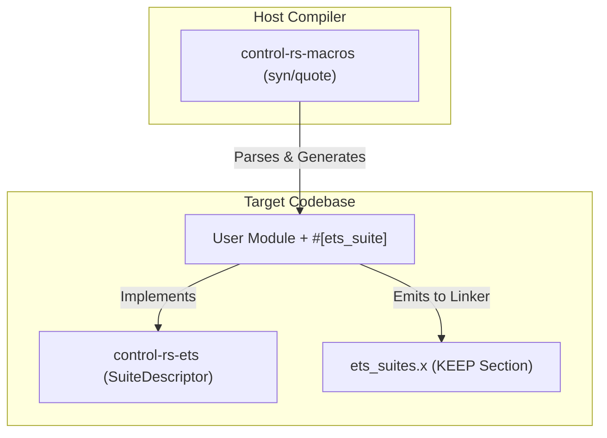

# Procedural Macros for Distributed Test Discovery (Design Document)


---

### 1. Introduction

Bare-metal embedded systems lack traditional operating system loaders, making
dynamic test discovery and runtime test registration difficult. Procedural
macros provide a compile-time solution by automatically analyzing source code
and generating the underlying test registry metadata.

This design document establishes the architecture for `control-rs-macros`, a
procedural macro library containing `#[ets_suite]`, `#[ets_setup]` and the
`Packet` derive. These macros enable developers to declare
ETS cases, settings and lifecycle tasks directly in their modules with zero
boilerplate. The macro generates
all registration hooks and places them in custom linker sections, permitting
automated discovery without a centralized registry.

---

### 2. Requirements

#### 2.1 Functional Requirements

- **FR-1 — Distributed Module Annotation**: Developers must declare a suite by
  tagging a module with `#[ets_suite]`.
- **FR-2 — Automatic Registration**: The macro must automatically identify
  non-underscore-prefixed functions within the module and generate test
  descriptors.
- **FR-3 — Typed Setting Translation**: Every static declared inside the
  `#[ets_suite]` module must be a `SettingCell<T>` with `T` one of `u8`,
  `u16`, `u32`, `i32`, `f32` or `bool` and is translated into a setting
  descriptor; any other static or type is a compile error.
- **FR-4 — Entrypoint & Setup Generation**: The `#[ets_setup]` macro must
  generate the `main()` entrypoint, call the user's hardware init code and
  instantiate the execution context and accept an optional board binding.
- **FR-5 — Custom Panic Redirection**: The macro-generated entrypoint must
  register a custom panic handler that routes panics and exceptions into the
  fault path.
- **FR-6 — Lifecycle Task Expansion**: An `impl LifecycleTask for X` inside the
  module must expand into a `TaskSlot<X>`, five monomorphic wrappers and an
  executable descriptor; a second implementation in one suite is a compile error.
- **FR-7 — Packet Derive**: `#[derive(Packet)]` must emit the packet info
  and codec for a user type. Settings need no derive.

#### 2.2 Non-Functional Requirements

- **NFR-1 — Zero Static RAM at Idle**: Emitted test descriptors and registration
  tables reside entirely in read-only Flash/ROM (`.ets_test_suites`), consuming
  0 bytes of static RAM at idle.
- **NFR-2 — Linker Retention Safety**: Generated descriptors must survive
  aggressive linker garbage collection (`--gc-sections`) in release builds.
- **NFR-3 — Rust 2024/2027 Compliance**: Generated structures must eliminate
  `static mut` usage in favor of interior-mutable cells.

#### 2.3 Constraints

- **C-1 — Strict `#![no_std]` and Zero Runtime Allocation**: Code emitted by the
  macros must compile on bare-metal targets without standard library or dynamic
  heap allocator runtime support.
- **C-2 — Target Independency**: The macros must emit target-agnostic Rust code
  that delegates hardware specifics to the user-defined profiler.

---

### 3. Technical Overview

The procedural macros are contained within the `control-rs-macros` library. This
library depends on standard compiler crates (`proc-macro`, `syn`, `quote`) and
operates as a compiler plugin. It interacts with other workspace crates to form
the test registry:



---

### 4. Architecture

#### 4.1 `#[ets_suite]` Module Parsing and Code Generation

When the compiler encounters `#[ets_suite]` on a module, the macro performs the
following transformations:

1. **Case Identification**: It traverses the module's items, locating all
   functions that are not underscore-prefixed. For each, it generates an
   `ExecDescriptor` with the name, description, allowed mode `Atomic`, shared
   no-op lifecycle pointers and the function pointer.
2. **Settings Translation**: It traverses statics. Each must be a
   `SettingCell<T>`; the macro emits a `SettingDescriptor` with the setting's
   name, doc-comment description, `#[setting(min, max)]` bounds and
   monomorphic `get` and `set` function pointers over a typed `Param`. `T` must
   be `u8`, `u16`, `u32`, `i32`, `f32` or `bool`; any other type is a spanned
   error. Any other static is rejected with a spanned error ("suite statics
   must be `SettingCell<T>`"), which removes `static mut` from user code.
3. **Lifecycle Task Expansion**: For `impl LifecycleTask for X` the macro emits
   `static SLOT: TaskSlot<X>` and five monomorphic wrappers (`setup`, `step`,
   `reset`, `teardown`, `safe_state`) that decode the input packet, call the
   trait method on the slot and encode the output packet. The wrappers are the
   only place typed code is erased to buffers. `LifecycleTask` has no default
   bodies, so omitting a function is a rustc error; a second implementation in
   one module is a macro error ("at most one lifecycle task per suite").
4. **Registry Emission**: The macro emits a static `SuiteDescriptor` that
   references the executables and settings. This descriptor is annotated with
   the link section attribute to ensure it is placed in the test registry:
    ```rust
    #[unsafe(link_section = ".ets_test_suites")]
    #[used]
    pub static SUITE_DESCRIPTOR_PTR: &::control_rs_ets::SuiteDescriptor = &SUITE_DESCRIPTOR;
    ```
   Tasks are reached through the suite descriptor, so there is one section.
5. **Derives**: `#[derive(Packet)]` emits the Postcard codec and `PacketInfo`;
   a raw packet is a hand-written `Packet` implementation.

#### 4.2 Linker Garbage Collection Mitigation

A critical issue in bare-metal Rust is that LLD linker passes the
`--gc-sections` flag by default. Because the application logic does not directly
call the static `SuiteDescriptor` variables, the linker views them as dead code
and strips them during compilation.

To prevent this, the workspace employs a multi-tiered retention architecture:

1. **`#[used]`**: Generated static variables use attributes directing LLVM to
   keep the symbol in the object file.
2. **Linker Script KEEP Directive**: The `control-rs-ets` crate packages a
   custom linker script snippet (`ets_suites.x`) that includes a `KEEP`
   directive for the `.ets_test_suites` section:
   ```ld
   KEEP(*(.ets_test_suites))
   ```
3. **Build Script Linker Argument Injection**: Target binary examples (like QEMU
   and Teensy 4) include a `build.rs` or `.cargo/config.toml` that injects the
   script to the linker command line:
   ```rust
   println!("cargo:rustc-link-arg=-Tets_suites.x");
   ```
   This prevents end-users from needing to manually manage linker configuration
   files.


The generated descriptors are placed by `#[link_section]`, which "specifies the
section of the object file that a function or static's content will be placed
into" (Rust Reference, 2026). The Reference also records that the attribute "is
unsafe as it allows users to place data and code into sections of memory not
expecting them, such as mutable data into read-only areas"
(Rust Reference, 2026). That is the reason the section name, its linker-script
entry and the descriptor type are owned by this crate together: the safety of
the placement is a property of the three agreeing, and it is not something a
user of `#[ets_suite]` can be asked to get right.

#### 4.3 `#[ets_setup]` Entrypoint and Fault Entry

The `#[ets_setup]` macro is applied to the user's hardware initialization
function. It replaces the function with the primary entrypoint:

1. **`main` Function Wrapper**: The macro emits the standard
   `#[no_mangle] pub extern "C" fn main() -> !` entrypoint.
2. **Setup Call**: It calls the user's setup function to initialize clock
   registers, configure peripherals (UART, SPI, DMA, watchdog, timers and
   interrupts) and return the execution `Context` with its `Link`, and
   optionally a board binding with `feed`, `wait` and `releases` hooks. The user
   starts any watchdog in setup; the executive only feeds it
   (`ets-executive-design.md` §4.6). The macro emits no interrupt handler.
3. **Context Registration**: It stores a pointer to the `Context<L, P>` in
   `ETS_CONTEXT` for the fault reporter. The pointer is monomorphic in the
   binary.
4. **Fault Entry**: It registers the panic handler and the exception entry
   (`ets_panic!` and `ets_exception!`). Both formats the message and location
   into a fixed buffer and call the fault path:
    ```rust
    #[cfg(target_os = "none")]
    #[panic_handler]
    fn panic(info: &::core::panic::PanicInfo) -> ! {
        // format message into a fixed buffer, then settle the run:
        // mask interrupts, read and write the phase, call the active safe_state(),
        // report if the comms lock is free, wait for TryReset, reset.
        ::control_rs_ets::fault::on_panic(info)
    }
    ```
   No `Drop` is relied on anywhere. This prevents the target from locking up
   silently and ensures the host displays the failure or detects it as an
   unreported fault.

---

### 5. Alternatives

* **Manual Registration Array**: Developers could manually declare a global
  array of function pointers. This is rejected due to high maintenance overhead,
  boilerplate and the risk of developer error when adding new tests.
* **`linkme::distributed_slice`**: Rejected, on ownership and dependency cost
  rather than on capability. The mechanism is architecturally identical to the hand-rolled
  section scheme: a distributed slice is "a collection of static elements that
  are gathered into a contiguous section of the binary by the linker"
  (linkme, 2026), whose elements "may be defined individually from anywhere in
  the dependency graph of the final binary" (linkme, 2026), which is exactly
  the property FR-2 needs. The crate describes itself as "safe cross-platform
  linker shenanigans" (linkme, 2026). `linkme` 0.3.37 is `#![no_std]` and handles `target_os = "none"` through the ELF `__start_`/`__stop_` section symbols (source of `linkme-impl` `declaration.rs`), so neither `std` nor element homogeneity rules it out: the `.ets_test_suites` section already holds a homogeneous slice of `&'static SuiteDescriptor`. The hand-rolled
  scheme is a linker fragment and two boundary symbols; adopting `linkme`
  would add a proc-macro dependency and surrender project-owned control of the
  `.ets_test_suites` section name and the `ets_suites.x` / `build.rs` linker
  coordination, while a bare-metal `SECTIONS` script must place the section
  either way.
* **`inventory` (constructor-based registration)**: Rejected on mechanism.
  `inventory` offers "typed distributed plugin registration" into which plugins
  "can be registered from any source file linked into your application"
  (inventory, 2026), and its registrations "all take effect simultaneously"
  without any call from `main` (inventory, 2026). Taking effect without being
  called from `main` is the property that makes it unsuitable here: it requires
  a pre-main constructor mechanism supplied by a loader, and a bare-metal
  target has no loader. The documented platform support extends to WebAssembly
  targets (inventory, 2026) but says nothing about bare metal.
* **Nightly `custom_test_frameworks`**: Rejected. This requires unstable
  compiler flags and nightly toolchains, which violates the strict reliability
  and safety-certification goals of `control-rs`.
* **Standard `#[test]` Harness (libtest)**: Rejected. It depends on `std`
  components like threads and dynamic memory, which are unavailable in
  bare-metal targets.
* **Global Compiler `-C link-dead-code` Flag**: Rejected. While it prevents test
  registry deletion, it also disables dead code elimination for the entire
  project, leading to bloated binaries that exceed the MCU's Flash capacity.

---

### 6. Verification & Validation

#### 6.1 Verification

The implementation must produce evidence that an annotated module registers
exactly the cases it declares, that malformed input is rejected at compile time
with a diagnostic pointing at the offending span, that registration survives
linker garbage collection, and that the generated code allocates nothing.

| Condition | Requirement | Method | Target | Criterion |
|:----------|:------------|:-------|:-------|:----------|
| VC-1.1 | FR-1 | `trybuild` | pass cases for valid suite forms | Valid suite and case annotations compile |
| VC-1.2 | FR-1 | `trybuild` | compile-fail cases for malformed suites | Each case yields a spanned `syn::Error`, not a proc-macro panic |
| VC-2.1 | FR-2 | `libtest` | `control_rs_macros::tests::descriptor_set_matches_annotations` | Descriptor set recovered from a built ELF equals the annotations in source |
| VC-3.1 | FR-3 | `trybuild` | compile-fail case for a non-`SettingCell` static in a suite | The diagnostic names the offending static |
| VC-3.2 | FR-3 | `trybuild` | compile-fail case for a `SettingCell` of a non-primitive type | The diagnostic names the offending type |
| VC-4.1 | FR-4 | `libtest` | `control_rs_macros::tests::setup_emits_entry_and_board_binding` | Expansion contains the entrypoint, the optional board binding and the fault entry, and no interrupt handler |
| VC-5.1 | FR-5 | `libtest` | `control_rs_macros::tests::panic_redirects_to_fault_entry` | The generated panic handler enters the fault path |
| VC-6.1 | FR-6 | `libtest` | `control_rs_macros::tests::lifecycle_impl_expands_to_slot_and_wrappers` | `impl LifecycleTask` expands to a `TaskSlot` and monomorphic wrappers |
| VC-7.1 | FR-7 | `libtest` | `control_rs_macros::tests::packet_derive_emits_info_and_codec` | `#[derive(Packet)]` emits the expected `PacketInfo` and codec |
| VC-21.1 | NFR-1 | Static analysis | section presence in the linked ELF | Descriptors reside in Flash; no static RAM at idle |
| VC-22.1 | NFR-2 | Static analysis | section retention after `--gc-sections` | Every registered descriptor survives linking |
| VC-23.1 | NFR-3 | Compile-time shape check | `cargo ci` builds with the 2024 edition lints denied | No `static mut` references or edition warnings in generated code |
| VC-31.1 | C-1 | Static analysis | `cargo ci` (clippy stage); inspection | Generated code allocates nothing and uses no `std` |
| VC-32.1 | C-2 | Compile-time shape check | target builds for every supported triple | Generated code compiles on each triple |

Target: 85% line coverage of the macro crate's host-side logic, measured with
`cargo coverage`.

Excluded: generated code, which is verified by the behaviour of the ELF rather
than by coverage of the generator; and `trybuild` fixtures, which are inputs.

* **Hardware integration**: Compile the Teensy 4.1 board tests using the macros
  and drive them through `control-rs-ets-host::Session`, confirming that
  every suite is discovered and that settings can be modified at runtime.
* **Third-party module**: Annotate a suite in a crate outside this workspace and
  confirm it registers, which is the property distributed registration exists to
  provide (linkme, 2026).

#### 6.2 Acceptance

| Claim | Oracle | Measure | Bound |
|:------|:-------|:--------|:------|
| Registration completeness | The annotations in the source tree | Descriptors recovered from the ELF | Exact set equality, no duplicates, no omissions |
| Retention under GC | Same ELF linked with `--gc-sections` | Descriptors present | Unchanged from the non-GC link |
| Diagnostic quality | Each compile-fail case | `trybuild` stderr | Matches the expected file, spans the offending token, no panic text |
| Allocation freedom | Disassembly of a target build | Allocator symbols reachable from generated code | 0 |
| Panic redirection | A deliberate panic on target | Path taken | The `#[ets_setup]` handler, not the default |
| Settings translation | A suite declaring each supported setting type | Runtime type and bounds of each registered setting | Match the declaration |
| Static rejection | A suite with a static that is not `SettingCell<T>` | `trybuild` outcome | Compile error spanning the static |
| Lifecycle expansion | A suite with one `LifecycleTask` | Descriptor with five wrapper pointers and one slot | Present and callable |
| One task per suite | A suite with two `LifecycleTask` implementations | `trybuild` outcome | Compile error spanning the second |
| Missing lifecycle function | A `LifecycleTask` omitting one of five functions | Build outcome | rustc error, not a runtime failure |

#### 6.3 Limits

- `#[analysis_budget]` procedural macro: not specified. Its consumer,
  `control-rs-static-analyzer`, does not exist (the static-analyzer design and its `analyze` gate were withdrawn on 2026-09-14).
- `#[ets_setup]` panic diagnostics: Error reporting via spanned `syn::Error`
  rather than macro panic is tracked as phase 2 hardening and is not verified in
  current builds.
- That the hand-rolled section scheme is more portable than `linkme`. Both
  target bare metal; the §5 decision rests on ownership and dependency cost,
  not on measured portability.
- Linker behaviour outside LLD and GNU ld. The section and script coordination
  is exercised only with the linkers the matrix uses.
- Proc-macro hygiene against adversarial input. Compile-fail cases cover
  expected misuse, not deliberately hostile token streams.
- Compile-time cost of the macros at large suite counts. No bound is stated and
  none is measured.
- Behaviour when two crates in one binary declare the same suite name.
  Deduplication is unspecified.

### 7. Performance & Resource Considerations

* **Static Flash Storage**: Since the macro places all descriptors in
  `.ets_test_suites` marked as read-only, they reside entirely in Flash (ROM)
  and consume zero RAM during idle state.
* **Compiler Timing**: To maintain fast build times, the macro relies on minimal
  syn features and avoids complex, recursive macro expansion paths.

---

### 8. Risks & Open Questions

* **Linker Target Differences**: Different targets (for example, MSP430 or custom
  architectures) might require variations of the linker script arguments. The
  build script must detect the target architecture and adapt the link flags
  accordingly.
* **Rust compiler updates**: Shifts in compiler syntax/AST structure in future
  Rust editions could disrupt the syn-based parser. Pinning dependencies in
  Cargo.toml mitigates this, supplemented by periodic dependency-tree audits:
  the workspace lockfile already carries syn 1.x (via TUI dependencies) and
  syn 2.x side by side, so version fragmentation is a live condition rather
  than a hypothetical.
* **`#[ets_setup]` Error Diagnostics**: The return-type and generic-extraction
  checks currently abort via `panic!`/`.expect()`, which surface as an opaque
  "proc-macro panicked" diagnostic. They must be migrated to the
  `syn::Error::new_spanned(...).to_compile_error()` pattern already used by
  `#[ets_suite]`.
* **Per-Test Opt-Out**: Test exclusion is limited to underscore-prefixed
  function names. `defmt-test` and `embedded-test` demonstrate attribute-based
  `#[ignore]`/`#[cfg]` opt-out in the same whole-module-rewrite macro shape;
  open question whether to add an equivalent attribute to the functional
  requirements.
* **syn Feature Scope**: The `extra-traits` feature only adds Debug/Eq/Hash
  impls that the transformation logic does not appear to use. A feature audit
  should confirm whether it can be dropped to narrow the proc-macro2/syn API
  surface.

---

### 9. Development Plan

Phase 1 is implemented in `control-rs-macros/src/lib.rs`; discovery via
`.ets_test_suites` is exercised by ETS (see
`embedded-test-server-design.md`). Phase 2 covers remaining hardening.

| Phase | Delivers | Requirements | Effort | Status |
|:------|:---------|:-------------|:-------|:-------|
| 1. Parser, codegen, linker and panic handler | `#[ets_suite]` and `#[ets_setup]` parsing, `SuiteDescriptor` and setting descriptor codegen, `build.rs` and `ets_suites.x`, bare-metal panic handler | FR-1, FR-2, FR-5, NFR-1, NFR-2 | Shipped | Complete |
| 2. Diagnostics and ergonomics hardening | Spanned `syn::Error` diagnostics for `#[ets_setup]`, `extra-traits` audit, per-test opt-out attribute evaluation | FR-1, NFR-3 | 1.0 day | Planned |
| 3. Lifecycle and derives | `LifecycleTask` expansion, `SettingCell` translation with `#[setting]` bounds, the `Packet` derive and the board binding in `#[ets_setup]` | FR-3, FR-4, FR-6, FR-7 | 2.0 days | Planned |

---

### 10. Revision History

| Revision | Date           | Author          | Description                                                                                                                   |
|:---------|:---------------|:----------------|:------------------------------------------------------------------------------------------------------------------------------|
| 1.0      | May 24, 2026   | @MitchellDScott | Initial specification for embedded test registration and discovery procedural macros.                                         |
| 1.1      | July 18, 2026  | @MitchellDScott | Linker section codegen: added distributed slice linker-section generation and bare-metal panic redirection in `#[ets_setup]`. |
| 1.2      | August 6, 2026 | @MitchellDScott | Tooling hardening: unified linker script name (`ets_suites.x`) and added compile-time AST span error diagnostics.             |
| 1.3      | September 9, 2026 | @MitchellDScott | Packaging alignment: updated host validation reference to `control-rs-ets-host::ServerBridge`.                               |
| 1.4 | September 9, 2026 | @MitchellDScott | Project split: relocated to `documentation/macros/` from the retired xtask project. |
| 1.5      | September 9, 2026 | @MitchellDScott | Evidence pass: replaced the pre-evidence research file with a quotes-only pair, cited the `linkme` and `inventory` rejections and the `link_section` semantics, corrected the linkme rejection from a capability claim to an ownership one, restructured §6 per `vv-standards.md`. |
| 1.6      | September 9, 2026 | @MitchellDScott | Structural hardening: numbered §2 subsections 2.1-2.3, fixed cross-reference to ../ets/embedded-test-server-design.md, recorded #[analysis_budget] deferral in §6.7, standardized reference ordering. |
| 1.7      | September 9, 2026 | @MitchellDScott | Dropped the author-year / `[n]` mapping table. |
| 1.8      | September 24, 2026 | @MitchellDScott | `linkme` rejection rests on ownership and dependency cost: 0.3.37 is `no_std` and supports `target_os = "none"`; re-evaluation closed. `#[analysis_budget]` dropped with the withdrawn static-analyzer. |
| 2.0      | October 12, 2026 | @MitchellDScott | Aligned to the single-job executive: FR-3 changed (statics must be `SettingCell<T>`), FR-4 and FR-5 extended (watchdog binding, fault entry), FR-6 and FR-7 added (lifecycle expansion, derives), NFR-3 reworded. Demoted from Approved to Draft pending re-approval. |
| 2.1      | October 12, 2026 | @MitchellDScott | `#[ets_setup]` takes a board binding (`feed`, `wait`, `releases`) and a `Link` instead of a watchdog handle with `start(period)`: FR-4 reworded. |
| 2.2      | October 12, 2026 | @MitchellDScott | Settings are named primitives with `#[setting]` bounds: FR-3 restricted to primitive types; the schema derive is removed and FR-7 covers `#[derive(Packet)]` only. |
| 2.3 | October 12, 2026 | @MitchellDScott | Development plan in the standard phase table. |
| 2.4 | October 13, 2026 | Claude Sonnet 5.5 | Header migrated to the Approval and Doc Status badge grammar; Approval set to Stale pending re-review. Affects C-1, C-2, FR-1, FR-2, FR-3, FR-4, FR-5, FR-6, FR-7, NFR-1, NFR-2, NFR-3. |

---

## References

[1] D. Tolnay, *linkme*: safe cross-platform linker shenanigans. [Online].
Available: https://docs.rs/linkme. Accessed: Sep. 9, 2026.

[2] D. Tolnay, *inventory*: typed distributed plugin registration. [Online].
Available: https://docs.rs/inventory. Accessed: Sep. 9, 2026.

[3] Rust Project Developers, "Application Binary Interface," *The Rust
Reference*. [Online]. Available:
https://doc.rust-lang.org/beta/reference/abi.html. Accessed: Sep. 9, 2026.