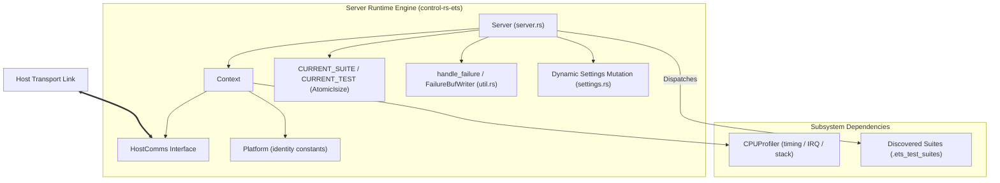
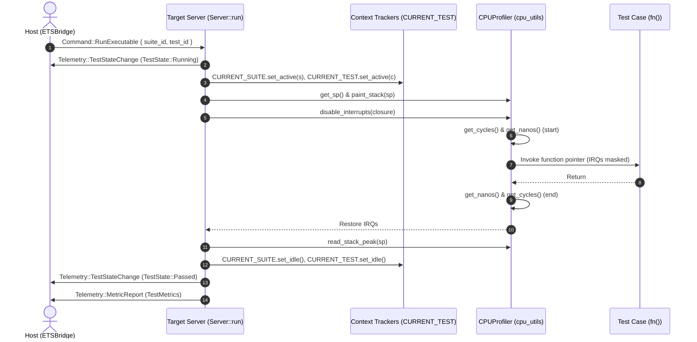

# Server Runtime (server-runtime)


---

### 1. Introduction

While host-based unit tests verify pure mathematical algorithms, verifying
firmware that interfaces with real-time timers, hardware interrupt controllers,
and stack boundaries requires executing on the target processor.
The Embedded Test Server (ETS) achieves this by operating as an interactive,
persistent on-target runtime server.

This document specifies the target-side execution engine and server runtime
component (`control-rs-ets::server` and `control-rs-ets::util`). It defines the
interactive command loop, test case dispatch and bounds checking, the test
execution lifecycle state machine, atomic execution context tracking for fault
attribution, zero-allocation panic interception, and dynamic parameter
mutation.

This component operates under the architectural coordination of the lead
subsystem design ([embedded-test-server-design.md](embedded-test-server-design.md)),
collaborating with the host communications layer
([host-comm-design.md](host-comm-design.md)), the CPU performance profiler
([cpu-profiler-design.md](cpu-profiler-design.md)), and the exportable test
suite data model ([test-suite-design.md](test-suite-design.md)).

---

### 2. Requirements

#### 2.1 Functional Requirements

- **FR-1 — Host Transport & Server Event Loop**: The server context shall flush
  bidirectional communication transport and run a persistent event loop
  indefinitely until terminated by an unrecoverable hardware fault, transport
  error, or cooperative reset command, propagating polling errors without
  swallowing.
- **FR-2 — Test Suite Discovery & Case Dispatch**: The server runtime shall safely
  reconstruct a static slice of test suite descriptors from raw linker section
  boundary pointers (`.ets_test_suites`), validate dispatch bounds without
  panicking on out-of-range indices, and stream suite discovery hierarchy upon
  request.
- **FR-3 — Execution Context & Lifecycle State Tracking**: The server runtime
  shall maintain thread-safe atomic indicators recording the active suite and
  test indices and emit sequenced lifecycle state transitions (`Running`,
  `Passed`, `Failed`) for every executed case.
- **FR-4 — Target Profiling & Resource Measurement**: The server profiling
  bracket shall measure elapsed CPU clock cycles, monotonic execution duration
  in microseconds, and peak stack memory consumption under critical section
  isolation, packaging measured metrics into a telemetry frame.
- **FR-5 — Dynamic Suite Configuration & Parameter Tuning**: The server shall
  service dynamic parameter mutation requests over the transport, validating
  suite indices, setting indices, and value types, rejecting type mismatches
  without corrupting memory or terminating the server.
- **FR-6 — Failure Diagnostics & Crash Recovery**: The server failure handler
  shall execute a deterministic, zero-allocation diagnostic capture sequence
  upon unhandled panics or hardware exceptions, format forensic records into
  static buffers without buffer overrun, attribute crashes to active tests, and
  coordinate cooperative resets.
- **FR-7 — Target Lifecycle & Hardware Identification**: The server shall query
  platform hardware identity, emit target identification telemetry, service
  cooperative warm resets, and support clean virtual environment termination via
  dedicated exit routines.

#### 2.2 Non-Functional Requirements

- **NFR-1 — Low-Overhead Case Dispatch**: Invoking an empty test case through
  the suite dispatch abstraction must introduce minimal latency (bounded to
  fewer than 20 clock cycles on target architectures) so as not to distort
  micro-benchmark timings.
- **NFR-2 — Microsecond Telemetry Timestamp Precision**: Diagnostic error logs
  and execution metrics must derive timestamps with microsecond resolution
  from monotonic platform nanosecond clocks.
- **NFR-3 — Timing-Critical Zero-Allocation Logging**: The server logging,
  state transition, metric reporting, and discovery streaming paths must format
  and transmit telemetry without invoking dynamic allocation or expensive
  on-target string formatting on the hot execution path.

#### 2.3 Constraints

- **C-1 — Strict `#![no_std]`, Zero Heap**: The target Server crate
  (`control-rs-ets`) must compile on bare-metal targets under `#![no_std]` with
  strictly zero dynamic heap allocation.
- **C-2 — Bounded Flash and RAM Footprint**: The target Server implementation
  (excluding test payloads) must consume under 32 KB Flash memory and under 8 KB
  RAM, with test suite descriptors residing in Flash ROM.

---

### 3. Technical Overview

The `Server` runtime manages interactive target execution, processing commands
from the host, executing dispatched test cases, managing dynamic parameter
updates, and capturing forensic panic state.



---

### 4. Architecture

#### 4.1. Server Struct and Context Abstraction

Serves: FR-1, FR-1.1, FR-1.2, C-1

To remain decoupled from physical UART/RTT hardware and vendor-specific
profiling registers, the `Server` is generic over communications transport `C`
and CPU profiling utilities `P`:

```rust
pub struct Context<C, P> {
    pub comms: C,
    pub cpu_utils: P,
    pub platform: Platform,
}

pub struct Server<'a, C, P> {
    pub context: Context<C, P>,
    pub suites: &'a [&'static SuiteDescriptor],
}
```

The context fields provide:
- `C: HostComms`: Bidirectional host link providing non-blocking command
  polling, telemetry framing, and flushing ([host-comm-design.md](host-comm-design.md)).
- `P: CPUProfiler`: Cycle counting, monotonic nanosecond clock samples, stack
  pointer queries, stack painting, scoped interrupt masking (`disable_interrupts`),
  permanent interrupt disabling, and target lifecycle hooks (`reset`, `exit`)
  ([cpu-profiler-design.md](cpu-profiler-design.md)).
- `platform: Platform`: Target hardware identity constants (`board_id`,
  `core_clock_hz`, `fpu_flags`, §4.6).

#### 4.2. Interactive Event Loop and Dispatch

Serves: FR-1, FR-1.1, FR-1.2, FR-2, FR-2.2, FR-7.2, FR-7.3, NFR-1

The server's main loop (`Server::run`) polls non-blocking commands from the host
transport and routes them:

```rust
pub fn run(&mut self) -> ServerResult<C::Error> {
    self.context.comms.flush()?;
    loop {
        match self.context.comms.poll_command()? {
            Some(Command::ListSuites) => self.stream_discovery()?,
            Some(Command::RunExecutable { suite_id, test_id }) => {
                self.dispatch_executable(suite_id, test_id)?;
            }
            Some(Command::SetSetting { suite_id, setting_id, value }) => {
                self.mutate_setting(suite_id, setting_id, value)?;
            }
            Some(Command::TryReset) => self.context.cpu_utils.reset(),
            None => {}
        }
    }
}
```

Dispatch validates indices against `self.suites.len()` and
`suite.executables.len()`. An out-of-bounds index transmits an error diagnostic
frame to the host without panicking or terminating the server loop.

#### 4.3. Test Execution and Lifecycle State Transitions

Serves: FR-3, FR-3.1, FR-4, FR-4.1, FR-4.2, FR-4.3, FR-4.4, FR-4.5, NFR-1, NFR-2

When executing a test case, the server coordinates execution inside a scoped
profiling bracket:



1. Transmits `TestState::Running`.
2. Marks active indicators (`CURRENT_SUITE.set_active(s)`, `CURRENT_TEST.set_active(t)`).
3. Queries stack pointer (`get_sp`) and paints stack sentinel words (`0xCDCD_CDCD`).
4. Masks interrupts via `disable_interrupts`, sampling start cycles and nanoseconds.
5. Invokes the case function pointer (`fn()`).
6. Samples end cycles and nanoseconds, restoring interrupt masks.
7. Scans painted memory (`read_stack_peak`) to calculate stack byte displacement.
8. Clears indicators (`set_idle()`).
9. Transmits `TestState::Passed` and `Telemetry::MetricReport`.

#### 4.4. Atomic Execution Context Tracking and Fault Attribution

Serves: FR-3, FR-3.2, FR-6.3, FR-6.4

To attribute unhandled panics or CPU faults to the specific running test case,
global atomic indicators maintain active execution context:

```rust
pub struct TestIndexIndicator {
    index: AtomicIsize,
}

impl TestIndexIndicator {
    pub const fn new() -> Self;
    pub fn get(&self) -> Option<usize>;
    pub fn set_active(&self, index: usize);
    pub fn set_idle(&self);
}

pub static CURRENT_SUITE: TestIndexIndicator = TestIndexIndicator::new();
pub static CURRENT_TEST: TestIndexIndicator = TestIndexIndicator::new();
```

- When active, `index` holds the non-negative index ($\ge 0$).
- When idle or between tests, `index` holds negative sentinel `-1`.
- On panic, `handle_failure` inspects `get()`: if `Some`, it transmits
  `TestState::Failed` for that specific case; if `None`, it records a general
  firmware fault without case attribution.

#### 4.5. Forensic Panic Capture and State Recovery

Serves: FR-6, FR-6.1, FR-6.2, FR-6.3, FR-6.4, FR-6.5, FR-6.6, C-1

When an assertion fails or a hardware exception occurs, `handle_failure` executes
a zero-allocation diagnostic capture sequence:

```rust
pub fn handle_failure<C: HostComms, P: CPUProfiler>(
    ctx: &mut Context<C, P>,
    info: &core::panic::PanicInfo<'_>,
) -> ! {
    let mut buffer = [0u8; 256];
    let mut writer = FailureBufWriter::new(&mut buffer);
    // Format file, line, and panic message safely into static buffer
    let _ = write!(writer, "{}", info);
    
    // Attributed state transition if active test
    if let (Some(s), Some(t)) = (CURRENT_SUITE.get(), CURRENT_TEST.get()) {
        let _ = ctx.comms.send_telemetry(&Telemetry::TestStateChange {
            suite_id: s,
            test_id: t,
            state: TestState::Failed,
        });
    }

    // Emit forensic telemetry frame
    let _ = ctx.comms.send_telemetry(&Telemetry::Panic {
        message: writer.as_str(),
    });
    let _ = ctx.comms.flush();

    ctx.cpu_utils.disable_interrupts_permanently();

    // Await cooperative reset or trigger fallback
    loop {
        if let Ok(Some(Command::TryReset)) = ctx.comms.poll_command() {
            ctx.cpu_utils.reset();
        }
    }
}
```

`FailureBufWriter` guarantees zero dynamic heap allocation and enforces strict
capacity limits, cleanly truncating messages that exceed 256 bytes without
panicking or writing out of bounds.

#### 4.6. Platform Struct: Hardware Identity

Serves: FR-7, FR-7.1

`Platform` is a pure data struct containing immutable target board constants:

```rust
#[derive(Debug, Clone, Copy, PartialEq, Eq)]
pub struct Platform {
    pub board_id: u16,
    pub core_clock_hz: u32,
    pub fpu_flags: u8,
}

impl Platform {
    pub const fn derive_fpu_flags() -> u8 {
        let single = u8::from(cfg!(target_abi = "eabihf") || cfg!(target_feature = "f"));
        let double = u8::from(cfg!(target_feature = "d"));
        single | (double << 1)
    }
}
```

The server queries `Platform` during discovery to emit `Telemetry::TargetInfo`.

#### 4.7. Dynamic Parameter Mutation and Type Checking

Serves: FR-5, FR-5.1, FR-5.2, NFR-3

The server provides dynamic parameter tuning (`settings.rs`) without stopping
the execution loop:

1. Validates `suite_id < suites.len()`.
2. Validates `setting_id < suite.settings.len()`.
3. Verifies that the requested `SettingValue` matches the registered parameter's
   type (`SettingType`).
4. On type match, applies the updated value using atomic or interior-mutable
   descriptors and echoes the updated state via `Telemetry::SettingUpdate`.
5. On type mismatch or invalid index, emits an error diagnostic telemetry log
   without corrupting setting memory or terminating the server.

---

### 5. Alternatives Considered

#### 5.1. Debug-Probe-Driven Execution (`probe-rs` + semihosting)
* Executing test dispatch via ARM semihosting traps.
* *Rejected*: Semihosting halts the processor core during I/O operations,
  destroying real-time timing determinism.

#### 5.2. Heap-Allocated Panic Formatting (`alloc::format!`)
* Formatting panic strings via dynamic heap allocation.
* *Rejected*: Bare-metal targets run `#![no_std]` without an active global
  allocator; heap allocations during panic handling risk secondary panics on OOM.

---

### 6. Verification & Validation

#### 6.1 Verification

| Condition | Requirement | Method | Target | Criterion |
|:----------|:------------|:-------|:-------|:----------|
| VC-1.1 | FR-1 | `libtest` | `control_rs_ets::server::tests::test_server_ok_to_reset` | Persistent event loop executes until cooperative reset command is received; FR-1 holds iff both conditions hold |
| VC-1.2 | FR-1 | `libtest` | `control_rs_ets::server::tests::test_server_poll_command_error` | Polling errors from transport are returned as `Err` and not swallowed |
| VC-2.1 | FR-2 | `libtest` | `control_rs_ets::util::tests::test_get_suites_fn` | Test suites are safely reconstructed from linker boundary pointers; FR-2 holds iff all conditions hold |
| VC-2.2 | FR-2 | `libtest` | `control_rs_ets::server::tests::test_server_out_of_bounds` | Invalid suite or test index emits diagnostic error and aborts without panicking |
| VC-2.3 | FR-2 | `libtest` | `control_rs_ets::server::tests::test_server_discovery` | Discovery command streams target info, suites, executables, and settings |
| VC-3.1 | FR-3 | `libtest` | `control_rs_ets::server::tests::test_server_run_test` | Test execution emits `Running` and `Passed` lifecycle transitions; FR-3 holds iff both conditions hold |
| VC-3.2 | FR-3 | `libtest` | `control_rs_ets::server::tests::test_index_indicator` | Thread-safe atomic indicators track active suite and test indices and reset to idle |
| VC-4.1 | FR-4 | `libtest` | `control_rs_ets::server::tests::profiling_reports_elapsed_cycles_and_microseconds` | Execution bracket reports non-zero elapsed cycles, microsecond duration, and stack peak; FR-4 holds iff all conditions hold |
| VC-4.2 | FR-4 | `libtest` | `control_rs_ets::server::tests::test_server_metric_report_flush_error` | Metric report transmission flushes telemetry frames to host transport |
| VC-4.3 | FR-4 | `libtest` | `control_rs_ets::server::tests::test_host_cpu_profile_utils` | Profiler execution bracket exercises cycle and duration measurement hooks |
| VC-5.1 | FR-5 | `libtest` | `control_rs_ets::server::tests::test_server_set_setting` | Valid setting mutation updates parameter value and echoes state; FR-5 holds iff both conditions hold |
| VC-5.2 | FR-5 | `libtest` | `control_rs_ets::server::tests::test_server_set_setting_type_mismatch` | Incompatible value type is rejected with error without mutating state |
| VC-6.1 | FR-6 | `libtest` | `control_rs_ets::util::tests::test_failure_buf_writer_fn` | Diagnostic capture formats forensic payload into static buffer without heap allocation; FR-6 holds iff all conditions hold |
| VC-6.2 | FR-6 | `libtest` | `control_rs_ets::util::tests::the_buffer_writer_fills_its_buffer_exactly_and_refuses_more` | Formatting routine rejects writes exceeding buffer capacity without writing past boundary |
| VC-6.3 | FR-6 | `libtest` | `control_rs_ets::util::tests::test_handle_failure_comms_active` | Crash during active test marks active case as failed |
| VC-6.4 | FR-6 | `libtest` | `control_rs_ets::util::tests::test_handle_failure_comms_idle` | Crash in idle state suppresses case failure transitions |
| VC-6.5 | FR-6 | `libtest` | `control_rs_ets::util::tests::test_handle_exception_fn` | Exception handler captures location and coordinates cooperative reset |
| VC-6.6 | FR-6 | `libtest` | `control_rs_ets::util::tests::test_handle_failure_comms_disabled` | Failure handler safely completes target reset when transport is non-functional |
| VC-7.1 | FR-7 | `libtest` | `control_rs_ets::server::tests::test_server_discovery` | Target info telemetry emits protocol version, board ID, clock frequency, and FPU capabilities; FR-7 holds iff all conditions hold |
| VC-7.2 | FR-7 | `libtest` | `control_rs_ets::server::tests::test_server_ok_to_reset` | Cooperative reset command triggers target reset sequence |
| VC-7.3 | FR-7 | `libtest` | `control_rs_ets::server::tests::test_server_exit` | Exit routine closes communications before invoking target exit hook |
| VC-10.1 | NFR-1 | `libtest` | `control_rs_ets::server::tests::test_server_run_test` | Indirect case dispatch via function pointer introduces low latency |
| VC-10.2 | NFR-2 | `libtest` | `control_rs_ets::server::tests::log_timestamps_are_in_microseconds` | Diagnostic error logs and execution metrics derive timestamps with microsecond resolution |
| VC-10.3 | NFR-3 | `libtest` | `control_rs_ets::util::tests::the_buffer_writer_fills_its_buffer_exactly_and_refuses_more` | Formatting and logging operate with zero dynamic heap allocations on hot path |
| VC-26.1 | C-1 | `gate` | `build` | `control-rs-ets` compiles cleanly for bare-metal targets under `#![no_std]` |
| VC-26.2 | C-2 | `libtest` | `control_rs_ets::tests::test_flash_descriptor_sizes` | Descriptors and runtime state structures reside within bounded memory footprints |

#### 6.2 Acceptance

| Claim | Oracle | Measure | Bound |
|:------|:-------|:--------|:------|
| Discovery completeness | Source annotations | Suites and cases reported to host | Exact set equality |
| Persistent execution | Suite of *n* cases | Target restarts during suite | 0, absent injected fault |
| Cycle telemetry attribution | Case boundaries | Reports attributed to running case | 1:1, no orphans |
| Panic capture | Injected panic | Forensic record received before reset | Received, with location |
| Dynamic setting mutation | Update command | Setting value on target | Mutated and echoed |
| Allocation freedom | Disassembly | Dynamic allocator symbols | 0 |

#### 6.3 Limits

- **Cooperative polling loop (`L-1`)**: Test execution inside `disable_interrupts`
  cannot be preempted by `Command::TryReset`; infinite loops in test cases require
  hardware watchdog timer reset or external reset line.
- **Fixed 256-byte panic buffer (`L-2`)**: `FailureBufWriter` formats payloads
  into a static 256-byte stack buffer; longer messages truncate cleanly at 256 bytes.

---

### 7. Performance & Resource Considerations

- **Zero Allocations**: All formatting and dispatch routines operate strictly on
  stack or static buffers.
- **Microsecond Clock Precision**: Profiling durations derive directly from
  hardware timer nanoseconds converted to microseconds.
- **Footprint**: Compiled server runtime logic contributes fewer than 12 KB Flash
  and under 2 KB RAM overhead.

---

### 8. Risks & Open Questions

- **Watchdog Integration**: Currently, runaway test loops rely on host session
  timeouts; future hardware watchdog integration will enforce automated target
  reboots.

---

### 9. Development Plan

| Phase | Delivers | Requirements | Effort | Status |
|:------|:---------|:-------------|:-------|:-------|
| 1. Server Event Loop & Dispatch | Core polling loop and case dispatch abstraction | FR-1, FR-2, NFR-1 | 3 days | Shipped |
| 2. Lifecycle & Profiling Bracket | State machine, atomic context tracking, metrics | FR-3, FR-4, NFR-2 | 3 days | Shipped |
| 3. Panic Interception & Settings | Forensic buffer writer, crash recovery, settings | FR-5, FR-6, FR-7, C-1 | 4 days | Shipped |

---

### 10. Revision History

| Revision | Date | Author | Description |
|:---------|:-----|:-------|:------------|
| 1.0 | November 10, 2026 | @MitchellDScott | Initial component design doc extracted from lead subsystem architecture. |

---

## References

[1] embedded-test, "embedded_test," *docs.rs*. [Online].
Available: https://docs.rs/embedded-test/latest/embedded_test/. Accessed: Aug.
7, 2026.

[2] Noah Pendleton, "Measuring Stack Usage the Hard Way," *Interrupt (Memfault
blog)*. [Online].
Available: https://interrupt.memfault.com/blog/measuring-stack-usage. Accessed:
Aug. 7, 2026.
