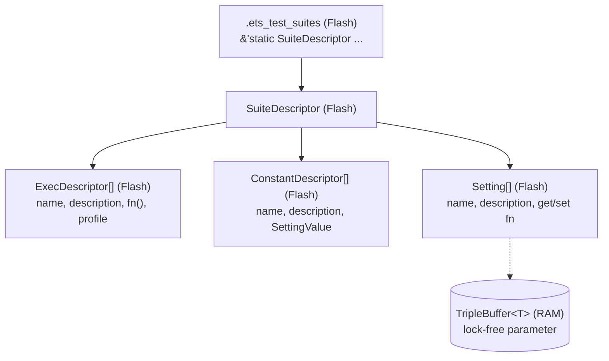

# Exportable Test Suites (test-suite)


### 1. Introduction

The standard Rust testing harness (`cargo test`) implicitly relies on the
standard library (`std`), which triggers compilation errors in bare-metal
environments. Attempting to bypass this by setting `harness = false` solves the
immediate compilation failure but leaves a functional void with no native
mechanism to automatically discover, execute or report tests.

This design document establishes the architecture for "Exportable Test Suites"
designed natively for bare-metal embedded Rust. It enables developers to declare
test and benchmark suites with dynamically configurable settings across multiple
files without maintaining a central
registry, requiring zero boilerplate and little runtime overhead.

This design specifies the suites data model and its linker-section ABI only.
It references no other ETS component. How suites are generated, discovered,
run, measured and reported is specified in the lead ETS design
([embedded-test-server-design.md](embedded-test-server-design.md)).

---

### 2. Requirements

#### 2.1 Functional Requirements

- **FR-1 — Self-describing suite grouping**: Related test cases, fixed
  parameters and adjustable parameters must be grouped under a named,
  documented unit that can be inspected at runtime. Without suite-level
  grouping and metadata, an external runner cannot discover which tests and
  parameters belong together or what the suite verifies without parsing source
  files or debug symbols.
- **FR-2 — Individually addressable test cases**: Each test or benchmark case
  must expose its name, documentation, callable entry point, and execution
  profiling
  policy (`Profile::Full`, `Profile::Unmasked`, `Profile::Off`) for on-demand
  execution. Without per-case metadata paired with an entry point and profiling
  arm,
  a runner cannot discover, invoke, or measure a single case in isolation.
- **FR-3 — Inspectable compile-time constants**: Fixed suite parameters must
  expose their name, documentation, type and value for runtime inspection
  while remaining ordinary compile-time constants in Rust code. Requiring a
  runtime wrapper around constants would prevent their use in `const` contexts,
  array bounds and compile-time evaluation.
- **FR-4 — Runtime-tunable parameters**: Adjustable suite parameters must be
  readable by executing test code as their native static type and updatable at
  runtime only with values of the matching type. Parameter updates must not
  block the reader or produce torn reads during concurrent access, and type
  mismatches must be rejected without modifying the stored value.
- **FR-5 — No central suite registration**: Suites enabled by the build
  configuration must appear in the firmware's available suite set without
  maintaining a central registration list in the binary root. Requiring a
  central table couples the application entry point to every test module and
  risks omitting suites enabled through conditional compilation or Cargo
  features.
- **FR-6 — Suite-scoped constant naming**: Distinct suites may expose constants
  with identical names. Each constant must resolve independently by suite
  identity and constant name without collision.
- **FR-7 — Explicit suite membership**: A suite descriptor must include only
  constants and settings declared directly within that suite. Test cases may
  use imported or crate-global state, but such state must not be discovered or
  reported as suite-owned metadata.

#### 2.2 Non-Functional Requirements

- **NFR-1 — Zero static RAM for immutable metadata**: Suite metadata, test case
  metadata and compile-time constant metadata must consume zero bytes of static
  RAM, residing entirely in read-only non-volatile memory. Allocating static RAM
  for test descriptions and constant manifests would exhaust bare-metal memory
  budgets as the suite library grows.
- **NFR-2 — Retention under dead-code elimination**: Compiled test suites must
  remain in the linked firmware image when dead-code elimination is enabled,
  even when no symbol in the firmware entry point references them directly.
  Standard embedded link passes strip unreferenced symbols, which would silently
  discard self-registered suites from the binary.

#### 2.3 Constraints

- **C-1 — `#![no_std]` and zero heap allocation**: The module must compile under
  `#![no_std]` without `alloc` or dynamic heap allocation (conforms to
  [embedded-test-server-design.md](embedded-test-server-design.md) C-1).
- **C-2 — No `static mut`**: Shared mutable parameter state must use safe
  interior mutability and must not use `static mut`.
- **C-3 — Target architecture portability**: The module must compile across ARM
  Cortex-M (`ARMv6-M`, `ARMv7-M`, `ARMv8-M`) and RISC-V (`RV32`, `RV64`) targets
  (conforms to [embedded-test-server-design.md](embedded-test-server-design.md)
  C-1).

---

### 3. Technical Overview



---

### 4. Architecture

#### 4.1. Descriptors (`SuiteDescriptor`, `ExecDescriptor`,

`ConstantDescriptor`)

Serves: FR-1, FR-2, FR-3, FR-6, FR-7, NFR-1, C-1

- Module: `control_rs_ets` (`ConstantDescriptor`, `ExecDescriptor`,
  `SuiteDescriptor`, `SettingsSlice`).
- `SuiteDescriptor`, `ExecDescriptor`, and `ConstantDescriptor` are immutable
  value types constructed in `const` context and placed in `.rodata` (Flash),
  consuming zero static RAM at idle.
- `ConstantDescriptor` records a read-only constant's `name`, `description`, and
  compiled `SettingValue` in Flash without wrapping the source `const` item.
- `SuiteDescriptor` holds separate static slices for `executables`, `constants`,
  and concrete `settings` without `dyn` trait objects or vtables.
- Each `SuiteDescriptor` defines an independent namespace for its `constants`
  and `settings`; identical constant names in distinct suites resolve
  independently by `(suite_name, const_name)` without collision (`FR-6`). Test
  cases may reference external global or imported state, but only items
  declared directly within the suite and placed in its descriptor slices are
  exposed as suite metadata (`FR-7`).

```rust
#[derive(
    Debug,
    Clone,
    Copy,
    PartialEq,
    Eq,
    Default,
    serde::Serialize,
    serde::Deserialize
)]
#[repr(u8)]
pub enum Profile {
    #[default]
    Full = 0,
    Unmasked = 1,
    Off = 2,
}

#[derive(Debug, Clone, Copy)]
pub struct ExecDescriptor {
    pub description: &'static str,
    pub name: &'static str,
    pub test_fn: fn(),
    pub profile: Profile,
}

#[derive(Debug, Clone, Copy)]
pub struct ConstantDescriptor {
    pub description: &'static str,
    pub name: &'static str,
    pub value: SettingValue,
}

pub type SettingsSlice = &'static [Setting];

pub struct SuiteDescriptor {
    pub constants: &'static [ConstantDescriptor],
    pub description: &'static str,
    pub executables: &'static [ExecDescriptor],
    pub name: &'static str,
    pub settings: SettingsSlice,
}
```

#### 4.2. Settings (`Setting`, `SettingValue`, `TripleBuffer<T>`)

Serves: FR-4, C-1, C-2, C-3

- Module: `control_rs_ets::settings`.
- Dynamic settings are declared in suite modules as
  `pub static NAME: TripleBuffer<T> = TripleBuffer::new(initial);`.
- `Setting` is a concrete struct in Flash constructed via
  `Setting::new(name, description, &NAME)`, pairing setting metadata (`name`,
  `description`) with a type-erased pointer and `get`/`set` function pointers to
  the `TripleBuffer<T>` static in RAM.
- Under `#[cfg(target_has_atomic = "8")]`, `TripleBuffer<T>` stores three
  `UnsafeCell<T>` slots and a single `AtomicU8` state byte in static RAM (`C-2`,
  `C-3`); under `#[cfg(not(target_has_atomic = "8"))]` (ARMv6-M),
  `TripleBuffer<T>` falls back to a single `UnsafeCell<T>` slot:
    - Test functions call `TripleBuffer::<T>::get(&self) -> T` to swap the read
      slot with the back slot when the dirty bit is set (or read the single slot
      when `not(target_has_atomic = "8")`) and return the primitive value `T`
      directly without `SettingValue` matching.
    - Host updates call `Setting::set(&self, value: SettingValue) -> SetResult`,
      which converts `SettingValue` via `TryFrom<SettingValue>` (returning `Err`
      on variant mismatch), writes the incoming value into the write slot and
      atomically swaps the write and back slot indices in `state`.

```rust
#[derive(Debug, Clone, Copy, serde::Serialize, serde::Deserialize)]
pub enum SettingValue {
    Bool(bool),
    F32(f32),
    I8(i8),
    I32(i32),
    U8(u8),
    U16(u16),
    U32(u32),
    U64(u64),
}

pub type SetResult = Result<(), &'static str>;

pub struct TripleBuffer<T: Copy> {
    #[cfg(target_has_atomic = "8")]
    buffers: [core::cell::UnsafeCell<T>; 3],
    #[cfg(target_has_atomic = "8")]
    state: core::sync::atomic::AtomicU8,
    #[cfg(not(target_has_atomic = "8"))]
    value: core::cell::UnsafeCell<T>,
}

unsafe impl<T: Copy + Send> Sync for TripleBuffer<T> {}

impl<T: Copy> TripleBuffer<T> {
    pub const fn new(initial_value: T) -> Self;
    pub fn get(&self) -> T;
    pub fn set(&self, value: T);
}

pub struct Setting {
    pub description: &'static str,
    pub name: &'static str,
    data: *const (),
    get_fn: fn(*const ()) -> SettingValue,
    set_fn: fn(*const (), SettingValue) -> SetResult,
}

unsafe impl Sync for Setting {}

impl Setting {
    pub const fn new<T>(
        name: &'static str,
        description: &'static str,
        buffer: &'static TripleBuffer<T>,
    ) -> Self
    where
        T: Copy
        + Into<SettingValue>
        + TryFrom<SettingValue, Error=&'static str>
        + 'static;
    pub fn get(&self) -> SettingValue;
    pub fn set(&self, value: SettingValue) -> SetResult;
}
```

#### 4.3. Distributed Test Discovery

Serves: FR-5, NFR-1, C-1, C-3

Instead of building a dynamic test registry at runtime, the framework uses a
linker-based distributed slice mechanism. Each suite declares one
`SuiteDescriptor` static and places a `&'static SuiteDescriptor` pointer to it
in a custom ELF memory section named `.ets_test_suites` (§4.5).

During compilation, the `control-rs-ets` build script (`build.rs`) generates a
linker script fragment named `ets_suites.x` containing the following section
configuration:

```ld
SECTIONS
{
  .ets_test_suites :
  {
    . = ALIGN(4);
    PROVIDE_HIDDEN (__ets_test_suites_start = .);
    KEEP (*(.ets_test_suites));
    . = ALIGN(4);
    PROVIDE_HIDDEN (__ets_test_suites_end = .);
  } > FLASH
}
```

This forces the linker to aggregate the descriptor pointers contiguously
inside Flash memory (ROM) bounded by the hidden start and end symbols, exposed
as `fn suites() -> &'static [&'static SuiteDescriptor]`. The descriptors
themselves stay in ordinary
read-only data.

The mechanism this section specifies exists because cross-crate linker-section
registration is not automatic. A distributed slice gathers "static elements
into a contiguous section of the binary by the linker" and its elements may be
defined in the same crate that declares the distributed slice or in any
downstream crate. In practice the dependency direction matters:
entries declared in a dependency crate have been observed not to appear in the
final slice [2], and the same asymmetry is reported for a plain
`#[used] #[link_section]` static, whose behavior "is different when the
static is placed in a dependency or in the currently built crate"
[3]. The `KEEP` directive and the `build.rs`-generated linker
script below exist to close that gap exactly, and the descriptor-set
verification in §6.3 is what detects it if they fail.

#### 4.4. Linker Garbage Collection Mitigation

Serves: FR-5, NFR-2

Embedded compilers invoke the linker with optimization flags like
`--gc-sections` to perform dead code elimination. Since the target firmware does
not reference `SuiteDescriptor` statics directly (accessing them only via
pointer arithmetic over the bounding symbols), the linker would normally discard
them.

To prevent this, the crate implements a multi-tiered retention strategy:

1. **`#[used]` Attribute**: Annotating static descriptors tells the
   compiler and linker to retain the symbol. On ELF targets, this generates the
   `SHF_GNU_RETAIN` flag.
2. **`KEEP` Linker Directive**: Wrapping the section wildcard as
   `KEEP (*(.ets_test_suites))` forces the linker to preserve these blocks
   regardless of references.

Items 1 and 2 are the shipped strategy (`control-rs-ets/build.rs` emits the
`KEEP` fragment and no linker flags).

#### 4.5. Declaring a Suite by Hand

Serves: FR-1, FR-2, FR-3, FR-4, FR-5, NFR-1

A suite is complete without any code generation. The following declaration is
the reference form; any generator must produce an equivalent:

```rust
pub const SUPPLY_VOLTAGE: u32 = 12;
pub static KP: TripleBuffer<u32> = TripleBuffer::new(1500);

/// Checks that the plant model integrates.
fn test_system_integrates() {
    assert!((5..=24).contains(&SUPPLY_VOLTAGE));
    assert!(KP.get() > 0);
}

static CASES: [ExecDescriptor; 1] = [ExecDescriptor {
    description: "Checks that the plant model integrates.",
    name: "integrates",
    test_fn: test_system_integrates,
    profile: Profile::Full,
}];

static CONSTANTS: [ConstantDescriptor; 1] = [ConstantDescriptor {
    description: "Nominal supply rail in volts.",
    name: "SUPPLY_VOLTAGE",
    value: SettingValue::U32(SUPPLY_VOLTAGE),
}];

static SETTINGS: [Setting; 1] = [Setting::new(
    "KP",
    "Proportional gain.",
    &KP,
)];

static SUITE: SuiteDescriptor = SuiteDescriptor {
    constants: &CONSTANTS,
    description: "Plant model checks",
    executables: &CASES,
    name: "plant",
    settings: &SETTINGS,
};

#[unsafe(link_section = ".ets_test_suites")]
#[used]
static SUITE_PTR: &SuiteDescriptor = &SUITE;
```

---

### 5. Alternatives

* **Constructor-based runtime registries (`inventory`, `ctor`)**: Rejected on
  mechanism. `inventory` registers types from "any source file linked into your
  application" with no central list [4], but relies on runtime initialization
  functions similar to `__attribute__((constructor))` in C [4]. Its documented
  platform support is restricted to hosted operating systems; bare-metal targets
  are not supported. Similarly, `ctor` supplies constructors for hosted
  systems [5]
  and explicitly subverts Rust's execution model before `main`.
* **`static_init` runtime initialization**: Rejected. `static_init` is `no_std`
  only on Linux or Redox using futex system calls [6], which is not viable on
  bare metal.
* **`linkme::DistributedSlice`**: Not adopted. `linkme` 0.3.37 is `#![no_std]`
  and handles `target_os = "none"` through ELF symbols, but the hand-rolled
  mechanism is a linker fragment and two boundary symbols, already shipped; on
  bare metal a custom `SECTIONS` script must still place the section explicitly,
  so `linkme` would add a proc-macro dependency without removing linker-script
  work.
* **`static mut` for state tracking**: Rejected. Violates Rust's strict aliasing
  rules, introduces data race risks and is deprecated in current Rust editions.

---

### 6. Verification & Validation

#### 6.1 Verification

| Condition | Requirement | Method    | Target                                                                    | Criterion                                                                                                                          |
|:----------|:------------|:----------|:--------------------------------------------------------------------------|:-----------------------------------------------------------------------------------------------------------------------------------|
| VC-1.1    | FR-5        | `libtest` | `control_rs_ets::util::tests::test_get_suites_fn`                         | Descriptors in `.ets_test_suites` match the set of declared suites across modules and crates                                       |
| VC-2.1    | FR-2        | `libtest` | `control_rs_ets::tests::test_exec_descriptor_metadata`                    | `ExecDescriptor` metadata (name, description, function pointer, profile arm) reflects source declarations                          |
| VC-5.1    | FR-4        | `libtest` | `control_rs_ets::server::tests::test_server_set_setting`                  | `Setting` safely gets and sets typed parameter values by suite and setting name                                                    |
| VC-5.2    | FR-4        | `libtest` | `control_rs_ets::server::tests::test_server_set_setting_type_mismatch`    | `Setting::set` rejects mismatched `SettingValue` variants and unknown suite or setting names, leaving stored values unchanged      |
| VC-5.3    | FR-4        | `libtest` | `control_rs_ets::server::tests::test_setting_value_partial_eq`            | Setting value equality comparison differentiates distinct types and magnitudes without type confusion                              |
| VC-6.1    | FR-6        | `libtest` | `control_rs_ets::tests::test_duplicate_constant_names_in_distinct_suites` | Two suites declaring constants with identical names resolve distinct values by suite identity and constant name.                   |
| VC-7.1    | FR-7        | `libtest` | `control_rs_ets::tests::test_external_globals_are_not_suite_metadata`     | A test may reference external global state while discovery reports only constants and settings declared directly within its suite. |
| VC-9.1    | NFR-1       | `gate`    | `clippy`                                                                  | Clippy verification passes without dynamic heap allocation (`alloc`) on target paths                                               |
| VC-9.2    | NFR-1       | `libtest` | `control_rs_ets::tests::test_flash_descriptor_sizes`                      | Descriptors and static metadata reside entirely in Flash (ROM), consuming zero static RAM at idle                                  |
| VC-10.1   | NFR-2       | `gate`    | `build`                                                                   | Target firmware builds cleanly with `--gc-sections`, retaining `.ets_test_suites` via `KEEP` directives                            |
| VC-11.1   | C-1         | `gate`    | `clippy`                                                                  | The `clippy` quality gate passes, enforcing `#![no_std]` and zero dynamic heap allocation                                          |
| VC-12.1   | C-2         | `gate`    | `clippy`                                                                  | The codebase contains zero occurrences of `static mut`                                                                             |
| VC-13.1   | C-3         | `gate`    | `build`                                                                   | The test suite framework compiles across Cortex-M (v6-M, v7-M, v8-M) and RISC-V targets                                            |

#### 6.2 Acceptance

| Claim                         | Oracle                                             | Measure                                                 | Bound                                          |
|:------------------------------|:---------------------------------------------------|:--------------------------------------------------------|:-----------------------------------------------|
| Registration completeness     | Source annotations across all crates in the binary | Descriptors in the ELF section                          | Exact set equality                             |
| Dependency-crate registration | A suite declared in a dependency                   | Present in the final binary                             | Present                                        |
| Parameter access              | `Setting::set` then `get` by name                  | Returned value                                          | Exact value match; mismatched type is an error |
| Retention under GC            | The same ELF linked with `--gc-sections`           | Descriptors present                                     | Unchanged                                      |
| Type safety                   | A descriptor of the wrong type                     | Build outcome                                           | Compile error, not a runtime mismatch          |
| Allocation freedom            | Disassembly of a target build                      | Allocator symbols on the registration or discovery path | 0                                              |
| Constant resolution           | Two suites declaring identical constant names      | Discovery and retrieval by `(suite, name)`              | Distinct values resolved without collision     |
| Metadata boundary             | A test case accessing external global state        | Descriptors reported for that suite                     | External state absent from constants/settings  |

#### 6.3 Limits

- ExecDescriptor attribute extensions (`#[should_panic]`, `#[ignore]`,
  `#[timeout]`): deferred; descriptors carry no such metadata in this revision.
- Linker behaviour outside LLD and GNU ld. The section and script coordination
  is exercised with those only.
- Behaviour when two crates declare the same suite name. Deduplication is
  unspecified and untested.

### 7. Performance & Resource Considerations

* **ROM/RAM Overhead**: To operate within strict bare-metal budgets, all suite
  and case metadata resides strictly in Flash. `Atomic*Setting` wrappers
  allocate no dynamic heap and require only the underlying atomic word in RAM.

---

### 8. Risks & Open Questions

* **Linker Compatibility**: Older GNU ld or LLVM lld versions may not respect
  the `SHF_GNU_RETAIN` flag. Forcing symbol retention relies on the
  `KEEP` directive inside the generated `ets_suites.x` script.
* **Cross-Crate Discovery (`rust-lang/rust#67209`)**: Upstream defect may drop
  `#[used]` statics in `.rlib` archives if no direct symbol reference exists.
  Workspace
  suites are linked via root-crate module inclusion.
* **Architecture & Verification Update for FR-1, FR-3 and FR-4**: §4 and §6.1
  require updating from `Atomic*Setting` to read-only constant descriptors and
  triple-buffer setting wrappers, along with verification conditions for FR-1
  and FR-3.

---

### 9. Development Plan

| Phase                            | Delivers                                                             | Requirements                             | Effort | Status  |
|:---------------------------------|:---------------------------------------------------------------------|:-----------------------------------------|:-------|:--------|
| 1. Core Suite & Case Descriptors | `SuiteDescriptor`, `ExecDescriptor`, and distributed slice discovery | FR-1, FR-2, FR-5, NFR-1, NFR-2, C-1, C-3 | 3 days | Shipped |
| 2. Read-Only Constant Manifest   | Read-only constant descriptors in Flash                              | FR-3, FR-6, FR-7, NFR-1                  | 2 days | Planned |
| 3. Triple-Buffer Setting Wrapper | Triple-buffered dynamic settings                                     | FR-4, C-2                                | 2 days | Planned |

---

### 10. Revision History

| Revision | Date              | Author                                        | Description                                                                                                                                                                                                                         |
|:---------|:------------------|:----------------------------------------------|:------------------------------------------------------------------------------------------------------------------------------------------------------------------------------------------------------------------------------------|
| 1.0      | August 29, 2026   | @MitchellDScott                               | Initial exportable test suite design with linker-section discovery.                                                                                                                                                                 |
| 2.0      | November 14, 2026 | @MitchellDScott, Antigravity, Claude Opus 5.5 | Replace suite and setting requirements with suite descriptors, read-only constants, triple-buffer dynamic settings, and distributed discovery. Affects C-1, C-2, C-3, FR-1, FR-2, FR-3, FR-4, FR-5, FR-6, FR-7, FR-8, NFR-1, NFR-2. |
| 3.0      | November 14, 2026 | @MitchellDScott, Antigravity                  | State suite, case, constant, setting, and discovery requirements as testable needs rather than architectural features. Affects C-1, C-2, C-3, FR-1, FR-2, FR-3, FR-4, FR-5, FR-6, FR-7, NFR-1, NFR-2.                               |
| 3.1      | November 17, 2026 | Antigravity                                   | Add Profile arm to ExecDescriptor and test suite requirements. Affects FR-6, FR-7.                                                                                                                                                  |

---

## References

[1] linkme, "linkme: safe cross-platform linker shenanigans," *GitHub,
dtolnay/linkme* (Version 0.3.37), 2026. [Online].
Available: https://github.com/dtolnay/linkme. Accessed: Aug. 7, 2026.

[2] kcuzner, "Distributed slice members in dependency crates are discarded
(Issue #36)," *GitHub, dtolnay/linkme*, 2021. [Online].
Available: https://github.com/dtolnay/linkme/issues/36. Accessed: Aug. 7, 2026.

[3] jfrimmel, "#[link_section] is only usable from the root crate (Issue
#67209)," *GitHub, rust-lang/rust*, 2019. [Online].
Available: https://github.com/rust-lang/rust/issues/67209. Accessed: Aug. 7,

2026.

[4] inventory, "inventory: typed distributed plugin registration," *GitHub,
dtolnay/inventory*, 2026. [Online].
Available: https://github.com/dtolnay/inventory. Accessed: Aug. 7, 2026.

[5] ctor, "ctor: module initialization functions," *GitHub, mmatyas/ctor*,

2026. [Online]. Available: https://github.com/mmatyas/ctor. Accessed: Aug. 7,
2026.

[6] static_init, "static_init: safe initialization of statics," *crates.io*,

2026. [Online]. Available: https://crates.io/crates/static_init. Accessed: Aug.
      7, 2026.
