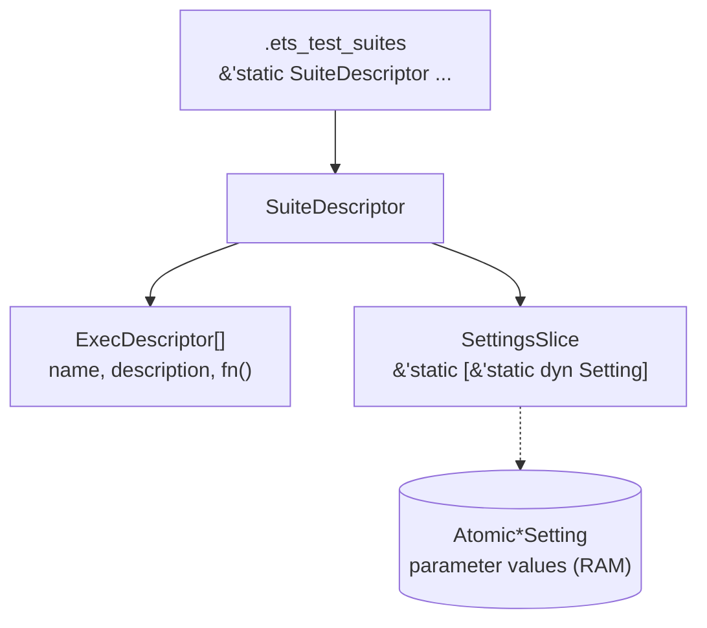

# Exportable Test Suites (test-suite)


### 1. Introduction

The standard Rust testing harness (`cargo test`) implicitly relies on the
standard library (`std`), which triggers compilation errors in bare-metal
environments. Attempting to bypass this by setting `harness = false` solves the
immediate compilation failure but leaves a functional void with no native
mechanism to automatically discover, execute or report tests.

This design document establishes the architecture for "Exportable Test Suites"
designed natively for bare-metal embedded Rust. It enables developers to declare
test and benchmark suites with dynamically configurable settings across multiple
files without maintaining a central
registry, requiring zero boilerplate and little runtime overhead.

This design specifies the suites data model and its linker-section ABI only.
It references no other ETS component. How suites are generated, discovered,
run, measured and reported is specified in the lead ETS design
([embedded-test-server-design.md](embedded-test-server-design.md)).

---

### 2. Requirements

#### 2.1 Functional Requirements

- **FR-1 — Distributed Linker-Section Suite Discovery**: Test suites and cases
  must be
  discoverable across modules and crates at runtime without central registration
  tables via `.ets_test_suites`.
- **FR-2 — ExecDescriptor Case Representation**: `ExecDescriptor` bundles test
  case name,
  description, and execution body function pointer.
- **FR-5 — Dynamic Parameter Registration and Type-Checked Access**: `SuiteDescriptor`
  exposes typed settings (`Setting`, `SettingType`, `SettingValue`, `SettingsSlice`),
  supporting runtime `get` and `set` by suite and setting name with type
  checking.
- **FR-6 — Lock-Free Atomic Static Setting Storage**:
  The `Atomic*Setting` wrappers (`AtomicBoolSetting`, `AtomicF32Setting`,
  `AtomicI8Setting`, `AtomicI32Setting`, `AtomicU8Setting`, `AtomicU16Setting`,
  `AtomicU32Setting`, `AtomicU64Setting`) wrap lock-free atomic primitives
  (`AtomicBool`, `AtomicI8`, `AtomicI32`, `AtomicU8`, `AtomicU16`, `AtomicU32`,
  `AtomicU64`) to provide wait-free `#![no_std]` interior mutability for
  configurable parameters without `static mut` or lock contention.
- **FR-7 — Embedded Flash Metadata Efficiency**: Suite and case descriptors
  must reside in Flash (read-only memory) with zero static RAM consumption at
  idle.

#### 2.2 Non-Functional Requirements

- **NFR-1 — Zero Runtime Registration Overhead**: The test registry must be
  constructed during the linking phase with zero heap allocation.
- **NFR-2 — High ROM/RAM Efficiency**: Test descriptors must reside directly in
  Flash memory (ROM) to conserve RAM and survive `--gc-sections`.

#### 2.3 Constraints

- **C-1 — Strict `#![no_std]` Execution**: The target-side framework must
  compile under `#![no_std]` with zero dynamic heap allocation.
- **C-2 — Eradication of `static mut`**: All global state and configurable
  settings must use thread-safe atomic interior mutability wrappers
  (`Atomic*Setting`), not `static mut`.
- **C-3 — Target Architecture Portability**: ARM Cortex-M (ARMv6-M, ARMv7-M,
  ARMv8-M) and RISC-V (RV32, RV64).

---

### 3. Technical Overview

A suite is read-only data plus function pointers. Each suite contributes one
`SuiteDescriptor` and one pointer to it in `.ets_test_suites`; the linker
gathers the pointers into a contiguous slice exposed as `get_suites()`. Mutable
parameter state lives in lock-free `Atomic*Setting` statics referenced through
the suite's `settings` slice.



---

### 4. Architecture

#### 4.1. Linker-Based Distributed Test Discovery

Serves: FR-1, NFR-1, C-1, C-3

Instead of building a dynamic test registry at runtime, the framework utilizes a
linker-based distributed slice mechanism. Each suite declares one
`SuiteDescriptor` static and places a `&'static SuiteDescriptor` pointer to it
in a custom ELF memory section named `.ets_test_suites` (§4.6).

During compilation, the `control-rs-ets` build script (`build.rs`) generates a
linker script fragment named `ets_suites.x` containing the following section
configuration:

```ld
SECTIONS
{
  .ets_test_suites :
  {
    . = ALIGN(4);
    PROVIDE_HIDDEN (__ets_test_suites_start = .);
    KEEP (*(.ets_test_suites));
    . = ALIGN(4);
    PROVIDE_HIDDEN (__ets_test_suites_end = .);
  } > FLASH
}
```

This forces the linker to aggregate the descriptor pointers contiguously
inside Flash memory (ROM) bounded by the hidden start and end symbols, exposed
as `fn suites() -> &'static [&'static SuiteDescriptor]`. The descriptors
themselves stay in ordinary
read-only data.

The mechanism this section specifies exists because cross-crate linker-section
registration is not automatic. A distributed slice gathers "static elements
into a contiguous section of the binary by the linker" and its elements "may be
defined in the same crate that declares the distributed slice or in any
downstream crate" [1]. In practice the dependency direction matters:
entries declared in a dependency crate have been observed not to appear in the
final slice [2], and the same asymmetry is reported for a plain
`#[used] #[link_section]` static, whose behaviour "is different when the
static is placed in a dependency or in the currently built crate"
[3]. The `KEEP` directive and the `build.rs`-generated linker
script below exist to close exactly that gap, and the descriptor-set
verification in §6.3 is what detects it if they fail.

#### 4.2. Linker Garbage Collection Mitigation

Serves: FR-1, NFR-2

Embedded compilers invoke the linker with optimization flags like
`--gc-sections` to perform dead code elimination. Since the target firmware does
not reference `SuiteDescriptor` statics directly (accessing them only via
pointer arithmetic over the bounding symbols), the linker would normally discard
them.

To prevent this, the crate implements a multi-tiered retention strategy:

1. **`#[used]` Attribute**: Annotating static descriptors tells the
   compiler and linker to retain the symbol. On ELF targets, this generates the
   `SHF_GNU_RETAIN` flag.
2. **`KEEP` Linker Directive**: Wrapping the section wildcard as
   `KEEP (*(.ets_test_suites))` forces the linker to preserve these blocks
   regardless of references.

Items 1 and 2 are the shipped strategy (`control-rs-ets/build.rs` emits the
`KEEP` fragment and no linker flags).

#### 4.3. Lock-Free Atomic Setting Storage (`Atomic*Setting`)

Serves: FR-6, C-2

To prevent undefined behavior from unsynchronized preemption without `static mut`,
`control-rs-ets::settings` provides concrete atomic wrapper structs
(`AtomicBoolSetting`, `AtomicI8Setting`, `AtomicI32Setting`, `AtomicU8Setting`,
`AtomicU16Setting`, `AtomicU32Setting`, `AtomicU64Setting` under
`#[cfg(target_has_atomic = "64")]`, and `AtomicF32Setting`) wrapping standard
`core::sync::atomic` primitives (`AtomicBool`, `AtomicI8`, `AtomicI32`,
`AtomicU8`, `AtomicU16`, `AtomicU32`, `AtomicU64`):

```rust
pub struct AtomicU32Setting {
    description: &'static str,
    name: &'static str,
    value: AtomicU32,
}

impl AtomicU32Setting {
    pub const fn new(
        name: &'static str,
        description: &'static str,
        initial_value: u32,
    ) -> Self;
}
```

Single-precision floating-point settings (`f32`) are stored bit-cast inside
`AtomicF32Setting` (`AtomicU32`) via `f32::to_bits` and `f32::from_bits`, allowing
wait-free `Ordering::Relaxed` loads and stores across host and embedded targets.

#### 4.4. Dynamic Parameter Access (`Setting`, `SettingType`, and `SettingValue`)

Serves: FR-5

Parameters configured from the host or queried at runtime are accessed through
the `Setting` trait, `SettingType` enum, and `SettingValue` enum in
`control-rs-ets::settings`:

```rust
#[derive(Debug, Clone, Copy, PartialEq, Eq, serde::Serialize, serde::Deserialize)]
pub enum SettingType {
    Bool,
    F32,
    I32,
    I8,
    U16,
    U32,
    U64,
    U8,
}

#[derive(Debug, Clone, Copy, serde::Serialize, serde::Deserialize)]
pub enum SettingValue {
    Bool(bool),
    F32(f32),
    I32(i32),
    I8(i8),
    U16(u16),
    U32(u32),
    U64(u64),
    U8(u8),
}

pub type SetResult = Result<(), &'static str>;

pub trait Setting: Sync {
    fn description(&self) -> &'static str;
    fn expected_type(&self) -> SettingType;
    fn get(&self) -> SettingValue;
    fn name(&self) -> &'static str;
    fn set(&self, value: SettingValue) -> SetResult;
}

pub type SettingsSlice = &'static [&'static dyn Setting];
```

`Setting::set` checks that the incoming `SettingValue` variant matches the
underlying atomic type; on a variant mismatch it returns `Err("Type mismatch...")`
and leaves the stored value unchanged. `SettingValue` implements `PartialEq` and
`Eq` using bitwise comparison (`f32::to_bits`) for `SettingValue::F32`.

#### 4.5. Descriptors and Discovery Layout

Serves: FR-2, FR-7

```rust
pub struct ExecDescriptor {
    pub description: &'static str,
    pub name: &'static str,
    pub test_fn: fn(),
}

pub struct SuiteDescriptor {
    pub description: &'static str,
    pub executables: &'static [ExecDescriptor],
    pub name: &'static str,
    pub settings: SettingsSlice,
}
```

#### 4.6. Declaring a Suite by Hand

Serves: FR-1, FR-2, FR-7

A suite is complete without any code generation. The following declaration is
the reference form; any generator must produce an equivalent:

```rust
/// Checks that the plant model integrates.
fn test_system_integrates() { /* assertions */ }

static CASES: [ExecDescriptor; 1] = [ExecDescriptor {
    description: "Checks that the plant model integrates.",
    name: "integrates",
    test_fn: test_system_integrates,
}];

static SUITE: SuiteDescriptor = SuiteDescriptor {
    description: "Plant model checks",
    executables: &CASES,
    name: "plant",
    settings: &[],
};

#[unsafe(link_section = ".ets_test_suites")]
#[used]
static SUITE_PTR: &SuiteDescriptor = &SUITE;
```

---

### 5. Alternatives

* **Constructor-based runtime registries (`inventory`, `ctor`)**: Rejected on
  mechanism. `inventory` registers types from "any source file linked into your
  application" with no central list [4], but relies on runtime initialization
  functions similar to `__attribute__((constructor))` in C [4]. Its documented
  platform support is restricted to hosted operating systems; bare-metal targets
  are not supported. Similarly, `ctor` supplies constructors for hosted
  systems [5]
  and explicitly subverts Rust's execution model before `main`.
* **`static_init` runtime initialization**: Rejected. `static_init` is `no_std`
  only on Linux or Redox using futex system calls [6], which is not viable on
  bare metal.
* **`linkme::DistributedSlice`**: Not adopted. `linkme` 0.3.37 is `#![no_std]`
  and handles `target_os = "none"` through ELF symbols, but the hand-rolled
  mechanism is a linker fragment and two boundary symbols, already shipped; on
  bare metal a custom `SECTIONS` script must still place the section explicitly,
  so `linkme` would add a proc-macro dependency without removing linker-script
  work.
* **`static mut` for state tracking**: Rejected. Violates Rust's strict aliasing
  rules, introduces data race risks, and is deprecated in current Rust editions.
  Interior mutability is achieved via atomic `Atomic*Setting` wrappers.

---

### 6. Verification & Validation

#### 6.1 Verification

| Condition | Requirement | Method    | Target                                                    | Criterion                                                                                                       |
|:----------|:------------|:----------|:----------------------------------------------------------|:----------------------------------------------------------------------------------------------------------------|
| VC-1.1    | FR-1        | `libtest` | `control_rs_ets::util::tests::test_get_suites_fn`         | Descriptors in `.ets_test_suites` match the set of declared suites across modules and crates                    |
| VC-2.1    | FR-2        | `libtest` | `control_rs_ets::tests::test_exec_descriptor_metadata`    | `ExecDescriptor` metadata (name, description, function pointer) reflects source declarations                    |
| VC-5.1    | FR-5        | `libtest` | `control_rs_ets::server::tests::test_server_set_setting`  | `Setting` safely gets and sets typed parameter values by suite and setting name |
| VC-5.2    | FR-5        | `libtest` | `control_rs_ets::server::tests::test_server_set_setting_type_mismatch` | `Setting::set` rejects mismatched `SettingValue` variants and unknown suite or setting names, leaving stored values unchanged |
| VC-5.3    | FR-5        | `libtest` | `control_rs_ets::server::tests::test_setting_value_partial_eq` | Setting value equality comparison differentiates distinct types and magnitudes without type confusion |
| VC-6.3    | FR-6        | `libtest` | `control_rs_ets::server::tests::test_atomic_settings_u64`, `control_rs_ets::server::tests::test_atomic_settings_bool_f32` | Boundary value mutations (`u64::MAX`, `f32::MIN`, negative integers) are updated and read back with exact precision |
| VC-6.4    | FR-6        | `libtest` | `control_rs_ets::server::tests::test_atomic_settings_ints`, `control_rs_ets::server::tests::test_atomic_settings_u8_u32` | Atomic integer and boolean settings execute lock-free atomic loads and stores without data corruption |
| VC-7.1    | FR-7        | `libtest` | `control_rs_ets::tests::test_flash_descriptor_sizes`      | Descriptors and static metadata reside entirely in Flash (ROM), consuming zero static RAM at idle               |
| VC-9.1    | NFR-1       | `gate`    | `clippy`                                                  | Clippy verification passes without dynamic heap allocation (`alloc`) on target paths                            |
| VC-10.1   | NFR-2       | `gate`    | `build`                                                   | Target firmware builds cleanly with `--gc-sections`, retaining `.ets_test_suites` via `KEEP` directives         |
| VC-11.1   | C-1         | `gate`    | `clippy`                                                  | The `clippy` quality gate passes, enforcing `#![no_std]` and zero dynamic heap allocation                       |
| VC-12.1   | C-2         | `gate`    | `clippy`                                                  | The codebase contains zero occurrences of `static mut`                                                          |
| VC-13.1   | C-3         | `gate`    | `build`                                                   | The test suite framework compiles across Cortex-M (v6-M, v7-M, v8-M) and RISC-V targets                         |

#### 6.2 Acceptance

| Claim                         | Oracle                                             | Measure                                                 | Bound                                          |
|:------------------------------|:---------------------------------------------------|:--------------------------------------------------------|:-----------------------------------------------|
| Registration completeness     | Source annotations across all crates in the binary | Descriptors in the ELF section                          | Exact set equality                             |
| Dependency-crate registration | A suite declared in a dependency                   | Present in the final binary                             | Present                                        |
| Parameter access              | `Setting::set` then `get` by name                  | Returned value                                          | Exact value match; mismatched type is an error |
| Retention under GC            | The same ELF linked with `--gc-sections`           | Descriptors present                                     | Unchanged                                      |
| Type safety                   | A descriptor of the wrong type                     | Build outcome                                           | Compile error, not a runtime mismatch          |
| Allocation freedom            | Disassembly of a target build                      | Allocator symbols on the registration or discovery path | 0                                              |

#### 6.3 Limits

- ExecDescriptor attribute extensions (`#[should_panic]`, `#[ignore]`,
  `#[timeout]`): deferred; descriptors carry no such metadata in this revision.
- Linker behaviour outside LLD and GNU ld. The section and script coordination
  is exercised with those only.
- Behaviour when two crates declare the same suite name. Deduplication is
  unspecified and untested.

### 7. Performance & Resource Considerations

* **ROM/RAM Overhead**: To operate within strict bare-metal budgets, all suite
  and case metadata resides strictly in Flash. `Atomic*Setting` wrappers
  allocate no dynamic heap and require only the underlying atomic word in RAM.

---

### 8. Risks & Open Questions

* **Linker Compatibility**: Older GNU ld or LLVM lld versions may not respect
  the `SHF_GNU_RETAIN` flag. Forcing symbol retention relies on the
  `KEEP` directive inside the generated `ets_suites.x` script.
* **Cross-Crate Discovery (`rust-lang/rust#67209`)**: Upstream defect may drop
  `#[used]` statics in `.rlib` archives if no direct symbol reference exists.
  Workspace
  suites are linked via root-crate module inclusion.

---

### 9. Development Plan

| Phase                               | Delivers                                                             | Requirements                             | Effort | Status  |
|:------------------------------------|:---------------------------------------------------------------------|:-----------------------------------------|:-------|:--------|
| 1. Core Suite & Case Descriptors    | `SuiteDescriptor`, `ExecDescriptor`, and distributed slice discovery | FR-1, FR-2, FR-7, NFR-1, NFR-2, C-1, C-3 | 3 days | Shipped |
| 2. Atomic Setting Storage           | `Atomic*Setting` wrappers and zero `static mut`                      | FR-6, C-2                                | 2 days | Shipped |
| 3. Dynamic Setting Reflection       | `Setting` trait, `SettingType`, and `SettingValue` access            | FR-5                                     | 2 days | Shipped |

---

### 10. Revision History

| Revision | Date               | Author          | Description                                                                                                                                                                         |
|:---------|:-------------------|:----------------|:------------------------------------------------------------------------------------------------------------------------------------------------------------------------------------|
| 1.0      | August 29, 2026    | @MitchellDScott | Initial exportable test suite design with linker-section discovery.                                                                                                                 |
| 2.0 | November 8, 2026 | @MitchellDScott, Antigravity, Claude Opus 5.5 | Requirement traceability matrix, Atomic*Setting/SettingValue dynamic configuration, and Flash retention verification. Affects FR-3, FR-4, FR-5, FR-6, FR-7, FR-8. |

---

## References

[1] linkme, "linkme: safe cross-platform linker shenanigans," *GitHub,
dtolnay/linkme* (Version 0.3.37), 2026. [Online].
Available: https://github.com/dtolnay/linkme. Accessed: Aug. 7, 2026.

[2] kcuzner, "Distributed slice members in dependency crates are discarded
(Issue #36)," *GitHub, dtolnay/linkme*, 2021. [Online].
Available: https://github.com/dtolnay/linkme/issues/36. Accessed: Aug. 7, 2026.

[3] jfrimmel, "#[link_section] is only usable from the root crate (Issue
#67209)," *GitHub, rust-lang/rust*, 2019. [Online].
Available: https://github.com/rust-lang/rust/issues/67209. Accessed: Aug. 7,

2026.

[4] inventory, "inventory: typed distributed plugin registration," *GitHub,
dtolnay/inventory*, 2026. [Online].
Available: https://github.com/dtolnay/inventory. Accessed: Aug. 7, 2026.

[5] ctor, "ctor: module initialization functions," *GitHub, mmatyas/ctor*,

2026. [Online]. Available: https://github.com/mmatyas/ctor. Accessed: Aug. 7,
2026.

[6] static_init, "static_init: safe initialization of statics," *crates.io*,

2026. [Online]. Available: https://crates.io/crates/static_init. Accessed: Aug.
      7, 2026.
