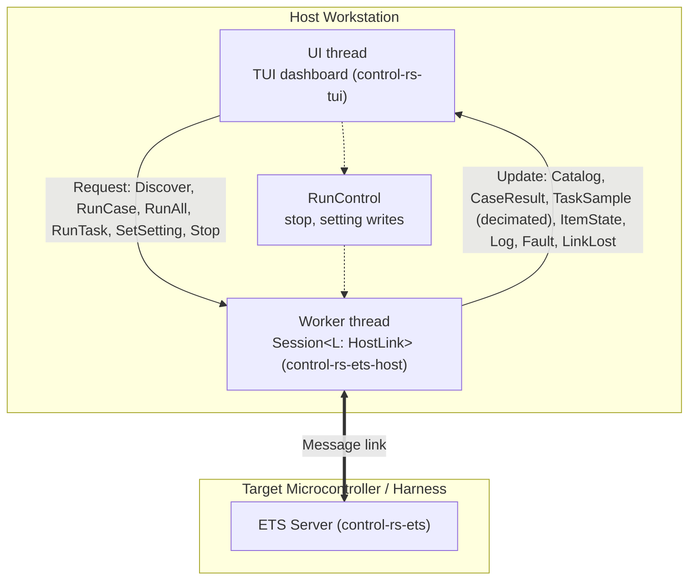

# Terminal User Interface (Design Document)


---

### 1. Introduction

This design document establishes the architecture for `control-rs-tui`, a
standalone Terminal User Interface (TUI) binary designed to control and
monitor on-target Embedded Test Server (ETS) and Hardware-in-the-Loop (HIL)
execution. The TUI provides developers with a dynamic, real-time dashboard
displaying system metadata, test suite namespaces, cycle-level execution
statistics, target logs and online parameter reflection for tuning.

In the single-job executive architecture (ADR-0002), the TUI is a frontend over
one `Session` (`ets-host-design.md`). A worker thread owns the session; the UI
thread sends requests and receives updates, so terminal rendering never
interferes with target execution or a running task.

---

### 2. Requirements

#### 2.1 Functional Requirements

- **FR-1 — Target Metadata Display**: The TUI must query and display target
  board details, core clock frequency, FPU status and debug link parameters,
  consuming `Telemetry::TargetInfo` from the host session.
- **FR-2 — Hierarchical Test Tree**: The interface must present test suites and
  cases in a tree layout mapping the Rust module namespace.
- **FR-3 — Hierarchical Telemetry Table**: For each test, the TUI must display
  cycle count (CYCCNT), duration (µs) and peak stack memory usage.
- **FR-4 — Persistent Log Terminal**: An integrated console window must display
  real-time debug and system logs streaming from the target.
- **FR-5 — Keystroke Controls**: Users must control target execution via
  single-key shortcuts (`f` filter, `r` run all, `p` settings, `s` stop, `q` quit)
  and `Enter` to start the selected case or task.
- **FR-6 — Session liveness**: The dashboard retries discovery until the host
  session reports it complete, and it surfaces target process exit. A QEMU
  boot race or a dead subprocess must not look like an idle empty tree.
- **FR-7 — Setting Console**: The operator can read a setting's name,
  description, type, value and bounds, edit the value in a field parsed from its
  type and write it as a single `SetSetting` by name while idle or between
  steps of an active task, without leaving the dashboard.
- **FR-8 — Online Parameter Tuning Console (withdrawn)**: Withdrawn in revision
  3.0; merged into FR-7.
- **FR-9 — Decoupled Telemetry Consumption**: The TUI must subscribe to
  decimated telemetry samples from the host session, consuming updates
  asynchronously without sitting in the critical simulation path.
- **FR-10 — Tasks Beside Cases**: Lifecycle tasks appear in the test tree beside
  cases with a distinct marker and start like cases; Run all never starts a task.
  During a task the row shows step count, last state and a decimated sample
  readout.
- **FR-11 — Fault and Link Status**: The dashboard shows recorded faults,
  unreported faults and unresponsive runs reported by the session.
- **FR-12 — Release-Paced Task Controls**: The task view starts `Periodic` with
  a period, offers `Triggered` only when the target reports a release source,
  and shows release jitter and missed releases for the run.
- **FR-13 — Multi-Terminal Independent Monitoring**: The TUI and host bridge operate concurrently alongside external serial monitors without port contention, allowing operators to monitor target diagnostic streams in one terminal while driving interactive ETS tests in another.

#### 2.2 Non-Functional Requirements

- **NFR-1 — Diff-only repaint**: An unchanged frame writes nothing to the
  terminal; the write is the buffer diff, and repaint happens only when the
  application asks. A 16 ms / 60 FPS budget is not required.
- **NFR-2 — Metrics Caching**: Test suite results are stored on the host to
  maintain state across target restarts or reconnections.
- **NFR-3 — Non-Intrusive Polling**: The communication driver must poll
  telemetry buffers asynchronously without halting the target CPU.
- **NFR-4 — Simulation Isolation**: TUI rendering freezes, terminal resize
  events, or user input stalls must never backpressure or introduce execution
  jitter into target control or host plant simulation loops.

#### 2.3 Constraints

- **C-1 — Presentation Only Scope**: `control-rs-tui` is strictly a presentation
  frontend; it does not own physical transport, session state machines, framing
  algorithms, or CRC checks, which are wholly delegated to
  `control-rs-ets-host::Session`.
- **C-2 — Single-Session Lifetime**: The binary manages exactly one active
  `Session` at any time.
- **C-3 — Host Environment Constraints**: The crate requires standard terminal
  input/output and ANSI/VT escape sequences, operating under `std`.

---

### 3. Technical Overview

The TUI is implemented as the standalone binary crate `control-rs-tui`. It
runs on the developer's host machine and interfaces with physical
microcontrollers through the `Session` abstraction provided by
`control-rs-ets-host`.

Rendering is immediate mode via `ratatui` (Ratatui, 2026a) backed by `crossterm` (crossterm, 2026). Repaint
is event-driven and diff-only (Ratatui, 2026b).



---

### 4. Architecture

#### 4.1 User Interface Layout

The TUI layout supports toggling between Test Execution and Live Parameter Tuning:

```text
===============================================================================
 TARGET: Teensy 4.0 (Cortex-M7) | LINK: USB CDC (/dev/ttyACM0) | MODE: HIL RUN
===============================================================================
 [ SETTINGS ] (Tab to switch view)
-------------------------------------------------------------------------------
 SUITE / SETTING                   TYPE    VALUE      RANGE / NOTES
 ▼ drone::attitude_gains (setting)
   ├─ kp_pitch                     F32     12.50      [0.0 .. 50.0] Proportional pitch gain
   ├─ kd_pitch                     F32      1.85      [0.0 .. 10.0] Derivative pitch gain
   └─ ki_pitch                     F32      0.10      [0.0 .. 5.0]  Integral pitch gain
 ▼ drone::safety_limits
   ├─ max_tilt_deg                 F32     45.00      Maximum allowed tilt angle
   └─ emergency_stop_enabled       Bool    true       Kill power on link drop
-------------------------------------------------------------------------------
 [ LIVE TELEMETRY ] (Decimated 20 Hz)
  Step: 14,250 | Plant Time: 14.25 s | Pitch Error: -0.02 rad | Jitter: 4.2 µs
-------------------------------------------------------------------------------
 [ TARGET LOGS ] (Autoscroll: ON)
 > [INFO] Lifecycle task initialized. Hardware clamped.
 > [SETTING] attitude_gains.kp_pitch updated: 12.00 -> 12.50
 ===============================================================================
 (f)ilter | (r)un all | (p)settings | (s)top | (q)uit
```

1. **Header Dashboard**: Displays the link, and from the session catalog
   the protocol revision, board ID, core clock (MHz) and FPU class (FR-1).
   A rejected session shows `PROTOCOL MISMATCH` with both revisions. Debug
   link parameters beyond the configured port are not shown.
2. **Hierarchical Metrics Table**: A collapsible tree table showing test
   namespaces, cycle metrics, temporal duration (the target-reported `time_us`,
   passed through unmodified by `control-rs-ets-host`) and peak stack memory usage in
   bytes.
3. **Logs Panel**: A live log terminal streaming output from the target.
4. **Footer Action Bar**: Displays available key shortcuts.

#### 4.2 Host-Target Session Integration

The TUI communicates with target environments via the `Session`
abstraction provided by the `control-rs-ets-host` library crate. That crate is
the sole transport dependency; `ratatui` and `crossterm` stop at this binary
and never enter a headless dependency closure. Two execution targets are
supported:

* **QEMU Emulator (stdio pipe)**: Spawn a local QEMU virtual machine in a
  background child process by running `cargo run --bin ...` inside
  `examples/qemu`, piping stdin, stdout and stderr. (Semihosting is not used
  for data transport; see §5.)
* **Physical Serial Device**: Opens a connection to hardware (such as the Teensy
  4.0 board) over a USB CDC virtual serial port at a configured baud rate (
  defaulting to 115200) using the `serial2` crate.

#### 4.3 Delegated Transport, Framing and Recovery

Frame construction, CRC verification, telemetry deserialization, panic
detection and the reset/reconnect sequence are owned by `control-rs-ets-host`
and specified in `ets-host-design.md`. The worker thread owns the `Session`.
The TUI consumes its updates only:

* `Update::CaseResult` and `Update::Catalog` update the metrics tree.
* `Update::TaskSample` (decimated) and `Update::ItemState` update the task row.
* `Update::Log` appends to the logs panel.
* `Update::Fault` and `Update::LinkLost` surface faults, unreported faults and
  unresponsive runs. After a recovery the local request queue is cleared and the
  tree is re-rendered from the re-issued discovery response, without tearing
  down terminal state.
* `Stop` and mid-run `SetSetting` requests go through the shared `RunControl`,
  so they reach a running task without waiting for the worker.

The TUI holds no framing constants, no CRC parameters and no serial
configuration beyond the link options it forwards to `control-rs-ets-host`.

The loop follows the centralized catching, message passing pattern: events are
polled in one place and dispatched onward (Ratatui, 2026c). The event loop merges incoming
session updates and terminal keystrokes into a single event processing queue.

---

### 5. Alternatives

* **ARM Semihosting**: Rejected. Semihosting relies on triggering target
  software interrupts that halt the CPU core. This introduces millisecond-level
  latencies that violate real-time constraints and mask control-loop timing
  jitter. Additionally, probe-rs has documented register decoding and caching
  bugs during rapid semihosting trap polling.
* **Standard UART Logging**: Rejected. While it operates asynchronously,
  standard serial output lacks structured data capability, rendering
  hierarchical tables, dynamic status overlays and bidirectional control
  vectors impossible without complex custom parsers.
* **Session Logging**: The session sees all traffic between the server
  and the TUI, so it is the natural place to record a session transcript. That
  capability belongs to `control-rs-ets-host`, not to this binary.
* **Process-per-case result model**: Rejected for this dashboard, and noted
  because it is the dominant model elsewhere. `cargo-nextest` isolates each
  test in its own process so that "memory corruption in one test doesn't cause
  others to behave erratically" and "one test segfaulting does not take down a
  bunch of other tests" (nextest, 2026), and reads that process's standard
  output and error directly (nextest, 2026). ETS keeps one persistent target
  process across a suite, so isolation comes from the reset sequence rather
  than from process boundaries, and the console stream is shared. The dashboard
  therefore attributes log lines to the running case by ordering, not by
  stream ownership.

---

### 6. Verification & Validation

#### 6.1 Verification

The implementation must produce evidence that the dashboard renders the target
state it is given, that keystrokes map to the intended commands, that the view
survives a target reset without losing history, and that the binary carries no
transport logic of its own.

| Condition | Requirement | Method | Target | Criterion |
|:----------|:------------|:-------|:-------|:----------|
| VC-1.1 | FR-1 | `libtest` | `control_rs_tui::app::tests::target_info_rendered` | The scripted `Update` stream yields the expected target metadata panel |
| VC-2.1 | FR-2 | `libtest` | `control_rs_tui::app::tests::tree_from_discovery` | Suites, cases and tasks appear in the expected hierarchy |
| VC-3.1 | FR-3 | `libtest` | `control_rs_tui::app::tests::telemetry_table_rows` | Per-case metrics appear under the owning case |
| VC-4.1 | FR-4 | `libtest` | `control_rs_tui::app::tests::log_buffer_order` | Log lines persist in arrival order |
| VC-5.1 | FR-5 | `libtest` | `control_rs_tui::keys::tests::key_to_command` | Each bound key emits its intended command |
| VC-6.1 | FR-6 | `libtest` | `control_rs_tui::app::tests::rediscovery_with_fake_link` | Discovery retries until the host answers, timing asserted over an injected event source |
| VC-7.1 | FR-7 | `libtest` | `control_rs_tui::app::tests::setting_console_edit` | A setting's type, value and bounds render, and an edit emits one `SetSetting` by name with a value of the setting's type |
| VC-9.1 | FR-9 | Static analysis | `cargo tree -p control-rs-tui -e normal` | No framing or serial code in this crate |
| VC-10.1 | FR-10 | `libtest` | `control_rs_tui::app::tests::tasks_beside_cases` | Tasks appear in the tree beside cases and start through the same key |
| VC-11.1 | FR-11 | `libtest` | `control_rs_tui::app::tests::fault_and_link_status` | A recorded fault and link state render in the status area |
| VC-12.1 | FR-12 | `libtest` | `control_rs_tui::app::tests::triggered_hidden_without_release_source` | `Triggered` is not offered for a target without a release source, and missed releases render in the task view |
| VC-21.1 | NFR-1 | `libtest` | `control_rs_tui::render::tests::unchanged_frame_writes_nothing` | Structural buffer diff of identical frames is empty |
| VC-22.1 | NFR-2 | Metamorphic relation | `control_rs_tui::app::tests::reset_preserves_cached_metrics` | Reset then re-discovery leaves cached per-case metrics unchanged |
| VC-23.1 | NFR-3 | `libtest` | `control_rs_tui::app::tests::poll_does_not_block` | Polling returns within the event-loop tick |
| VC-24.1 | NFR-4 | Inspection | resize and render stall during an emulated session | Simulation continues unaffected |
| VC-31.1 | C-1 | Static analysis | dependency tree and source inspection | Presentation only; no transport logic |
| VC-32.1 | C-2 | `libtest` | `control_rs_tui::app::tests::single_session` | A second concurrent session is refused |
| VC-33.1 | C-3 | Inspection | smallest supported terminal size | Layout per §4.1 remains usable |

Target: 70% line coverage of `control-rs-tui`, measured with `cargo coverage`.

Excluded: widget draw calls, which are verified by inspection against §4.1
rather than by assertion; and terminal setup and teardown, which require a
real terminal.

* **Hardware integration run**: Flash a benchmark binary containing the
  mathematical subprograms onto physical target hardware and drive a full
  session interactively, including a deliberate panic and recovery.
* **Emulated session**: Drive the same session against a QEMU target and
  confirm the dashboard is indistinguishable apart from the link description.

#### 6.2 Acceptance

| Claim | Oracle | Measure | Bound |
|:------|:-------|:--------|:------|
| Tree reflects discovery | Scripted discovery response | Suites and cases rendered against those sent | Exact match |
| Telemetry table values | Scripted `RunStats` messages | Cycles, duration and stack rendered against those sent | Exact, no rounding of raw counts |
| Duration derivation | Cycle delta divided by core frequency | Rendered microseconds against the computed value | Within display precision |
| Key bindings | Each bound key | Command emitted | The command named in FR-5 |
| Cache survives reset | Reset injected mid-session | Per-case metrics after re-discovery | Unchanged for completed cases |
| Transport isolation | Source and dependency tree | Framing, CRC or serial code in this crate | None |
| Discovery retry | First `ListSuites` dropped | Suites eventually rendered | Discovery completes |
| Target process exit | Spawned QEMU exits | Dashboard state | Exit surfaced; session not left looking connected |
| Setting description | Key bound to description | Setting text shown | Matches the suite registry |
| Setting console reflects discovery | Scripted `SettingInfo` stream | Names, types, bounds and values rendered | Exact match |
| Live setting update | Edit of a setting value | Emitted `Command::SetSetting` | Exact name and typed value |
| Tasks beside cases | Catalog with cases and a task | Tree rows and Run all request | Task row marked; Run all excludes it |
| Decoupled telemetry ingestion | High-rate incoming stream | Terminal refresh rate and loop non-blocking | Ingests at $\le 30\ \text{Hz}$ without blocking target |

No frame-rate bound is asserted. See §6.3.

#### 6.3 Limits

- **A 16 ms / 60 FPS frame budget is not a requirement of this plan and is
  not measured.** NFR-1 is the diff-only write, discharged by inspection of
  §3. The former 16 ms figure has no source and no measurement method here.
- Terminal emulator compatibility. `crossterm` is cross-platform
  (crossterm, 2026), but only the emulators developers happen to use are
  exercised.
- Behaviour at large suite counts. No bound is stated on how many cases
  the tree can render before layout or scrolling degrades.
- Accessibility. Screen-reader behaviour of a full-screen TUI is not
  considered.
- Log attribution under concurrency. Because ETS shares one console stream
  across a suite, a line emitted by a case that has already ended may render
  under its successor; nothing detects or corrects this.

### 7. Performance & Resource Considerations

* **Host CPU Loading**: The TUI repaints only when new telemetry arrives or
  when the user presses a key, rather than polling in a hot loop. This is
  possible because `ratatui` "only updates when you tell it to"
  (Ratatui, 2026a), and cheap because a repaint writes only the buffer diff
  (Ratatui, 2026b). An idle session with a quiet target therefore costs no host
  CPU.
* **Decoupled Telemetry Rate**: Telemetry frames are consumed from a bounded
  decoupling channel at a rate capped for human perception ($\le 30\ \text{Hz}$),
  dropping or skipping intermediate samples so that rendering cost does not scale
  with simulation step rate ($\ge 1\ \text{kHz}$).

---

### 8. Risks & Open Questions

* **Maintenance surface**: The dashboard is the largest host-side component by
  line count and the least covered by automated tests, since rendering is
  verified by inspection rather than assertion. The mitigation is to keep the
  binary thin: state and protocol handling belong to `control-rs-ets-host`, and
  this crate holds layout and input handling only.

---

### 9. Development Plan

| Phase | Delivers | Requirements | Effort | Status |
|:------|:---------|:-------------|:-------|:-------|
| 1. Interface, session connection and controls | `ratatui` layout panels, `Session` on a worker thread, keystroke handlers | FR-1 to FR-5, C-1 | Shipped | Complete |
| 2. Session liveness and settings | Discovery retry on the headless interval, process exit, reset delay before re-open, setting description and `SetSetting` | FR-6, FR-7, FR-11 | 1.0 day | Planned |
| 3. Setting console, task row and decoupled telemetry | Type-driven setting console, task row beside cases and the decimated update queue | FR-7, FR-9, FR-10, NFR-4 | 2.0 days | Planned |
| 4. Release-paced task controls | `Periodic` with a period, `Triggered` only with a target release source, release jitter and missed releases | FR-12 | 0.5 day | Planned |

---

### 10. Revision History

| Revision | Date           | Author          | Description                                                                                                                 |
|:---------|:---------------|:----------------|:----------------------------------------------------------------------------------------------------------------------------|
| 1.0      | May 24, 2026   | @MitchellDScott | Initial specification for interactive terminal user interface (TUI) test dashboard.                                         |
| 1.1      | July 18, 2026  | @MitchellDScott | Architecture & transport: added Ratatui layout, `ServerBridge` async polling channels, and Teensy 4.1 hardware integration. |
| 1.2      | August 6, 2026 | @MitchellDScott | Protocol alignment: synchronized interactive command schemas with shipped postcard framing and reconnection lifecycles.     |
| 1.3      | September 9, 2026 | @MitchellDScott | Packaging split: promoted TUI to standalone `control-rs-tui` binary crate consuming `control-rs-ets-host::ServerBridge`.   |
| 1.4      | September 9, 2026 | @MitchellDScott | Crate split: relocated to `documentation/tui/`; framing, panic detection and reconnection delegated to `control-rs-ets-host`. |
| 1.5      | September 9, 2026 | @MitchellDScott | Evidence pass: added the research pair and citation layer, grounded the rendering and repaint claims, added the process-per-case alternative, restructured §6 per `vv-standards.md`, and moved the unverified 16 ms budget to 6.7. |
| 1.6      | September 9, 2026 | @MitchellDScott | Hardening pass: numbered §2.1–§2.3 and added §2.3 Constraints (C-1..C-3), mapped TargetInfo in FR-1, corrected bridge diagram link, completed 6.4 traceability, and standardized References. |
| 1.7      | September 15, 2026 | @MitchellDScott | NFR-1 is diff-only repaint; 16 ms budget is not a requirement and is not traced. |
| 1.8      | September 16, 2026 | @MitchellDScott | FR-6 session liveness, FR-7 suite setting inspection and edit; 6.2 discovery/exit/setting rows; §9 Step 4. |
| 1.9      | September 18, 2026 | @MitchellDScott | Packaging alignment: updated host bridge references to `control-rs-ets-host::ETSBridge`. |
| 1.10      | September 24, 2026 | @MitchellDScott | Duration column shows the target-reported `time_us`; §6.3 reference corrected. |
| 1.11     | September 24, 2026 | @MitchellDScott | FR-1 header shows `TargetInfo` protocol, board, clock and FPU, or the protocol mismatch. |
| 1.12     | September 28, 2026 | @MitchellDScott | The event loop takes its input from an injected event source (the terminal is the production source) and the discovery retry decision is a pure function, so the loop is testable without a terminal. |
| 2.0      | October 11, 2026 | @MitchellDScott | Overhaul for unified ETS and HIL (ADR-0002): added parameter tuning console (FR-8), decoupled telemetry consumption (FR-9), simulation isolation invariant (NFR-4), and parameter inspection layout. |
| 3.0      | October 12, 2026 | @MitchellDScott | Frontend over `Session` on a worker thread: FR-7 reworded as the setting console, FR-8 withdrawn and merged into FR-7, FR-10 and FR-11 added, C-1 and C-2 name `Session`. |
| 3.1 | October 12, 2026 | @MitchellDScott | Converted numeric citations to author-year; FR-12 added for `Periodic` and `Triggered` controls. |
| 3.2 | October 12, 2026 | @MitchellDScott | Setting console edits named primitive settings by type: FR-7 reworded. |
| 3.3 | October 12, 2026 | @MitchellDScott | Bridge, `MetricReport` and `TaskState` references replaced with `control-rs-ets-host`, `RunStats` and `ItemState`. |
| 3.4 | October 12, 2026 | @MitchellDScott | Development plan in the standard phase table. |
| 3.5 | October 12, 2026 | @MitchellDScott | FR-11 in the development plan; `Session<L: HostLink>`. |
| 3.6 | October 13, 2026 | Claude Sonnet 5.5 | Header migrated to the Approval and Doc Status badge grammar; Approval set to Stale pending re-review. Affects C-1, C-2, C-3, FR-1, FR-2, FR-3, FR-4, FR-5, FR-6, FR-7, FR-8, FR-9, FR-10, FR-11, FR-12, FR-13, NFR-1, NFR-2, NFR-3, NFR-4. |

---

## References

[1] Ratatui contributors, "Rendering," *Ratatui documentation, Concepts*.
[Online]. Available: https://ratatui.rs/concepts/rendering/. Accessed:
Sep. 9, 2026.

[2] crossterm contributors, *crossterm*: pure-Rust cross-platform terminal
manipulation library. [Online]. Available: https://docs.rs/crossterm.
Accessed: Sep. 9, 2026.

[3] Ratatui contributors, *ratatui*: terminal user interface library.
[Online]. Available:
https://docs.rs/ratatui/latest/ratatui/terminal/struct.Terminal.html. Accessed:
Sep. 9, 2026.

[4] Ratatui contributors, "Event handling," *Ratatui documentation, Concepts*.
[Online]. Available: https://ratatui.rs/concepts/event-handling/. Accessed:
Sep. 9, 2026.

[5] nextest contributors, "Why process-per-test," *cargo-nextest
documentation*. [Online]. Available:
https://nexte.st/docs/design/why-process-per-test/. Accessed: Sep. 9, 2026.
