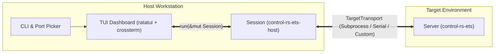

# Terminal User Interface (tui)


---

### 1. Introduction

`control-rs-tui` provides an interactive terminal user interface (TUI) for
monitoring, configuring, and driving on-target Embedded Test Server
(`control-rs-ets`) targets. Running on a host workstation, it interfaces
directly with the target runtime through the unified `Session` abstraction
provided by `control-rs-ets-host`. The TUI furnishes embedded developers with a
high-density real-time dashboard displaying target platform metadata,
hierarchical test suites and continuous lifecycle tasks, cycle-accurate execution
statistics, a live target console log viewer, and an interactive parameter tuning
console.

Prior revisions routed communication through an intermediate `ETSBridge`
background thread pair, an action-queue dispatch layer (`SessionAction`), and
per-run wrapper types (`CaseRun`, `TaskRun`). In accordance with `ADR-0002` and
the host ETS redesign (`ets-host-design.md`), this design eliminates the
intermediate bridge threads, action queues, run wrappers, and obsolete settings
types. `control-rs-tui` consumes `Session` directly within a single-threaded
event loop driven by synchronous polling ticks. The crate maintains strictly
zero compile-time hardware feature flags, allowing a single host binary or
library entrypoint to seamlessly control emulated targets (such as QEMU child
processes), physical microcontroller boards (such as USB CDC serial devices), and
custom stdio streams.

Primary usage scenarios:

- **Interactive test suite & task execution**: A developer connects the TUI to a
  running target over serial or an emulated QEMU instance, inspects discovered
  suites, atomic cases, and continuous lifecycle tasks, triggers targeted or batch
  runs, and monitors real-time pass/fail outcomes, cycle counts (CYCCNT), execution
  durations (µs), and peak stack memory usage.
- **Live parameter inspection and tuning**: The operator navigates the parameter
  catalog exposed by discovered suites, inspects parameter types, descriptions,
  and bounds, mutates numerical values in real time (`Session::set_param`), and
  observes live target response, with all mutations transparently preserved and
  re-applied by `Session` across target reboots.
- **Continuous lifecycle task supervision**: An engineer monitors long-running or
  rate-driven `LifecycleTask` routines (such as feedback controllers or state
  estimators) operating under lockstep, free-running, or periodic modes, observing
  step jitter, loop cycle execution envelopes, and state transitions.
- **Fault containment and manual recovery**: When an on-target assertion or
  hardware fault triggers a panic (`Telemetry::TargetPanic`, `Telemetry::FaultReport`)
  or communication dropout, the TUI surfaces the captured panic backtrace and fault
  diagnostics without losing prior test outcomes, and enables manual or automated
  target reset and re-discovery (`Session::reset_and_reconnect`).
- **Universal target connection & port discovery**: A user launches the dashboard
  from the terminal using CLI shortcuts (`--serial`, `qemu <arch>`, `--spawn`),
  leveraging an interactive port picker to select attached serial hardware without
  requiring hardcoded path configuration or platform-specific builds.

---

### 2. Requirements

#### 2.1 Functional Requirements

- **FR-1 — Target Metadata & Link Display**: The dashboard must query and display
  target platform metadata (board identifier, CPU clock frequency in MHz, FPU
  capabilities, Wire protocol revision) and connection transport status, consuming
  `Session::target_info()` and reporting active reset counts.
- **FR-2 — Hierarchical Suite, Case & Task Tree**: The interface must present
  discovered test suites, atomic test cases, and continuous lifecycle tasks in a
  navigable, collapsible tree layout mapping the Rust module namespace.
- **FR-3 — Execution & Cycle Telemetry Table**: For each test case and lifecycle
  task, the interface must display status (Pending, Running, Pass, Fail), cycle
  count (CYCCNT), elapsed duration (µs), peak stack memory consumption (bytes),
  and step jitter (for tasks).
- **FR-4 — Live Target Console Terminal**: An integrated console window must
  stream and render raw target console logs received from `SessionEvent::Console`
  without disrupting dashboard layout or table alignment.
- **FR-5 — Interactive Keystroke Controls**: The interface must process
  single-key shortcuts to execute selected/all test cases, toggle lifecycle tasks,
  open the parameter console, trigger target reset and re-discovery, filter items,
  and quit.
- **FR-6 — Live Parameter Console**: The interface must present discovered
  parameter metadata (name, description, type, default, min/max bounds) and allow
  live editing of parameter values, dispatching mutations via `Session::set_param`
  and relying on `Session` parameter caching across target resets.
- **FR-7 — Continuous Lifecycle Task Stepping & Monitoring**: The interface must
  support starting, toggling, and monitoring `LifecycleTask` routines in
  lockstep, free-running, or periodic modes, displaying cycle metrics and step
  jitter.
- **FR-8 — Fault Diagnostics & Panic Containment**: The interface must surface
  target panics, hardware fault reports, and transport disconnects, attributing
  failures to the active case or task while preserving prior test results, and
  provide manual target reset and reconnection (`Session::reset_and_reconnect`).
- **FR-9 — Universal Transport CLI & Interactive Port Picker**: The binary must
  accept `--serial`, `--port`, `--baud`, `qemu <arch>`, and `--spawn` arguments
  without hardware compile-time feature flags, providing an interactive terminal
  selection menu when `--serial` is specified without a port.
- **FR-10 — Library Run Entrypoint**: The crate must export a public library
  function `control_rs_tui::run(session: &mut Session)` that executes the terminal
  dashboard over a caller-supplied host session.

#### 2.2 Non-Functional Requirements

- **NFR-1 — Diff-Only Repaint**: Rendering must compute buffer diffs via
  `ratatui` double buffering, writing only modified terminal cells and avoiding CPU
  overhead during idle or unchanged frames.
- **NFR-2 — Metrics & Log Retention**: Test suite results, task execution
  summaries, and console logs must be cached in memory across target restarts,
  reconnections, or manual resets within the session.
- **NFR-3 — Non-Blocking Event Integration**: Terminal input polling and
  `Session` polling must execute synchronously within a single event loop tick
  without starving user input responsiveness or stalling target communication.

#### 2.3 Constraints

- **C-1 — Presentation Only Scope**: `control-rs-tui` is strictly a presentation
  and input frontend; all transport I/O, framing, CRC-16 checks, protocol
  handshakes, and parameter mutation caching are delegated to
  `control-rs-ets-host::Session`.
- **C-2 — Single Active Session**: The TUI manages exactly one active `Session`
  lifecycle per execution.
- **C-3 — Zero Hardware Feature Flags**: The crate must compile on standard host
  platforms under `std` with zero microcontroller or hardware-specific feature flags.

---

### 3. Technical Overview

The TUI is implemented in `control-rs-tui` as a hybrid library and standalone
binary. It operates on the developer's workstation, directly driving an on-target
Embedded Test Server (`control-rs-ets`) through the `Session` abstraction provided
by `control-rs-ets-host`.

Rendering is immediate mode: "In `ratatui`, every frame draws the UI anew"
[1], in contrast to a retained-mode toolkit where widgets are created once and
mutated [1]. The repaint cost this implies is bounded by double-buffering diffs:
changes accumulate in a working buffer, and "at the end of each draw pass, the
two buffers are compared, and only the changes between these buffers are written
to the terminal, avoiding any redundant operations" [2]. A full-screen redraw of
an unchanged frame writes zero bytes to the terminal device. Furthermore,
`ratatui` "only updates when you tell it to" [1], enabling the synchronous
event-driven loop of §4.3.

Terminal manipulation and raw keyboard input handling are powered by `crossterm`,
"a pure-rust, terminal manipulation library that makes it possible to write
cross-platform text-based interfaces" [3].

The event architecture adopts the centralized catching and message passing pattern:
events are polled from input devices and communication streams in a single
coordinated loop and dispatched onward [4]. Unlike process-per-test runners such
as `cargo-nextest` where every test executes in an isolated process to prevent
corruption [5], the ETS target is a persistent embedded firmware server.
Fault containment and isolation are managed through structured protocol recovery
and hardware reset sequences rather than process boundaries [5].



---

### 4. Architecture

`control-rs-tui` is organized into the following module hierarchy:

| Module       | Responsibility                                                                                |
|:-------------|:----------------------------------------------------------------------------------------------|
| `app`        | Application state machine, tree selection, metrics cache, and log history buffer.            |
| `view`       | Immediate-mode UI layout rendering: Header, Metrics Table, Parameter Drawer, Logs, Footer.    |
| `event`      | Event loop merging `crossterm` input polling and `Session::poll` telemetry ticks.             |
| `param`      | Parameter console state, value editing modal, bounds checking, and mutation submission.       |
| `target_sel` | CLI parsing, serial port discovery (`serial2`), interactive menu, and target instantiation.   |
| `error`      | `TuiError` enum with typed error definitions.                                                 |

#### 4.1 Visual Panels & Layout

Serves: FR-1, FR-2, FR-3, FR-4, FR-8

The interface partitions the terminal into four primary regions designed to
maximize developer situational awareness during test and tuning runs:

```text
====================================================================================================
 TARGET: Teensy 4.0 (Cortex-M7, 600 MHz) | LINK: USB CDC (/dev/ttyACM0) | RESETS: 0 | PROTOCOL: v2
====================================================================================================
 NAME                                      KIND   STATUS   CYCLES      TIME       STACK    JITTER
 ▼ control_rs::math
   ├─ contiguous_storage_alloc             CASE   PASS     1,204       2.00µs     32 B     ---
   ├─ noncontiguous_storage_dma            CASE   PASS     3,410       5.68µs     64 B     ---
 ▼ control_rs::control::biquad
   ├─ biquad_direct_form_2                 CASE   PASS     845         1.41µs     48 B     ---
   ├─ biquad_filter_loop                   TASK   RUNNING  420,100     700.1µs    128 B    ±1.2µs
 ▼ control_rs::estimation::ekf
   ├─ attitude_estimator_step              TASK   IDLE     ---         ---        ---      ---
----------------------------------------------------------------------------------------------------
 [ TARGET CONSOLE LOGS ] (Autoscroll: ON)
 > [INFO] Target boot: Teensy 4.0 (ARM Cortex-M7 @ 600 MHz, FPU: Hard VFPv5-D16)
 > [INFO] Discovered 3 suites, 4 cases, 2 tasks, 5 parameters.
 > [PASS] biquad::biquad_direct_form_2: completed in 845 cycles (1.41 µs)
====================================================================================================
 (r)un case | (t)ask toggle | (p)arams | (x) reset | (f)ilter | (c)lear | (q)uit
====================================================================================================
```

1. **Header Dashboard (FR-1, FR-8)**: Displays board ID, CPU architecture, clock
   frequency (MHz), FPU class, Wire protocol version (`v2`), active transport link,
   and accumulated reset count from `Session::target_info()`. If protocol version
   negotiation fails, the header displays `PROTOCOL MISMATCH`.
2. **Hierarchical Metrics Table (FR-2, FR-3)**: A collapsible tree table
   presenting discovered suites, atomic test cases, and continuous lifecycle tasks.
   Displays execution status (`PENDING`, `RUNNING`, `PASS`, `FAIL`), cycle count,
   duration (µs), peak stack memory usage, and step jitter (for tasks).
3. **Target Console Logs (FR-4)**: A console window streaming target log
   lines and panic backtraces received via `SessionEvent::Console`. Supports
   autoscroll and manual scrolling.
4. **Footer Action Bar (FR-5)**: Displays active single-key shortcuts and contextual
   hints based on the active selection and modal state.

#### 4.2 Application State Machine & Metrics Cache

Serves: FR-2, FR-3, FR-6, NFR-2

The central application state struct `App` maintains in-memory metadata, execution
histories, and view states across target resets:

```rust
use std::collections::BTreeMap;
use control_rs_ets::comms::{ParamValue, TestState};
use control_rs_ets_host::session::{CaseInfo, ParamInfo, SuiteInfo, TargetInfo, TaskInfo};

/// Selectable item within the hierarchical navigation tree.
#[derive(Debug, Clone, PartialEq, Eq)]
pub enum TreeItem {
    Suite { suite_id: u16, name: String, expanded: bool },
    Case { suite_id: u16, case_id: u16, name: String },
    Task { suite_id: u16, task_id: u16, name: String },
}

/// Recorded outcome and profiling metrics for a test case.
#[derive(Debug, Clone)]
pub struct CaseMetrics {
    pub status: TestState,
    pub cycles: Option<u64>,
    pub time_us: Option<u64>,
    pub stack_bytes: Option<u32>,
}

/// Dynamic execution metrics for a continuous lifecycle task.
#[derive(Debug, Clone)]
pub struct TaskMetrics {
    pub running: bool,
    pub cycles: Option<u64>,
    pub time_us: Option<u64>,
    pub jitter_ns: Option<u32>,
}

/// Central application state for the TUI dashboard.
pub struct App {
    pub target_info: Option<TargetInfo>,
    pub suites: Vec<SuiteInfo>,
    pub tree_items: Vec<TreeItem>,
    pub selected_index: usize,
    pub case_metrics: BTreeMap<(u16, u16), CaseMetrics>,
    pub task_metrics: BTreeMap<(u16, u16), TaskMetrics>,
    pub params: BTreeMap<(u16, u16), (ParamInfo, ParamValue)>,
    pub console_logs: Vec<String>,
    pub autoscroll_logs: bool,
    pub log_scroll_offset: usize,
    pub param_modal_open: bool,
    pub selected_param_index: usize,
    pub filter_query: String,
    pub resets_observed: u32,
    pub should_quit: bool,
}
```

When discovery completes or is refreshed after a target reset, `App::rebuild_tree`
populates `tree_items` and updates `params`. Completed `CaseMetrics` and
`console_logs` are preserved in `App` across resets (NFR-2), ensuring that
collected test metrics remain intact.

#### 4.3 Direct Session Polling & Event Loop

Serves: FR-5, FR-7, FR-8, NFR-1, NFR-3, C-1, C-2

The TUI event loop operates synchronously without intermediary background threads.
A single thread coordinates keyboard events from `crossterm` and incoming
telemetry events from `Session::poll`:

```rust
use std::time::{Duration, Instant};
use crossterm::event::{self, Event as CEvent, KeyCode, KeyEvent};
use control_rs_ets_host::session::{Session, SessionError, SessionEvent};
use control_rs_ets::comms::Telemetry;

/// Drives the interactive event loop to completion.
pub fn run_event_loop(
    terminal: &mut ratatui::Terminal<impl ratatui::backend::Backend>,
    session: &mut Session,
    app: &mut App,
    tick_rate: Duration,
) -> Result<(), TuiError> {
    let mut last_tick = Instant::now();

    while !app.should_quit {
        terminal.draw(|f| view::render_ui(f, app))?;

        let timeout = tick_rate
            .checked_sub(last_tick.elapsed())
            .unwrap_or_else(|| Duration::from_millis(0));

        if event::poll(timeout)? {
            if let CEvent::Key(key) = event::read()? {
                handle_key_event(app, session, key)?;
            }
        }

        if last_tick.elapsed() >= tick_rate {
            // Poll incoming target telemetry and console logs
            while let Some(event) = session.poll()? {
                handle_session_event(app, event);
            }
            last_tick = Instant::now();
        }
    }
    Ok(())
}
```

`SessionEvent` variants handled by the loop:

- `SessionEvent::Telemetry(telem)`: Updates case metrics (`Telemetry::MetricReport`,
  `Telemetry::TestOutcome`), task summaries (`Telemetry::TaskSummary`), parameter
  acknowledgements (`Telemetry::ParamUpdated`), or fault diagnostics
  (`Telemetry::TargetPanic`, `Telemetry::FaultReport`).
- `SessionEvent::Console(text)`: Appends incoming console lines to `app.console_logs`.
- `SessionEvent::Disconnected`: Marks link status as disconnected and prompts
  reconnection.
- `SessionEvent::Reconnected`: Updates `app.target_info` and increments `resets_observed`.

#### 4.4 Live Parameter Console & Mutation Caching

Serves: FR-6

Pressing `p` toggles the parameter console drawer. The drawer presents a table of
all parameters registered across discovered suites:

```text
+--------------------------------------------------------------------------------------------------+
| PARAMETER TUNING CONSOLE                                                            [Esc: Close] |
+--------+----------+-----------------------+--------+---------+---------+---------+---------------+
| SUITE  | PARAM ID | NAME                  | TYPE   | VALUE   | DEFAULT | BOUNDS  | DESCRIPTION   |
+--------+----------+-----------------------+--------+---------+---------+---------+---------------+
| 0      | 1        | kp                    | f64    | 2.500   | 1.000   | 0..100  | Proportional  |
| 0      | 2        | ki                    | f64    | 0.100   | 0.050   | 0..10   | Integral gain |
| 1      | 1        | cutoff_freq           | u32    | 1000    | 500     | 10..50k | Lowpass Hz    |
+--------+----------+-----------------------+--------+---------+---------+---------+---------------+
 [Enter] Edit Value | [r] Revert to Default | [Up/Down] Select Parameter
```

When an operator edits a parameter value:

1. The TUI validates the typed input string against the parameter's `ParamType`
   (for example, `i32`, `u32`, `f64`) and declared min/max bounds.
2. The TUI calls `session.set_param(suite_id, param_id, new_value)`.
3. `Session` transmits `Command::WriteParam` to the target and caches the mutation
   in `session.param_mutations`.
4. Upon receiving `Telemetry::ParamUpdated`, the TUI updates the displayed value in
   `app.params`.
5. If the target firmware resets or crashes subsequently, `Session` automatically
   re-transmits all cached parameter mutations during reconnection (FR-5 of
   `ets-host-design.md`), preserving the operator's tuning state transparently.

#### 4.5 Lifecycle Task Monitoring & Controls

Serves: FR-7

`LifecycleTask` entries appear alongside test cases in the navigation tree.
Selecting a task and pressing `t` commands `session.start_task(suite_id, task_id, mode)`.
While running, `Session` polls `Telemetry::TaskSample` frames; on stop (`t`),
`session.stop_task()` settles task state and returns a `TaskSummary` containing:

- Execution cycle count.
- Elapsed duration (µs).
- Step jitter statistics (standard deviation in nanoseconds).
- Peak stack memory usage.

These metrics are updated in `app.task_metrics` and rendered directly in the
hierarchical table.

#### 4.6 CLI Options, Interactive Port Picker & Library Entrypoint

Serves: FR-9, FR-10, C-3

`control-rs-tui` exposes both an executable binary entrypoint and a reusable
library function:

```rust
use control_rs_ets_host::session::Session;
use control_rs_ets_host::target::Target;

/// Library entrypoint: runs the interactive TUI over an open host session.
pub fn run(session: &mut Session) -> Result<(), TuiError>;

/// Entrypoint with CLI target resolution: opens a session and runs the TUI.
pub fn run_with_target(target: Target) -> Result<(), TuiError>;
```

The CLI binary parses arguments with zero hardware feature flags:

```text
Usage: control-rs-tui [OPTIONS] [COMMAND]

Commands:
  qemu <ARCH>           Spawn a target QEMU instance (e.g. arm, riscv32)

Options:
  -s, --serial          Connect over serial (launches port picker if --port omitted)
  -p, --port <PORT>     Serial device path (e.g. /dev/ttyACM0, COM3)
  -b, --baud <BAUD>     Serial baud rate [default: 115200]
      --spawn <CMD...>  Spawn a custom subprocess target communicating via stdio
  -h, --help            Print help
```

**Interactive Serial Port Picker (FR-9)**:
When `--serial` is passed without an explicit `--port` argument, `control-rs-tui`
enumerates available serial ports using `serial2::SerialPort::available_ports()`,
formats device paths and USB vendor/product IDs, and presents an interactive
terminal picker before initializing the session:

```text
================================================================================
 SELECT TARGET SERIAL PORT
================================================================================
 > [1] /dev/ttyACM0 — Teensy 4.0 (USB VID: 0x16C0, PID: 0x0483)
   [2] /dev/ttyUSB0 — ESP32-C6 USB JTAG/Serial (USB VID: 0x303A, PID: 0x1001)
   [3] /dev/ttyAMA0 — Broadcom PL011 UART
================================================================================
 Use [Up/Down] to navigate, [Enter] to select, [q] to cancel.
```

#### 4.7 Error Handling

Serves: NFR-3

Errors encountered during TUI execution are encapsulated in `TuiError`:

```rust
use thiserror::Error;
use control_rs_ets_host::error::SessionError;

#[derive(Debug, Error)]
pub enum TuiError {
    #[error("Terminal I/O failure: {source}")]
    TerminalIo {
        #[from]
        source: std::io::Error,
    },

    #[error("Host session communication error: {source}")]
    Session {
        #[from]
        source: SessionError,
    },

    #[error("Failed to enumerate serial ports: {0}")]
    PortEnumeration(String),

    #[error("No serial ports available for interactive selection")]
    NoPortsAvailable,

    #[error("Invalid parameter value for {param_name}: {reason}")]
    InvalidParamValue {
        param_name: String,
        reason: String,
    },
}
```

#### 4.8 Dependencies

Third-party dependencies utilized by `control-rs-tui`:

| Dependency            | Version | Usage                                                              |
|:----------------------|:--------|:-------------------------------------------------------------------|
| `ratatui`             | `0.30`  | Immediate-mode terminal user interface and diff-buffered widgets.  |
| `crossterm`           | `0.29`  | Pure-Rust cross-platform terminal control and event handling.      |
| `serial2`             | `0.2`   | Serial port discovery for the interactive port picker.            |
| `thiserror`           | `2.0`   | Structured typed error declarations.                               |
| `control-rs-ets`      | `0.1`   | Wire protocol types (`Command`, `Telemetry`, `ParamValue`).        |
| `control-rs-ets-host` | `0.1`   | Unified `Session` and target transport orchestration runtime.      |

---

### 5. Alternatives

- **Direct Synchronous `Session::poll` vs Multi-Threaded Channel Bridge**:
  Prior revisions used an `ETSBridge` background thread pair communicating over
  crossbeam channels. While this decoupled I/O from rendering, it introduced
  complex thread synchronization, shutdown race conditions during target crashes,
  and unnecessary buffer allocations. Direct synchronous integration with
  `Session::poll` simplifies the architecture, guarantees deterministic execution
  ordering, and eliminates thread teardown deadlocks while easily satisfying
  render responsiveness.
- **Immediate-Mode Diff Buffering vs Retained Widget Tree**:
  Retained-mode UI architectures require manual state synchronization and cache
  invalidation between host models and UI widgets. `ratatui`'s immediate-mode
  model [1] recalculates layout every frame while relying on double-buffering diffs
  to ensure zero-cost terminal updates on unchanged frames [2]. This avoids
  retained-tree complexity while maintaining high performance.
- **Unified Hierarchy (Suites, Cases, Tasks) vs Partitioned Multi-Tab Views**:
  Partitioning test cases and lifecycle tasks into separate tabs was considered.
  However, embedded control testing routinely involves running atomic unit cases
  followed by continuous control loop tasks on the same peripheral. A unified
  collapsible tree presents a cohesive architectural view of target capabilities
  on a single screen.
- **Interactive Serial Port Picker vs Strict CLI Configuration**:
  Requiring explicit `--port /dev/ttyACM0` flags forces users to run external
  tools (`dmesg`, `ls /dev`) to identify device endpoints. Implementing an
  interactive serial picker within `control-rs-tui` streamlines developer
  experience when multiple development boards are connected, without requiring
  platform-specific dependencies.
- **Persistent Embedded Server vs Process-Per-Test Isolation**:
  General software test runners (such as `cargo-nextest`) isolate each test in a
  distinct host process to contain segfaults [5]. On bare-metal microcontrollers,
  spawning a new process per test is impossible. ETS utilizes a persistent server
  with structured panic detection and hardware reset recovery (`Session::reset_and_reconnect`)
  to achieve test isolation without process-per-test overhead.

---

### 6. Verification & Validation

#### 6.1 Verification Table

| Condition | Requirement | Method    | Target                             | Criterion                                                                                           |
|:----------|:------------|:----------|:-----------------------------------|:----------------------------------------------------------------------------------------------------|
| VC-1.1    | FR-1        | test      | `tests::verify_metadata_display`   | Target board ID, clock, FPU flags, and protocol revision render matching `target_info`; FR-1 holds. |
| VC-2.1    | FR-2        | test      | `tests::verify_tree_hierarchy`     | Suites, cases, and tasks render in a collapsible tree matching module namespaces; FR-2 holds.       |
| VC-3.1    | FR-3        | test      | `tests::verify_telemetry_table`    | CYCCNT, duration (µs), and stack bytes render matching received `MetricReport` packets; FR-3 holds. |
| VC-4.1    | FR-4        | test      | `tests::verify_console_streaming`  | Log strings received via `SessionEvent::Console` append to log buffer without table disruption; FR-4 holds. |
| VC-5.1    | FR-5        | test      | `tests::verify_keystroke_mapping`  | Keys `r`, `t`, `p`, `x`, `f`, `c`, `q` dispatch corresponding session actions; FR-5 holds.          |
| VC-6.1    | FR-6        | test      | `tests::verify_parameter_console`  | Parameter editing dispatches `Session::set_param`, preserving mutations across simulated resets; FR-6 holds. |
| VC-7.1    | FR-7        | test      | `tests::verify_task_monitoring`    | Starting and stopping a task updates status and renders summary cycle/jitter metrics; FR-7 holds.   |
| VC-8.1    | FR-8        | test      | `tests::verify_fault_containment`  | Target panic frames render diagnostic backtrace while preserving prior test outcomes; FR-8 holds.   |
| VC-9.1    | FR-9        | test      | `tests::verify_cli_and_picker`     | CLI parses all target options; picker enumerates available serial ports; FR-9 holds.               |
| VC-10.1   | FR-10       | test      | `tests::verify_library_entrypoint` | `control_rs_tui::run` executes over a mock session and exits cleanly on quit; FR-10 holds.         |
| VC-11.1   | NFR-1       | review    | —                                  | Redraw pass writes only modified cells via `ratatui` double buffering; NFR-1 holds.                |
| VC-12.1   | NFR-2       | test      | `tests::verify_metrics_retention`  | Reset event clears pending queue but retains completed case metrics and logs; NFR-2 holds.         |
| VC-13.1   | NFR-3       | test      | `tests::verify_event_nonblocking`  | Event loop tick completes within specified tick duration without hanging; NFR-3 holds.              |
| VC-14.1   | C-1         | analysis  | —                                  | `control-rs-tui` contains zero framing, CRC, or transport deserialization logic; C-1 holds.        |
| VC-15.1   | C-2         | review    | —                                  | Application state maintains exactly one active `Session` reference; C-2 holds.                      |
| VC-16.1   | C-3         | analysis  | —                                  | `cargo tree -p control-rs-tui` confirms zero target-specific compile flags or crates; C-3 holds.   |

Line coverage target: $\ge 70\%$ for `control-rs-tui`, measured with `cargo coverage`.
Widget draw routines are verified by inspection and automated headless terminal buffer tests.

#### 6.2 Acceptance Criteria

| Claim                         | Oracle                          | Measure                         | Bound                            |
|:------------------------------|:--------------------------------|:--------------------------------|:---------------------------------|
| Tree reflects discovery       | Scripted discovery response     | Rendered tree nodes vs received | Exact 1:1 match                  |
| Metric report fidelity        | Injected `MetricReport` frames  | Displayed cycles, µs, stack     | Exact, zero count distortion     |
| Duration calculation          | Cycle count / Core clock MHz    | Displayed microsecond value     | $\pm 0.01$ µs rounding precision |
| Parameter mutation round-trip | Dispatched `WriteParam` frames  | Target received value vs input  | Exact equality                   |
| Diff-only redraw overhead     | Terminal draw buffer comparison | Bytes written on idle frame     | Exactly 0 bytes                  |
| Metrics retention on reset    | Simulated target crash & reset  | Retained test outcome records   | 100% preservation of prior cases |
| Transport isolation           | Dependency tree inspection      | Framing or CRC crates in TUI    | Exactly 0 foreign comms crates   |

#### 6.3 Limits

- **Terminal size threshold**: The interface requires a minimum terminal geometry
  of $80 \times 24$ cells. Windows below this resolution truncate table columns
  gracefully without panicking.
- **High-throughput log flooding**: Console log buffer history is capped at 10,000 lines
  to prevent unbounded memory consumption during continuous streaming.
- **Screen-reader accessibility**: Full-screen immediate-mode ANSI terminal
  interfaces have limited screen-reader support; accessibility is bounded by
  underlying terminal emulator translation.

---

### 7. Performance & Resource Considerations

- **Host CPU Loading**: The event loop sleeps on `crossterm::event::poll(tick_rate)`.
  When no user input arrives and the target is idle, CPU utilization is virtually
  zero ($\le 0.1\%$).
- **Terminal Diff-Buffering**: By leveraging `ratatui`'s double-buffered rendering
  model [1], [2], screen updates modify only dirty terminal cells. Even over remote
  SSH links, network bandwidth remains minimal.
- **Memory Footprint**: Total heap allocation for `control-rs-tui` remains under
  15 MB for suites with up to 500 cases and a 10,000-line log history.

---

### 8. Risks & Open Questions

- **High-frequency telemetry saturation**: In `FreeRunning` lifecycle tasks,
  targets may generate thousands of samples per second. The TUI coalesces metric
  redraws to the configured tick rate (for example, 50 ms), preventing terminal rendering
  bottlenecks.
- **Serial port disconnection during interactive session**: If a physical USB
  cable is detached, `Session::poll` reports `SessionEvent::Disconnected`. The
  TUI transitions to a disconnected visual overlay and prompts the user to
  re-attach the device.

---

### 9. Development Plan

| Phase                                   | Delivers                                                                        | Requirements                     | Effort | Status  |
|:----------------------------------------|:--------------------------------------------------------------------------------|:---------------------------------|:-------|:--------|
| 1. Direct Session & Layout Skeleton     | Consolidate TUI on `Session`, remove `ETSBridge`, implement Header, Table, Logs | FR-1, FR-2, FR-3, FR-4, FR-10, NFR-1, C-1, C-2 | 2 days | Planned |
| 2. Interactive Keystrokes & Test Runner | Case execution controls, filtering, fault display, and target reset triggers    | FR-5, FR-8, NFR-2, NFR-3         | 2 days | Planned |
| 3. Live Parameter Console Drawer        | Parameter catalog table, live value editor modal, bounds checks, mutation cache | FR-6                             | 2 days | Planned |
| 4. Lifecycle Task Monitoring & Jitter   | Task tree integration, start/stop toggle, cycle & step jitter tracking          | FR-7                             | 1.5 days | Planned |
| 5. Universal CLI & Port Picker          | Shorthand QEMU runner, `--serial` interactive port picker, library test harness | FR-9, C-3                        | 1.5 days | Planned |

---

### 10. Revision History

| Revision | Date               | Author          | Description                                                                                                                                                                          |
|:---------|:-------------------|:----------------|:-------------------------------------------------------------------------------------------------------------------------------------------------------------------------------------|
| 1.0      | August 29, 2026    | @MitchellDScott | Ratatui test dashboard over the bridge's polling channels.                                                                                                                           |
| 2.0      | September 18, 2026 | @MitchellDScott | Standalone `control-rs-tui` crate; diff-only repaint (NFR-1), session liveness (FR-6) and suite settings (FR-7).                                                                     |
| 3.0      | September 25, 2026 | @MitchellDScott | Target-reported durations; `TargetInfo` header (FR-1).                                                                                                                               |
| 4.0      | October 1, 2026    | @MitchellDScott | Injected event source, so the event loop runs without a terminal.                                                                                                                    |
| 5.0 | November 1, 2026 | @MitchellDScott, Antigravity | Align with ETS-5: direct Session consumption, drop ETSBridge and dead weight types, tasks beside cases, parameter console, and interactive port picker. Affects C-2, C-3, FR-1, FR-2, FR-3, FR-4, FR-5, FR-6, FR-7, FR-8, FR-9, FR-10, NFR-1, NFR-2, NFR-3. |

---

## References

[1] Ratatui contributors, "Rendering," *Ratatui documentation, Concepts*.
[Online]. Available: https://ratatui.rs/concepts/rendering/. Accessed:
Sep. 9, 2026.

[2] Ratatui contributors, *ratatui*: terminal user interface library.
[Online]. Available:
https://docs.rs/ratatui/latest/ratatui/terminal/struct.Terminal.html. Accessed:
Sep. 9, 2026.

[3] crossterm contributors, *crossterm*: pure-Rust cross-platform terminal
manipulation library. [Online]. Available: https://docs.rs/crossterm.
Accessed: Sep. 9, 2026.

[4] Ratatui contributors, "Event handling," *Ratatui documentation, Concepts*.
[Online]. Available: https://ratatui.rs/concepts/event-handling/. Accessed:
Sep. 9, 2026.

[5] nextest contributors, "Why process-per-test," *cargo-nextest
documentation*. [Online]. Available:
https://nexte.st/docs/design/why-process-per-test/. Accessed: Sep. 9, 2026.
