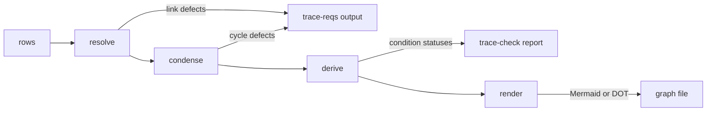

# Tracer Link Graph (tracer-link-graph)


---

### 1. Introduction

A `link` condition in the requirement tracer names a design document, a
requirement or a condition, and takes the status of what it names, so a
requirement can rest on another design without restating its verification.
`requirement-traceability-design.md` owns the `link` method, its configuration
and the target spelling. This document specifies the graph that method needs:
resolving what a link names, finding links that depend on themselves, and
ordering status evaluation so that a linked status is known before a link reads
it. A link that depends on itself is never intended and is hard to find by hand
in a large collection of requirements [1].

---

### 2. Requirements

#### 2.1 Functional Requirements

- **FR-1 — Link target resolution**: Each target of a link condition resolves
  to a design document, a requirement or a condition defined in the selected
  rows. A link with no target, a target that names nothing defined, and a
  target document that defines no requirement are each a defect at the
  condition row.
- **FR-2 — Link cycle detection**: Every link condition that lies on a cycle of
  links is reported at its row. A link to the condition itself, to its parent
  requirement, to its own document, or into a chain that returns to it is a
  cycle; a link to another requirement of the same document is not.
- **FR-3 — Link status**: A link condition takes the worst status of the items
  it names, a document taking the worst status of its requirements. A link
  condition on a cycle is `Fail`, a link with no target is `Uncovered`, and a
  status passes along a chain of links.
- **FR-4 — One set of link defects**: `trace-reqs` and `trace-check` report the
  same link defects for the same rows.
- **FR-5 — Viewable link graph**: `trace-check` writes the link structure as a
  diagram that opens in a common viewer without a bespoke tool, showing each
  vertex with its status and marking every link that lies on a cycle. The
  diagram is read-only; links change by editing the Markdown.

#### 2.2 Non-Functional Requirements

- **NFR-1 — Linear cost**: Resolution, cycle detection and status derivation
  take time and space linear in the number of rows plus link targets. The cost
  of a document that many links name does not grow with the number of those
  links.
- **NFR-2 — Bounded stack**: The depth of a link chain does not bound the call
  stack. A chain of 100 000 documents is processed on the default test stack.
- **NFR-3 — Reproducible diagram**: The same rows and results give a
  byte-identical diagram, so a diagram under review changes only when the links
  or their statuses change.

#### 2.3 Constraints

- **C-1 — Inherited dependency budget**: Conforms to
  `requirement-traceability-design.md` NFR-3.
- **C-2 — Inherited schema**: Conforms to `requirement-traceability-design.md`
  NFR-4; the graph reads existing rows and adds no field to a row or to
  `trace-report.json`.
- **C-3 — No panic path**: Link problems are defects, never errors or panics;
  the graph code contains no `unwrap`, `expect` or `panic!` outside tests.
- **C-4 — Inherited plain-text source**: Conforms to
  `requirement-traceability-design.md` C-1; the diagram is generated output and
  no tool reads it back.

---

### 3. Technical Overview

The graph lives in the `control-rs-ci` crate beside the tracer it serves. It
has one vertex per document, requirement and condition, and one edge for each
dependency of one vertex's status on the status of a second vertex. Three steps run in a fixed
order, each producing the input of the next. Cycle detection is the single-pass
depth-first strongly connected component search of Tarjan [2], which also yields
the evaluation order. A document is a vertex of its own, so a link to a
document costs one edge rather than one per requirement of that document [3].



`trace-reqs` runs `resolve` and `condense` and prints their defects.
`trace-check` runs all three and supplies the status of non-link conditions.
With `--graph`, it also renders the resolved link structure and the derived
statuses as a Mermaid or Graphviz DOT file.

---

### 4. Architecture

The graph is the module `control_rs_ci::trace::link`, in
`control-rs-ci/src/trace/link.rs`. It uses `Row` and `Defect` of
`control_rs_ci::trace` and `ConditionStatus` and `Status` of
`control_rs_ci::trace::status`. It adds no crate and no crate boundary.

`requirement-traceability-design.md` supplies three inputs this design relies on
and does not restate: the `link` method, the spelling of a link
target, and the position of the `link` rows in its status derivation. A link
target is a qualified ID `<doc>#<id>` or a bare document name `<doc>`, and a
link condition carries its targets in `Row::targets`.

#### 4.1 Resolution

Serves: FR-1, FR-4, C-2, C-3

```rust
/// The link graph over `rows` in state `S`: one vertex per document,
/// requirement and condition, with the structural and the resolved link edges.
pub struct LinkGraph<'a, S> {
    /* rows, vertices, adjacency, state: S */
}

/// Every link target is resolved to a vertex, an unresolved target or an
/// empty document.
pub struct Resolved;

/// A graph in state `S` and the defects found producing it.
pub type Built<'a, S> = (LinkGraph<'a, S>, Vec<Defect>);

/// Condition statuses by condition ID.
pub type ConditionMap<'a> = BTreeMap<&'a str, ConditionStatus>;

impl<'a> LinkGraph<'a, Resolved> {
    /// Builds the graph and reports the resolution defects, in row order.
    pub fn resolve(rows: &'a [Row]) -> Built<'a, Resolved>;
}
```

`resolve` owns the only construction path. All fields are private, so a caller
cannot build a graph in a later state. It interns each row's qualified ID as a
vertex in row order, and a document as a vertex at the first row that carries
its
prefix. An edge points from a vertex to each vertex whose status it depends on:

- a document to each requirement it defines;
- a requirement to each condition that names it as a parent;
- a link condition, a row whose method is `link`, to the document,
  requirement or condition each of its targets names.

A bare `<doc>` target gives one edge to the document vertex instead of one
edge to each requirement of that document. This factors a complete bipartite
subgraph through an intermediate vertex: the paths are kept and the product of
the two sides becomes their sum [3].

`resolve` reports `condition <id> names no link target` for a link condition
without a target; `condition <id> target '<target>' names no selected
document, requirement or condition` for a target that interns to nothing; and
`condition <id> target '<target>' defines no requirement` for a document target
whose vertex has no requirement. The first two leave the link without an edge
for that target; the status of each is set in 4.3. The first row of an ID
defines its vertex and a later duplicate adds none. A row whose ID has no
`<doc>#` prefix, or whose kind is neither a definition nor a condition, adds no
vertex, and a parent that is not a defined requirement adds no edge.

#### 4.2 Cycle Condensation

Serves: FR-2, FR-4, NFR-1, NFR-2

```rust
/// No cycle remains, and every vertex has a place in the evaluation order.
pub struct Acyclic {
    /* order: Vec<u32>, cyclic: Vec<u32> */
}

impl<'a> LinkGraph<'a, Resolved> {
    /// Finds the link conditions on a cycle, removes their cyclic edges and
    /// fixes the evaluation order. Reports one defect per cyclic condition,
    /// in row order.
    pub fn condense(self) -> Built<'a, Acyclic>;
}
```

`condense` consumes the resolved graph and runs one Tarjan pass [2] with an
explicit stack of `(vertex, next edge)` frames, so the call stack does not grow
with the chain. Tarjan's algorithm identifies the strongly connected components
in time and space linear in vertices and edges [2]. The components of the
condensation are numbered in completion order, which lists each component
after every component it points to [4], [5].

A link edge whose two ends lie in one component is a cycle edge. The condition
that owns it is recorded in `cyclic` and reported as
`condition <id> lies on a link cycle`, and the edge is removed. The structural
edges alone form no cycle, because they run document, requirement, condition,
so removing every cycle edge leaves an acyclic graph. A self-link is a
one-vertex component with a self-edge and is a cycle. A link to the parent
requirement closes the loop requirement, condition, requirement, and a link to
the condition's own document closes document, requirement, condition, document;
both are cycles. A link to a sibling requirement of the same document adds an
edge that returns to no ancestor and is not.

`order` lists the vertices by component number. Within a component, which holds
only structural edges once the cycle edges are gone, it puts conditions before
requirements and requirements before documents. Each vertex then follows every
vertex its status depends on.

#### 4.3 Status Derivation

Serves: FR-3, FR-4, NFR-1, NFR-2

```rust
impl<'a> LinkGraph<'a, Acyclic> {
    /// Derives the status of every condition row, keyed by condition ID.
    /// `leaf` supplies the status of a row whose method is not in
    /// `link`.
    pub fn derive(
        &self,
        leaf: impl FnMut(&Row) -> ConditionStatus,
    ) -> ConditionMap<'a>;
}
```

`derive` walks `order` once, without recursion. Every vertex it reads has
already received its status, so each status is computed once and read, not
recomputed, by every vertex that depends on it. This is the bottom-up
evaluation of an acyclic graph in which every successor is complete when it is
added [4], and the precomputed linear order of a topological scheduler [6].
Status is the maximum of `Status`, in the existing order `Pass`, `Review`,
`Deferred`, `Uncovered`, `Unrun`, `Fail`.

- A condition whose method is not `link` takes `leaf(row)`.
- A link condition in `cyclic` is `Fail` and carries no `ItemOutcome`.
- A link condition with no target is `Uncovered`.
- Any other link condition takes the worst status of its targets, a target
  that resolved to nothing counting as `Unrun` and a document target with no
  requirement as `Uncovered`. It carries one `ItemOutcome` per target, passed
  iff that target's status is `Pass`, `Review` or `Deferred`.
- A requirement takes the worst status of its conditions, and a document the
  worst status of its requirements. A requirement with no conditions and a
  document with no requirements are `Uncovered`. A document that many links name
  is computed once.

`trace-check` passes the existing result-log evaluation as `leaf`. It does not
list a link condition among the `Review` conditions awaiting sign-off, since
the document it names lists its own.

#### 4.4 Graph Export

Serves: FR-5, NFR-3, C-4

```rust
/// Output format of [`LinkGraph::render`].
#[derive(Debug, Clone, Copy, PartialEq, Eq)]
pub enum GraphFormat {
    /// A Mermaid `flowchart`.
    Mermaid,
    /// A Graphviz `digraph`.
    Dot,
}

impl<'a> LinkGraph<'a, Acyclic> {
    /// Renders the link view of the graph as text in `format`. `statuses`
    /// is the result of [`LinkGraph::derive`]; without it the vertices carry
    /// no status.
    pub fn render(
        &self,
        format: GraphFormat,
        statuses: Option<&ConditionMap<'a>>,
    ) -> String;
}
```

A Mermaid flowchart is nodes and edges with classes of styles attached to
nodes [8]; a DOT digraph is nodes and `->` edges [9]. Both open in existing
viewers, so no viewer is written or vendored.

The link view is the subgraph of the link conditions, their parent
requirements, the documents defining those requirements, and each vertex a
link names. It does not expand below a named document or requirement, which
would draw every requirement and condition of the workspace. The removed cyclic
edges are kept in `Acyclic` and drawn, so a cycle is visible.

- Vertices are written in interning order, so equal rows and statuses give
  equal bytes. A vertex id is `n<index>`; the label is the qualified ID and,
  with
  statuses, the status name, so colour is never the only signal.
- A document is a stadium, a requirement a rectangle and a condition a rounded
  box; in DOT, an ellipse, a box and a rounded box. Status selects the fill:
  `Pass` green `#c8e6c9`, `Review` and `Deferred` grey `#e0e0e0`, `Uncovered`
  and `Unrun` amber `#ffe0b2`, `Fail` red `#ffcdd2`. A removed cyclic edge is
  `#d32f2f`. Mermaid draws top down and DOT with `rankdir=TB`.
- A structural edge and a link edge are solid arrows; a removed cyclic edge is
  red and dashed.
- A requirement or document status is the worst status of what it depends on,
  by the same rollup `derive` uses.

`trace-check --graph <path>` writes the file, choosing the format by the
extension: `.mmd` for Mermaid and `.dot` for DOT. Any other extension is a usage
error, exit code 2. The file is written after the report, and a failed gate
still writes it. Nothing reads the file back.

#### 4.5 Binary Wiring

Serves: FR-3, FR-4, FR-5

`control_rs_ci::trace::reqs` gains the constant `LINK_METHOD`, the method name
`link`. `trace-reqs` calls `resolve` and
`condense` from its checks and reports both defect lists. `trace-check` calls
the same two functions, reports the same defects, then calls `derive` with its
result-log evaluation of a condition as `leaf` and reports the derived statuses
in `trace-report.json`. With `--graph <path>` it calls `render` on the derived
statuses and writes the text, creating missing parent directories, after the
report and also when the gate fails; the format follows the extension (`.mmd` or
`.dot`) and any other extension is a usage error, checked before the run. A
link condition is excluded from the `Review` and `Deferred` lists of the report,
and the per-status counts include it. `trace-check` builds the graph a second
time for `--graph`.

```rust
/// Required and optional flag values of a command line.
pub type Flags<const N: usize, const M: usize> =
    (FlagValues<N>, [Option<PathBuf>; M]);

/// The link view of `reqs` in `format`, with the condition statuses of `report`.
pub fn render_graph(
    reqs: &[Row],
    report: &TraceReport,
    format: GraphFormat,
) -> String;

/// The `parse_flags` and `cli_args` of the tracer with optional flags.
pub fn parse_flags_with<const N: usize, const M: usize>(
    args: impl IntoIterator<Item = String>,
    required: [&str; N],
    optional: [&str; M],
) -> Result<Flags<N, M>, String>;
pub fn cli_args_with<const N: usize, const M: usize>(
    usage: &str,
    required: [&str; N],
    optional: [&str; M],
) -> Result<Flags<N, M>, ExitCode>;
```

`trace::QUALIFIER`, `'#'`, separates the document from the ID of a qualified ID;
the graph and the scanner both read it. The `link` check is skipped when the
configuration has no link method.

#### 4.6 Error Handling

The module has no error type. Resolution and condensation return
`Vec<Defect>`; a link problem is never an `Err`. The defects are the four
messages above: `names no link target`, `names no selected document,
requirement or condition`, `defines no requirement` and `lies on a link
cycle`. Each prints at the file and line of the condition row, in the
`path:line: message` form of the tracer. `render` cannot fail; writing the file
is an I/O error of the binary, reported as its other write errors are.

---

### 5. Alternatives

| Alternative                                               | Rejected Because                                                                                                                                                                                                                                | Reference |
|:----------------------------------------------------------|:------------------------------------------------------------------------------------------------------------------------------------------------------------------------------------------------------------------------------------------------|:----------|
| `petgraph` strongly connected components                  | Its manifest requires `fixedbitset` ^0.5.7 and `hashbrown` ^0.15, and pulls `indexmap` and `equivalent`. The workspace locks `fixedbitset` 0.4.2 and `hashbrown` 0.16.1 and 0.17.1, so adoption adds duplicate crate versions and violates C-1. | [5]       |
| One reachability search per link edge                     | Testing whether a link's target reaches the link by a separate search costs $O(E (V + E))$ time; one Tarjan pass finds every cyclic edge in $O(V + E)$ and yields the evaluation order.                                                         | [2]       |
| Expanding a document target into one edge per requirement | Forms a complete bipartite subgraph of $m \times n$ edges and repeats the document rollup for each link; a document vertex needs $m + n$ edges (NFR-1).                                                                                         | [3]       |
| Recursive Tarjan search                                   | Depth of the call stack follows the longest link chain and overflows on a long one (NFR-2).                                                                                                                                                     | [2]       |
| Collapsing each component into one vertex                 | Merges the members of a cycle into a single status, so no row carries the defect (FR-2); detection followed by removal of the cyclic edges keeps one defect per condition.                                                                      | [7]       |
| Evaluating a cycle to a fixed point                       | Gives a cycle member a status from its own assumption and can pass; a cycle is a defect, not a value [1].                                                                                                                                       | [1]       |
| Bespoke HTML viewer                                       | Adds an embedded script or a vendored library to a tool that has neither (FR-5); Mermaid and DOT already open in common viewers [8], [9].                                                                                                       | [8], [9]  |
| Interactive editor with write-back to the Markdown        | Needs a round trip through Markdown tables and contradicts C-4; it needs a design of its own.                                                                                                                                                   | n/a       |
| Diagram of every requirement and condition                | Draws the whole workspace and hides the links among it; the link view keeps the figure readable.                                                                                                                                                | n/a       |
| Rendered SVG or PNG                                       | Needs a Graphviz binary in CI and cannot be diffed; text formats review in a pull request (NFR-3).                                                                                                                                              | [9]       |

---

### 6. Verification & Validation

#### 6.1 Verification

| Condition | Requirement | Method       | Target                                                                                                                                                                                                                                                                                                                                                                                                                                                               | Criterion                                                                                                                                                                                                                                                                                  |
|:----------|:------------|:-------------|:---------------------------------------------------------------------------------------------------------------------------------------------------------------------------------------------------------------------------------------------------------------------------------------------------------------------------------------------------------------------------------------------------------------------------------------------------------------------|:-------------------------------------------------------------------------------------------------------------------------------------------------------------------------------------------------------------------------------------------------------------------------------------------|
| VC-1.1    | FR-1        | `libtest`    | `control_rs_ci::trace::link::tests::link_without_a_target_is_reported`, `control_rs_ci::trace::link::tests::link_to_an_undefined_item_is_reported`, `control_rs_ci::trace::link::tests::link_to_a_document_without_requirements_is_reported`, `control_rs_ci::trace::link::tests::targets_naming_a_document_requirement_or_condition_resolve`                                                                                                                        | `resolve` reports a link with no target, a target naming nothing defined and a target document that defines no requirement as one defect each at the condition row, and reports none for a target naming a defined document, requirement or condition; FR-1 holds iff this condition holds |
| VC-2.1    | FR-2        | `libtest`    | `control_rs_ci::trace::link::tests::a_self_link_is_a_cycle`, `control_rs_ci::trace::link::tests::a_link_to_the_parent_requirement_is_a_cycle`, `control_rs_ci::trace::link::tests::a_link_to_the_own_document_is_a_cycle`, `control_rs_ci::trace::link::tests::a_two_document_cycle_reports_both_conditions`, `control_rs_ci::trace::link::tests::a_link_to_a_sibling_requirement_is_no_cycle`, `control_rs_ci::trace::link::tests::an_acyclic_graph_has_no_defects` | `condense` reports a defect at exactly the link conditions that lie on a cycle, none for a link to a sibling requirement or for an acyclic graph; FR-2 holds iff this condition holds                                                                                                      |
| VC-3.1    | FR-3        | `libtest`    | `control_rs_ci::trace::link::tests::derive_takes_the_worst_status_of_the_targets`, `control_rs_ci::trace::link::tests::derive_gives_a_requirement_or_condition_target_its_status`, `control_rs_ci::trace::link::tests::derive_gives_a_document_the_worst_status_of_its_requirements`, `control_rs_ci::trace::link::tests::derive_evaluates_a_chain_of_links_dependencies_first`                                                                                      | `derive` gives a link the worst status of the items it names with one item per target, and a status passes along a chain of two links; FR-3 holds iff both conditions hold                                                                                                                 |
| VC-3.2    | FR-3        | `libtest`    | `control_rs_ci::trace::link::tests::derive_fails_a_link_on_a_cycle`, `control_rs_ci::trace::link::tests::derive_marks_a_link_without_a_target_uncovered`, `control_rs_ci::trace::link::tests::derive_marks_an_unresolved_target_unrun`, `control_rs_ci::trace::link::tests::derive_marks_an_empty_document_uncovered`                                                                                                                                                | `derive` gives `Fail` to a link on a cycle, `Uncovered` to a link with no target or naming an empty document, and `Unrun` to a target that resolved to nothing                                                                                                                             |
| VC-4.1    | FR-4        | `libtest`    | `trace_tests::cli::trace_reqs_and_trace_check_report_the_same_link_defects`                                                                                                                                                                                                                                                                                                                                                                                          | The link defect lines printed by `trace-reqs` and `trace-check` for one set of rows are identical                                                                                                                                                                                          |
| VC-5.1    | NFR-1       | `libtest`    | `control_rs_ci::trace::link::tests::a_document_target_adds_one_edge_per_link`                                                                                                                                                                                                                                                                                                                                                                                        | Resolving $m$ link conditions that name one document of $n$ requirements adds $m + n$ edges, not $m \times n$; NFR-1 holds iff both conditions hold                                                                                                                                        |
| VC-5.2    | NFR-1       | `analysis`   | —                                                                                                                                                                                                                                                                                                                                                                                                                                                                    | `resolve` visits each row and target once, `condense` is one Tarjan pass and `derive` visits each vertex and edge once, so time and space are $O(V + E)$                                                                                                                                   |
| VC-6.1    | NFR-2       | `libtest`    | `control_rs_ci::trace::link::tests::a_long_link_chain_is_processed_on_the_default_stack`                                                                                                                                                                                                                                                                                                                                                                             | `condense` and `derive` process a chain of 100 000 linked documents on the default test stack without overflow                                                                                                                                                                             |
| VC-7.1    | C-1         | `review`     | —                                                                                                                                                                                                                                                                                                                                                                                                                                                                    | `cargo tree` for `control-rs-ci` shows no dependency beyond the dependency budget of the inherited constraint                                                                                                                                                                              |
| VC-8.1    | C-2         | `inspection` | —                                                                                                                                                                                                                                                                                                                                                                                                                                                                    | The diff adds no field to `Row` or to the `trace-report.json` structures                                                                                                                                                                                                                   |
| VC-9.1    | C-3         | `inspection` | —                                                                                                                                                                                                                                                                                                                                                                                                                                                                    | `link.rs` contains no `unwrap`, `expect` or `panic!` outside `#[cfg(test)]`                                                                                                                                                                                                                |
| VC-10.1   | FR-5        | `libtest`    | `control_rs_ci::trace::link::tests::render_mermaid_shows_status_and_marks_cycle_edges`, `control_rs_ci::trace::link::tests::render_dot_shows_status_and_marks_cycle_edges`, `control_rs_ci::trace::link::tests::render_draws_only_the_link_view`                                                                                                                                                                                                                     | Each format shows every link vertex with its status, draws a removed cyclic edge dashed and red, and omits requirements and conditions that no link touches; FR-5 holds iff both conditions hold                                                                                           |
| VC-10.2   | FR-5        | `libtest`    | `trace_tests::cli::graph_flag_writes_mermaid_or_dot_by_extension`, `trace_tests::cli::graph_flag_with_another_extension_is_a_usage_error`, `trace_tests::cli::a_failing_gate_still_writes_the_graph`                                                                                                                                                                                                                                                                 | `trace-check --graph` writes a Mermaid file for `.mmd` and a DOT file for `.dot`, exits 2 for another extension, and writes the file when the gate fails                                                                                                                                   |
| VC-11.1   | NFR-3       | `libtest`    | `control_rs_ci::trace::link::tests::render_is_byte_identical_across_runs`                                                                                                                                                                                                                                                                                                                                                                                            | Rendering the same rows and statuses twice gives identical bytes in both formats                                                                                                                                                                                                           |
| VC-12.1   | C-4         | `inspection` | —                                                                                                                                                                                                                                                                                                                                                                                                                                                                    | No binary or module reads a graph file                                                                                                                                                                                                                                                     |

#### 6.3 Limits

- The target spelling, the `link` method and the scan of link
  rows are verified in `requirement-traceability-design.md`, not here; the
  graph is tested on rows.
- NFR-1 is shown by analysis and one edge-count test; no wall-clock bound is
  claimed.
- The diagram syntax is checked against recorded expected text, not by
  rendering in Mermaid or Graphviz.
- The 100 000-document chain exercises depth, not breadth; width is covered by
  the edge-count test.

---

### 7. Performance & Resource Considerations

The graph is host tooling, so `std` and the heap are available. Vertices are
interned as `u32` indices; adjacency, the component stack and `order` are
arrays of at most $V + E$ entries, and the tracer's existing 1 s budget is
unchanged. The explicit search stack holds one frame per vertex on the current
path, on the heap. Status values are the existing `Status` enum; there is no
numeric policy.

---

### 8. Risks & Open Questions

- `requirement-traceability-design.md` does not yet contain the `link`
  method, the target spelling or the `link` rows of its status
  derivation. Those requirements land there first; implementation of this design
  waits for them. Affects FR-1 to FR-4.
- `Fail` for a link on a cycle is a project choice. The cited tool detects link
  cycles and defines no status for their members [1]. Affects FR-3.
- The diagram is read-only and not interactive. Editing links from the diagram
  needs a write-back to Markdown tables and a design of its own. Affects FR-5.
- A link condition is excluded from the `Review` sign-off list on the ground
  that the named document lists its own. If a link must be signed off
  separately, 4.3 changes. Affects FR-3.

---

### 9. Development Plan

| Phase                    | Delivers                                                     | Requirements        | Effort   | Status  |
|:-------------------------|:-------------------------------------------------------------|:--------------------|:---------|:--------|
| 1. Resolution            | `LinkGraph<Resolved>`, `resolve` and its defects             | FR-1, C-1, C-2, C-3 | 1.5 days | Complete |
| 2. Condensation          | Iterative Tarjan pass, cyclic edge removal, evaluation order | FR-2, NFR-1, NFR-2  | 2 days   | Complete |
| 3. Derivation and wiring | `derive`, calls from `trace-reqs` and `trace-check`          | FR-3, FR-4          | 2 days   | Complete |
| 4. Graph export          | `render`, `--graph` for `trace-check`                        | FR-5, NFR-3, C-4    | 1.5 days | Complete |

---

### 10. Revision History

| Revision | Date             | Author                             | Description                                                                                                                                                                              |
|:---------|:-----------------|:-----------------------------------|:-----------------------------------------------------------------------------------------------------------------------------------------------------------------------------------------|
| 1.0      | October 20, 2026 | @MitchellDScott, Claude Sonnet 5.5 | Initial design document.                                                                                                                                                                 |
| 1.2      | October 20, 2026 | @MitchellDScott, Claude Sonnet 5.5 | Added the link graph export. Affects C-1, C-2, C-3, C-4, FR-1, FR-2, FR-3, FR-4, FR-5, NFR-1, NFR-2, NFR-3.                                                                              |
| 1.3      | October 20, 2026 | @MitchellDScott                    | Removed AI-generated mark after human review. Affects C-1, C-2, C-3, C-4, FR-1, FR-2, FR-3, FR-4, FR-5, NFR-1, NFR-2, NFR-3.                                                             |
| 1.4      | October 20, 2026 | @MitchellDScott, Claude Sonnet 5.5 | Empty requirement and document rule, render palette, row-reading rules, public aliases and binary wiring. Affects C-1, C-2, C-3, C-4, FR-1, FR-2, FR-3, FR-4, FR-5, NFR-1, NFR-2, NFR-3. |
| 1.5 | October 20, 2026 | @MitchellDScott, Claude Sonnet 5.5 | Binary wiring signatures, the qualifier constant and phase status. Affects C-1, C-2, C-3, C-4, FR-1, FR-2, FR-3, FR-4, FR-5, NFR-1, NFR-2, NFR-3. |

---

## References

[1] OpenFastTrace Contributors, "doc/spec/system_requirements.md," in
*itsallcode/openfasttrace*. [Online]. Available:
https://github.com/itsallcode/openfasttrace/blob/main/doc/spec/system_requirements.md.
Accessed: Oct. 20, 2026.

[2] R. Tarjan, "Depth-first search and linear graph algorithms," *SIAM J.
Comput.*, vol. 1, no. 2, pp. 146–160, Jun. 1972, doi: 10.1137/0201010.

[3] A. Chavan, S. Rabinia, D. Grosu, and M. Brocanelli, "Speeding-up graph
algorithms via clique partitioning," The Ohio State Univ. and Wayne State
Univ., arXiv:2502.02477v3, Mar. 2026. [Online]. Available:
https://arxiv.org/abs/2502.02477. Accessed: Oct. 18, 2026.

[4] Y. E. Ioannidis and R. Ramakrishnan, "Efficient transitive closure
algorithms," Computer Sciences Dept., Univ. of Wisconsin–Madison, Madison, WI,
USA, Tech. Rep. 765, Apr. 1988.

[5] petgraph Contributors, "crates/petgraph/src/algo/scc/tarjan_scc.rs," in
*petgraph/petgraph*. [Online]. Available:
https://github.com/petgraph/petgraph/blob/master/crates/petgraph/src/algo/scc/tarjan_scc.rs.
Accessed: Oct. 18, 2026.

[6] A. Mokhov, N. Mitchell, and S. Peyton Jones, "Build systems à la carte,"
*Proc. ACM Program. Lang.*, vol. 2, no. ICFP, pp. 79:1–79:29, Sep. 2018, doi:
10.1145/3236774.

[7] B. Hardekopf and C. Lin, "The ant and the grasshopper: Fast and accurate
pointer analysis for millions of lines of code," in *Proc. 28th ACM SIGPLAN
Conf. Program. Lang. Design Implement. (PLDI '07)*, San Diego, CA, USA, Jun.
2007, pp. 290–299, doi: 10.1145/1250734.1250767.

[8] Mermaid Contributors, "Flowcharts - Basic Syntax," *Mermaid
documentation*. [Online]. Available:
https://mermaid.js.org/syntax/flowchart.html. Accessed: Oct. 20, 2026.

[9] Graphviz Authors, "The DOT Language," *Graphviz documentation*. [Online].
Available: https://graphviz.org/doc/info/lang.html. Accessed: Oct. 20, 2026.