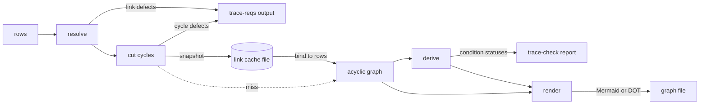

# Tracer Link Graph (tracer-link-graph)


---

### 1. Introduction

A `link` condition in the requirement tracer names a design document, a
requirement or a condition, and takes the status of what it names, so a
requirement can rest on another design without restating its verification.
`requirement-traceability-design.md` owns the `link` method, its configuration
and the target spelling. This document specifies the graph that method needs:
resolving what a link names, finding links that depend on themselves and
ordering status evaluation so that a linked status is known before a link reads
it. A link that depends on itself is never intended and is hard to find by hand
in a large collection of requirements [1].

The graph is a pure function of the rows. A full `cargo gate` run reads the same
rows in `trace-reqs` and in `trace-check` and, before this revision, resolved
and cut the graph three times: once in `trace-reqs`, once in `trace-check` for
derivation and once more for `--graph`. This document also specifies how that
work is done once per process and how `trace-reqs` hands the acyclic result to
`trace-check` through a snapshot file bound to the rows it was built from.

---

### 2. Requirements

#### 2.1 Functional Requirements

- **FR-1 — Link target resolution**: Each target of a link condition resolves
  to a design document, a requirement or a condition defined in the selected
  rows. A link with no target, a target that names nothing defined and a
  target document that defines no requirement are each a defect at the
  condition row.
- **FR-2 — Link cycle detection**: Every link condition that lies on a cycle of
  links is reported at its row. A link to the condition itself, to its parent
  requirement, to its own document or into a chain that returns to it is a
  cycle; a link to another requirement of the same document is not.
- **FR-3 — Link status**: A link condition takes the worst status of the items
  it names, a document taking the worst status of its requirements. A link
  condition on a cycle is `Fail`, a link with no target is `Uncovered`and a
  status passes along a chain of links.
- **FR-4 — One set of link defects**: `trace-reqs` and `trace-check` report the
  same link defects for the same rows, whether `trace-check` builds the graph
  or binds it from a snapshot.
- **FR-5 — Viewable link graph**: `trace-check` writes the link structure as a
  diagram that opens in a common viewer without a bespoke tool, showing each
  vertex with its status and marking every link that lies on a cycle. The
  diagram is read-only; links change by editing the Markdown.
- **FR-6 — One graph per process**: Each binary obtains the acyclic link graph
  of its rows once. `trace-check` derives statuses and renders the diagram from
  that one graph.
- **FR-7 — Link graph snapshot**: `trace-reqs` writes the acyclic link graph of
  the rows it wrote to a snapshot file beside `reqs.jsonl`, after `reqs.jsonl`
  is complete and also when it reports defects. It removes any earlier snapshot
  before it scans, so a run that ends early leaves none. A snapshot that cannot
  be written is a warning and does not change the exit code.
- **FR-8 — Content-bound validity**: `trace-check` binds a snapshot only when
  its format version is the current one, its identity equals the `id`, `kind`,
  `parents`, `method`, `targets`, `file` and `line` of every row it read, in
  order and in number, and every stored index is in range. A difference in any
  one of those fields, a row added, removed or reordered and an index out of
  range are each a miss. A difference in `text` alone and the modification
  times of the files are not.
- **FR-9 — Silent fallback**: On a miss and on a missing, unreadable, malformed
  or truncated snapshot, `trace-check` resolves and cuts the graph itself. The
  miss causes no defect, no warning and no change of exit code; the exit code
  is the one the live path gives.
- **FR-10 — Observable path**: `trace-check` prints one progress line that
  names which path ran, `Reading` for a bound snapshot and `Building` for a
  graph it built, so a developer can see the path without it changing a result.

#### 2.2 Non-Functional Requirements

- **NFR-1 — Linear cost**: Resolution, cycle detection and status derivation
  take time and space linear in the number of rows plus link targets. The cost
  of a document that many links name does not grow with the number of those
  links.
- **NFR-2 — Bounded stack**: The depth of a link chain does not bound the call
  stack. A chain of 100 000 documents is processed on the default test stack.
- **NFR-3 — Reproducible diagram**: The same rows and results give a
  byte-identical diagram, so a diagram under review changes only when the links
  or their statuses change. The diagram does not depend on whether the graph
  was built or bound from a snapshot.
- **NFR-4 — Snapshot transparency**: With a matching snapshot, with none, with
  a stale one and with a corrupt one, `trace-check` writes the same defects, the
  same `trace-report.json`, the same diagram and the same exit code. Progress
  lines are the only output that differs.
- **NFR-5 — Linear snapshot**: The size of a snapshot and the time to write,
  read and bind it are linear in the number of rows plus link targets.
- **NFR-6 — Reproducible snapshot**: The same rows give a byte-identical
  snapshot, so a change to the snapshot of a fixed set of rows is a change to
  the cut and is visible in a diff.

#### 2.3 Constraints

- **C-1 — Inherited dependency budget**: Conforms to
  `requirement-traceability-design.md` NFR-3.
- **C-2 — Inherited schema**: Conforms to `requirement-traceability-design.md`
  NFR-4; the graph reads existing rows and adds no field to a row or to
  `trace-report.json`. The snapshot carries its own format integer, separate
  from the row schema.
- **C-3 — No panic path**: Link problems are defects, never errors or panics;
  the graph code contains no `unwrap`, `expect` or `panic!` outside tests. The
  same holds for loading a snapshot: corrupt JSON, a short offset table or an
  index past the last vertex rebuilds the graph.
- **C-4 — Inherited plain-text source**: Conforms to
  `requirement-traceability-design.md` C-1; the diagram is generated output and
  no tool reads it back. The snapshot is a different file from the diagram.
- **C-5 — Inherited paths**: Conforms to `requirement-traceability-design.md`
  C-3; the snapshot path is derived from `--out` of `trace-reqs` and `--reqs` of
  `trace-check`, and neither binary gains a required flag.
- **C-6 — Content, not time**: The validity of a snapshot is decided by the
  rows alone. No decision reads a file modification time.
- **C-7 — Stable format**: The snapshot holds integers, enums and sequences in
  a fixed order. It holds no hash value, map iteration order or address, so a
  snapshot written by one build reads the same under another.

---

### 3. Technical Overview

The graph lives in the `control-rs-ci` crate beside the tracer it serves. It
has one vertex per document, requirement and condition, and one edge for each
dependency of one vertex's status on the status of a second vertex. Three steps
run in a fixed
order, each producing the input of the next. Cycle detection is the single-pass
depth-first strongly connected component search of Tarjan [2], which also yields
the evaluation order. A document is a vertex of its own, so a link to a
document costs one edge rather than one per requirement of that document [3],
[10].



`trace-reqs` runs `resolve` and `cut_cycles`, prints their defects and writes
the snapshot of the acyclic graph. `trace-check` obtains the same acyclic graph
once, by binding the snapshot to the rows it read or, when the snapshot does
not match, by running `resolve` and `cut_cycles` itself. It then runs `derive`
with the status of non-link conditions and, with `--graph`, passes the same
graph and the derived statuses to `render`, which writes a Mermaid or Graphviz
DOT file. A stored result is reused only when the inputs it was computed from
are unchanged, and is recomputed otherwise [6]. The snapshot holds the
structure alone: statuses depend on the result logs of `test` and `kani`, which
do not exist when `trace-reqs` runs, so `derive` stays in `trace-check`.

#### 3.1 User Model

Four users meet the tool: a CI runner that starts with an empty artifact
directory; a developer who runs the whole gate; a developer who runs
`cargo trace-reqs` or `cargo trace-check` alone, in either order; and a reviewer
who reads the report and the diagram. None of them is asked to know that the
snapshot exists. It adds no flag, no step and no failure mode, and deleting
`target/` is never the cure for a wrong result. Every situation reduces to the
three cases below.

**`trace-check` binds the snapshot** only when it matches the rows it read
(FR-8). This is the normal case on a CI runner, where `lint` writes the snapshot
and `post` reads it. It is also the case when a developer runs
`cargo trace-check` alone after editing the Markdown: the snapshot is exactly as
old as `reqs.jsonl`, so the report reflects the last `trace-reqs`, as it did
before the cache.

**`trace-check` rebuilds the graph** in every other case, with no message beyond
the progress line (FR-9, FR-10). The cases are a missing snapshot (fresh
checkout, `clean_artifacts`), a snapshot cut short by a timeout or an interrupt,
a corrupt one, one of another format version and one whose rows no longer match
because `reqs.jsonl` was replaced by hand or by another run. A tracer rebuilt
with a different cut cannot bind an old snapshot either, because the change
alters the golden snapshot and so forces a version increment (NFR-6).

**`trace-reqs` leaves a trustworthy file or none.** It removes the earlier
snapshot before it scans and writes the new one last (FR-7), so a configuration
error or an interrupt leaves nothing from an earlier run. If the artifact
directory is read-only or full, it warns and keeps its exit code.

The reviewer sees the same report and diagram bytes on every path (NFR-3,
NFR-4).

Persisting a computed graph beside its inputs and reusing it only while those
inputs are unchanged is the practice of the Rust compiler, which serializes its
dependency graph to disk with the query result cache [11], and of Cargo, which
treats a unit as dirty when its fingerprint is missing or any fingerprint field
changes [12]. The same rules apply here: an absent snapshot is a miss (FR-9) and
a changed identity field is a miss (FR-8). Cargo does not update a fingerprint
when its unit fails to build [12], which is the reason `trace-reqs` removes the
snapshot first and writes it last (FR-7). Cargo also documents that tracking
modification times is imprecise [12], so validity here is decided by the
content of the rows (C-6). The sources do not state what happens when a
persisted file is present but unreadable; this design decides it: a miss (FR-9).

---

### 4. Architecture

The graph is the module `control_rs_ci::trace::link`, in
`control-rs-ci/src/trace/link.rs`. It uses `Row` and `Defect` of
`control_rs_ci::trace` and `ConditionStatus` and `Status` of
`control_rs_ci::trace::status`. It adds no crate and no crate boundary.

`requirement-traceability-design.md` supplies three inputs this design relies on
and does not restate: the `link` method, the spelling of a link
target and the position of the `link` rows in its status derivation. A link
target is a qualified ID `<doc>#<id>` or a bare document name `<doc>`, and a
link condition carries its targets in `Row::targets`.

#### 4.1 Resolution

Serves: FR-1, FR-4, C-2, C-3

```rust
/// The link graph over `rows` in state `S`: one vertex per document,
/// requirement and condition, with the structural and the resolved link edges.
pub struct LinkGraph<'a, S> {
    /* rows, vertices, adjacency, state: S */
}

/// Every link target is resolved to a vertex, an unresolved target or an
/// empty document.
pub struct Resolved;

/// A graph in state `S` and the defects found producing it.
pub type Built<'a, S> = (LinkGraph<'a, S>, Vec<Defect>);

/// Condition statuses by condition ID.
pub type ConditionMap<'a> = BTreeMap<&'a str, ConditionStatus>;

impl<'a> LinkGraph<'a, Resolved> {
    /// Builds the graph and reports the resolution defects, in row order.
    pub fn resolve(rows: &'a [Row]) -> Built<'a, Resolved>;
}
```

`resolve` owns the only construction path. All fields are private, so a caller
cannot build a graph in a later state. It interns each row's qualified ID as a
vertex in row order, and a document as a vertex at the first row that carries
its
prefix. An edge points from a vertex to each vertex whose status it depends on:

- a document to each requirement it defines;
- a requirement to each condition that names it as a parent;
- a link condition, a row whose method is `link`, to the document,
  requirement or condition each of its targets names.

A bare `<doc>` target gives one edge to the document vertex instead of one
edge to each requirement of that document. This factors a complete bipartite
subgraph through an intermediate vertex: the paths are kept and the product of
the two sides becomes their sum [3], [10].

`resolve` reports `condition <id> names no link target` for a link condition
without a target; `condition <id> target '<target>' names no selected
document, requirement or condition` for a target that interns to nothing; and
`condition <id> target '<target>' defines no requirement` for a document target
whose vertex has no requirement. The first two leave the link without an edge
for that target; the status of each is set in 4.3. The first row of an ID
defines its vertex and a later duplicate adds none. A row whose ID has no
`<doc>#` prefix, or whose kind is neither a definition nor a condition, adds no
vertex, and a parent that is not a defined requirement adds no edge.

#### 4.2 Cycle Removal

Serves: FR-2, FR-4, NFR-1, NFR-2

```rust
/// No cycle remains, and every vertex has a place in the evaluation order.
pub struct Acyclic {
    /* cyclic: Vec<bool>, order: Vec<usize>, removed: Vec<(usize, usize)> */
}

impl<'a> LinkGraph<'a, Resolved> {
    /// Finds the link conditions on a cycle, removes their cyclic edges and
    /// fixes the evaluation order. Reports one defect per cyclic condition,
    /// in row order.
    pub fn cut_cycles(self) -> Built<'a, Acyclic>;
}
```

`cut_cycles` consumes the resolved graph and runs one Tarjan pass [2] with an
explicit stack of `(vertex, next edge)` frames, so the call stack does not grow
with the chain. Tarjan's algorithm identifies the strongly connected components
in time and space linear in vertices and edges [2]. The components of the
condensation are numbered in completion order, which lists each component
after every component it points to [4], [5].

A link edge whose two ends lie in one component is a cycle edge. The condition
that owns it is recorded in `cyclic` and reported as
`condition <id> lies on a link cycle`, and the edge is removed. The structural
edges alone form no cycle, because they run document, requirement, condition,
so removing every cycle edge leaves an acyclic graph. A self-link is a
one-vertex component with a self-edge and is a cycle. A link to the parent
requirement closes the loop requirement, condition, requirement, and a link to
the condition's own document closes document, requirement, condition, document;
both are cycles. A link to a sibling requirement of the same document adds an
edge that returns to no ancestor and is not.

`order` lists the vertices by component number. Within a component, which holds
only structural edges once the cycle edges are gone, it puts conditions before
requirements and requirements before documents. Each vertex then follows every
vertex its status depends on. The order is a counting sort on component and
kind, linear in the number of vertices.

#### 4.3 Status Derivation

Serves: FR-3, FR-4, NFR-1, NFR-2

```rust
/// Requirement statuses by requirement ID.
pub type RequirementMap<'a> = BTreeMap<&'a str, Status>;

/// The statuses `derive` computes.
pub struct LinkStatuses<'a> {
    pub conditions: ConditionMap<'a>,
    pub requirements: RequirementMap<'a>,
}

impl<'a> LinkGraph<'a, Acyclic> {
    /// Derives the status of every condition row and every requirement,
    /// keyed by ID. `leaf` supplies the status of a row whose method is not
    /// `link`.
    pub fn derive(
        &self,
        leaf: impl FnMut(&Row) -> ConditionStatus,
    ) -> LinkStatuses<'a>;
}
```

`derive` walks `order` once, without recursion. Every vertex it reads has
already received its status, so each status is computed once and read, not
recomputed, by every vertex that depends on it. This is the bottom-up
evaluation of an acyclic graph in which every successor is complete when it is
added [4], and the precomputed linear order of a topological scheduler [6].
Status is the maximum of `Status`, in the existing order `Pass`, `Review`,
`Deferred`, `Uncovered`, `Unrun`, `Fail`.

- A condition whose method is not `link` takes `leaf(row)`.
- A link condition in `cyclic` is `Fail` and carries no `ItemOutcome`.
- A link condition with no target is `Uncovered`.
- Any other link condition takes the worst status of its targets, a target
  that resolved to nothing counting as `Unrun` and a document target with no
  requirement as `Uncovered`. It carries one `ItemOutcome` per target, passed
  iff that target's status is `Pass`, `Review` or `Deferred`.
- A requirement takes the worst status of its conditions, and a document the
  worst status of its requirements. A requirement with no conditions and a
  document with no requirements are `Uncovered`. A document that many links name
  is computed once.

`trace-check` passes the existing result-log evaluation as `leaf` and takes
each requirement's status from `requirements`, so the report and the graph
share one rollup. It does not
list a link condition among the `Review` conditions awaiting sign-off, since
the document it names lists its own.

#### 4.4 Graph Export

Serves: FR-5, NFR-3, C-4

```rust
/// Output format of [`LinkGraph::render`].
#[derive(Debug, Clone, Copy, PartialEq, Eq)]
pub enum GraphFormat {
    /// A Mermaid `flowchart`.
    Mermaid,
    /// A Graphviz `digraph`.
    Dot,
}

impl<'a> LinkGraph<'a, Acyclic> {
    /// Renders the link view of the graph as text in `format`. `statuses`
    /// is the condition map of [`LinkGraph::derive`]; without it the vertices
    /// carry no status.
    pub fn render(
        &self,
        format: GraphFormat,
        statuses: Option<&ConditionMap<'a>>,
    ) -> String;
}
```

A Mermaid flowchart is nodes and edges with classes of styles attached to
nodes [8]; a DOT digraph is nodes and `->` edges [9]. Both open in existing
viewers, so no viewer is written or vendored.

The link view is the subgraph of the link conditions, their parent
requirements, the documents defining those requirements and each vertex a
link names. It does not expand below a named document or requirement, which
would draw every requirement and condition of the workspace. The removed cyclic
edges are kept in `Acyclic` and drawn, so a cycle is visible.

- Vertices are written in interning order, so equal rows and statuses give
  equal bytes. A vertex id is `n<index>`; the label is the qualified ID and,
  with
  statuses, the status name, so colour is never the only signal.
- A document is a stadium, a requirement a rectangle and a condition a rounded
  box; in DOT, an ellipse, a box and a rounded box. Status selects the fill:
  `Pass` green `#66bb6a`, `Review` and `Deferred` grey `#bdbdbd`, `Uncovered`
  and `Unrun` amber `#ffb74d`, `Fail` red `#e57373`. A removed cyclic edge is
  `#d32f2f`. A Mermaid vertex has a `#212121` outline 2 px wide and black
  text, set by one `style` line per vertex rather than a `classDef`, which
  some viewers ignore. Mermaid draws top down and DOT with `rankdir=TB`.
- A structural edge and a link edge are solid arrows; a removed cyclic edge is
  red and dashed.
- A requirement or document status is the worst status of what it depends on,
  by the same rollup `derive` uses.

`trace-check --graph <path>` writes the file, choosing the format by the
extension: `.mmd` for Mermaid and `.dot` for DOT. Any other extension is a usage
error, exit code 2. The file is written after the report, and a failed gate
still writes it. Nothing reads the file back. The snapshot of 4.5 is a separate
file that the diagram never feeds.

#### 4.5 Link Cache

Serves: FR-4, FR-7, FR-8, FR-9, FR-10, NFR-3, NFR-4, NFR-5, NFR-6, C-2, C-3,
C-4, C-5, C-6, C-7

```rust
/// Format version of the snapshot, separate from the row `SCHEMA`.
pub const CACHE_SCHEMA: u32 = 1;

/// The owned, serializable form of an acyclic link graph.
#[derive(Serialize, Deserialize)]
pub struct LinkCache {
    /* schema, identity, vertices, offsets, targets, links, cyclic, order, removed */
}

impl<'a> LinkGraph<'a, Acyclic> {
    /// The snapshot of this graph.
    pub fn snapshot(&self) -> LinkCache;
    /// The link defects of this graph, resolution defects then cycle defects,
    /// each in row order.
    pub fn defects(&self) -> Vec<Defect>;
}

impl LinkCache {
    /// Reads a snapshot; any failure is `None`.
    pub fn read(path: &Path) -> Option<LinkCache>;
    /// Writes the snapshot, creating missing parent directories.
    pub fn write(&self, path: &Path) -> GateResult<()>;
    /// Binds the snapshot to `rows`, or `None` when it was not built from them.
    pub fn bind<'a>(&self, rows: &'a [Row]) -> Option<LinkGraph<'a, Acyclic>>;
}

/// The snapshot path for a rows file: `reqs.jsonl` gives `reqs.link-cache.json`.
pub fn cache_path(rows: &Path) -> PathBuf;

/// Where an acyclic link graph came from.
pub enum GraphSource {
    /// Bound from a snapshot.
    Snapshot,
    /// Built by `resolve` then `cut_cycles`.
    Built,
}

/// The acyclic link graph of `rows` and its defects: bound from `cache` when it
/// matches, otherwise [`link_graph`].
pub fn cached_link_graph<'a>(
    rows: &'a [Row],
    cache: Option<&LinkCache>,
) -> (Built<'a, Acyclic>, GraphSource);
```

`LinkGraph` borrows the row slice: a vertex name is a `&str` into `Row::id` and
a document name is the prefix of that ID before `#`. Serde borrows `&str` fields
from the input it reads, and a type that owns all its data can be read from any
input [13]. `LinkCache` is the owning form: it stores indices and numbers, and
`bind` recovers the names from the rows `trace-check` already parsed. The
adjacency is already compressed sparse row, which keeps the edges in
$O (V + E)$ space and iterates the edges of one vertex quickly [14], so its
offsets and targets are written as they are (NFR-5).

| Field                | Role after load                                                                        | Left out                                                |
|:---------------------|:---------------------------------------------------------------------------------------|:--------------------------------------------------------|
| `schema`             | `CACHE_SCHEMA`, the format version of the snapshot                                     | any field of `Row` or of `trace-report.json` (C-2)      |
| `identity`           | `id`, `kind`, `parents`, `method`, `targets`, `file` and `line` of every row, in order | `text`, which never affects the graph; the row `schema` |
| `vertices`           | kind and row index of each vertex, in interning order                                  | the name string, recovered from the row                 |
| `offsets`, `targets` | compressed sparse row of the edges kept after the cut                                  | the pre-cut adjacency; the edge order is the kept order |
| `links`              | per vertex, absent or a list of vertex index or `Unresolved`                           | target name strings, which stay on the row              |
| `cyclic`, `order`    | which link conditions lie on a cycle, and the evaluation order                         | Tarjan's discovery numbers and stack                    |
| `removed`            | the cyclic edges in the order `cut_cycles` recorded them                               | status colours, which come from `derive`                |

`bind` returns `None`, and `cached_link_graph` then rebuilds, in each of these
cases:

- the format version differs from `CACHE_SCHEMA`;
- the identity differs from the rows in the length or in any of the seven
  fields of any row (FR-8);
- an offset table is shorter than the vertex count plus one, or decreases;
- a stored vertex, target, link or removed-edge index is past the last vertex,
  or a vertex's row index is past the last row;
- `cyclic` does not have one flag per vertex, or `order` is not a permutation of
  the vertices.

`read` returns `None` for a file that is absent, empty, truncated, not JSON, of
another shape or carrying an unknown field. A rebuild is silent: a bad snapshot
is not a defect and not an exit code 2 (FR-9, C-3). The check is structural. It
establishes that the arrays can be read without leaving their bounds and that
the rows are the rows the snapshot was cut from; it does not repeat the cut, and
the limit this leaves is stated in 6.3. The identity is compared field by field,
one linear pass over the rows (NFR-5). A hash of the rows would need a digest
crate outside the dependency budget (C-1), would cost the same pass, and the
standard library states that the algorithm of `DefaultHasher` is unspecified and
its hashes are not to be relied on across releases [15], which C-7 rules out for
a file one build writes and another reads.

`cyclic`, `order` and `removed` are stored, not recomputed, so the removed-edge
order and the evaluation order that `render` and `derive` read equal those of
`cut_cycles` on the same rows (NFR-3). The defect sentences are not stored.
`defects` formats them again from the bound graph with a walk of the link rows,
so a snapshot written under older messages cannot disagree with the current
ones (FR-4). The work saved is the interning maps, the Tarjan pass and the
counting sort; the walk and the formatting remain.

`trace-reqs` removes the snapshot beside its `--out` path before it scans, runs
`resolve` and `cut_cycles` for its defects as before, writes `reqs.jsonl` and
then writes the snapshot of the cut graph, also when it reports defects. A
configuration error or an interrupt therefore leaves no snapshot from an earlier
run, and a write cut short leaves a file that `read` rejects. A failed
snapshot write is reported with `ui::warning` and leaves the exit code as the
defects alone set it, because the snapshot is an optimisation and no result may
depend on it (FR-7, FR-9). The live cut stays in `trace-reqs` so the `lint`
group can fail before `test` and `kani` run. `trace-check` reads the sibling of
`--reqs`.

The snapshot sits next to `reqs.jsonl`, for example
`target/ci-artifacts/reqs.link-cache.json`. Both gates already use that
directory, and the private `CARGO_TARGET_DIR` of the `lint` group does not apply
to `--out`. The `post` stage runs after the groups join, on the same runner, and
sees the file. `clean_artifacts` removes it with the other artifacts, the
per-run removal of `*.result.json` leaves it, and it is not committed.

#### 4.6 Binary Wiring

Serves: FR-3, FR-4, FR-5, FR-6, FR-7, FR-10

`control_rs_ci::trace::reqs` gains the constant `LINK_METHOD`, the method name
`link`. `trace-reqs` calls `resolve` and `cut_cycles` from its checks, reports
both defect lists and writes the snapshot of 4.5. `trace-check` calls
`cached_link_graph` once with the snapshot it read, prints
`ui::status("Reading", <snapshot path>)` for `GraphSource::Snapshot` or
`ui::status("Building", "link graph")` for `GraphSource::Built` (FR-10),
reports the defects it returns, then calls `derive` on that graph with its
result-log evaluation of a condition as `leaf` and reports the derived statuses
in `trace-report.json`. With `--graph <path>` it calls `render` on the same graph
and the derived statuses and writes the text, creating missing parent
directories, after the report and also when the gate fails; the format follows
the extension (`.mmd` or `.dot`) and any other extension is a usage error,
checked before the run. A link condition is excluded from the `Review` and
`Deferred` lists of the report, and the per-status counts include it.

The graph is built or bound once in `trace-check`. The CI gate passes `--graph`
and previously built the graph twice in that process; the local `cargo
trace-check` alias omits `--graph` and built it once. The entry points that
tests call keep their signatures: `status::derive_with_base` calls
`link_graph`, which reads no snapshot, and passes its result to a new
`status::derive_with_graph`, which the binary calls with the graph it
obtained. `derive_with_graph` merges the
link defects it receives into its sorted defect list and reads the rows from
the graph, so each link defect is reported once.

```rust
// control_rs_ci::trace::link

/// The acyclic link graph of `rows` and its defects: `resolve` then
/// `cut_cycles`, resolution defects then cycle defects, each in row order.
pub fn link_graph(rows: &[Row]) -> Built<'_, Acyclic>;

impl<'a> LinkGraph<'a, Acyclic> {
    /// The rows the graph was built from.
    pub const fn rows(&self) -> &'a [Row];
}

// control_rs_ci::trace::status

/// Derives condition and requirement status relative to `base` from the rows
/// of `graph`, their acyclic link graph, and its `link_defects`.
pub fn derive_with_graph(
    graph: &LinkGraph<'_, Acyclic>,
    link_defects: Defects,
    config: &TraceConfig,
    base: &Path,
) -> Derived;

/// Required and optional flag values of a command line.
pub type Flags<const N: usize, const M: usize> =
(FlagValues<N>, [Option<PathBuf>; M]);

/// The link view of `graph` in `format`, with the condition statuses of `report`.
pub fn render_graph(
    graph: &LinkGraph<'_, Acyclic>,
    report: &TraceReport,
    format: GraphFormat,
) -> String;

/// The `parse_flags` and `cli_args` of the tracer with optional flags.
pub fn parse_flags_with<const N: usize, const M: usize>(
    args: impl IntoIterator<Item=String>,
    required: [&str; N],
    optional: [&str; M],
) -> Result<Flags<N, M>, String>;
pub fn cli_args_with<const N: usize, const M: usize>(
    usage: &str,
    required: [&str; N],
    optional: [&str; M],
) -> Result<Flags<N, M>, ExitCode>;
```

`trace::QUALIFIER`, `'#'`, separates the document from the ID of a qualified ID;
the graph and the scanner both read it. The `link` check is skipped when the
configuration has no link method.

#### 4.7 Error Handling

The module has no error type. Resolution and condensation return
`Vec<Defect>`; a link problem is never an `Err`. The defects are the four
messages above: `names no link target`, `names no selected document,
requirement or condition`, `defines no requirement` and `lies on a link
cycle`. Each prints at the file and line of the condition row, in the
`path:line: message` form of the tracer. `render` cannot fail; writing the file
is an I/O error of the binary, reported as its other write errors are. Reading
and binding a snapshot return `None` rather than an error, and no message
reports that a snapshot was missed. Writing the snapshot cannot fail the gate:
`trace-reqs` reports a failed write as a warning and keeps its exit code (FR-7).

---

### 5. Alternatives

| Alternative                                               | Rejected Because                                                                                                                                                                                                                                | Reference |
|:----------------------------------------------------------|:------------------------------------------------------------------------------------------------------------------------------------------------------------------------------------------------------------------------------------------------|:----------|
| `petgraph` strongly connected components                  | Its manifest requires `fixedbitset` ^0.5.7 and `hashbrown` ^0.15, and pulls `indexmap` and `equivalent`. The workspace locks `fixedbitset` 0.4.2 and `hashbrown` 0.16.1 and 0.17.1, so adoption adds duplicate crate versions and violates C-1. | [5]       |
| One reachability search per link edge                     | Testing whether a link's target reaches the link by a separate search costs $O(E (V + E))$ time; one Tarjan pass finds every cyclic edge in $O(V + E)$ and yields the evaluation order.                                                         | [2]       |
| Expanding a document target into one edge per requirement | Forms a complete bipartite subgraph of $m \times n$ edges and repeats the document rollup for each link; a document vertex needs $m + n$ edges (NFR-1).                                                                                         | [3], [10] |
| Recursive Tarjan search                                   | Depth of the call stack follows the longest link chain and overflows on a long one (NFR-2).                                                                                                                                                     | [2]       |
| Collapsing each component into one vertex                 | Merges the members of a cycle into a single status, so no row carries the defect (FR-2); detection followed by removal of the cyclic edges keeps one defect per condition.                                                                      | [7]       |
| Evaluating a cycle to a fixed point                       | Gives a cycle member a status from its own assumption and can pass; a cycle is a defect, not a value [1].                                                                                                                                       | [1]       |
| Bespoke HTML viewer                                       | Adds an embedded script or a vendored library to a tool that has neither (FR-5); Mermaid and DOT already open in common viewers [8], [9].                                                                                                       | [8], [9]  |
| Interactive editor with write-back to the Markdown        | Needs a round trip through Markdown tables and contradicts C-4; it needs a design of its own.                                                                                                                                                   | n/a       |
| Diagram of every requirement and condition                | Draws the whole workspace and hides the links among it; the link view keeps the figure readable.                                                                                                                                                | n/a       |
| Rendered SVG or PNG                                       | Needs a Graphviz binary in CI and cannot be diffed; text formats review in a pull request (NFR-3).                                                                                                                                              | [9]       |
| Building the graph again for `--graph`                    | Repeats `resolve`, the Tarjan pass and the counting sort on rows already processed in the same process; `render` takes the graph `derive` read (FR-6).                                                                                          | n/a       |
| Writing the graph to disk for the render pass                | Within one process the graph is already in memory, so the file adds a write and a read. The file is only the handoff from the `lint` group to the `post` stage (FR-7).                                                                          | n/a       |
| Caching statuses with the graph                              | Statuses need the result logs of `test` and `kani`, which do not exist when `trace-reqs` runs; the snapshot holds structure and `derive` stays in `trace-check`.                                                                                | n/a       |
| Storing the defect sentences                                 | An older snapshot could print messages that differ from the current ones (FR-4); the sentences are cheap to format from the bound graph.                                                                                                        | n/a       |
| Deriving `Serialize` and `Deserialize` on `LinkGraph`        | The graph borrows `&str` names from the rows, which a reader that owns its data cannot produce from the file; an index-based owned snapshot rebinds the names from the parsed rows.                                                             | [13]      |
| Keying the snapshot by a hash of `reqs.jsonl` or of the rows | Needs a digest crate (`sha2` is locked for other crates only) against C-1; `DefaultHasher` is unspecified across releases, so a persisted value is not stable (C-7); an exact comparison of the identity fields costs the same linear pass. | [15]      |
| Reporting a bad snapshot as a defect or exit code 2          | The snapshot is an optimisation; failing the gate on it would make results depend on it (FR-7, NFR-4, C-3).                                                                                                                                     | n/a       |
| Dropping the live cut from `trace-reqs`                      | The `lint` group could not fail on a link defect before `test` and `kani` run, and no process would write the snapshot.                                                                                                                         | n/a       |
| Committing the snapshot                                      | It would go stale against the Markdown and add merge conflicts; it is a per-run artifact beside `reqs.jsonl`.                                                                                                                                   | n/a       |
| Validity by file modification time                           | Cargo documents modification-time tracking as imprecise; a copy, a checkout or a clock step changes the time without changing the rows, and the reverse (C-6).                                                                                  | [12]      |
| Failing `trace-reqs` when the snapshot cannot be written     | The snapshot is an optimisation; a read-only or full artifact directory would then fail a gate that has no link defect (FR-7).                                                                                                                  | n/a       |
| Printing a warning on every miss                             | A clean runner misses by design, so the message is noise and `trace-check` output would differ by path; one neutral progress line names the path (FR-10, NFR-4).                                                                                | n/a       |

---

### 6. Verification & Validation

#### 6.1 Verification

| Condition | Requirement | Method       | Target                                                                                                                                                                                                                                                                                                                                                                                                                                                                                 | Criterion                                                                                                                                                                                                                                                                                  |
|:----------|:------------|:-------------|:---------------------------------------------------------------------------------------------------------------------------------------------------------------------------------------------------------------------------------------------------------------------------------------------------------------------------------------------------------------------------------------------------------------------------------------------------------------------------------------|:-------------------------------------------------------------------------------------------------------------------------------------------------------------------------------------------------------------------------------------------------------------------------------------------|
| VC-1.1    | FR-1        | `libtest`    | `control_rs_ci::trace::link::tests::link_without_a_target_is_reported`, `control_rs_ci::trace::link::tests::link_to_an_undefined_item_is_reported`, `control_rs_ci::trace::link::tests::link_to_a_document_without_requirements_is_reported`, `control_rs_ci::trace::link::tests::targets_naming_a_document_requirement_or_condition_resolve`                                                                                                                                          | `resolve` reports a link with no target, a target naming nothing defined and a target document that defines no requirement as one defect each at the condition row, and reports none for a target naming a defined document, requirement or condition; FR-1 holds iff this condition holds |
| VC-2.1    | FR-2        | `libtest`    | `control_rs_ci::trace::link::tests::a_self_link_is_a_cycle`, `control_rs_ci::trace::link::tests::a_link_to_the_parent_requirement_is_a_cycle`, `control_rs_ci::trace::link::tests::a_link_to_the_own_document_is_a_cycle`, `control_rs_ci::trace::link::tests::a_two_document_cycle_reports_both_conditions`, `control_rs_ci::trace::link::tests::a_link_to_a_sibling_requirement_is_no_cycle`, `control_rs_ci::trace::link::tests::an_acyclic_graph_has_no_defects`                   | `cut_cycles` reports a defect at exactly the link conditions that lie on a cycle, none for a link to a sibling requirement or for an acyclic graph; FR-2 holds iff this condition holds                                                                                                    |
| VC-3.1    | FR-3        | `libtest`    | `control_rs_ci::trace::link::tests::derive_takes_the_worst_status_of_the_targets`, `control_rs_ci::trace::link::tests::derive_gives_a_requirement_or_condition_target_its_status`, `control_rs_ci::trace::link::tests::derive_gives_a_document_the_worst_status_of_its_requirements`, `control_rs_ci::trace::link::tests::derive_evaluates_a_chain_of_links_dependencies_first`, `control_rs_ci::trace::link::tests::derive_gives_each_requirement_the_worst_status_of_its_conditions` | `derive` gives a link the worst status of the items it names with one item per target, a requirement the worst status of its conditions, and a status passes along a chain of two links; FR-3 holds iff both conditions hold                                                               |
| VC-3.2    | FR-3        | `libtest`    | `control_rs_ci::trace::link::tests::derive_fails_a_link_on_a_cycle`, `control_rs_ci::trace::link::tests::derive_marks_a_link_without_a_target_uncovered`, `control_rs_ci::trace::link::tests::derive_marks_an_unresolved_target_unrun`, `control_rs_ci::trace::link::tests::derive_marks_an_empty_document_uncovered`                                                                                                                                                                  | `derive` gives `Fail` to a link on a cycle, `Uncovered` to a link with no target or naming an empty document, and `Unrun` to a target that resolved to nothing                                                                                                                             |
| VC-4.1    | FR-4        | `libtest`    | `trace_tests::cli::trace_reqs_and_trace_check_report_the_same_link_defects`                                                                                                                                                                                                                                                                                                                                                                                                            | The link defect lines printed by `trace-reqs` and `trace-check` for one set of rows are identical                                                                                                                                                                                          |
| VC-4.2    | FR-4        | `libtest`    | `control_rs_ci::trace::link::tests::bound_graph_reports_the_defects_of_the_live_cut`, `trace_tests::cli::a_cache_hit_reports_the_live_link_defects` | `defects` of a bound graph equals the resolution and cycle defects of `resolve` and `cut_cycles` on the same rows, in the same order, for rows with an empty link, an unresolved target, an empty document and a cycle; `trace-check` with a matching snapshot prints the link defect lines of `trace-reqs`; FR-4 holds iff both conditions hold |
| VC-5.1    | NFR-1       | `libtest`    | `control_rs_ci::trace::link::tests::a_document_target_adds_one_edge_per_link`                                                                                                                                                                                                                                                                                                                                                                                                          | Resolving $m$ link conditions that name one document of $n$ requirements adds $m + n$ edges, not $m \times n$; NFR-1 holds iff both conditions hold                                                                                                                                        |
| VC-5.2    | NFR-1       | `analysis`   | —                                                                                                                                                                                                                                                                                                                                                                                                                                                                                      | `resolve` visits each row and target once, `cut_cycles` is one Tarjan pass and a counting sort and `derive` visits each vertex and edge once, so time and space are $O(V + E)$; the ID-keyed maps `derive` returns add $O(V \log V)$; `snapshot`, `write`, `read` and `bind` each make one pass over the rows, vertices and edges, and `defects` one over the link rows                                                       |
| VC-6.1    | NFR-2       | `libtest`    | `control_rs_ci::trace::link::tests::a_long_link_chain_is_processed_on_the_default_stack`                                                                                                                                                                                                                                                                                                                                                                                               | `cut_cycles` and `derive` process a chain of 100 000 linked documents on the default test stack without overflow                                                                                                                                                                           |
| VC-7.1    | C-1         | `review`     | —                                                                                                                                                                                                                                                                                                                                                                                                                                                                                      | `cargo tree` for `control-rs-ci` shows no dependency beyond the dependency budget of the inherited constraint                                                                                                                                                                              |
| VC-8.1    | C-2         | `inspection` | —                                                                                                                                                                                                                                                                                                                                                                                                                                                                                      | The diff adds no field to `Row` or to the `trace-report.json` structures, and the snapshot version is `CACHE_SCHEMA`, not `SCHEMA`                                                                                                                                                                                                                   |
| VC-9.1    | C-3         | `inspection` | —                                                                                                                                                                                                                                                                                                                                                                                                                                                                                      | `link.rs` contains no `unwrap`, `expect` or `panic!` outside `#[cfg(test)]`, including the snapshot read and bind code                                                                                                                                                                                                                |
| VC-10.1   | FR-5        | `libtest`    | `control_rs_ci::trace::link::tests::render_mermaid_shows_status_and_marks_cycle_edges`, `control_rs_ci::trace::link::tests::render_dot_shows_status_and_marks_cycle_edges`, `control_rs_ci::trace::link::tests::render_draws_only_the_link_view`                                                                                                                                                                                                                                       | Each format shows every link vertex with its status, draws a removed cyclic edge dashed and red, and omits requirements and conditions that no link touches; FR-5 holds iff both conditions hold                                                                                           |
| VC-10.2   | FR-5        | `libtest`    | `trace_tests::cli::graph_flag_writes_mermaid_or_dot_by_extension`, `trace_tests::cli::graph_flag_with_another_extension_is_a_usage_error`, `trace_tests::cli::a_failing_gate_still_writes_the_graph`                                                                                                                                                                                                                                                                                   | `trace-check --graph` writes a Mermaid file for `.mmd` and a DOT file for `.dot`, exits 2 for another extension, and writes the file when the gate fails                                                                                                                                   |
| VC-11.1   | NFR-3       | `libtest`    | `control_rs_ci::trace::link::tests::render_is_byte_identical_across_runs`                                                                                                                                                                                                                                                                                                                                                                                                              | Rendering the same rows and statuses twice gives identical bytes in both formats, from a built graph and from a graph bound to its snapshot                                                                                                                                                                                                           |
| VC-12.1   | C-4         | `inspection` | —                                                                                                                                                                                                                                                                                                                                                                                                                                                                                      | No binary or module reads a graph file written by `--graph`; the only file read back is the snapshot beside `reqs.jsonl`                                                                                                                                                                                                                                                     |
| VC-13.1   | FR-6        | `inspection` | —                                                                                                                                                                                                                                                                                                                                                                                                                                                                                      | `status.rs` and `trace-check.rs` obtain the graph through one call of `link_graph` or `cached_link_graph` per run and call neither `resolve` nor `cut_cycles` directly; `render_graph` and `derive_with_graph` take a graph                                                                                       |
| VC-14.1   | FR-8        | `libtest`    | `control_rs_ci::trace::link::tests::snapshot_round_trips_to_an_equal_graph`, `control_rs_ci::trace::link::tests::snapshot_survives_a_json_round_trip` | `bind` of `snapshot` on the same rows gives a graph whose `derive` statuses, `defects` and `render` bytes in both formats equal those of the graph it was taken from, including the removed cyclic edges in recorded order, for rows with a cycle, an unresolved target, an empty link and an empty document |
| VC-14.2   | FR-7        | `libtest`    | `trace_tests::cli::trace_reqs_writes_a_snapshot_that_binds_to_its_rows`, `trace_tests::cli::trace_reqs_writes_the_snapshot_when_it_reports_defects`, `trace_tests::cli::trace_reqs_removes_the_snapshot_of_an_earlier_run_on_a_config_error` | After `trace-reqs` succeeds or reports defects, `reqs.link-cache.json` exists beside `reqs.jsonl` and binds to the rows read from `reqs.jsonl`; after a configuration error no snapshot exists even when one existed before |
| VC-14.3   | FR-7        | `libtest`    | `trace_tests::cli::a_snapshot_that_cannot_be_written_is_a_warning` | With a directory in place of the snapshot path, `trace-reqs` prints a warning and exits with the code it gives without the obstruction, 0 for clean rows and 1 for rows with defects |
| VC-14.4   | FR-8        | `libtest`    | `control_rs_ci::trace::link::tests::bind_rejects_a_changed_id`, `control_rs_ci::trace::link::tests::bind_rejects_a_changed_kind`, `control_rs_ci::trace::link::tests::bind_rejects_a_changed_parents`, `control_rs_ci::trace::link::tests::bind_rejects_a_changed_method`, `control_rs_ci::trace::link::tests::bind_rejects_a_changed_targets`, `control_rs_ci::trace::link::tests::bind_rejects_a_changed_file`, `control_rs_ci::trace::link::tests::bind_rejects_a_changed_line`, `control_rs_ci::trace::link::tests::bind_rejects_an_added_row`, `control_rs_ci::trace::link::tests::bind_rejects_a_removed_row`, `control_rs_ci::trace::link::tests::bind_rejects_reordered_rows`, `control_rs_ci::trace::link::tests::bind_accepts_a_changed_text`, `control_rs_ci::trace::link::tests::bind_rejects_another_cache_schema` | `bind` returns `None` when exactly one of `id`, `kind`, `parents`, `method`, `targets`, `file` or `line` of one row differs, when a row is added, removed or moved, and when the format version differs, and returns a graph when only `text` differs; FR-8 holds iff every condition holds |
| VC-14.5   | FR-8        | `libtest`    | `trace_tests::cli::a_snapshot_is_not_judged_by_modification_time` | With the snapshot made older than `reqs.jsonl` and then newer, `trace-check` prints the same `Reading` line and writes the same report; with `reqs.jsonl` changed and the snapshot untouched it prints `Building` |
| VC-14.6   | FR-9        | `libtest`    | `control_rs_ci::trace::link::tests::read_returns_none_for_an_empty_file`, `control_rs_ci::trace::link::tests::read_returns_none_for_truncated_json`, `control_rs_ci::trace::link::tests::read_returns_none_for_json_of_another_shape`, `control_rs_ci::trace::link::tests::read_returns_none_for_an_unknown_field`, `control_rs_ci::trace::link::tests::bind_rejects_a_short_offset_table`, `control_rs_ci::trace::link::tests::bind_rejects_decreasing_offsets`, `control_rs_ci::trace::link::tests::bind_rejects_a_target_past_the_last_vertex`, `control_rs_ci::trace::link::tests::bind_rejects_a_link_past_the_last_vertex`, `control_rs_ci::trace::link::tests::bind_rejects_an_order_that_is_not_a_permutation`, `control_rs_ci::trace::link::tests::bind_rejects_a_removed_edge_past_the_last_vertex`, `control_rs_ci::trace::link::tests::bind_rejects_a_cyclic_vector_of_the_wrong_length`, `control_rs_ci::trace::link::tests::bind_rejects_a_vertex_row_past_the_last_row` | Each case returns `None` and none panics; C-3 holds iff every condition holds |
| VC-14.7   | FR-9        | `libtest`    | `trace_tests::cli::a_corrupt_snapshot_is_rebuilt_without_a_diagnostic`, `trace_tests::cli::a_missing_snapshot_is_rebuilt_without_a_diagnostic` | `trace-check` prints no defect, warning or error line for a corrupt or a missing snapshot beyond the `Building` progress line, and exits with the code the same rows give with a matching snapshot |
| VC-15.1   | FR-10       | `libtest`    | `trace_tests::cli::a_bound_snapshot_prints_reading`, `trace_tests::cli::a_rebuilt_graph_prints_building` | `trace-check` prints one `Reading` line naming the snapshot when it binds one and one `Building` line when it builds the graph, and never both |
| VC-16.1   | NFR-4       | `libtest`    | `trace_tests::cli::a_matching_missing_stale_and_corrupt_snapshot_give_identical_output` | For one set of rows with a link cycle, `trace-check` with a matching, a missing, a stale (`reqs.jsonl` edited after the snapshot) and a corrupt snapshot writes byte-identical `trace-report.json` and diagram, prints the same defect lines and exits with the same code; progress lines are excluded; NFR-4 holds iff all conditions hold |
| VC-16.2   | NFR-5       | `libtest`    | `control_rs_ci::trace::link::tests::snapshot_size_is_linear_in_the_chain_length` | The snapshot of a chain of $2n$ linked documents is no more than twice the bytes of the snapshot of $n$, for $n$ of 1 000 and 10 000; reading and binding it are covered by the linear-cost analysis of NFR-1 |
| VC-16.3   | NFR-6       | `libtest`    | `control_rs_ci::trace::link::tests::snapshot_is_byte_identical_across_runs`, `control_rs_ci::trace::link::tests::snapshot_matches_the_recorded_golden_file` | Two snapshots of the same rows are byte-identical, and the snapshot of the fixture rows equals `control-rs-ci/tests/data/link-cache.golden.json` byte for byte |
| VC-16.4   | NFR-6       | `review`     | — | A diff that changes the golden snapshot also increments `CACHE_SCHEMA`, and a diff that increments `CACHE_SCHEMA` changes the golden snapshot |
| VC-17.1   | C-5         | `libtest`    | `control_rs_ci::trace::link::tests::cache_path_is_the_sibling_of_the_rows_file`, `trace_tests::cli::trace_binaries_take_no_new_required_flag` | `cache_path` replaces the extension of `reqs.jsonl` to give `reqs.link-cache.json` in the same directory, and the usage text of both binaries lists the same required flags as before |
| VC-18.1   | C-6         | `inspection` | — | The snapshot code calls no `metadata`, `modified` or `SystemTime` API |
| VC-18.2   | C-7         | `inspection` | — | The snapshot types hold only integers, enums, `String`s and `Vec`s, and the snapshot code uses no `Hash`, `Hasher`, `HashMap` or `HashSet` |

#### 6.3 Limits

- The target spelling, the `link` method and the scan of link
  rows are verified in `requirement-traceability-design.md`, not here; the
  graph is tested on rows.
- NFR-1 is shown by analysis and one edge-count test; no wall-clock bound is
  claimed.
- The diagram syntax is checked against recorded expected text, not by
  rendering in Mermaid or Graphviz.
- The 100 000-document chain exercises depth, not breadth; width is covered by
  the edge-count test.
- FR-6 is shown by inspection of the call sites, not by timing them; no
  wall-clock saving is claimed.
- NFR-4 is shown on the outputs, which are equal with and without a snapshot, so
  no test observes which path ran. VC-13.1 inspects the call sites instead of
  timing them, and no wall-clock saving is claimed.
- The identity compare covers the rows, not the code. A change to `cut_cycles`,
  the vertex order or the kept-edge order that leaves the snapshot layout as it
  is changes the golden snapshot of VC-16.3, and VC-16.4 requires that diff to
  increment `CACHE_SCHEMA`; the requirement is reviewed, not enforced by a tool.
- `bind` checks bounds and identity. It does not repeat the cut, so a snapshot
  edited by hand with consistent indices and an unchanged identity binds and is
  reported. No user of the tool is expected to edit it.
- The binaries run in sequence, `trace-reqs` in the `lint` group and
  `trace-check` in the `post` stage. A concurrent run of both on one artifact
  directory is not specified.
- A write cut short is detected because the JSON no longer parses. No checksum
  is stored.

---

### 7. Performance & Resource Considerations

The graph is host tooling, so `std` and the heap are available. Vertices are
interned as `usize` indices; adjacency is compressed sparse row, one offset per
vertex and one target per edge, and the component stack and `order` are
arrays of at most $V + E$ entries, and the tracer's existing 1 s budget is
unchanged. The explicit search stack holds one frame per vertex on the current
path, on the heap. Status values are the existing `Status` enum; there is no
numeric policy.

A full `cargo gate` run resolves and cuts the graph once, in `trace-reqs`, and
`trace-check` binds the snapshot instead of repeating the cut for `derive` and
again for `render`: three Tarjan passes become one, and the two inside
`trace-check` become none on a hit. The snapshot holds one identity entry per
row and one vertex, offset and target entry per vertex and edge, so its size and
the time to write, read and bind it are $O (V + E)$ and the same order as
`reqs.jsonl`. The saved work is a linear pass that the 1 s budget already covers
on the present corpus; the snapshot stops two processes repeating it and serves
any later gate that needs the same acyclic graph. A miss costs the pass it would
have saved plus one failed read.

---

### 8. Risks & Open Questions

- `requirement-traceability-design.md` does not yet contain the `link`
  method, the target spelling or the `link` rows of its status
  derivation. Those requirements land there first; implementation of this design
  waits for them. Affects FR-1 to FR-4.
- `Fail` for a link on a cycle is a project choice. The cited tool detects link
  cycles and defines no status for their members [1]. Affects FR-3.
- The diagram is read-only and not interactive. Editing links from the diagram
  needs a write-back to Markdown tables and a design of its own. Affects FR-5.
- A link condition is excluded from the `Review` sign-off list on the ground
  that the named document lists its own. If a link must be signed off
  separately, 4.3 changes. Affects FR-3.
- The identity compare binds the snapshot to the rows and not to the code that
  cut them. No collected source describes a tool-version stamp for a persisted
  result, so the guard here is this design's own and is an assumption to verify:
  the golden snapshot of VC-16.3 changes whenever the cut changes, and VC-16.4
  ties that change to a `CACHE_SCHEMA` increment. A change that leaves the
  golden fixture unchanged but alters the cut of rows outside it would not be
  caught. CI starts from a clean artifact directory and `trace-reqs` rewrites
  the snapshot on every run, so the exposure is a local `cargo trace-check` run
  after a code change and before `trace-reqs`. Affects FR-8 and NFR-6.
- The sources read for this revision do not say what a build tool does with a
  persisted file that is present but unreadable, and the `serde_json`
  documentation of `from_str` lists a structure or data mismatch and does not
  list a syntax error under its errors [16]. FR-9 decides the first case as a
  miss, and VC-14.6 tests malformed, truncated and mis-shaped input directly.
  Affects FR-9.
- `requirement-traceability-design.md` lists the artifacts of the two binaries
  and says the gate does not pass `--graph`; `gate.toml` passes it and the
  snapshot is a new artifact, so that document needs the matching revision.
  Affects FR-6 and FR-7.

---

### 9. Development Plan

| Phase                    | Delivers                                                                       | Requirements        | Effort   | Status   |
|:-------------------------|:-------------------------------------------------------------------------------|:--------------------|:---------|:---------|
| 1. Resolution            | `LinkGraph<Resolved>`, `resolve` and its defects                               | FR-1, C-1, C-2, C-3 | 1.5 days | Complete |
| 2. Cycle removal         | Iterative Tarjan pass, cyclic edge removal, evaluation order                   | FR-2, NFR-1, NFR-2  | 2 days   | Complete |
| 3. Derivation and wiring | `derive`, calls from `trace-reqs` and `trace-check`                            | FR-3, FR-4          | 2 days   | Complete |
| 4. Graph export          | `render`, `--graph` for `trace-check`                                          | FR-5, NFR-3, C-4    | 1.5 days | Complete |
| 5. One graph per process | `link_graph`, `derive_with_graph`, `render_graph` over the graph `derive` read | FR-6, NFR-3         | 0.5 day  | Complete |
| 6. Link cache              | `LinkCache`, `snapshot`, `bind`, `defects`, `cache_path`, writer in `trace-reqs`, reader in `trace-check` | FR-4, FR-7, FR-8, FR-9, NFR-5, C-2, C-3, C-4, C-5, C-7 | 1.5 days | Planned  |
| 7. Observability and guard | `GraphSource` progress lines, golden snapshot, `CACHE_SCHEMA` rule, corruption suite                      | FR-10, NFR-4, NFR-6, C-6                               | 1 day    | Planned  |

---

### 10. Revision History

| Revision | Date             | Author                                              | Description                                                                                                                                                                              |
|:---------|:-----------------|:----------------------------------------------------|:-----------------------------------------------------------------------------------------------------------------------------------------------------------------------------------------|
| 1.0      | October 20, 2026 | @MitchellDScott, Claude Sonnet 5.5                  | Initial design document.                                                                                                                                                                 |
| 1.2      | October 20, 2026 | @MitchellDScott, Claude Sonnet 5.5                  | Added the link graph export. Affects C-1, C-2, C-3, C-4, FR-1, FR-2, FR-3, FR-4, FR-5, NFR-1, NFR-2, NFR-3.                                                                              |
| 1.3      | October 20, 2026 | @MitchellDScott                                     | Removed AI-generated mark after human review. Affects C-1, C-2, C-3, C-4, FR-1, FR-2, FR-3, FR-4, FR-5, NFR-1, NFR-2, NFR-3.                                                             |
| 1.4      | October 20, 2026 | @MitchellDScott, Claude Sonnet 5.5                  | Empty requirement and document rule, render palette, row-reading rules, public aliases and binary wiring. Affects C-1, C-2, C-3, C-4, FR-1, FR-2, FR-3, FR-4, FR-5, NFR-1, NFR-2, NFR-3. |
| 1.5      | October 20, 2026 | @MitchellDScott, Claude Sonnet 5.5                  | Binary wiring signatures, the qualifier constant and phase status. Affects C-1, C-2, C-3, C-4, FR-1, FR-2, FR-3, FR-4, FR-5, NFR-1, NFR-2, NFR-3.                                        |
| 2.0      | October 20, 2026 | @MitchellDScott, Claude Sonnet 5.5                  | link is a fixed method name: resolve takes no method set, render_graph takes no configuration, and the link_methods configuration is removed.                                            |
| 3.0      | October 20, 2026 | @MitchellDScott, Claude Opus 5.5                    | Raised graph fill contrast; Mermaid vertices get a dark 2 px outline.                                                                                                                    |
| 3.1      | October 20, 2026 | @MitchellDScott, Claude Opus 5.5                    | Mermaid vertex colours are written as one style line per vertex instead of classDef classes.                                                                                             |
| 4.0      | October 21, 2026 | @MitchellDScott, Claude Opus 5.5                    | cut_cycles replaces condense; derive returns condition and requirement statuses; linear evaluation order; usize indices and compressed sparse row adjacency                              |
| 4.1      | October 21, 2026 | @MitchellDScott, Claude Opus 5.5                    | Cites Feder and Motwani as the primary source of the document vertex                                                                                                                     |
| 6.0      | October 22, 2026 | @MitchellDScott, Claude Sonnet 5.5, Claude Opus 5.5 | One graph per process: FR-6 added; `link_graph` built once in `trace-check`; `render_graph` takes the graph `derive` read.                                                               |
| 6.1      | October 22, 2026 | @MitchellDScott, Claude Opus 5.5                    | Binary wiring: `link_graph` in `trace::link`, `LinkGraph::rows`, `derive_with_graph` signature and link defect ownership; phase 5 complete. Affects FR-6.                                |
| 7.0 | October 22, 2026 | Claude Opus 5.5 | Link graph snapshot: FR-7 to FR-10, NFR-4 to NFR-6 and C-5 to C-7 added; user model (3.1) and 4.5 Link Cache added, Binary Wiring and Error Handling renumbered to 4.6 and 4.7; `cached_link_graph` binds the snapshot or falls back to `link_graph`; verification, limits, risks, phases 6 and 7 and references 11 to 16 added. |

---

## References

[1] OpenFastTrace Contributors, "doc/spec/system_requirements.md," in
*itsallcode/openfasttrace*. [Online]. Available:
https://github.com/itsallcode/openfasttrace/blob/main/doc/spec/system_requirements.md.
Accessed: Oct. 20, 2026.

[2] R. Tarjan, "Depth-first search and linear graph algorithms," *SIAM J.
Comput.*, vol. 1, no. 2, pp. 146–160, Jun. 1972, doi: 10.1137/0201010.

[3] A. Chavan, S. Rabinia, D. Grosu and M. Brocanelli, "Speeding-up graph
algorithms via clique partitioning," The Ohio State Univ. and Wayne State
Univ., arXiv:2502.02477v3, Mar. 2026. [Online]. Available:
https://arxiv.org/abs/2502.02477. Accessed: Oct. 18, 2026.

[4] Y. E. Ioannidis and R. Ramakrishnan, "Efficient transitive closure
algorithms," Computer Sciences Dept., Univ. of Wisconsin–Madison, Madison, WI,
USA, Tech. Rep. 765, Apr. 1988.

[5] petgraph Contributors, "crates/petgraph/src/algo/scc/tarjan_scc.rs," in
*petgraph/petgraph*. [Online]. Available:
https://github.com/petgraph/petgraph/blob/master/crates/petgraph/src/algo/scc/tarjan_scc.rs.
Accessed: Oct. 18, 2026.

[6] A. Mokhov, N. Mitchell and S. Peyton Jones, "Build systems à la carte,"
*Proc. ACM Program. Lang.*, vol. 2, no. ICFP, pp. 79:1–79:29, Sep. 2018, doi:
10.1145/3236774.

[7] B. Hardekopf and C. Lin, "The ant and the grasshopper: Fast and accurate
pointer analysis for millions of lines of code," in *Proc. 28th ACM SIGPLAN
Conf. Program. Lang. Design Implement. (PLDI '07)*, San Diego, CA, USA, Jun.
2007, pp. 290–299, doi: 10.1145/1250734.1250767.

[8] Mermaid Contributors, "Flowcharts - Basic Syntax," *Mermaid
documentation*. [Online]. Available:
https://mermaid.js.org/syntax/flowchart.html. Accessed: Oct. 20, 2026.

[9] Graphviz Authors, "The DOT Language," *Graphviz documentation*. [Online].
Available: https://graphviz.org/doc/info/lang.html. Accessed: Oct. 20, 2026.

[10] T. Feder and R. Motwani, "Clique partitions, graph compression and
speeding-up algorithms," *J. Comput. Syst. Sci.*, vol. 51, no. 2, pp. 261–272,
Oct. 1995, doi: 10.1006/jcss.1995.1065.

[11] The Rust Project Developers,
"src/queries/incremental-compilation-in-detail.md,"
in *rust-lang/rustc-dev-guide*. [Online]. Available:
https://github.com/rust-lang/rustc-dev-guide/blob/main/src/queries/incremental-compilation-in-detail.md.
Accessed: Oct. 22, 2026.

[12] Cargo Contributors, "cargo::core::compiler::fingerprint," *Cargo
nightly-rustc documentation*. [Online]. Available:
https://doc.rust-lang.org/nightly/nightly-rustc/cargo/core/compiler/fingerprint/index.html.
Accessed: Oct. 22, 2026.

[13] Serde Developers, "Understanding deserializer lifetimes," *Serde
documentation*. [Online]. Available: https://serde.rs/lifetimes.html. Accessed:
Oct. 22, 2026.

[14] petgraph Contributors, "Struct petgraph::csr::Csr," *docs.rs*. [Online].
Available: https://docs.rs/petgraph/latest/petgraph/csr/struct.Csr.html.
Accessed: Oct. 22, 2026.

[15] The Rust Project Developers, "Struct std::hash::DefaultHasher," *Rust
standard library documentation*. [Online]. Available:
https://doc.rust-lang.org/std/hash/struct.DefaultHasher.html. Accessed: Oct. 22,
2026.

[16] serde_json Contributors, "Function serde_json::from_str," *docs.rs*.
[Online]. Available:
https://docs.rs/serde_json/latest/serde_json/fn.from_str.html. Accessed: Oct. 22,
2026.